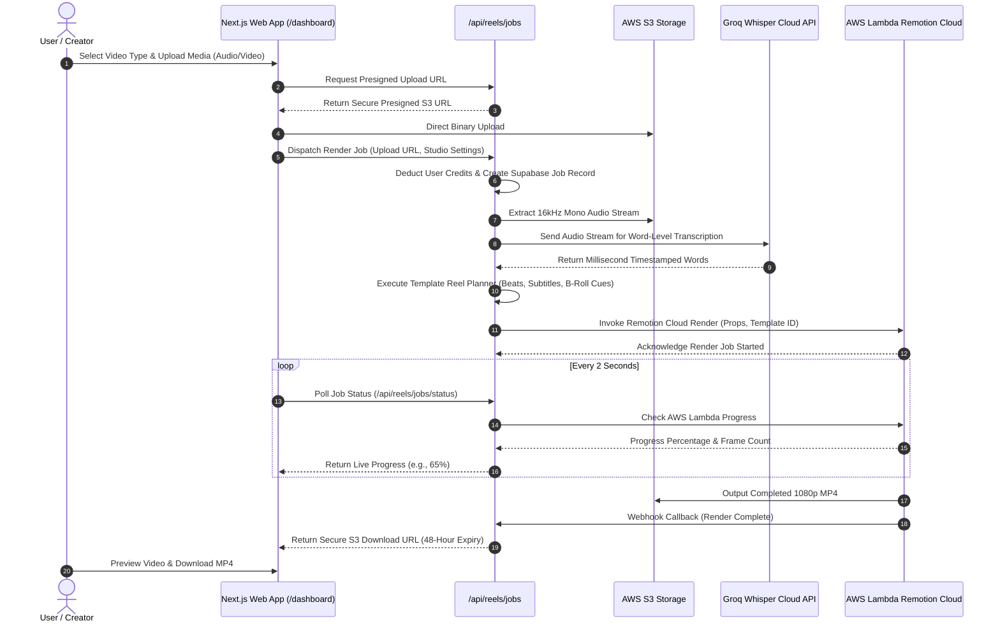

<!-- BEGIN:nextjs-agent-rules -->
# This is NOT the Next.js you know

This version has breaking changes — APIs, conventions, and file structure may all differ from your training data. Read the relevant guide in `node_modules/next/dist/docs/` before writing any code. Heed deprecation notices.
<!-- END:nextjs-agent-rules -->

# Itnavideo — Master Architecture & Agent Rules (AGENTS.md)

Welcome to **Itnavideo**, a next-generation AI video creation and editing SaaS platform designed for content creators, digital marketers, educators, and businesses. Itnavideo enables users to generate studio-quality long-form videos (16:9 widescreen) and viral short-form reels (9:16 vertical) in minutes through automated transcription, smart visual matching, kinetic typography, and cloud-based rendering.

This document serves as the **single source of truth** and primary entry point for all software engineers, architects, and autonomous coding agents (Antigravity, Codex, Kiro, Cursor). All instructions, policies, architectural patterns, and execution workflows are consolidated here.

---

## Table of Contents

1. [Project Overview & Mission](#1-project-overview--mission)
2. [Product Vision & Target Audience](#2-product-vision--target-audience)
3. [Technology Stack & Core Dependencies](#3-technology-stack--core-dependencies)
4. [High-Level System Architecture](#4-high-level-system-architecture)
5. [Repository Structure & Key Directories](#5-repository-structure--key-directories)
6. [Zero Local Heavy Compute Policy (4GB RAM Safeguards)](#6-zero-local-heavy-compute-policy-4gb-ram-safeguards)
7. [Coding Standards, Type Safety & Zero-Error Policy](#7-coding-standards-type-safety--zero-error-policy)
8. [Database Security, Supabase Data API & Mandatory RLS](#8-database-security-supabase-data-api--mandatory-rls)
9. [Global UI/UX Brand Guidelines & Design Tokens](#9-global-uiux-brand-guidelines--design-tokens)
10. [Shared UI Components & Studio Workflows](#10-shared-ui-components--studio-workflows)
11. [End-to-End Video Generation Pipeline](#11-end-to-end-video-generation-pipeline)
12. [AI Providers, Transcription & Fallback Policy](#12-ai-providers-transcription--fallback-policy)
13. [Remotion Cloud Rendering Engine (AWS Lambda)](#13-remotion-cloud-rendering-engine-aws-lambda)
14. [API Architecture & Backend Route Handlers](#14-api-architecture--backend-route-handlers)
15. [Cloud Infrastructure, Hosting & Deployments](#15-cloud-infrastructure-hosting--deployments)
16. [Master Video Duration, Aspect Ratio & Credit Pricing System](#16-master-video-duration-aspect-ratio--credit-pricing-system)
17. [Video Type Documentation Index (15 Active Studios)](#17-video-type-documentation-index-15-active-studios)
18. [Homepage Documentation Reference](#18-homepage-documentation-reference)
19. [Verification, Quality Assurance & Task Hygiene](#19-verification-quality-assurance--task-hygiene)
20. [Documentation Maintenance Guidelines](#20-documentation-maintenance-guidelines)

---

## 1. Project Overview & Mission

Itnavideo automates complex video creation workflows that traditionally require hours of manual work in desktop non-linear editing software (Adobe Premiere Pro, Final Cut Pro, DaVinci Resolve, After Effects).

By combining state-of-the-art speech transcription, intelligent asset matching, automated kinetic captioning, and programmatic video rendering via Remotion, Itnavideo democratizes high-retention video production. Creators simply upload audio, enter a script, or paste a video link, and the platform delivers a fully composed, color-graded, subtitle-synced 1080p video ready for YouTube, Instagram Reels, TikTok, and LinkedIn.

---

## 2. Product Vision & Target Audience

### 2.1 Target Audiences
- **Solo Creators & YouTubers**: Seeking rapid multi-platform video repurposing, viral shorts extraction, and automated subtitles.
- **Digital Marketers & Agencies**: Generating high-converting video advertisements, promotional explainers, and client campaign reels at scale.
- **Educators & Course Creators**: Converting spoken lectures and audio lessons into visual whiteboard explainers and structured book summaries.
- **Podcasters & Audio Storytellers**: Turning raw voice recordings into kinetic typography and faceless visual stories without being on camera.

### 2.2 Core Product Pillars
1. **Zero Learning Curve**: No complex timelines, keyframing, or video codec configuration required.
2. **Speed & Scalability**: Serverless cloud rendering ensures videos are produced in parallel in under 2 minutes.
3. **Retention-Optimized Visuals**: Built-in word-level kinetic animations, dynamic b-roll cuts every 3–5 seconds, sound effects, and clean typography.
4. **Transparent Economics**: Clear credit pricing (1 minute = 1 credit for 16:9; 1 credit flat for 9:16 shorts; generous free daily quotas).

---

## 3. Technology Stack & Core Dependencies

| Layer | Technologies & Packages | Version / Configuration | Purpose |
| :--- | :--- | :--- | :--- |
| **Frontend Framework** | Next.js (App Router), React, TypeScript | Next.js 16+, React 19, TypeScript 5.x | High-performance hybrid SSR/client web application |
| **Styling & Animation** | Tailwind CSS, Framer Motion, Lucide React | Modern dark aesthetic (`zinc-900`/`zinc-950`) | Responsive UI, fluid layout transitions, vector icons |
| **Video Engine** | Remotion, `@remotion/lambda`, `@remotion/player` | 30 FPS programmatic rendering | Composition timeline, kinetic subtitle sync, cloud renders |
| **Authentication & DB** | Supabase (PostgreSQL, Supabase Auth) | `@supabase/ssr`, RLS policies enabled | User identity, persistent render jobs, credit quotas |
| **Transcription API** | Groq Whisper Cloud API | `whisper-large-v3-turbo` | Millisecond-accurate word-level speech-to-text |
| **AI Fallback & Logic** | Google Gemini API (Vertex AI) | Gemini 2.0 Flash (`asia-south1`) | Transcription fallback, scene direction, prompt planning |
| **Cloud Hosting** | Google Cloud Run | Region: `us-central1`, containerized | Web server and API route handlers (`itnavideo-web`) |
| **Cloud Rendering** | AWS Lambda | Region: `us-east-1` (`remotionlambda-useast1-2zq6twaok1`) | Distributed 30fps Chromium headless video rendering |
| **Media Storage** | AWS S3 & Cloudinary | AWS S3 for render storage; Cloudinary for UI images | Presigned uploads, render downloads, marketing graphics |
| **Payments** | Razorpay / Stripe | Secure server-side webhook validation | Subscription billing and credit package top-ups |

---

## 4. High-Level System Architecture

```mermaid
flowchart TD
    User["User Client Browser / Mobile Client"] -->|HTTPS / Next.js SSR| CloudRun["Google Cloud Run (itnavideo-web)<br/>us-central1"]
    
    subgraph CloudRunBackend ["Google Cloud Run Backend APIs"]
        UploadAPI["/api/media/upload (Presigned S3 URL)"]
        JobsAPI["/api/reels/jobs (Render Dispatcher)"]
        StatusAPI["/api/reels/jobs/status (Status Poller)"]
        Webhooks["/api/webhooks/render (Lambda Callback)"]
    end
    
    User -->|Direct Binary Upload| S3Temp["AWS S3 Bucket (Uploads / Temp Media)"]
    CloudRunBackend -->|Extract Mono Audio| GroqAPI["Groq Whisper API (Speech-to-Text)"]
    GroqAPI -.->|Fallback on error| GeminiAPI["Google Gemini 2.0 Flash (asia-south1)"]
    
    CloudRunBackend -->|Trigger Cloud Render| AWSLambda["AWS Lambda Remotion Engine (us-east-1)"]
    AWSLambda -->|Fetch Assets & Props| S3Temp
    AWSLambda -->|Write Rendered MP4| S3Output["AWS S3 Output Bucket (48h Lifecycle)"]
    
    CloudRunBackend <-->|Auth & Metadata (RLS)| SupabaseDB[("Supabase PostgreSQL")]
    User -->|Stream UI Graphics| CloudinaryCDN["Cloudinary CDN (itnavideo12345)"]
```

---

## 5. Repository Structure & Key Directories

```
itnavideo-project/
├── app/                                # Next.js App Router (Pages, Layouts, API Routes)
│   ├── (auth)/                         # Authentication flows (login, register, forgot-password)
│   ├── (marketing)/                    # 15 Public SEO Landing Pages, Blog, Pricing, Features
│   ├── api/                            # Serverless API Route Handlers
│   │   ├── reels/jobs/                 # Render dispatching, status polling, and background tasks
│   │   ├── media/                      # Secure presigned upload URL generators
│   │   └── webhooks/                   # External payment and rendering callback receivers
│   ├── dashboard/                      # Authenticated Creator Studio Shell
│   ├── layout.tsx                      # Root HTML layout with providers and global styles
│   └── globals.css                     # Tailwind CSS v4 design tokens and theme rules
├── components/                         # Modular React Components
│   ├── dashboard/                      # Studio pickers, audio uploaders, style selectors
│   ├── landing/                        # Landing page hero, interactive studios, pricing cards
│   ├── layout/                         # Global Navbar, Mobile Navigation Drawer, Footer
│   └── ui/                             # Buttons, inputs, modals, toasts, progress bars
├── docs/                               # Master Project Documentation
│   ├── homepage.md                     # Dedicated Homepage Master Specification
│   └── video-types/                    # Exactly 15 Dedicated Video Type Specifications
│       ├── README.md                   # Video Types Master Registry
│       ├── faceless-video.md           # 16:9 Faceless Video Generator
│       ├── book-summary.md             # 16:9 Book Summary Video
│       ├── image-to-video-ai.md        # 16:9 Image to Video AI
│       ├── youtube-subtitles-generator.md # 16:9 YouTube Subtitles Generator
│       ├── ai-video-generator.md       # 16:9 AI Video Generator
│       ├── ai-video-polisher.md        # 16:9 AI YouTube Video Polisher
│       ├── auto-caption-generator.md   # 9:16 Auto Caption Reel
│       ├── faceless-shorts.md          # 9:16 Faceless Shorts
│       ├── compare-explainer.md        # 9:16 Compare Explainer
│       ├── whiteboard-video.md         # 9:16 Whiteboard Animation
│       ├── long-video-clips.md         # 9:16 Long Video to Clips
│       ├── long-video-promo.md         # 9:16 Long Video Promo
│       ├── split-screen-explainer.md   # 9:16 Split Screen Explainer
│       ├── ai-shorts-polisher.md       # 9:16 AI Shorts Polisher
│       └── ai-audio-cleaner.md         # Audio Studio Utility
├── lib/                                # Core Utilities & Service Integrations
│   ├── remotion/                       # Lambda dispatching client and composition helpers
│   ├── seo/                            # Canonical URL collector and JSON-LD structured schemas
│   ├── supabase/                       # Supabase SSR client, server actions, and RLS helpers
│   └── utils/                          # Audio extraction, duration calculators, text formatters
├── public/                             # Static Assets
│   ├── assets/                         # Render library (b-roll videos, sound effects, stickmen)
│   ├── brand/                          # Official logos, favicons, and brand marks
│   └── visuals/                        # High-resolution UI illustrations and graphic assets
├── remotion/                           # Remotion Compositions & Video Templates
│   ├── index.ts                        # Root Remotion registry (`registerRoot`)
│   └── templates/                      # Compositions matching active video tools
├── services/                           # Business Logic & Backend Services
│   ├── ai/                             # Reel planner, scene direction, prompt engineering
│   └── transcriber/                    # Groq Whisper integration and Gemini fallback logic
├── AGENTS.md                           # Master Architecture & Agent Rules (This Document)
├── package.json                        # Dependencies, scripts, and engine specifications
└── tsconfig.json                       # Strict TypeScript compiler configuration
```

---

## 6. Zero Local Heavy Compute Policy (4GB RAM Safeguards)

> [!CAUTION]
> **Developer Laptop Environment**: The development machine has **4GB RAM and a mechanical HDD**. Running local rendering jobs or unconstrained Node processes causes disk paging (thrashing) and completely freezes the system.

### 6.1 Strictly Forbidden on Local Machine
- ❌ **No Local Video Rendering**: Never run `npx remotion render`, `npm run reel:render`, or local Chromium headless rendering.
- ❌ **No Local Heavy FFmpeg Media Jobs**: Never execute heavy local transcoding, complex multi-pass audio filters, or batch media conversions locally.
- ❌ **No Local ML Models**: Never run local Whisper models, PyTorch, or local LLMs on this machine.
- ❌ **No Unchecked Background Daemons**: Do not leave `remotion studio` or memory-heavy dev watchers running in the background.

### 6.2 Mandatory Cloud-Only Execution
- ☁️ **Web Hosting & API Execution**: Google Cloud Run (`itnavideo-web` in `us-central1`).
- ☁️ **Video Rendering**: AWS Lambda Remotion Cloud (`remotionlambda-useast1-2zq6twaok1` in `us-east-1`).
- ☁️ **Transcription**: Groq Whisper Cloud API (with Google Gemini 2.0 Flash fallback).
- ☁️ **Media Asset Delivery**: Cloudinary CDN (`itnavideo12345`) and AWS S3 (`itnavideo-media-assets`).

### 6.3 Permitted Local Operations
- ✅ Code editing, static code analysis, and git version control.
- ✅ Static type checking: `npx tsc --noEmit`
- ✅ Memory-guarded script execution: `NODE_OPTIONS="--max-old-space-size=1024" node <script>`.
- ✅ Direct deployment to Google Cloud Run via `gcloud run deploy` using the machine's local disk space.

---

## 7. Coding Standards, Type Safety & Zero-Error Policy

- **Strict TypeScript**: Never use `any` when a typed interface can be defined. Ensure strict null checking.
- **Zero-Error Mandate**: Every code modification must pass `npx tsc --noEmit` with zero errors and zero warnings before completion.
- **Safe Prop Defaults**: All Remotion composition props must have robust defaults in `services/ai/reelPlanner.ts` and `app/api/reels/jobs/route.ts` to ensure backward compatibility with in-flight render jobs.
- **Preserve Existing Comments**: Maintain existing code comments, docstrings, and architectural annotations.
- **Zero Automatic Git Push**: Never run `git push` automatically. Git push is strictly executed only upon explicit command from the founder.

### 7.1 API Key & Secret Security Policy

> [!CAUTION]
> **Never hardcode any API key, secret, or credential in source code.**

- ❌ **Forbidden**: Do not hardcode API keys, API secrets, access tokens, or service credentials anywhere in source code — including as `const DEFAULT_KEY = '...'` fallbacks, inline `config({ api_key: '...' })` calls, or in any script file that is committed to git.
- ✅ **Required**: All secrets must be stored exclusively in `.env.local` on the developer machine and in the Cloud Run service environment variables. Load them only via `process.env.VARIABLE_NAME`.
- ✅ **On Missing Key**: If a required environment variable is not set, the service must throw a descriptive error (e.g., `throw new Error('Missing CLOUDINARY_API_KEY. Set it in .env.local.')`) or fail silently with a warning and return an empty result — never fall back to a hardcoded value.
- ✅ **Template**: `.env.example` must list all required env vars with empty values (`CLOUDINARY_API_KEY=`) or placeholder text (`CLOUDINARY_API_KEY=YOUR_KEY_HERE`). Never put real values in `.env.example`.
- ✅ **Scripts**: Deployment and admin scripts in `scripts/` must read keys from `process.env` (loaded via `dotenv`) and exit with an error if the key is missing. Do not paste real keys into scripts.

### 7.2 Free-Tier Video Policy & Watermark Mandate

> [!IMPORTANT]
> **Only two video types are free for all users. All other video types require a paid plan.**

- **Free Video Types (5 free renders per day, no credits required)**:
  - `autoCaption` — Auto Caption Reel Generator (`/dashboard/auto-caption`)
  - `youtubeSubtitleGenerator` — YouTube Subtitles Generator (`/dashboard/youtube-subtitles`)

- **All other 13 video types are paid-only** (`facelessShorts`, `facelessVideo`, `imageToVideoAi`, `bookSummary`, `whiteboardVideo`, `compare`, `longVideoClips`, `longVideoPromo`, `splitScreenExplainer`, `aiVideoPolisher`, `aiShortsPolisher`, `aiVideoGenerator`, `audioClean`). Free users who attempt to render these must be blocked server-side (402) and shown an upgrade screen client-side via `FeaturePaywall` (`components/dashboard/FeaturePaywall.tsx`).

- **Watermark Mandate**: Every video rendered by a **free-tier or trial user** (`free-daily`, `free-signup-credit`, or any plan where `activePaidPlan: false`) **must carry the Itnavideo brand watermark**. The watermark is set server-side by the jobs route: `watermark: !isFounder && (!access?.activePaidPlan || Boolean(access?.watermark))`. Every Remotion template must accept a `watermark?: boolean` prop and render `<BrandWatermark watermark={watermark} />` before its closing `</AbsoluteFill>`. Templates missing this prop silently produce watermark-free exports for free users, which is a revenue leak. See `remotion/components/BrandWatermark.tsx` for the component implementation.

### 7.3 Studio Step System — Flexible Multi-Step Architecture

> [!IMPORTANT]
> **Studio steps are flexible — any count is valid (2, 3, 4, 5, 6, 7, 8+). Never hardcode a step count.**

- **Shared component**: All studios use `components/dashboard/shared/StudioStepper.tsx` which exports `StudioStepper`, `StudioStepperRow`, and `StudioBottomBar`.
- **State type**: Always `useState<number>(1)` — never `useState<1 | 2 | 3 | 4>`.
- **Step array**: Each studio exports a `STEPS` constant (e.g. `COMPARE_STEPS`, `CLIPS_STEPS`). The number of entries determines the total steps automatically.
- **Final step check**: Always use `currentStep === STEPS.length` — never hardcode `currentStep === 4`.
- **Next button**: Always reference `STEPS.find(s => s.step === currentStep + 1)?.title` — never index by `STEPS[currentStep]`.
- **Adding steps**: To add or remove a step, simply add/remove an entry from the studio's STEPS array. No other code changes needed.
- **Example**:
  ```ts
  export const COMPARE_STEPS = [
    { step: 1, title: "Upload",    desc: "Voiceover Narration" },
    { step: 2, title: "Subjects",  desc: "2 Comparison Images" },
    { step: 3, title: "Music",     desc: "Soundtrack & Volume" },
    { step: 4, title: "Character", desc: "Presenter & Theme"   },
    { step: 5, title: "Preview",   desc: "9:16 Shorts Simulator" },
  ] as const;
  // State:
  const [currentStep, setCurrentStep] = useState<number>(1);
  // Final step check:
  {currentStep === COMPARE_STEPS.length && <PreviewStep />}
  ```

### 7.4 Studio UI Color System

The dashboard studios use a **6-color semantic palette**. Using 7 or 8 colors is acceptable if a specific studio's UX genuinely requires it — but keep the total under control to maintain visual consistency.

| Color | Hex | Tailwind | Use |
| :--- | :--- | :--- | :--- |
| **Orange** | `#EA580C` | `orange-600` | Primary CTAs, active states, upload zones, step indicators |
| **Amber** | `#D97706` | `amber-600` | Secondary accents, pricing badges, 16:9 widescreen labels |
| **Emerald** | `#059669` | `emerald-600` | Completed steps, success states, "Ready" badges, free-tier |
| **Sky** | `#0284C7` | `sky-600` | Info links, secondary actions, preview play buttons |
| **Slate** | `#334155` | `slate-700` | Body text, neutral borders, inactive steps, card surfaces |
| **Violet** | `#7C3AED` | `violet-700` | AI-powered feature badges, smart features, watermark toggle |

- **Violet is reserved for AI-specific features** only: `WatermarkRemoverToggle`, smart punch-in, AI scene director badges, etc.
- **Sky is for informational/secondary actions**: transcript editing, preview controls, back buttons.
- **Never use blue (`#3B82F6`) or purple (`#8B5CF6`) directly** — use Sky and Violet from the table above instead, to keep the palette coordinated.

---

## 8. Database Security, Supabase Data API & Mandatory RLS

> [!CAUTION]
> **Supabase Data API Protection**: Supabase automatically exposes all tables in the `public` schema over REST (`/rest/v1/`). Leaving any table without Row Level Security allows unauthorized public read, write, or deletion using the client `anon` key.

### 8.1 Mandatory Row Level Security (RLS)
Every table created in the `public` schema must immediately have RLS enabled:
```sql
ALTER TABLE public.<table_name> ENABLE ROW LEVEL SECURITY;
```

### 8.2 Strict Policy Rules
- **User-Owned Data**: Tables storing user data (profiles, user credits, render jobs) must enforce user ownership:
  ```sql
  CREATE POLICY "Users can only access own data" ON public.<table_name>
    FOR ALL USING (auth.uid() = user_id);
  ```
- **Internal / Backend Tables**: Tables storing internal audit logs, render metrics, or billing secrets must revoke all access from public and authenticated roles:
  ```sql
  REVOKE ALL ON TABLE public.<internal_table> FROM anon, authenticated;
  ```
- **Service Role Isolation**: The `SUPABASE_SERVICE_ROLE_KEY` bypasses RLS and must strictly remain on the server in Next.js Route Handlers. It must NEVER be prefixed with `NEXT_PUBLIC_` or bundled in client code.

---

## 9. Global UI/UX Brand Guidelines & Design Tokens

### 9.1 Theme & Color Palette
- **Background**: Deep Zinc Dark (`#09090b` / `zinc-950`), secondary surface (`#18181b` / `zinc-900`).
- **Borders & Dividers**: Subtle frosted borders (`border-white/10` or `border-zinc-800`).
- **Primary Accent**: Emerald / Mint (`#10b981` / `#34d399`) for actions, primary CTAs, and active status indicators.
- **Secondary Accent**: Electric Indigo / Violet (`#6366f1` / `#8b5cf6`) for AI features, badges, and gradient highlights.
- **Text Hierarchy**: Primary headings (`text-white`, font weight 700/800), body text (`text-zinc-300`), secondary labels (`text-zinc-500`).

### 9.2 Zero Eyebrow Pill Badge Policy (Enterprise Standard)
- **Forbidden**: Never place small rounded-pill eyebrow tags, kicker chips, or spark badges (e.g. `✨ THE NO-CODE VIDEO TRANSFORMATION`) above H1, H2, or section headlines.
- **Brand Standard**: Follow the bold, clean, uncluttered visual aesthetic of modern enterprise platforms (Apple, Google, Stripe). Keep section titles confident and direct so the reader's focus is immediately on the core message.

### 9.3 Clean Navigation Architecture
- **No Non-Functional Header Switchers**: Never put a non-functional language toggle (EN/HI) in the navigation header.
- **Dedicated Public Landing Links**: Links inside the 'Products' dropdown and mobile drawer must point directly to public marketing pages (e.g., `/faceless-video`, `/auto-caption-generator`), while 'Get Started' and 'Dashboard' buttons navigate directly to the authenticated studio.

---

## 10. Shared UI Components & Studio Workflows

All 15 video studio workspaces inside `/dashboard` follow a unified 3-step creation flow:

1. **Step 1: Input & Media Upload**
   - Drag-and-drop zone with instant file validation.
   - Real-time file duration preview and waveform calculation.
   - Helpful notice: *"Videos and audio longer than 90 seconds are supported. Only the first 90 seconds will be used."* (for 9:16 short-form tools).
2. **Step 2: Creative Customization**
   - Subtitle animation style selector (Bionic, Bounce, Glow, Karaoke, Minimal).
   - Visual background source toggle (AI Stock Library vs. Custom User Media).
   - Audio soundtrack volume balance and optional sound effects toggle.
3. **Step 3: Cloud Render & Real-Time Monitor**
   - One-click render trigger displaying exact credit cost before confirmation.
   - Resilient status polling with animated progress bar and step-by-step indicator.
   - Durable job persistence via `localStorage` allowing users to switch tabs or minimize their browser without losing active renders.

---

## 11. End-to-End Video Generation Pipeline

The rendering lifecycle coordinates frontend upload, server-side planning, cloud transcription, and serverless rendering:



---

## 12. AI Providers, Transcription & Fallback Policy

### 12.1 Primary Speech-to-Text: Groq Whisper Cloud API
- **Model**: `whisper-large-v3-turbo`.
- **Performance**: Millisecond-accurate word timestamps with lightning-fast cloud response (~1–3 seconds for 90s audio).
- **Audio Optimization**: Audio files are always converted to lightweight 16kHz mono streams before sending to the Groq API. Never pass raw multi-gigabyte video containers to transcription endpoints.

### 12.2 Mandatory Fallback: Google Gemini 2.0 Flash
- **Deployment**: Google Cloud asia-south1.
- **Failover Trigger**: If Groq encounters rate limits (HTTP 429), temporary cloud downtime, or socket timeouts, the pipeline automatically routes transcription to Gemini 2.0 Flash without failing the user's render job.
- **AI Scene Direction**: Gemini 2.0 Flash is also utilized for semantic B-roll keyword extraction and whiteboard visual script generation.

### 12.3 OpenAI Deprecation
- OpenAI has been completely removed from the project. No OpenAI libraries, endpoints, or keys are used anywhere in the codebase.

---

## 13. Remotion Cloud Rendering Engine (AWS Lambda)

### 13.1 Cloud Configuration
- **AWS Region**: `us-east-1`.
- **Lambda Function**: Pre-deployed Chromium rendering cluster configured via `@remotion/lambda`.
- **S3 Bucket**: `remotionlambda-useast1-2zq6twaok1`.
- **Frame Rate**: Strictly 30 FPS across all compositions for optimal smoothness and fast render throughput.
- **Resolution**:
  - 16:9 Long-Form: 1920 × 1080 (Full HD Widescreen).
  - 9:16 Short-Form: 1080 × 1920 (Full HD Vertical).

### 13.2 Asset Lifecycle & Security
Rendered MP4 video outputs are stored in S3 with a standard 48-hour lifecycle policy. After 48 hours, temporary render binaries are automatically pruned to prevent cloud storage bloat.

---

## 14. API Architecture & Backend Route Handlers

All video operations are handled by secure serverless route handlers:

- `POST /api/media/upload`: Generates secure presigned AWS S3 URLs for direct client uploads, eliminating payload size limits on Cloud Run.
- `POST /api/reels/jobs`: Validates credit balances, extracts audio, invokes speech transcription, builds deterministic composition props, and triggers AWS Lambda.
- `GET /api/reels/jobs/status?jobId=...`: Returns real-time render percentage, current stage, and output download URL when completed.
- `POST /api/webhooks/render`: Internal webhook handler invoked by AWS Lambda upon render completion or failure.
- `GET /api/user/credits`: Retrieves current user credit balance and daily free quota usage.

---

## 15. Cloud Infrastructure, Hosting & Deployments

- **Production Domain**: `https://www.itnavideo.com`
- **Web App Hosting**: **Google Cloud Run** (`itnavideo-web` in project `geometric-hull-501707-m2`, region `us-central1`). Deployed from the local machine via `npm run deploy:cloud`.
- **Rendering Infrastructure**: **AWS Lambda** (`us-east-1`).
- **Database & Auth**: **Supabase** (Managed PostgreSQL with SSR cookie handling).
- **Static Assets & Demo Media**: **Cloudinary** (Folder: `itnavideo12345`, Cloud Name: `dhouh9idx`).

---

## 16. Master Video Duration, Aspect Ratio & Credit Pricing System

> [!IMPORTANT]
> **Strict Aspect Ratio & Duration Boundary**:
> - **16:9 Widescreen Videos**: Up to 5 minutes (300 seconds). Credit rate: **1 minute = 1 credit** (1m=1, 2m=2, 3m=3, 4m=4, 5m=5 credits).
> - **9:16 Vertical Shorts**: Up to 90 seconds (90s / 2700 frames @ 30fps). Credit rate: **1 credit flat** per video.
> - **Automatic First-90s Trimming**: Users can upload longer files (e.g. 2 minutes or 5 minutes) to 9:16 tools without upload errors. The system automatically trims and uses the first 90 seconds.
> - **Viral Clips (`longVideoClips`)**: Up to 2 hours of input media; outputs 30s–60s viral shorts at **1 credit per clip**.
> - **Free Daily Quota**: YouTube Subtitles Generator and Auto Caption Reel include **5 Free Videos daily** (0 credits consumed).

### Complete Master Studio Matrix (15 Active Tools)

| Category | Studio Name | Slug | Ratio | Max Duration | Credit Cost | Output Format |
| :--- | :--- | :--- | :---: | :---: | :---: | :--- |
| **16:9 Long-Form** | **Faceless Video Generator** | `faceless-video` | 16:9 | 5 Minutes | 1 Min = 1 Credit | 1080p MP4 |
| **16:9 Long-Form** | **Book Summary Video** | `book-summary` | 16:9 | 5 Minutes | 1 Min = 1 Credit | 1080p MP4 |
| **16:9 Long-Form** | **Image to Video AI** | `image-to-video-ai` | 16:9 | 5 Minutes | 1 Min = 1 Credit | 1080p MP4 |
| **16:9 Long-Form** | **YouTube Subtitles Generator** | `youtube-subtitles-generator` | 16:9 | 5 Minutes | **FREE • 5 Daily** | 1080p MP4 / SRT / VTT |
| **16:9 Long-Form** | **AI Video Generator** | `ai-video-generator` | 16:9 | 5 Minutes | 1 Min = 1 Credit | 1080p MP4 |
| **16:9 Long-Form** | **AI YouTube Video Polisher** | `ai-video-polisher` | 16:9 | 5 Minutes | 1 Min = 1 Credit | 1080p MP4 |
| **9:16 Short-Form** | **Auto Caption Reel Generator** | `auto-caption-generator` | 9:16 | 90 Seconds | **FREE • 5 Daily** | 1080p Vertical MP4 |
| **9:16 Short-Form** | **Faceless Shorts Generator** | `faceless-shorts` | 9:16 | 90 Seconds | 1 Credit Flat | 1080p Vertical MP4 |
| **9:16 Short-Form** | **Compare Explainer Video** | `compare-explainer` | 9:16 | 90 Seconds | 1 Credit Flat | 1080p Vertical MP4 |
| **9:16 Short-Form** | **Whiteboard Animation Generator** | `whiteboard-video` | 9:16 | 90 Seconds | 1 Credit Flat | 1080p Vertical MP4 |
| **9:16 Short-Form** | **Long Video to Shorts Clips** | `long-video-clips` | 9:16 | Up to 2h input | 1 Credit / Clip | 1080p Vertical MP4 |
| **9:16 Short-Form** | **Long Video Promo Generator** | `long-video-promo` | 9:16 | 90 Seconds | 1 Credit Flat | 1080p Vertical MP4 |
| **9:16 Short-Form** | **Split Screen Explainer** | `split-screen-explainer` | 9:16 | 90 Seconds | 1 Credit Flat | 1080p Vertical MP4 |
| **9:16 Short-Form** | **AI Shorts Polisher** | `ai-shorts-polisher` | 9:16 | 90 Seconds | 1 Credit Flat | 1080p Vertical MP4 |
| **Audio Utility** | **AI Audio Cleaner & Enhancer** | `ai-audio-cleaner` | Audio | 5 Minutes | 1 Credit Flat | Enhanced WAV / MP3 |

---

## 17. Video Type Documentation Index (15 Active Studios)

Detailed technical specifications, Remotion composition props, pipeline diagrams, and UI state references for each individual video type are maintained in their respective dedicated specifications:

- **Master Registry**: [`docs/video-types/README.md`](file:///c:/Users/user/Downloads/itnavideo-project/docs/video-types/README.md)
- **16:9 Long-Form Specifications**:
  1. [`docs/video-types/faceless-video.md`](file:///c:/Users/user/Downloads/itnavideo-project/docs/video-types/faceless-video.md)
  2. [`docs/video-types/book-summary.md`](file:///c:/Users/user/Downloads/itnavideo-project/docs/video-types/book-summary.md)
  3. [`docs/video-types/image-to-video-ai.md`](file:///c:/Users/user/Downloads/itnavideo-project/docs/video-types/image-to-video-ai.md)
  4. [`docs/video-types/youtube-subtitles-generator.md`](file:///c:/Users/user/Downloads/itnavideo-project/docs/video-types/youtube-subtitles-generator.md)
  5. [`docs/video-types/ai-video-generator.md`](file:///c:/Users/user/Downloads/itnavideo-project/docs/video-types/ai-video-generator.md)
  6. [`docs/video-types/ai-video-polisher.md`](file:///c:/Users/user/Downloads/itnavideo-project/docs/video-types/ai-video-polisher.md)
- **9:16 Short-Form Specifications**:
  7. [`docs/video-types/auto-caption-generator.md`](file:///c:/Users/user/Downloads/itnavideo-project/docs/video-types/auto-caption-generator.md)
  8. [`docs/video-types/faceless-shorts.md`](file:///c:/Users/user/Downloads/itnavideo-project/docs/video-types/faceless-shorts.md)
  9. [`docs/video-types/compare-explainer.md`](file:///c:/Users/user/Downloads/itnavideo-project/docs/video-types/compare-explainer.md)
  10. [`docs/video-types/whiteboard-video.md`](file:///c:/Users/user/Downloads/itnavideo-project/docs/video-types/whiteboard-video.md)
  11. [`docs/video-types/long-video-clips.md`](file:///c:/Users/user/Downloads/itnavideo-project/docs/video-types/long-video-clips.md)
  12. [`docs/video-types/long-video-promo.md`](file:///c:/Users/user/Downloads/itnavideo-project/docs/video-types/long-video-promo.md)
  13. [`docs/video-types/split-screen-explainer.md`](file:///c:/Users/user/Downloads/itnavideo-project/docs/video-types/split-screen-explainer.md)
  14. [`docs/video-types/ai-shorts-polisher.md`](file:///c:/Users/user/Downloads/itnavideo-project/docs/video-types/ai-shorts-polisher.md)
- **Audio Utility Specification**:
  15. [`docs/video-types/ai-audio-cleaner.md`](file:///c:/Users/user/Downloads/itnavideo-project/docs/video-types/ai-audio-cleaner.md)

---

## 18. Homepage Documentation Reference

The marketing homepage architecture, conversion funnel mechanics, interactive studio tabs, responsive grid layouts, and copy guidelines are documented in:
- **Dedicated Homepage Specification**: [`docs/homepage.md`](file:///c:/Users/user/Downloads/itnavideo-project/docs/homepage.md)

---

## 19. Verification, Quality Assurance & Task Hygiene

### 19.1 Verification Commands
Before concluding any task or submitting changes:
```powershell
# 1. Static Type Checking (Must report 0 errors)
npx tsc --noEmit

# 2. Verify all 15 SEO Landing Pages (>1,000 words each, 15/15 PASS)
node scripts/verify-all-15-landing-pages.mjs
```

### 19.2 Zero Hanging Tasks Rule
Always inspect background processes using `manage_task` (action: `list`). Never leave lingering background commands, hanging child processes, or active dev watchers running on the development laptop.

---

## 20. Documentation Maintenance Guidelines

Follow the **"Check First, Update After"** policy:
1. **Check First**: Before modifying any video template or studio component, open and read its dedicated specification in `docs/video-types/`.
2. **Implement**: Perform the visual, algorithmic, or pipeline update.
3. **Update After**: Immediately update the corresponding specification file with any new props, parameters, or UI controls so that documentation never lags behind production code.
4. **Maintain Simplicity**: All documentation must be written in simple, clear, professional English without colloquialisms or historical changelog noise.
