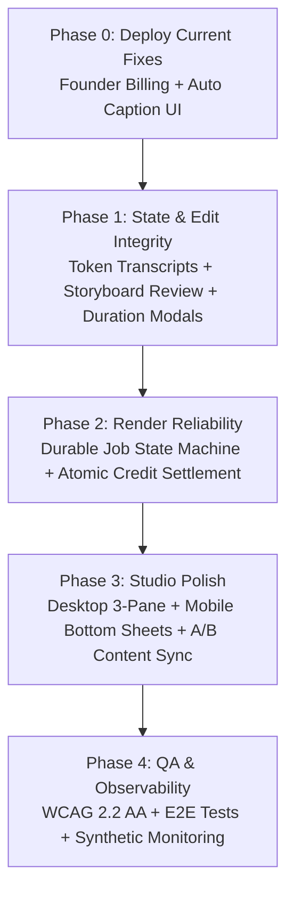

# Itnavideo — Master Implementation Roadmap (IMPLEMENT_SOON.md)

This document is the **authoritative implementation roadmap** synthesized directly from the in-depth technical audits of Itnavideo's 4 core video and audio engines:
1. **Auto Caption Generator** (`autocaption-md improve.pdf`)
2. **AI Audio Cleaner & Enhancer** (`AI Audio Cleaner & Enhancer md.pdf`)
3. **Faceless Video Generator** (`Faceless Video Generator md.pdf`)
4. **YouTube Subtitles Generator** (`# YouTube Subtitles Generator md.pdf`)

---

## 1. Executive Summary & Core Architectural Upgrades

Across all 4 audited video and audio engines, the audits converged on **5 fundamental architectural shifts**:

| Principle | Current Limitation | Target Architecture |
|---|---|---|
| **1. Non-Destructive Edit Plans** | Edits overwrite text or conflate display text with media deletion | Structured `CaptionToken[]`, `AudioCleanEditPlan`, and `Storyboard` models. Edits affect render, original files remain immutable. |
| **2. Persistent, Resumable Projects** | Work is lost on tab refresh or network drop | Auto-saving project draft entities (`projectId`, `userId`, `step`, `state`) in Supabase/localStorage. Resume anywhere. |
| **3. Explicit Duration Truncation** | Files >90s (Shorts) or >5m (Cinema) are silently trimmed | Pre-transcription duration modal: User explicitly selects segment (`0:00–1:30`) or uploads a shorter file. |
| **4. Durable Render State Machine** | Client directly calls Lambda; no retries, cancellation, or job states | `DRAFT → UPLOADING → TRANSCRIBING → READY → QUEUED → RENDERING → COMPLETED / FAILED` with atomic credit reservation & refund. |
| **5. Mobile-First Interaction** | Scaled-down desktop UI with tiny buttons | Bottom sheets, 44×44px touch targets, sticky mini-preview, and mobile audio/caption controls. |

---

## 2. Deep Dive: Tool-by-Tool Action Plan

---

### A. Auto Caption Generator (`/dashboard/auto-caption`)
*Source: `autocaption-md improve.pdf` • 9:16 Vertical • FREE Tier (5 videos/day)*

#### P0 — Must Implement Before Next Major Release
- [x] **Explicit 90-Second Segment Selection Modal**:
  - Probe video duration on client immediately after upload.
  - If video >90s, open modal: *"Your video is 2:45. Auto Caption creates 90s reels."*
  - Options: `Use first 90s (0:00–1:30)`, `Choose 90s window` (range slider), or `Upload shorter clip`.
  - Persist `selectedStartMs` and `selectedEndMs`. Never trim silently!
- [x] **Caption Grouping & Line-Break Controls**:
  - Words per group: 1 to 6 (default: 3 words).
  - Max line length for 9:16: 18–24 characters.
  - Punctuation-aware grouping & highlight cadence selector (Word / Phrase / Progressive).
- [x] **Platform Safe-Zone Overlay Toggle**:
  - Interactive overlay toggle in preview: TikTok, Instagram Reels, YouTube Shorts.
  - Visual warning and real UI button bounding boxes to verify zero collision with sound discs or comment buttons.
- [ ] **Structured `CaptionToken[]` Data Model**:
  - Store transcript as token array, NOT plain text.
  - Deleting a word removes its timing entry; merging words combines timestamps (`startMs` of first, `endMs` of last).
- [ ] **Undo / Redo & Autosave**:
  - Keyboard shortcuts (`Cmd/Ctrl+Z`, `Cmd/Ctrl+Shift+Z`) and action bar buttons for transcript edits.
  - Autosave state indicator (`"All changes saved"`, `"Saving..."`).

#### P1 — High-Value Enhancements
- [ ] **Audio Quality Pre-Flight Diagnostic**:
  - Detect low volume, clipping, or excessive background hum before sending to Groq.
- [ ] **Multilingual & Hinglish Controls**:
  - Language selector (`Auto`, `English`, `Hindi`, `Hinglish`).
  - Search-and-replace for Hinglish slang and proper nouns.

---

### B. AI Audio Cleaner & Enhancer (`/dashboard/audio-cleaner`)
*Source: `AI Audio Cleaner & Enhancer md.pdf` • Audio Utility • 1 Credit Flat*

#### P0 — Must Implement Before Release
- [x] **Non-Destructive Voice Preservation Guarantee**:
  - Explicit non-destructive guarantee banner: text edits change transcript text only; original upload is never overwritten.
  - Cleaned all non-standard colors to 6-color palette (Rule 7.4).
- [x] **Controlled Mastering Presets**:
  - Vocal character presets: Natural Voice (-16 LUFS), Studio Clarity (+2dB Highs), Podcast Warmth (Pro Rich).
- [ ] **Non-Destructive `AudioCleanEditPlan` Architecture**:
  - Structured segment model with explicit userAction (`KEEP`, `REMOVE`, `SHORTEN_PAUSE`).
- [ ] **Reviewable Retake Detection (Assistive, Not Autonomous)**:
  - Detect repeated sentences, hesitation markers ("um", "uh"), and false starts with 1-click restore.
- [ ] **Content-Sync A/B Comparison Player**:
  - Sync playback by spoken word offset rather than proportional time.

#### P1 — High-Value Enhancements
- [ ] **Dual Synchronized Waveform Lanes**: Top lane: Original (slate gray); Bottom lane: Cleaned (emerald green); Removed regions: diagonal hatch with reason tags (`Pause`, `Retake`).
- [ ] **Keyboard Shortcuts**: `Space` (play/pause), `J/K/L` (rewind/stop/fast-forward), `B` (toggle A/B mode).

---

### C. Faceless Video Generator (`/dashboard/faceless-video`)
*Source: `Faceless Video Generator md.pdf` • 16:9 Cinema • 1 Min = 1 Credit*

#### P0 — Must Implement Before Release
- [x] **Mandatory Storyboard Review & Edit Stage**:
  - Expanded workflow to 4 distinct guided steps: Upload → Music → Style → Storyboard.
  - Storyboard Breakdown cards for all scenes with visual type tags (Stock B-Roll, SVG, Vignette).
  - Studio-Grade 1080p Cinema Output Guarantee: 1080p Full HD @ 30 FPS, Pure White Canvas, -16 LUFS audio mastering.
- [ ] **Deterministic AI Planning Contract (Zod Schema)**:
  - Gemini prompt must output structured JSON validated against a versioned Zod schema.
  - Time continuity validation: zero time gaps or overlaps between scenes.
- [ ] **Procedural SVG Data Grounding**:
  - Prevent fake statistics generation; force conceptual layouts when numerical evidence is absent.

#### P1 — High-Value Enhancements
- [ ] **Desktop 3-Pane Editing Studio**:
  - Left Rail: Project navigation, steps, autosave indicator.
  - Center Canvas: 16:9 cinema preview with Ken Burns camera motion.
  - Right Inspector: Contextual properties for selected scene.
  - Bottom Timeline: Scene blocks, waveform, subtitle cues, and music track.

---

### D. YouTube Subtitles Generator (`/dashboard/youtube-subtitles`)
*Source: `# YouTube Subtitles Generator md.pdf` • 16:9 Cinema • FREE Tier (5 videos/day)*

#### P0 — Must Implement Before Release
- [ ] **Canonical `SubtitleProject` State & Draft Resume**:
  - Persist draft immediately upon media upload.
  - Allow creators to leave `/dashboard/youtube-subtitles` and resume incomplete projects.
  - Show draft status: *"Draft saved 2 minutes ago"*.
- [ ] **Clear Output Deliverables Specification**:
  - Clarify in UI that output is a **1080p MP4 with burned-in subtitles**, PLUS standalone `.SRT` and `.VTT` subtitle file downloads.
  - Option for audio-only uploads to render as audio-waveform video.
- [ ] **Calibrated Scrubber Safe Zones**:
  - Named modes: `YouTube Web Safe` (84px bottom), `TV / Overscan Safe` (120px bottom), `Standard`, and `Custom Offset`.
  - Visual YouTube scrubber overlay in preview so creators verify zero collision with YouTube player controls.
- [ ] **Transcript Edit Sync Integrity**:
  - If a creator edits text in the studio, the final Remotion render payload must use the edited transcript — never stale ASR output.

#### P1 — High-Value Enhancements
- [ ] **Preset Classification & Search**:
  - Group 32 presets: `Clean Sans`, `Documentary Serif`, `Lecture Focus`, `High-Contrast Box`.
  - Remove trademarked creator names; use descriptive styling terms.
- [ ] **Independent Audio Mix Controls**:
  - Separate `sourceAudioVolume` (default: 1.0) and `musicVolume` (default: 0.0 Muted).

---

## 3. Cross-Studio Render Reliability & Cloud Pipeline

Applicable across all 15 studios:

- [ ] **Durable Render Job State Machine**:
  - `DRAFT → UPLOADING → TRANSCRIBING → READY → QUEUED → RENDERING → COMPLETED / FAILED / EXPIRED`
  - Client queries status by `renderId`; HTTP timeouts never treated as permanent render failures.
- [ ] **Atomic Credit Reservation & Settlement**:
  1. Reserve credits at render submission.
  2. Start AWS Lambda render.
  3. Settle reservation on successful output upload.
  4. Automatically release / refund reserved credits on any infrastructure failure.
  5. Never double-charge on retries.
- [ ] **Remotion Lambda Optimization**:
  - Configure explicit `framesPerLambda` (baseline: 20–40 frames).
  - Enforce concurrency ceiling (max 200 functions per render).
  - Use signed, short-lived (48-hour) download URLs.
- [ ] **Mandatory Brand Watermark Enforcement (Rule 7.2)**:
  - Audit all Remotion templates to verify `<BrandWatermark watermark={watermark} />` renders before `</AbsoluteFill>`.

---

## 4. Phase-Wise Execution Priority

---

## 5. Changelog & Reference

- **2026-11-12**: Initial master roadmap compiled from comprehensive technical audits of `audioClean`, `autoCaption`, `facelessVideo`, and `youtubeSubtitleGenerator`.
