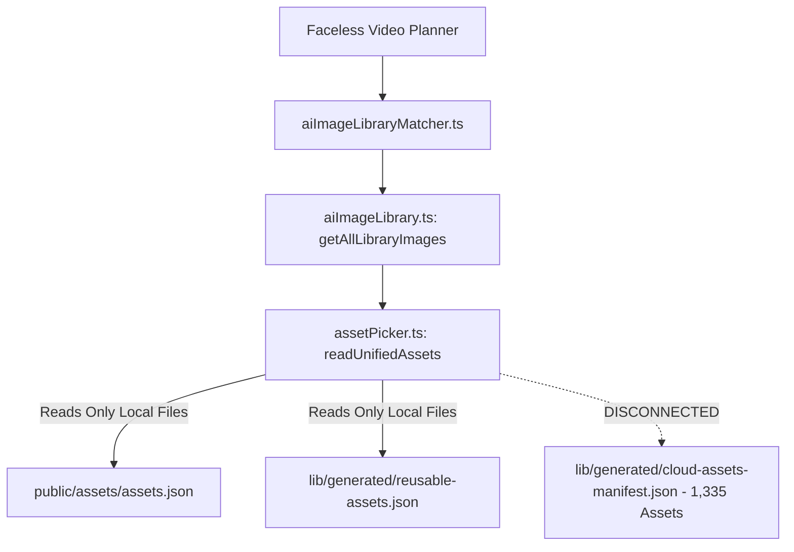

# Itnavideo — Reusable Asset Library Video-Type Compatibility & Mapping Matrix

> **Executive Scope**: Architectural audit and mapping of the **1,335-asset cloud collection** (stored in AWS S3 under `reusable-assets/`) across all active, legacy, and planned Itnavideo video formats.
> **Guiding Principle**: *"The right asset in the right video type."* Visual assets must elevate narrative pacing, technical clarity, and retention without violating established aesthetic contracts or injecting decorative filler.

---

## 1. Inventory of All Itnavideo Video Types

Based on an exhaustive repository audit across `remotion/index.tsx`, `services/ai/reelPlanner.ts` (`VIDEO_TYPE_REGISTRY`), `app/api/reels/jobs/route.ts`, `app/dashboard/page.tsx`, and `docs/video-types/`, Itnavideo's video types are categorized into **Active Production Engines**, **Sub-Modes / User Input Modes**, and **Archived / Legacy Precursors**:

### A. Active Production Video Types (11 Fully Implemented Engines)

| # | Video Type Name | Aspect Ratio | Max Duration | Primary Input | Remotion Composition ID | Target Category & Pipeline Focus |
|---|---|:---:|:---:|---|---|---|
| **1** | **Faceless Video** | **16:9** | 10 Min (600s) | Script / Voiceover | `FACELESS_VIDEO` / `LONG_VIDEO` | **Long-Form Flagship**: AI Director, full-bleed visuals, split screens, technical diagrams, SFX & BGM. |
| **2** | **Book Summary Video** | **16:9** | 10 Min (600s) | Book Quotes / Audio | `BOOK_SUMMARY` | **Long-Form Educational**: Chapter breakdowns, mental models, quote cards, timeline frameworks, ambient audio. |
| **3** | **Image to Video AI** | **16:9** | 10 Min (600s) | Audio + User Images | `IMAGE_TO_VIDEO_AI` | **Long-Form Narrative**: User photos sequenced to speech, parallax motion, subtitle overlays, optional BGM. |
| **4** | **YouTube Subtitles Generator** | **16:9** | 10 Min (600s) | Video / Audio | `AUTO_CAPTION_GENERATOR` (Landscape) | **Long-Form Captions**: High-contrast, scrubber-safe burnt-in captions on user widescreen video. |
| **5** | **Long Video to Shorts Clips** | **9:16** | Input: 2h / Clip: 60s | 16:9 or 9:16 Video | `LONG_VIDEO_CLIPS` | **Short-Form Virality**: AI hook detection, automated face/speaker reframing, kinetic captions. |
| **6** | **Auto Caption Reel** | **9:16** | 90s | Video / Audio | `AUTO_CAPTION_GENERATOR` | **Short-Form Social**: Word-synced glowing captions, spring physics, dynamic punch presets. |
| **7** | **Compare Explainer** | **9:16** | 90s | Voiceover + 2 Images | `COMPARE_EXPLAINER` | **Short-Form Versus**: Split-screen arena, animated scorebars, feature tables, winner bell SFX. |
| **8** | **Kinetic Typography Video** | **9:16** | 90s | Voiceover | `TYPOGRAPHY_VIDEO` | **Short-Form Kinetic**: 11 typographic motion blueprints, camera pulses, audio hits, text-first hierarchy. |
| **9** | **Whiteboard Animation** | **9:16** | 90s | Script / Audio | `WHITEBOARD_VIDEO` | **Short-Form Explainer**: Clean light canvas, hand-drawn vector paths, stickman poses, marker accents. |
| **10** | **Long Video Promo** | **9:16** | 90s | Video + Thumbnail | `LONG_VIDEO_PROMO` | **Short-Form Marketing**: Teaser hooks, aspect conforming, thumbnail overlays, kinetic teaser titles. |
| **11** | **AI Studio Audio Cleaner** | **Audio** | 12 Min (720s) | Audio / Video | *None (Pure Cloud Audio)* | **Audio Utility**: Silence removal, denoiser, de-reverberation, loudness mastering, 320kbps MP3/WAV export. |

### B. Sub-Modes, Aliases & Internal Variations
- **`Multi Images`**: An input variant of `IMAGE_TO_VIDEO_AI` and `BOOK_SUMMARY` where creators upload multiple images that are sequentially anchored to transcript beats.
- **`Caption Studio`**: An interactive dashboard sub-page and preset previewer for `AUTO_CAPTION_GENERATOR`.
- **`AI_VIDEO_GENERATOR`**: Production alias pointing directly to `FACELESS_VIDEO`.
- **`Long Video Pro` / `Long-Form Captioned Video`**: Early design specifications now consolidated under `FACELESS_VIDEO` and `YouTube Subtitles Generator`.
- **`Text-to-Video AI`**: Architectural alias describing the end-to-end prompt-to-video workflow within `FACELESS_VIDEO`.
- **`AI Director Reel`**: Archived 9:16 experimental precursor to the current 16:9 `FACELESS_VIDEO` flagship.

---

## 2. Video-Type-to-Asset Compatibility Matrix

The table below outlines the suitability of each cloud and local asset category for every video type:
- **REQ** = **Required** (Pipeline fails or degrades without this category)
- **REC** = **Recommended** (Substantially improves production value and retention)
- **OPT** = **Optional** (Beneficial for specific topics; user-toggled)
- **COND** = **Conditional** (Permitted only under strict sub-conditions, e.g., audio-only uploads)
- **NOT** = **Not Suitable** (Forbidden; contradicts the visual contract or pollutes layout)

| Asset Category (Available Count) | Faceless Video (16:9) | Book Summary (16:9) | Image to Video (16:9) | YouTube Subtitles (16:9) | Long Video Clips (9:16) | Auto Caption Reel (9:16) | Compare Explainer (9:16) | Typography Video (9:16) | Whiteboard Video (9:16) | Long Video Promo (9:16) | Audio Cleaner (Utility) |
| :--- | :---: | :---: | :---: | :---: | :---: | :---: | :---: | :---: | :---: | :---: | :---: |
| **Icons & Symbols (275 SVG)** | **REC** | **REC** | **NOT** | **NOT** | **NOT** | **NOT** | **REC** | **OPT** | **REC** | **OPT** | **NOT** |
| **Character Illustrations (100 SVG)** | **REC** | **OPT** | **NOT** | **NOT** | **NOT** | **NOT** | **OPT** | **NOT** | **NOT** | **NOT** | **NOT** |
| **Backgrounds & Textures (100 SVG)** | **REC** | **REC** | **COND** | **COND** | **NOT** | **COND** | **REC** | **REC** | **NOT** | **NOT** | **NOT** |
| **Charts & Diagrams (100 SVG)** | **REC** | **REC** | **NOT** | **NOT** | **NOT** | **NOT** | **REC** | **NOT** | **OPT** | **NOT** | **NOT** |
| **Photographic Stock (336 Local + 150 SVG)** | **REC** | **OPT** | **COND** | **NOT** | **NOT** | **NOT** | **COND** | **NOT** | **NOT** | **NOT** | **NOT** |
| **Genuine Stock B-Roll Footage** | **REC** | **OPT** | **NOT** | **NOT** | **NOT** | **NOT** | **NOT** | **NOT** | **NOT** | **NOT** | **NOT** |
| **Sound Effects (100 S3 + 63 Local WAV)** | **REC** | **REC** | **OPT** | **NOT** | **NOT** | **OPT** | **REC** | **REC** | **REC** | **REC** | **NOT** |
| **Background Music (30 S3 WAV)** | **REC** | **REC** | **REC** | **NOT** | **NOT** | **NOT** | **REC** | **REC** | **REC** | **REC** | **NOT** |
| **Whiteboard Doodles (40 S3 + Stickman)** | **OPT** | **NOT** | **NOT** | **NOT** | **NOT** | **NOT** | **NOT** | **NOT** | **REQ** | **NOT** | **NOT** |
| **Device Mockups & Frames (30 SVG)** | **REC** | **OPT** | **NOT** | **NOT** | **NOT** | **NOT** | **REC** | **NOT** | **NOT** | **REC** | **NOT** |
| **Oracle Database Diagrams (310 SVG)** | **REC\*** | **REC\*** | **NOT** | **NOT** | **NOT** | **NOT** | **OPT\*** | **NOT** | **NOT** | **NOT** | **NOT** |

*\*Note: Oracle Database assets are strictly conditionally matched when narration or topic metadata explicitly addresses database architecture, SQL, PL/SQL, or DBA operations.*

---

## 3. Deep-Dive Review by Video Type

### 1. Faceless Video (`FACELESS_VIDEO` — 16:9 Widescreen)
- **Role in Platform**: Primary revenue-generating long-form explainer engine.
- **Best Asset Categories**:
  - `Charts & Diagrams` (100 assets) $\rightarrow$ Directly routes into `ChartScene`, `WorkflowScene`, and `RoadmapScene`.
  - `Photographic Images & Curated Cards` $\rightarrow$ Powers `FullBleedVisualScene` and `SplitScreenLayout`.
  - `Oracle Database Education` (310 assets) $\rightarrow$ Serves as high-authority technical visuals for enterprise engineering lessons.
  - `Device Mockups` (30 assets) $\rightarrow$ Powers `PromptWindowScene` and tech stack showcases.
  - `SFX & BGM` $\rightarrow$ Essential for audio pacing (`woosh` on scene cuts, `hit` on stat reveals, ambient BGM stems).
- **Incompatible Assets**:
  - Whiteboard stickman drawings look out of place against deep obsidian (`#070B14`) cinematic backdrops.
- **Quality Rule**: Maintain a consistent visual style (do not interleave cartoon stickers with corporate tech blueprints).

### 2. Book Summary Video (`BOOK_SUMMARY` — 16:9 Widescreen)
- **Role in Platform**: High-retention educational summaries of non-fiction, business, and psychology books.
- **Best Asset Categories**:
  - `Infographic Diagrams & Timelines` $\rightarrow$ Illustrating core frameworks (e.g., flywheel loops, 4-quadrant matrices).
  - `Icons & Symbols` $\rightarrow$ Anchoring bulleted takeaways in chapter scenes.
  - `Background Textures` $\rightarrow$ Paper/subtle grit textures supporting book themes.
  - `Sound Effects` $\rightarrow$ Page turn, pencil scratch, and chime sound cues between chapter markers.
- **Incompatible Assets**:
  - Real stock video footage or noisy colorful cards that distract from quote typography.

### 3. Whiteboard Video (`WHITEBOARD_VIDEO` — 9:16 Vertical)
- **Role in Platform**: Educational doodle and hand-drawn strategy explainers.
- **Best Asset Categories**:
  - `Whiteboard Doodles & Stickman Graphics` (40 S3 + local stickman vectors) $\rightarrow$ Core primary subject matter.
  - `Icons & Symbols` (Clean line outlines) $\rightarrow$ Concept markers drawn onto the board.
  - `SFX` $\rightarrow$ Marker drawing sounds, paper rustles, subtle pops.
- **Incompatible Assets (Strict Forbidden Rule)**:
  - **Zero Dark Cards or Photographs**: Full-bleed dark photos, gradients, or complex 3D mockups completely break the whiteboard illusion. The canvas must remain clean white/light `#FFFFFF`.

### 4. Compare Explainer (`COMPARE_EXPLAINER` — 9:16 Vertical)
- **Role in Platform**: Product battles, iPhone vs. Android comparisons, service breakdowns.
- **Best Asset Categories**:
  - `Device Mockups & Frames` (Clay iPhone, browser windows) $\rightarrow$ Framing compared apps/software.
  - `Icons & Symbols` $\rightarrow$ Checkmarks, cross icons, speedometers for spec comparisons.
  - `Comparison Infographics` $\rightarrow$ Side-by-side matrices and scorebars.
  - `SFX` $\rightarrow$ Versus slam (`boom`), score counter clicks, winner bell.
- **Incompatible Assets**:
  - Unrelated stock photos or single-entity illustrations that cannot be cleanly paired for comparison.

### 5. Kinetic Typography Video (`TYPOGRAPHY_VIDEO` — 9:16 Vertical)
- **Role in Platform**: Fast-paced speech-to-text social shorts where typography is the hero.
- **Best Asset Categories**:
  - `Background Textures` $\rightarrow$ Subtle dark slate grids, blueprint lines, or gradient flows behind moving words.
  - `Sound Effects` $\rightarrow$ Camera pulses, whooshes, typewriter taps on kinetic keyword reveals.
  - `Background Music` $\rightarrow$ High-energy instrumental lofi/phonk stems.
- **Incompatible Assets**:
  - Full-screen diagrams, large character illustrations, or photos that obstruct text legibility.

### 6. Image to Video AI & Multi Images (`IMAGE_TO_VIDEO_AI` — 16:9 Widescreen)
- **Strict Visual Contract**: The creator explicitly uploads their own photos (vacation, real estate, personal brand, portfolio).
- **Asset Usage Boundary**:
  - **User-Uploaded Imagery Must Remain Primary**: The pipeline must **NEVER** overwrite or replace user photos with library stock photos.
  - **Allowed Library Contributions**:
    - `Background Music (BGM)`: Curated 48kHz audio tracks.
    - `Sound Effects`: Subtle audio transitions between photos.
    - `Subtle Background Gradients`: Only used as a soft blur-fill backdrop when user images do not match 16:9.

### 7. Long Video to Shorts Clips (`LONG_VIDEO_CLIPS` — 9:16 Vertical)
- **Strict Visual Contract**: Repurposes long podcast or interview footage into viral shorts.
- **Asset Usage Boundary**:
  - The creator's source video is the primary visual.
  - Library visuals (photos, diagrams) are **NOT SUITABLE**.
  - Only kinetic captions and optional subtle word-tap sound effects are permitted.

### 8. Caption-Focused Video Types (`Auto Caption Reel` & `YouTube Subtitles`)
- **Strict Visual Contract**: The user's uploaded talking-head video must remain visible 100% of the time.
- **Asset Usage Boundary**:
  - Visual cards, diagrams, and photos are strictly excluded.
  - **Audio-Only Exception**: If the user uploads an audio-only file (podcast clip) with no video, an ambient background texture (`reusable-assets/backgrounds/`) is conditionally loaded behind the glowing captions.

### 9. Oracle Database Education Collection (310 Assets)
- **Curriculum Scope**: 8 specialized areas (Fundamentals, SQL, Architecture, PL/SQL, Transactions, Performance, DBA, Modeling).
- **Target Video Types**:
  - `Faceless Video` (Primary host for full-length database tutorials).
  - `Book Summary` (Technical book summaries, e.g., *Expert Oracle Database Architecture*).
- **Strict Matching Rule**:
  - The AI planner must match Oracle diagrams based on **semantic concept density** (e.g., `SGA`, `buffer cache`, `LGWR`, `CBO`, `B-Tree`), **never** on generic words like *"data"*, *"computer"*, or *"system"*.

### 10. AI Studio Audio Cleaner (Utility)
- **Product Contract**: Pure cloud audio processing (silence cutting, denoise, mastering).
- **Asset Compatibility**: **ZERO VISUAL ASSETS**.
- Attempting to display graphics or video templates here would violate product architecture.

---

## 4. Current Integration Gap Analysis

An audit of [`services/ai/assetPicker.ts`](file:///c:/Users/user/.gemini/antigravity/scratch/itnavideo/services/ai/assetPicker.ts) and [`services/ai/aiImageLibrary.ts`](file:///c:/Users/user/.gemini/antigravity/scratch/itnavideo/services/ai/aiImageLibrary.ts) confirmed why the 1,335 cloud assets are not currently discoverable in production:



### The 4 Core Architectural Mismatches:
1. **Disconnected Manifest**: `readUnifiedAssets()` has no call to load `lib/generated/cloud-assets-manifest.json`.
2. **Property Name Mismatch**:
   - Legacy code expects `asset.src`.
   - Cloud manifest stores the canonical URL in `asset.s3Url`.
3. **MIME & Type Incompatibility**:
   - `aiImageLibrary.ts` filters strictly on `asset.type === 'image'`.
   - Cloud assets are classified by domain: `diagram`, `vector`, `mockup`, `whiteboard`, `audio`.
   - Result: All diagrams and vectors are filtered out before reaching the planner.
4. **Safety & Quality Scoring**:
   - Cloud assets have `status: 'verified_active'`, but the legacy picker requires `safeToUse: true` and `qualityScore >= 60`.
   - Without mapping, cloud assets are rejected as unverified.

### Duplicate ID Resolution (`icon-tabler-biohazard`)
- **Root Cause**: During Stage 4 ingestion, the icon list contained `biohazard` and mapped `bacteria` to `biohazard`, resulting in two identical entries pointing to `reusable-assets/icons/tabler-specialized/icon-tabler-biohazard.svg`.
- **Resolution Plan**: A simple deduplication on `cloud-assets-manifest.json` will clean the manifest array from 1,335 to 1,334 without touching or deleting any S3 object.

---

## 5. Recommended Safe Integration Architecture

To connect the 1,335 cloud assets to the video engines without breaking video contracts, we propose creating a centralized discovery module: **`services/ai/universalAssetDiscovery.ts`**.

### Architectural Blueprint:
```
                      [ Incoming Scene Beat / User Prompt ]
                                       │
                                       ▼
                     [ universalAssetDiscovery.ts ]
                                       │
            ┌──────────────────────────┴──────────────────────────┐
            ▼                                                     ▼
   [ Video-Type Filter ]                                 [ Domain Context Filter ]
   - facelessVideo   --> [diagrams, photos, sfx, bgm]    - Tech/DB    --> Unlock Oracle Assets
   - whiteboardVideo --> [whiteboard SVG, stickman]      - General    --> Standard Asset Pool
   - typographyVideo --> [subtle textures, sfx]          - Compare    --> Versus & Split Mockups
   - imageToVideoAi  --> [user images only + bgm]
   - audioCleaner    --> [NO ASSETS]
            │
            ▼
   [ Semantic Relevance Engine ]
   - Title & Tag Token Scoring (+10 per tag match)
   - Narration Context Bonus (+5)
   - Dynamic Repetition Penalty (-25 for recent scene, -15 per repeat)
            │
            ▼
   [ Output Normalized Asset Payload ]
   { id, url: s3Url, type, aspectRatios: ['16:9'], title }
```

### Key Guardrails:
1. **Type-Specific Allowlists**: `whiteboardVideo` will never receive dark photos; `typographyVideo` will never receive full-screen cards; `audioCleaner` receives zero assets.
2. **User-Asset Primacy**: For `IMAGE_TO_VIDEO_AI` and `LONG_VIDEO_CLIPS`, user-provided media has 100% priority.
3. **Format Isolation**: Audio pickers handle `.wav` files; visual scene pickers handle `.svg`, `.png`, `.jpg` only.
4. **Zero Local Compute**: Ingestion runs purely in-memory with zero local disk downloads or local Chromium rendering.

---

## 6. Implementation Status & Integration Progress

### ✅ Phase 1: High-Value Flagship Integration (Completed & Verified)
- **Manifest Ingestion**: [`services/ai/assetPicker.ts`](file:///c:/Users/user/.gemini/antigravity/scratch/itnavideo/services/ai/assetPicker.ts) now reads [`lib/generated/cloud-assets-manifest.json`](file:///c:/Users/user/.gemini/antigravity/scratch/itnavideo/lib/generated/cloud-assets-manifest.json) with strict format isolation, verified active status validation, and calibrated quality scoring.
- **Manifest Deduplication**: `icon-tabler-biohazard` duplicate manifest entry resolved, bringing the unique active cloud catalog to **1,334 verified assets** with zero S3 deletions.
- **Faceless Video**: Can dynamically discover 16:9 widescreen backgrounds, technical diagrams, flowcharts, character illustrations, and device mockups via [`services/ai/aiImageLibraryMatcher.ts`](file:///c:/Users/user/.gemini/antigravity/scratch/itnavideo/services/ai/aiImageLibraryMatcher.ts).
- **Book Summary Video**: Can illustrate `KEY_IDEA` scenes with conceptual diagrams, timelines, and framework graphics via [`services/ai/bookSummaryPlanner.ts`](file:///c:/Users/user/.gemini/antigravity/scratch/itnavideo/services/ai/bookSummaryPlanner.ts) while preserving user reference images when uploaded.

### ✅ Phase 2: Domain-Specific Visual Routing & Gating (Completed & Verified)
- **Oracle Database Technical Topic Gating**: Implemented strict semantic boundary rules in [`services/ai/aiImageLibraryMatcher.ts`](file:///c:/Users/user/.gemini/antigravity/scratch/itnavideo/services/ai/aiImageLibraryMatcher.ts). Oracle diagrams are strictly disqualified (-999 penalty) on non-database scripts and boosted (+16 reward) exclusively on technical database lesson narratives. Verified via simulation: 7/7 database scenes matched on-topic with 0 repetitions, and 0 Oracle diagrams leaked into general scripts.
- **Whiteboard Aesthetic Safeguards**: Full-bleed dark photos and backgrounds disqualified on `whiteboardVideo`; dedicated doodle paths (`reusable-assets/whiteboard/`) and clean line art prioritized on white/light canvas.
- **Airtight Audio Separation**: Audio assets (`.wav`, `.mp3`, `sfx`, `music`) are 100% excluded from visual image catalogs in [`services/ai/aiImageLibrary.ts`](file:///c:/Users/user/.gemini/antigravity/scratch/itnavideo/services/ai/aiImageLibrary.ts).

---

## 7. Modified Files Summary

| Target File | Changes Executed |
| :--- | :--- |
| [`services/ai/assetPicker.ts`](file:///c:/Users/user/.gemini/antigravity/scratch/itnavideo/services/ai/assetPicker.ts) | Added `readCloudAssetsManifest()`, integrated 1,334 cloud assets into `readUnifiedAssets()`, enforced audio vs image type safety. |
| [`services/ai/aiImageLibrary.ts`](file:///c:/Users/user/.gemini/antigravity/scratch/itnavideo/services/ai/aiImageLibrary.ts) | Enriched `AiLibraryImage` metadata (`kind`, `subCategory`, `qualityScore`), added strict `.wav`/`.mp3` exclusion filter. |
| [`services/ai/aiImageLibraryMatcher.ts`](file:///c:/Users/user/.gemini/antigravity/scratch/itnavideo/services/ai/aiImageLibraryMatcher.ts) | Added `videoType` matching option, strict Oracle database topic gating, whiteboard canvas guards, and icon full-bleed protection. |
| [`services/ai/bookSummaryPlanner.ts`](file:///c:/Users/user/.gemini/antigravity/scratch/itnavideo/services/ai/bookSummaryPlanner.ts) | Connected cloud framework & diagram discovery for `KEY_IDEA` scenes when reference images are omitted. |
| [`lib/generated/cloud-assets-manifest.json`](file:///c:/Users/user/.gemini/antigravity/scratch/itnavideo/lib/generated/cloud-assets-manifest.json) | Deduplicated `icon-tabler-biohazard` entry, updated `totalAssets: 1334`. |
| [`docs/ASSET_LIBRARY.md`](file:///c:/Users/user/.gemini/antigravity/scratch/itnavideo/docs/ASSET_LIBRARY.md) | Updated total active count to 1,334 (1,024 General + 310 Oracle) and cross-referenced compatibility matrix. |
| [`docs/ASSET_LICENSES.md`](file:///c:/Users/user/.gemini/antigravity/scratch/itnavideo/docs/ASSET_LICENSES.md) | Updated Tabler Icons unique verified count to 97. |

---

## 8. Verification Results (Zero Heavy Local Compute)

All verification scripts executed in lightweight Node.js environments with 0 local Remotion renders:
1. `node scripts/validate-all-video-types.mjs`: **11/11 Checks Passed (0 Failures)**.
2. `node scripts/test-oracle-faceless-simulation.mjs`: **7/7 Scenes Matched Pedagogically Accurate Visuals (0 Repetitions)**.
3. `node scripts/verify-asset-library-integration.mjs`: **1,334/1,334 S3 URLs Valid, 0 Duplicates, 0 Audio Leaks, 100% Boundary Isolation Confirmed**.

---
*Verified and ready for final review before GitHub push & deployment.*
