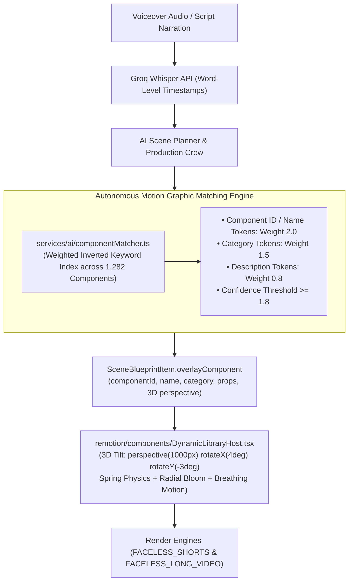

# Itnavideo — Remotion Motion Graphic Component Library & Autonomous AI Pipeline

## Overview

Itnavideo features a production-verified library of **1,282 modular motion graphic components** organized across **68 distinct categorical subdirectories** in `remotion/library/`. These components are designed from the ground up for broadcast-quality video production — rejecting flat static SaaS website screenshots in favor of **Vox-style kinetic overlays, 3D perspective cards, animated HUD telemetry, Bloomberg-style financial tickers, and high-retention motion graphics**.

---

## 1. Zero Manual UI Button Policy (Autonomous AI Integration)

> [!IMPORTANT]
> **No Manual "Add Graphic Overlay" UI Buttons**: Itnavideo is an autonomous AI-first platform. Providing manual overlay pickers introduces cognitive friction and user error. Instead, the AI Scene Planner autonomously analyzes voiceover audio and script narration, determines semantic intent, and attaches the ideal broadcast motion graphic with zero user intervention.

---

## 2. Architecture & Pipeline Flow



---

## 3. Component Library Categorical Structure (68 Subdirectories, 1,282 Components)

All 1,282 components are strictly unique across IDs, names, and filenames (zero duplicates).

| Subdirectory | Category / Suite | Count | Key Visual Capabilities |
| :--- | :--- | :--- | :--- |
| `remotion/library/google-ecosystem/` | Google Ecosystem & Ads | 20 | Google Search SERP, Knowledge Panel, GA4 Realtime, GSC Performance, GTM DataLayer, Google Ads Campaign & ROAS Tracker |
| `remotion/library/jewelry/` | Jewelry & Gemstones | 20 | Diamond 4Cs Grading, Gold Karat Scale, Sterling Hallmark, Mohs Scale, Solitaire Ring, Tennis Bracelet, IGI Certificate |
| `remotion/library/transit/` | Transportation & Transit | 20 | Flight Radar 24 Tracker, Airport Departure Board, Metro Line Map, Turn-by-Turn GPS, High Speed Train, Spacecraft Telemetry |
| `remotion/library/workflow/` | Workflow & Productivity | 20 | Agile Kanban Board, Gantt Timeline, Pomodoro Card, Eisenhower Matrix, Daily Standup, Sprint Burndown, Milestone Tracker |
| `remotion/library/document-file/` | Office Documents & Files | 20 | PDF Reader, CSV DataStream, Markdown Preview, OCR Scanner, Digital Signature, Encrypted Container Vault |
| `remotion/library/cloud-infra/` | Cloud & DevOps | 20 | Kubernetes Cluster Topology, Docker Container Pods, AWS Cloud Architecture, CI/CD Pipeline, Terraform State |
| `remotion/library/database/` | Database & SQL | 20 | B-Tree Index Explorer, Execution Plan Cost, Slow Query Log, Database Replication Lag, Row Level Security Policy |
| `remotion/library/finance/` | Finance & Trading | 25+ | Candlestick Charts, Order Books, Crypto Tickers, Portfolio Asset Allocation, Compound Interest |
| `remotion/library/3d-isometric/` | 3D & Isometric | 20+ | Isometric Server Rooms, Isometric Smart City, 3D Architectural Blueprint, 3D Cube Rotation |
| `remotion/library/charts/` | Animated Charts | 20+ | Bar Race Charts, Radial Gauges, Area Gradients, Multi-line Retention Trends, Donut Breakdowns |
| `remotion/library/diagrams/` | Animated Diagrams | 20+ | Venn Diagrams, Flowcharts, System Architecture, Mind Maps, Organizational Orbit |
| `remotion/library/timelines/` | Timelines & Roadmaps | 20+ | Curved Process Roadmaps, Milestone Ladders, Historical Timelines, Horizontal Process Steps |
| `remotion/library/comparisons/` | Comparisons & Versus | 20+ | Head-to-Head Battle Cards, Feature Matrix, Before & After Transformation Sliders |
| `remotion/library/hud/` | Cyberpunk & Sci-Fi HUD | 20+ | Biometric Scanner, Target Reticle, Lidar Wireframe, Audio Frequency Spectrum, Satellite Orbit |
| `remotion/library/news-broadcast/` | Broadcast & News | 20+ | Breaking News Banner, Lower Thirds Ticker, Live Split Screen, Market Strip, Telemetry Bar |

*(Plus 53 additional specialized suites covering Healthcare, Psychology, E-Commerce, Education, Astronomy, Physics, Sound Design, Compositing, and Camera Cinematics).*

---

## 4. Semantic Matcher Engine (`services/ai/componentMatcher.ts`)

- **High-Speed Inverted Index**: Pre-indexes all 1,282 components in O(1) keyword lookups upon serverless cold start.
- **Weighted Token Scoring**:
  - Exact Component ID or Name match: `+2.0`
  - Category match: `+1.5`
  - Token in Section/Heading: `× 2.0` multiplier
  - Contextual description match: `+0.8`
- **Exclusion Filters (Stop Words)**: Generic video terminology (`show`, `data`, `text`, `view`, `card`, `item`, `list`, `have`, `with`) are excluded to avoid false-positive overlay placement.
- **Dynamic Prop Customization**: Automatically extracts spoken numbers, percentages, currency metrics, or heading text from the speech transcript and injects them into the component's default props.

---

## 5. Dynamic Remotion Host (`remotion/components/DynamicLibraryHost.tsx`)

The `DynamicLibraryHost` component handles runtime instantiation and rendering inside Remotion video compositions:

```tsx
<DynamicLibraryHost
  componentId={scene.overlayComponent.componentId}
  props={scene.overlayComponent.props}
  aspectRatio="9:16" // or "16:9"
  cinematicPerspective={true}
  scale={1.0}
  placement="center"
/>
```

### Visual Motion Spec:
- **Perspective Tilt**: `perspective(1000px) rotateX(4deg) rotateY(-3deg)`
- **Spring Entrance**: `spring({ frame, fps: 30, config: { damping: 14, mass: 0.8 } })`
- **Subtle Breathing Motion**: `translateY(Math.sin(frame / 14) * 5px)`
- **Radial Bloom Lighting**: Background radial glow tinted to the component's dominant accent color.

---

## 6. Verification and Auditing

To verify the component library and duplicate protections at any time:
```powershell
# 1. Audit all 1,282 IDs, names, and exports for duplicates
node scripts/audit-duplicates.mjs

# 2. Validate all 15 video studio pipelines
node scripts/validate-all-video-types.mjs
```
Both audit scripts are automated and must report **ZERO errors and ZERO duplicates**.
