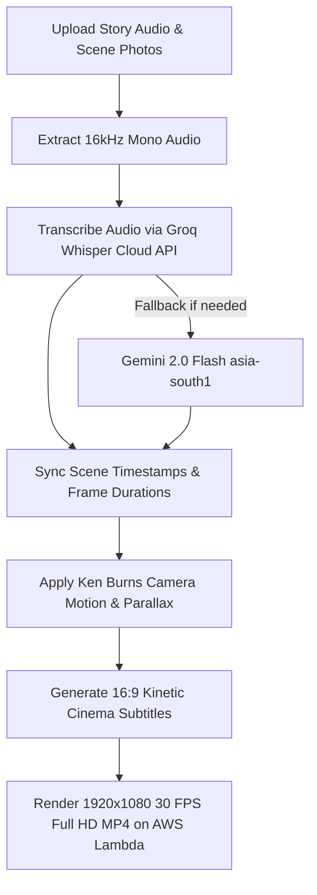

# Image to Video AI (`imagetovideoai.md`)

## 1. Overview & Purpose
**Image to Video AI** is Itnavideo's flagship cinematic narrative & story video creator. Its **primary use case is visual story creation, user narrative storytelling, and cinematic explainers**. It transforms user-uploaded voiceover narration audio, script stories, and character references into a cohesive 16:9 widescreen cinema-grade story video. It incorporates subtle Ken Burns camera motion (pan/zoom), smooth cross-dissolve scene transitions, and timed 2.5D frosted subtitles. (Note: External Pexels API fallback is completely removed; all visuals are generated directly via Vertex AI Imagen 3 / Gemini 2.0 or selected from the curated local Itnavideo library).

---

## 2. Key Specifications & Limits

| Attribute | Specification |
| :--- | :--- |
| **Video Type ID** | `image-to-video` / `IMAGE_TO_VIDEO_AI` |
| **Composition ID** | `IMAGE-TO-VIDEO-AI` |
| **Template Location** | `remotion/templates/IMAGE_TO_VIDEO_AI/template.tsx` |
| **Dashboard Studio** | `components/dashboard/ImageToVideoStudio.tsx` |
| **Dashboard Route** | `/dashboard/image-to-video` |
| **Aspect Ratio** | 16:9 Cinema Widescreen |
| **Resolution & Quality** | **1920×1080 (1080p Full HD)** |
| **Frame Rate** | 30 FPS |
| **Max Audio Duration** | Up to **5 minutes** (300 seconds) strictly per Rule 4.1 |
| **Primary Category** | Cinema, Narrative Stories & Explainers |
| **Credit Cost** | **1 Min = 1 Credit** (1m=1, 2m=2, 3m=3, 4m=4, 5m=5 Cr) per Rule 4.1 |
| **Design System** | Clean White Studio Design (`bg-white`, `border-slate-200`, `text-slate-900`, `bg-slate-50`) + Pure White Canvas (`#FAFAFA` with delicate dot grid texture and warm ambient blooms). |
| **Speech Transcription** | Extracted 16kHz audio → Groq Whisper Cloud API (Fallback: Gemini 2.0 Flash `asia-south1`) |
| **Cloud Engine** | AWS Lambda (Remotion in `us-east-1` Mumbai) |

---

## 3. User Inputs & Dashboard Workflow (7 Comprehensive Steps)

1. **Step 1 — Your Audio / Story Narration (Required)**:
   - Upload voiceover narration audio (MP3, WAV, M4A, AAC — 5 min max). Raw video is never sent directly to Groq; lightweight 16kHz mono audio is extracted first.
   - Live aesthetic waveform visualizer with interactive bar scrubbing, play/pause audition, and accurate duration detection.
   - Automatic Groq Whisper cloud speech transcription with Gemini 2.0 fallback.

2. **Step 2 — Scene Photos & Visuals (Up to 100 Photos)**:
   - Bulk drag-and-drop up to 100 scene photos in one action.
   - Interactive timeline sequence with click-to-preview in video player, delete, and 1-click replace.
   - Responsive multi-column thumbnail grid (2 cols mobile, 3-4 cols tablet/laptop/desktop).
   - Zero manual typing required.

3. **Step 3 — 32 Master YouTube Caption Styles**:
   - 32 high-contrast animated caption styles (`THIRTY_TWO_CAPTION_STYLES`) matching industry-standard short/long-form styles (Pop Word, Karaoke Line, Box Highlight, Neon Glow, Typewriter, Slam Headline, Hormozi Viral Pop, MrBeast Shorts Impact, etc.).
   - Clean, subtle rounded rectangular boxes (`rounded-lg`, 8px corner radius) with 1px border.
   - Search bar to filter across all 32 styles instantly.
   - Collapsible accordion (closed by default on initial page load to keep studio clean and uncluttered).
   - Rendered using `UniversalCaptionLayer` with dynamic colors and fonts.

4. **Step 4 — Background Music & Audio Engine**:
   - AWS S3 curated library background tracks (`AWS_BGM_TRACKS`) with instant play/pause audition.
   - Dynamic volume slider (normal initial volume, adjustable 0% to 100%).
   - Waveform audio player with interactive visualizer bars and time scrub sync.

5. **Step 5 — In-Player Cinema Stage & Direct Video Controls**:
   - **Direct In-Canvas Editing**: Click directly on the video subtitle overlay to edit text on the fly.
   - **In-Player Toolbar**: Play/pause, time scrubber, instant photo replacement, framing mode toggle (16:9 Cover vs. Blur-Fill Letterbox), in-player caption style picker popover, BGM volume popover, and camera motion toggle.
   - **Interactive Scene Filmstrip**: Visual thumbnail timeline of all uploaded scene photos with click-to-preview, individual photo replacement, and deletion.

6. **Step 6 — Studio Subtitle Engine & Timestamped Captions Track**:
   - Sentence-by-sentence breakdown with millisecond-accurate timestamps (`startTime` → `endTime`).
   - **Click to Jump (Timeline Sync)**: Clicking any sentence instantly seeks audio and video to that second.
   - **Active Speech Follower**: Lights up the active sentence and auto-scrolls into view during playback.
   - **In-Place Inline Editing**: Edit words and fine-tune start/end timing directly in the list.
   - **Search Bar**: Real-time search across all subtitle segments.
   - **1-Click .SRT Export**: Export industry-standard subtitle file for YouTube, Premiere, or Final Cut.

7. **Step 7 — Full Responsive Support & Mobile Sticky Render Bar**:
   - Clean responsive layout for Desktop, Laptop, Tablet, and Mobile.
   - Touchscreen-friendly controls (edit & delete buttons visible on touchscreens).
   - Mobile Sticky Render Bar: Floating 1-click render CTA on mobile/tablet so creators can trigger video export without scrolling.
   - Desktop layout toggle: 1-click `[ Right Side | Left Side ]` preview orientation switch.
   - Strictly conforms to Rule 0.7: Zero eyebrow pill badges above headlines for a clean enterprise brand aesthetic.

---

## 4. Dedicated Processing Pipeline (UI Stepper)

