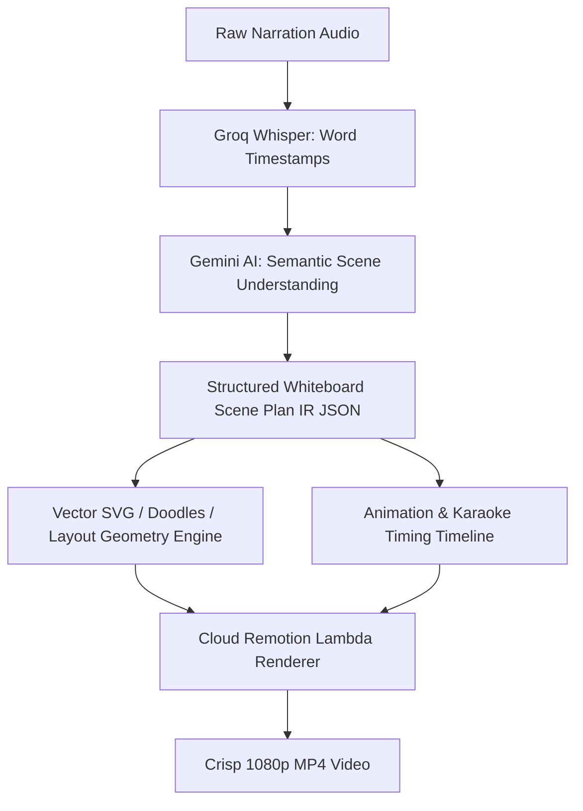

# Whiteboard Animation Video (`whiteboardvideo.md`)

## 1. Overview & Purpose
**Whiteboard Animation Video** uses a light CSS canvas with crisp handwriting typography, structured text, animated SVG diagrams, vector arrows, and marker highlights. No board-photo background or raster icon is rendered.

---

## 2. Key Specifications & Limits

| Attribute | Specification |
| :--- | :--- |
| **Video Type ID** | `whiteboard-video` / `WHITEBOARD_VIDEO` |
| **Composition ID** | `WHITEBOARD_VIDEO` |
| **Template Location** | `remotion/templates/WHITEBOARD_VIDEO/template.tsx` |
| **Dashboard Studio** | `components/dashboard/WhiteboardStudio.tsx` |
| **Dashboard Route** | `/dashboard/whiteboard-video` |
| **Aspect Ratio** | Strictly **9:16 Vertical Shorts** Only (16:9 completely removed) |
| **Resolution & Quality** | **1080×1920 (9:16)** Full HD @ 30 FPS |
| **Frame Rate** | 30 FPS |
| **Max Video Duration** | **Up to 90 Seconds (90s)** (Master Rule 4.1) |
| **Primary Category** | Explainer & Shorts/Reels |
| **Credit Cost** | **1 Credit** per render (Master Rule 4.1) |
| **Design System** | Light CSS canvas (`#F1F5F9` / `#FFFFFF`) + high-contrast marker colors + SVG stroke drawings |
| **Transcription Engine**| Extracted 16kHz audio → Groq Whisper Cloud API (Fallback: Google Gemini 2.0 Flash `asia-south1`) |
| **AI Scene Director** | Groq Cloud LLM (`qwen/qwen3.8-27b`) + Semantic Storyboard Scene Director (Fallback: Gemini / Rule Engine) |

---

## 3. User Inputs & Smart AI Whiteboard Styling

1. **Narration Audio Track (Required)**:
   - Explainer voiceover, business pitch, or tutorial audio track (MP3/WAV/M4A up to 90 seconds).
2. **Pre-Render Transcript Review & Edit (New)**:
   - Audio is transcribed in 2 seconds via Groq Whisper Cloud.
   - User can review and edit text, spelling, proper nouns, and numbers before rendering.
   - AI uses the user's verified transcript for scene planning and diagram layout.
3. **Fixed Light CSS Canvas (Default)**:
   - A clean pale CSS gradient with a subtle border and soft shadow. No whiteboard photo, bitmap texture, or room background.
4. **Writing Typography Personalities**:
   - `Marker` (✍️ Natural handwritten look — Default)
   - `Clean` (📋 Professional whiteboard)
   - `Bold` (📢 High-impact presentation)
   - `Blueprint` (📐 Technical drafting style)
5. **Script-Driven Dynamic Drawing & Text System (Zero Static Images)**:
   - **No Static/Cutout Images**: Use progressive **SVG Vector Stroke Drawings** and readable text. The background is CSS-only; point and table icons render as SVG.
   - **SVG on every written line**: Board titles, transcript points, and takeaways receive a semantic library drawing (or safe concept fallback); all paths reveal with deterministic stroke-dash animation synced to their narration timing. Whiteboard mode ignores raster icon URLs.
   - **Script Semantics Matching**: Drawings and handwritten text are selected automatically based on narration topic:
     - 🩺 **Medical & Health**: Doctor character, ECG heart rhythm (`medical_ecg_pulse`), pill capsule (`medical_pill_capsule`), DNA helix (`medical_dna_helix`).
     - 📈 **Corporate & Business**: Executive leader, rising bar chart (`business_growth_chart`), target bullseye (`business_target_bullseye`), partnership handshake (`business_handshake`).
     - 🔬 **Science & Education**: Atom orbits (`science_atom_orbit`), chemistry flask (`science_beaker_flask`), lightbulb concept (`science_lightbulb_idea`).
     - 🔄 **Process & Steps**: Curved step connector arrows (`process_step_curved_arrow`), conversion funnel (`process_funnel_filter`).
     - ⚖️ **Comparison (Problem vs Solution)**: Mistake cross (`comparison_cross_error`) vs success checkmark (`comparison_checkmark_success`).
     - 👤 **Story Characters**: Doctor, business executive, thinking/questioning person, victory celebration.
6. **AI Semantic Content Taxonomy (Automatic Layout Mapping)**:
   The Gemini Scene Planner automatically classifies speech beats into optimal visual layouts:
   - 📌 **Core Insight / Paragraph**: Punchy key statement + focal vector sketch.
   - 📋 **Checklist / Bullet Points**: Structured checked/numbered items with progressive marker reveals.
   - 🔢 **Steps / Framework**: `Step 01: IDEA 💡` ➔ `Step 02: VALIDATE ✓` ➔ `Step 03: BUILD 🚀`.
   - ⚖️ **Comparison**: `OLD ❌ vs NEW ✓` contrast cards with real-time vector markers.
   - 📊 **Statistic / Metric**: Bold high-impact number callout (`40% SURGE 📈`) with growth chart sketch.
   - 🔄 **Process / Pipeline**: Step-by-step vector arrows (`INPUT ➔ PROCESS ➔ RESULT`).
   - 📖 **Definition**: `TERM ↓ 3-word meaning` with focus underline.
   - ❓ **Question / Hook**: Big focal question with timed answer reveal.
   - 💡 **Story / Example**: Highlighted keywords with contextual character illustration.
7. **Subtle Marker & Drawing Sound Design (SFX)**:
   - ✍️ **Pen / Marker Sketching Sound** (volume: 30%) automatically synchronized during line reveals.
   - 🖊️ **Marker Cap Soft Click** (volume: 25%) on initial board introduction.
   - 💨 **Board Swipe / Paper Whoosh** (volume: 35%) on multi-board transitions.
8. **Multi-Board Auto-Erase & Pagination (Up to 90 Seconds / 90s)**:
   - Maximum 3–4 points per board to preserve 9:16 vertical canvas readability.
   - Longer videos (30s-90s) automatically distribute points across up to 3 sequential boards.
   - Smooth animated horizontal duster wipe sheen and swipe audio effect on board transitions.

---

## 4. Decoupled Intermediate Representation (IR) Architecture

> [!IMPORTANT]
> **Decoupled AI Thinking & Render Engine**:
> AI (Gemini / Whisper) never renders pixels directly. Instead, it generates a clean, structured **Whiteboard Scene Plan IR (Intermediate Representation JSON)**. The Remotion renderer on AWS Lambda strictly consumes this Scene Plan JSON.
> This ensures:
> 1. Complete separation of AI logic from video rendering.
> 2. Swappable renderer engine without modifying AI planning models.
> 3. 100% deterministic, testable, and inspectable scene graphs.



### UI Stepper Stages:
1. **Transcribing Audio**: Groq Whisper extracting word timestamps & speech pacing.
2. **Understanding Content**: AI analyzing semantics to detect steps, stats, comparisons & key takeaways.
3. **Planning Visual Scenes**: Gemini AI generating the structured Intermediate Scene Plan JSON.
4. **Syncing Vector Drawings**: Synchronizing progressive line reveals & karaoke highlighting with narration.
5. **Rendering 1080p Video**: Cloud Remotion Lambda exporting crisp 1080×1920 Full HD MP4.

---

## 5. Remotion Composition Props

```typescript
export type WhiteboardPoint = {
  text: string;
  title?: string;
  startTime: number;      // When vector card/line starts drawing (seconds)
  endTime: number;        // When vector card finishes drawing (seconds)
  focusStartTime: number; // Spoken speech window start (yellow highlighter box)
  focusEndTime: number;   // Spoken speech window end
  markerColor: string;    // Navy (#1E3A8A), Crimson (#B91C1C), Teal (#0F766E), Amber (#D97706)
  bulletType: 'number' | 'bullet' | 'check' | 'arrow' | 'star';
  isHighlight?: boolean;
  icon?: string;          // Cloudinary doodle icon name (brain, rocket, lightbulb, target, chart, etc.)
  iconUrl?: string;       // Direct CDN URL
  boardIndex: number;     // Multi-board pagination index: 0, 1, 2, 3, 4
  focusType: 'circle' | 'underline' | 'box' | 'arrow' | 'highlight';
};

export type WhiteboardPlan = {
  title: string;
  titleColor: string;
  layoutType: 'cards' | 'table' | 'quiz' | 'hook';
  language: 'ur' | 'hi' | 'en';
  direction: 'rtl' | 'ltr';
  points: WhiteboardPoint[];
  conclusion: string;
  conclusionTime: number;
  source: 'gemini' | 'deterministic';
};

export interface WhiteboardVideoProps {
  mediaSrc: string;
  mediaType: 'audio' | 'video';
  durationSeconds: number;
  title: string;
  titleColor?: string;
  layoutType?: 'cards' | 'table' | 'quiz' | 'hook';
  points: WhiteboardPoint[];
  conclusion?: string;
  conclusionTime?: number;
  boardStyle?: string;
}
```

---

## 6. Drawing & Hand-Sketch Motion Rules
- **Progressive Stroke Reveal**: SVG paths and vector lines use frame interpolation with a 1.18x safety buffer (`strokeDasharray = ceil(len * 1.18)`) and progress clamping $[0, 1]$ to eliminate vector stroke pop-ins on the final frame.
- **Multi-Line Pen Cursor Baseline Tracking**: `<PenCursor />` uses `verticalAlign: 'baseline'` and `transform: translate(2px, calc(0.18em + wobbleY))` to stay anchored to the exact writing baseline across line breaks.
- **Board Auto-Erase Wipe Transition**: When moving across boards (`boardIndex: 0 ➔ 1 ➔ 2`), an animated horizontal duster sheen wipes the canvas clean with an accompanying swipe whoosh SFX.
- **Anti-Cramping Policy**: Maximum 3–4 punchy bullet points per board to ensure crystal-clear 9:16 vertical smartphone readability.

---

## 7. Edge Cases & Safeguards
- **Long Audio (Up to 90 Seconds / 90s / 2,700 Frames)**: Automatically distributed across up to 5 clean board pages by `LAYOUT_AUTO_FIXER`.
- **Pre-Render Transcript Editing**: User can verify and fix any typos before submission to guarantee zero misspellings on the board.
- **Deterministic Offline Fallback**: If Gemini AI experiences rate limits, the deterministic planner extracts key points and calculates timestamped boards instantly.

---

## 8. Pipeline Error Checklist & Auto-Fix Matrix

| Pipeline Stage | Potential Error / Failure | Root Cause | Automated Recovery / Fix | User-Facing Action / Feedback |
| :--- | :--- | :--- | :--- | :--- |
| **1. Audio / Script Input** | `DURATION_TOO_LONG` | Audio exceeds the 90s Whiteboard limit | Preflight validation returns 422 with time limit notice | "Please trim the Whiteboard audio under 90 seconds" |
| **1. Audio / Script Input** | `EMPTY_INPUT_SCRIPT` | User submitted without voiceover or script | Input validation prevents blank job creation | "Please provide either voiceover audio or a script" |
| **2. Transcription** | `GROQ_RATE_LIMIT_429` | Groq Whisper concurrency burst | Seamless failover to Google Gemini 2.0 Flash (`asia-south1`) | Instant zero-downtime transcription |
| **2. Transcription** | `NO_SPEECH_DETECTED` | Audio lacks audible vocal track | Fails with explicit `NO_SPEECH_DETECTED` reason code | "No clear speech detected. Please upload clear narration audio." |
| **3. AI Board Planning** | `GEMINI_JSON_PARSE_ERROR` | LLM returns incomplete or non-JSON response | Fallback to deterministic whiteboard planner (`buildWhiteboardSegments`) | Instant local board cards generated from sentence breaks |
| **4. Icon & Doodle Sync** | `MISSING_ICON_ASSET` | Cloudinary stickman/doodle icon 404 | Auto-substitutes default universal icon (e.g. `lightbulb`, `checkmark`) | Board always renders complete illustrations |
| **5. Stroke Animation** | `STROKE_POP_IN_BUG` | Vector path lengths miscalculated | 1.18x safety buffer (`strokeDasharray = ceil(len * 1.18)`) + progress clamping | Smooth, organic hand-drawing stroke animation |
| **6. Remotion Lambda Render** | `LAMBDA_OOM_OR_TIMEOUT` | Heavy whiteboard SVG drawing timeout | Clamps frameRange to `[0, totalFrames - 1]` and optimizes Lambda concurrency | Fast Full HD 30 FPS MP4 export |
| **6. Remotion Lambda Render** | `FATAL_RENDER_CRASH` | AWS Lambda instance crash | Status route catches error and refunds reserved credits via `releaseReservedRenderUsageFromServer` | Immediate credit refund + retry prompt |
| **7. File Delivery** | `S3_DOWNLOAD_LINK_EXPIRED` | User returns to download link after 48h | Polling status route auto-renews S3 presigned URL on demand | Direct download link re-activated instantly |


---

## 10. Transcription Audit & Real Speech Extraction (Zero Canned Script Guarantee)

### 1. Root Cause Analysis of "Demo Script" Bug
- Previously, `services/ai/whiteboardPlanner.ts` contained 4 hardcoded fallback scripts with generic terms ("Medical emergencies", "Why You Should Save Money?", "Life has uncertainties").
- When AI calls encountered depleted Gemini quotas or Groq language validation errors (`language: "auto"` causing 400 Bad Request), the planner fell back to static demo scripts instead of using the user's spoken words.

### 2. Comprehensive Fixes Applied
1. **Dynamic Spoken Transcript Sentence Parsing**:
   - `services/ai/whiteboardPlanner.ts` now splits the user's uploaded speech transcript directly into dynamic scenes:
     - Spoken words drive `titlePrefix` and `titleAccent`.
     - First key sentence populates the character's thought bubble.
     - Spoken points are dynamically extracted into curly bracket list items.
     - Core speech takeaway forms the center callout statement.
     - Spoken sentences are partitioned into bottom benefit cards.
   - Canned fallback scripts have been completely eradicated.
2. **Groq Language Code Normalization**:
   - Stripped `language: "auto"` to `undefined` in `app/api/reels/transcribe/route.ts` and `services/ai/groqTranscription.ts`, allowing Whisper native auto-detection without 400 Bad Request errors.
3. **Multi-Field Editorial Transcript Wiring**:
   - `app/api/reels/jobs/route.ts` now reads `editorialTranscript`, `editedTranscript`, and `customTranscript` seamlessly.
4. **Audition Playback Fix in Whiteboard Music Drawer**:
   - Increased audition volume from 12% (`0.12`) to a clear, audible 75% (`0.75`) in `WhiteboardMusicDrawer.tsx` so preview playback is easily heard on laptop speakers.
5. **Render Polling & Status Transition**:
   - `WhiteboardVideoPageClient.tsx` verifies `data.done`, `data.state === "ready"`, and `data.outputFile` before completing, eliminating premature resets back to the initial dashboard.
6. **Modern Studio Palette (Electric Royal Blue)**:
   - Migrated Whiteboard studio tabs, preview markers, drawer toggles, and buttons from legacy orange to Electric Royal Blue (`#0066FF` / `#2563EB`).
