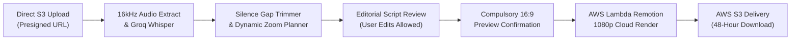

# AI YouTube Video Polisher (`12-ai-video-polisher`)

> **Single Source of Truth** for the 16:9 Widescreen YouTube Video Polishing & Auto-Editing Workflow in [Itnavideo](https://www.itnavideo.com).
> Engineered for YouTube creators, vloggers, educators, podcasters, and multi-take shoots that need publication-ready jump-cuts, dynamic punch-in zooms, and picture-in-picture graphics.

---

## 1. Overview & Purpose

**AI YouTube Video Polisher** (`aiVideoPolisher`) takes raw recorded video footage and automatically produces a broadcast-quality 16:9 widescreen video (`1920×1080` @ 30 FPS MP4) up to 5 minutes long.

It automates the tedious post-production steps that YouTubers spend hours doing manually:
1. **Auto Silence & Gap Cutter (Jump Cuts)**: Detects awkward pauses, breath gaps, and silent dead-air, seamlessly cutting them to match snappy modern YouTube pacing.
2. **Smart Camera Punch-Ins (Dynamic Zoom)**: Automatically alternates scale (+10% to +14% punch-in) at sentence boundaries using smooth spring physics, keeping viewer retention high.
3. **Dual-Stream Media Management**:
   - **Primary Full-Screen Media**: Main speaker camera footage, B-roll, or sequential multi-take video clips.
   - **Overlay Graphic Layers (Picture-in-Picture)**: Floating callout images, product screenshots, or secondary reaction videos positioned in the upper-right corner with smooth entrance springs and subtle drop shadows.
4. **50 Widescreen Phrase-Based Caption Styles**: Formats transcript lines into natural 4–8 word phrases positioned across the lower-third with keyword color highlights.
5. **Ducked 12% Background Audio & SFX**: Integrates 13 curated AWS S3 audio tracks or custom user music, automatically ducked to 12% volume during active speech with transition sound effects.
6. **Compulsory Visual Review Gate**: An interactive 16:9 live player simulation with a compulsory confirmation checkbox gating the final render button.

---

## 2. Key Specifications & Limits

| Attribute | Specification |
| :--- | :--- |
| **Video Type ID** | `aiVideoPolisher` / `ai-video-polisher` |
| **Remotion Composition ID**| `AI_VIDEO_POLISHER` |
| **Template Location** | `remotion/templates/AI_VIDEO_POLISHER/template.tsx` |
| **Dashboard Studio** | `components/dashboard/AiVideoPolisherStudio.tsx` |
| **Subpage Client** | `components/dashboard/subpages/AiVideoPolisherPageClient.tsx` |
| **Dashboard Route** | `/dashboard/ai-video-polisher` |
| **Aspect Ratio** | **Strictly 16:9 Widescreen Only** (`1920×1080` Full HD) |
| **Frame Rate** | 30 FPS MP4 |
| **Max Video Duration** | Up to **5 Minutes (300 seconds / 9,000 frames)** |
| **Credit Rate** | **1 Min = 1 Credit** (1m=1, 2m=2, 3m=3, 4m=4, 5m=5 Credits Max) |
| **Primary Media Input** | Single or multiple sequential 16:9 video takes / images (MP4, MOV, WebM, PNG, JPG) |
| **Layer Media Input** | Floating Picture-in-Picture overlay graphics or secondary video clips |
| **Audio Ducking** | Background music defaulted to **12% volume (`0.12`)** during speech |
| **Transcription Engine** | Extracted 16kHz mono audio → Groq Whisper Cloud API (Fallback: Google Gemini 2.0 Flash) |
| **Cloud Render Engine** | AWS Lambda Remotion Engine |
| **Storage & Lifecycle** | AWS S3 with 48-hour secure signed download lifecycle |

---

## 3. Dedicated Internal Components (Rule 8.B.4 Compliance)

Per **Rule 8.B.4 of `AGENTS.md` (Anti-Repetition & Visual Diversity Policy)**, this video type uses dedicated visual components engineered specifically for 16:9 widescreen YouTube aesthetics:

- **Widescreen Lower-Third Captions**: Wide-format text containers designed for 1920×1080 resolution, avoiding vertical reel word flashes.
- **Picture-in-Picture (PIP) Callout Window**: Corner-anchored floating container with spring-loaded scale-in and soft cinematic elevation.
- **Dynamic Camera Punch-In Controller**: Spring-interpolated frame zoom that shifts center coordinates subtly toward the subject.
- **Jump-Cut Transition Blends**: Clean cuts on audio silence thresholds to maintain video pacing without visual warping.

---

## 4. Pipeline Stages & Execution Flow



1. **Upload Staging**: Primary clips and overlay layers upload directly to AWS S3 via presigned multipart URLs, bypassing server payload bottlenecks.
2. **Speech Transcription**: Groq Whisper extracts word-by-word millisecond timestamps from 16kHz mono audio. If rate limits occur, failover routes seamlessly to Google Gemini 2.0 Flash.
3. **Editorial Markdown Editor**: Creators can edit any transcription typos or spelling mistakes directly in the dashboard prior to final rendering.
4. **Pacing & Punch-In Synthesis**: The pipeline calculates silence gaps (< -35dB for > 400ms) and tags dynamic camera zoom punch-in frames (+12%) at sentence breaks.
5. **Compulsory Preview Gate**: The creator views their draft in the 16:9 live preview simulator and checks the confirmation gate to unlock rendering.
6. **Cloud Render & Delivery**: AWS Lambda renders 1080p frames across distributed cores. The completed MP4 is saved to AWS S3 and delivered via a signed download URL.

---

## 5. Remotion Input Props Schema (`inputProps`)

```typescript
export interface AiVideoPolisherProps {
  // Source Media
  mediaUrl: string;                  // Primary video or image URL
  mediaType?: "video" | "image";     // Media type indicator
  additionalClips?: Array<{          // Multi-take sequential clips
    url: string;
    durationInSeconds?: number;
  }>;
  layerMediaUrl?: string;            // Picture-in-Picture overlay media
  layerMediaType?: "video" | "image";
  layerPosition?: "top-right" | "top-left" | "bottom-right";

  // Editing Directives
  autoJumpCuts?: boolean;            // Enable silence gap removal
  dynamicZoom?: boolean;             // Enable +12% camera punch-in
  zoomIntensity?: number;            // Default: 1.12 (12% punch-in)

  // Subtitles & Captions
  transcript?: Array<{
    text: string;
    start: number;
    end: number;
    words?: Array<{ word: string; start: number; end: number }>;
  }>;
  captionStyleId?: string;           // One of 50 kinetic caption presets
  captionFontSize?: number;          // Default: 44px for 16:9 lower-thirds

  // Audio Controls
  backgroundMusicUrl?: string;       // AWS S3 curated track or custom upload
  backgroundMusicVolume?: number;    // Default: 0.12 (12% ducked volume)
  sfxEnabled?: boolean;              // Enable zoom & callout SFX

  // Timeline & Canvas
  durationInFrames: number;          // Clamped up to 9,000 frames (5 minutes)
  fps: number;                       // 30 FPS
  width: number;                     // 1920
  height: number;                    // 1080
}
```

---

## 6. Error Handling & Credit Protection

- **Silence / No Speech Detected**: Full credit refund triggered automatically; user is prompted to upload footage with clear speech.
- **Upload Timeout**: Client-side chunk retries prevent dropped connections. Zero credits deducted if upload fails.
- **Render Worker Failure**: AWS Lambda timeout automatically triggers `releaseReservedRenderUsageFromServer` to restore credits instantly.
- **Expired Download Links**: The status API regenerates a fresh 48-hour presigned S3 download link on demand.

