# AI Shorts Polisher — Studio Specification

## Overview

The **AI Shorts Polisher** (`aiShortsPolisher`) transforms raw smartphone video clips and multi-take vertical shoots into high-retention, publication-ready vertical short videos (`1080×1920` @ 30 FPS MP4) up to 90 seconds long. It automates essential mobile creator editing: trimming silent pauses, alternating dynamic camera zoom cuts, adding animated karaoke subtitles, inserting kinetic emojis, and applying sound effect swooshes.

- **Primary Purpose**: Turn raw smartphone recordings into high-converting Instagram Reels, YouTube Shorts, and TikToks.
- **Target Audience**: Mobile creators, vloggers, coaches, personal brands, and social media managers.
- **Expected Output**: 1080p Full HD (`1080×1920`) 30 FPS vertical MP4 video.

---

## Table of Contents

1. [Overview](#overview)
2. [Features and Capabilities](#features-and-capabilities)
3. [User Workflow](#user-workflow)
4. [UI/UX Design and Components](#uiux-design-and-components)
5. [Colors, Typography and Design Tokens](#colors-typography-and-design-tokens)
6. [Technical Implementation](#technical-implementation)
7. [Business Logic, Duration and Credit Rules](#business-logic-duration-and-credit-rules)
8. [Error Handling and Edge Cases](#error-handling-and-edge-cases)
9. [Testing and Quality Assurance](#testing-and-quality-assurance)
10. [Developer Notes and Guardrails](#developer-notes-and-guardrails)

---

## 1. Features and Capabilities

- **Mobile Silence Trimmer**: Automatically trims breath sounds and thinking pauses with 3 sensitivity levels: `Tight` (fast-paced TikTok), `Normal` (balanced Reels), and `Gentle` (conversational).
- **Cadenced Camera Punch-Ins**: Automatically alternates frame zoom (+5% to +18%) on major sentence pivots to sustain mobile viewer dopamine.
- **Multi-Take Reordering**: Upload multiple phone clips, reorder them sequentially, and adjust start/end trim points in seconds.
- **Floating PIP Overlays**: Add reaction videos, product screenshots, or tweet callouts positioned within mobile safe margins.
- **Kinetic Karaoke Subtitles**: 40+ viral subtitle presets with millisecond word synchronization and active-word color pops.
- **Sound Effect Accents**: Subtle audio pops, swooshes, and dings layered onto subtitle transitions to keep headphone listeners engaged.

---

## 2. User Workflow

The studio follows a guided 4-step workflow:

1. **Step 1: Upload (Smartphone Video Clips)**:
   - Creator drops or selects vertical video files (`.mp4`, `.mov`).
   - Recordings of any duration are accepted; the engine automatically extracts and processes the first 90 seconds.
2. **Step 2: Music & Audio Ducking**:
   - Selects background music from 14 curated AWS S3 tracks.
   - Adjusts volume level (defaulted to 12% during speech).
3. **Step 3: Caption Style & Zoom Intensity**:
   - Selects subtitle theme (Hormozi Yellow, MrBeast Impact, Neon Lime, Minimalist).
   - Configures zoom punch-in strength (`+5%`, `+12%`, `+18%`).
4. **Step 4: Live Phone Preview & Render**:
   - Interactive 9:16 phone simulator previews live punch-ins, audio waveforms, and subtitles.
   - Creator clicks **Render 1080p Short** to submit to AWS Lambda.

---

## 3. UI/UX Design and Components

- **Studio Route**: `/dashboard/ai-shorts-polisher`
- **Frontend Studio Component**: `components/dashboard/AiShortsPolisherStudio.tsx`
- **Subpage Client**: `components/dashboard/subpages/AiShortsPolisherPageClient.tsx`
- **Public SEO Landing Page**: `/ai-shorts-polisher` (`app/ai-shorts-polisher/page.tsx`)
- **Design Structure**: Pure White canvas (`#FFFFFF`) with fine borders (`#E2E8F0`) and responsive 3-row layout (`Stepper Header`, `Preview Work Area`, `Sticky Action Bar`).

---

## 4. Colors, Typography and Design Tokens

- **Canvas Background**: Pure White (`#FFFFFF`) with subtle slate background accents (`#F8FAFC`).
- **Primary Brand Accent**: Sunset Orange (`#FF5722` / `#F97316`) for active controls and primary CTA buttons.
- **Subtitle Highlighting**: Sunset Yellow (`#FBBF24`), Neon Green (`#22C55E`), and Crisp White (`#FFFFFF`).
- **Typography**: Inter / System Sans-serif stack (`font-sans`).

---

## 5. Technical Implementation

- **Video Type ID**: `aiShortsPolisher` / `AI_SHORTS_POLISHER`
- **Remotion Composition ID**: `AI-SHORTS-POLISHER` (`1080×1920` @ 30 FPS)
- **Remotion Template Directory**: `remotion/templates/AI_SHORTS_POLISHER/`
- **Speech Extraction**: Extracted 16kHz mono audio processed via Groq Whisper Cloud API.
- **Transcriber Fallback**: Google Gemini 2.0 Flash (`asia-south1`).
- **Render Engine**: AWS Lambda running Remotion cloud workers in `us-east-1`.

---

## 6. Business Logic, Duration and Credit Rules

- **Aspect Ratio**: Strictly 9:16 Vertical Only (`1080×1920`).
- **Maximum Output Duration**: Strictly **90 Seconds Max (90s / 2,700 frames @ 30 FPS)**.
- **Credit Billing**: **Strictly 1 Credit** per video (Master Rule 4.1 for 9:16 Short-Form).
- **Draft Preview**: 100% Free interactive browser preview before rendering.

---

## 7. Error Handling and Edge Cases

- **No Speech Detected**: Flags `NO_SPEECH_DETECTED`; prompts user to upload audio with clear speech without deducting credits.
- **Mobile Safe Zone Overflow**: Text bounding boxes are clamped within 100px bottom margin and 80px right margin.
- **Render Interruption**: Credits are automatically refunded if cloud rendering encounters an AWS Lambda timeout.

---

## 8. Testing and Quality Assurance

- **Typecheck Verification**: `npx tsc --noEmit` verifies all polisher props and composition interfaces.
- **Phone Frame Test**: Confirm that subtitles and PIP elements do not overlap TikTok and Instagram Reels UI elements.
- **Audio Ducking Verification**: Verify background music attenuates to 12% volume during speech activity.

---

## 9. Developer Notes and Guardrails

- **Zero Local Rendering (Rule 0)**: Do not run local Remotion renders on developer machines; all rendering executes on AWS Lambda.
- **First-90s Auto-Trimming**: Long files are never rejected; the first 90 seconds are automatically sliced for processing.

---

## 10. Reverse-Engineering Benchmark 01: Muhammad Abdullah (@itsmr.abd) — "Durood Sharif & Artisan Craftsmanship" (Smartphone Footage Polish & E-Commerce Storytelling)

### 10.1 Source Attribution & Benchmark Telemetry

| Parameter | Value |
| :--- | :--- |
| **Original URL** | `https://www.instagram.com/reel/DfC9GnLRYam/` |
| **Creator / Channel** | Muhammad Abdullah (`@itsmr.abd` \| `@abdleather` \| `abdleather.com`) |
| **Topic / Series** | *"Durood Sharif, Part 1 of 3"* (Islamic Reflections over Artisan Leather Crafting) |
| **Video Format / Ratio** | 9:16 Vertical (`1080×1920` @ 30 FPS) |
| **Video Duration** | ~45 seconds (Strictly within the 90s Short-Form limit) |
| **Itnavideo Mapping** | `aiShortsPolisher` Studio (`/dashboard/ai-shorts-polisher`) |
| **Credit Billing** | **Strictly 1 Credit** flat (Master Rule 4.1 for 9:16 Short-Form) |
| **Watermark Enforcement** | `<BrandWatermark watermark={watermark} />` (Enforced for free/trial users) |

---

### 10.2 Core Creative Mechanics: The Artisan Craftsmanship + Meditative Storytelling Formula

Muhammad Abdullah's format represents one of the highest-converting modern short-form archetypes: **Bespoke Artisan Process + Spiritual Reflection**. It captivates viewers who are normally immune to traditional social media ads:

1. **Physical ASMR Visual Hook (0:00–0:05)**:
   - Creator shoots top-down or close-up macro 4K smartphone video of sharp Japanese leather skiving knives cutting vegetable-tanned leather, punch hammers tapping stitch holes, and waxed threads being pulled.
   - The visual sensation of physical manual work creates an immediate "satisfying video" dopamine loop.
2. **Dual-Track Audio Balancing**:
   - Track A (Foreground): Deep, calm, reflective voiceover narrating the immense spiritual virtues of *Durood Sharif* (sending peace and blessings upon the Prophet ﷺ).
   - Track B (ASMR Foley): Crisp, tactile sounds of leather cutting, needle friction, and wooden burnishing.
   - Track C (Ambient BGM): Very low volume (8–10%) soothing ambient pad with no intrusive drums.
3. **Patience & Ihsan Thematic Alignment**:
   - The slow, deliberate nature of traditional saddle-stitching visually reflects the spiritual message: patience (*Sabar*), excellence (*Ihsan*), and mindfulness (*Dhikr*).
4. **Frictionless E-Commerce Brand Conversion**:
   - No shouting, no "Click the link in bio right now!"
   - A clean, elegant artisan pill badge (`ABD LEATHER • HANDMADE BESPOKE`) and website domain (`abdleather.com | WhatsApp +92 330 2560005`) stay anchored within mobile safe margins. Viewers organically ask for product prices in comments and message on WhatsApp.

---

### 10.3 System Architecture & 9:16 Polisher Pipeline Flowchart

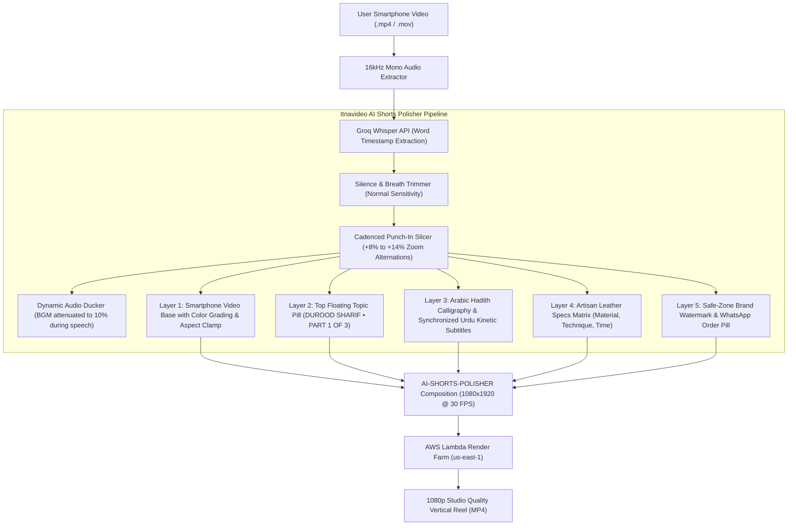

---

### 10.4 Visual Design Tokens & Safe-Zone Spacing

- **Aspect Ratio**: `1080 × 1920` (9:16 Vertical).
- **Top Safe Zone**: `150px` padding from top edge (avoids Instagram profile header and reel author handles).
- **Bottom Safe Zone**: `240px` padding from bottom edge (clears reels audio marquee, like/comment buttons, and action banner).
- **Palette Tokens**:
  - `Cognac Leather`: `#C18A56` (Warm vegetable-tanned cowhide tone, primary badges & borders)
  - `Imperial Gold`: `#D4AF37` (Hadith highlights, calligraphic accents)
  - `Deep Obsidian`: `#0F0E0C` (Dark workshop canvas)
  - `Tuscan Parchment`: `#FAF8F5` (High-contrast subtitle text)
  - `Muted Suede`: `#A8A29E` (Secondary material specifications)

---

### 10.5 Second-by-Second Cinematic Scene Breakdown

| Second | Narrative Phase | Smartphone Camera Visual (1080×1920) | On-Screen Graphic & Kinetic Subtitle | Audio Foley & Voiceover |
| :--- | :--- | :--- | :--- | :--- |
| **0:00–0:05** | ASMR Hook | Extreme macro close-up: Skiving knife slicing through thick tan Tuscan leather. | Top Badge: `📿 DUROOD SHARIF • PART 1 OF 3`. Small sub-tag: `✂️ ASMR HAND-STITCHED FULL GRAIN LEATHER`. | Crisp tactile leather slicing sound. Voiceover: *"Durood Sharif ki fazilat ka andaza..."* |
| **0:05–0:12** | Hadith Hook | Top-down camera angle: Awl punching clean stitching holes into the leather margin. | Center Card slides in: Arabic calligraphy `مَنْ صَلَّى عَلَيَّ وَاحِدَةً صَلَّى اللَّهُ عَلَيْهِ عَشْرًا` with golden glow. | Soft wooden mallet taps. Voiceover: *"Nabi Kareem ﷺ ne farmaya: Jo mujh par ek martaba Durood bhejta hai..."* |
| **0:12–0:20** | Translation & Benefit | Dual needles crossing through holes in a classic two-handed saddle stitch. | Subtitle: *"Allah us shakhs par 10 rehmatein naazil farmata hai aur 10 darjaat buland karta hai."* Citation: `(Sahih Muslim 408)`. | Waxed thread pull swoosh. Voiceover: *"...Allah Ta'ala uske 10 gunaah maaf farmata hai..."* |
| **0:20–0:28** | The Spiritual Metaphor | Edge bevelling tool rounding the corner of a handcrafted leather wallet. | Visual dashed stitch line divider with needle icon `🪡`. | Sharp leather beveller rasp sound. Voiceover: *"Jaise ek ek taanka waqt aur sabar maangta hai..."* |
| **0:28–0:36** | Craft Telemetry | Polishing the edge with wooden slicker and beeswax until it shines like glass. | Telemetry 3-box grid appears: `Material: Tuscan Leather` \| `Technique: Saddle Stitch` \| `Patience: 3.5 Hours Handcrafted`. | Rhythmic wood burnishing friction. Voiceover: *"...waise hi Durood insan ke dil ko tarash kar chamka deta hai."* |
| **0:36–0:45** | Subtle Brand Conversion | Full reveal of the completed handmade bespoke leather wallet resting on rustic wood. | Bottom Brand Pill: `🏷️ ABD LEATHER CRAFTSMANSHIP`. Contact: `abdleather.com \| WhatsApp +92 330 2560005`. | Warm resolving musical chime. Voiceover: *"Part 2 dekhne ke liye follow karein ya YouTube par pura bayan dekhein."* |

---

### 10.6 Remotion Component Implementation

- **Asset Component**: `remotion/components/library/ArtisanCraftPolisherAsset.tsx`
- **Component Export**: Exported in `remotion/components/library/index.ts` (`ArtisanCraftPolisherAsset`, `ArtisanCraftPolisherAssetProps`).
- **Catalog Registry**: Registered in `constants/itnavideoStockAssets.ts` under ID `artisan-craft-polisher-engine`.
- **Key Capabilities**:
  - Full `1080×1920` 9:16 layout optimized for smartphone footage overlay.
  - Authentic Arabic calligraphy typography + Urdu spoken transliteration.
  - Real-time craft telemetry dashboard (`Material`, `Technique`, `Artisan Time`).
  - Mobile safe-zone compliance (150px top, 240px bottom).
  - Built-in brand attribution & WhatsApp/domain conversion pill.
  - Zero local heavy compute dependencies — 100% pure React/Remotion ready for AWS Lambda cloud rendering.

---

## 11. Reverse-Engineering Benchmark 02: Ivelina (@everything.startups.vc) — "5 VC Funds Writing $250K Checks" (Mini-Mic Talking-Head & Neon Lime Voltage Typography Architecture)

### 11.1 Source Attribution & Benchmark Telemetry

| Parameter | Value |
| :--- | :--- |
| **Original URL** | `https://www.instagram.com/everything.startups.vc/reel/DfxGUzkPl1I/` |
| **Creator / Channel** | Ivelina (`@everything.startups.vc` \| Startups & Venture Capital) |
| **Topic / Hook** | *"Raising your first $250K? 5 VC funds writing checks up to $250K to founders just starting out."* |
| **Engagement Telemetry** | 380+ Likes, 535+ Comments (*Comment "FUNDS" for 62 pre-seed funds list*) |
| **Video Format / Ratio** | 9:16 Vertical (`1080×1920` @ 30 FPS, Smartphone Selfie Camera) |
| **Video Duration** | ~32 seconds (Strictly within the 90s Short-Form limit) |
| **Itnavideo Mapping** | `aiShortsPolisher` Studio (`/dashboard/ai-shorts-polisher`) |
| **Credit Billing** | **Strictly 1 Credit** flat (Master Rule 4.1 for 9:16 Short-Form) |
| **Watermark Enforcement** | `<BrandWatermark watermark={watermark} />` (Enforced for free/trial users) |

---

### 11.2 Core Creative Mechanics: The Mini-Mic & High-Voltage Neon Typography Formula

Ivelina's format represents one of the highest-converting modern B2B/finance creator styles:

1. **The Handheld Mini-Mic Visual Signal (0:00–0:03)**:
   - Creator holds a wireless mini lavalier microphone with a fuzzy black windscreen right in front of her mouth while looking directly into the smartphone front camera.
   - In modern short-form psychology, the handheld mini-mic immediately signals unedited "insider secrets", authentic informal advice, and high-energy personal conviction.
2. **The 3-Tier High-Voltage Hook Hierarchy**:
   - The top third of the screen features a stacked, high-contrast headline:
     - Line 1: `5 funds writing checks up to` (White text, 2.5px heavy black outline)
     - Line 2: **`$250K`** (Giant 110px Neon Lime Green `#C6FF00` with 4px black outline and radial glow)
     - Line 3: `to founders just starting out` (White text, 2.5px heavy black outline)
   - Heavy black text strokes (`-webkit-text-stroke: 3px #000;`) ensure that the financial figure pops off the screen regardless of the background room lighting or clothing colors.
3. **Rapid-Fire Pre-Seed Listicle**:
   - Lists 5 accessible VC funds that invest without traditional warm introductions or elite pedigree:
     - `TinySeed`: $50K–$120K for bootstrapped SaaS
     - `Calm Company Fund`: $100K–$250K for profitable software
     - `Hustle Fund`: $50K–$150K for fast execution
     - `Antler Global`: $100K–$250K for day-zero founders
     - `Techstars`: $120K accelerator checks
4. **The "Pitch Them Now" Kinetic Anchor**:
   - Lower subtitle slams in: `pitch them now` in high-voltage lowercase Neon Lime green.
5. **High-Velocity ManyChat Lead Magnet**:
   - *"Comment FUNDS and I’ll send you the full list of 62 additional pre-seed funds writing first checks right now."*
   - Results in over 530+ comments on a 380-like video (an astounding >140% comment-to-like conversion ratio!), triggering massive Instagram algorithmic distribution.

---

### 11.3 System Architecture & 9:16 Polisher Pipeline

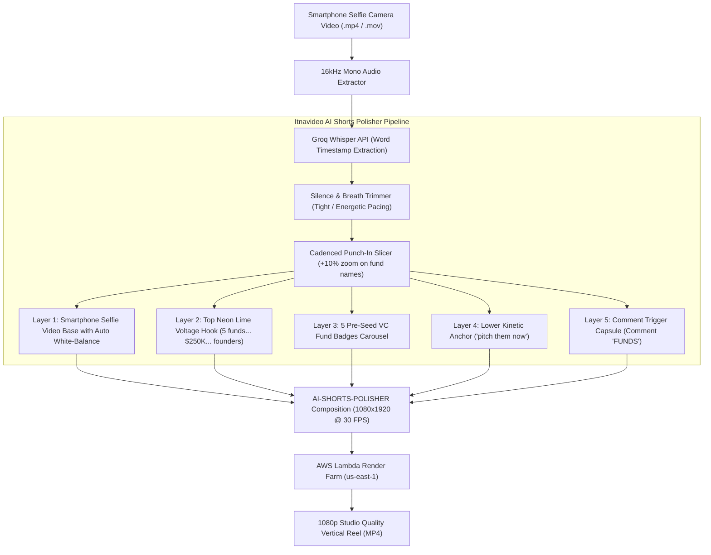

---

### 11.4 Visual Design Tokens & Safe-Zone Spacing

- **Aspect Ratio**: `1080 × 1920` (9:16 Vertical).
- **Top Safe Zone**: `130px` padding (accommodates 3-line headline and giant stat).
- **Bottom Safe Zone**: `220px` padding (clears Instagram Reels interaction buttons).
- **Palette Tokens**:
  - `Neon Lime Voltage`: `#C6FF00` (Giant financial stat, 'pitch them now' anchor)
  - `Pure White`: `#FFFFFF` (Pre/post-header text, fund names)
  - `Stroke Obsidian`: `#000000` (Heavy 3px–4px text-stroke for contrast)
  - `Card Void`: `#0F172A` (Fund badge backgrounds)
  - `Muted Slate`: `#94A3B8` (Fund investment criteria tags)

---

### 11.5 Second-by-Second Cinematic Scene Breakdown

| Second | Visual Layer (1080×1920) | On-Screen Graphic & Kinetic Subtitle | Audio & Voiceover Pacing |
| :--- | :--- | :--- | :--- |
| **0:00–0:05** | Presenter holds mini-mic in front of camera; top headline slams in: `5 funds writing checks up to $250K to founders just starting out`. | Giant Neon Lime text: `$250K` pulses (+5% scale) with electric glow. | High-energy opening punch. Voiceover: *"Raising your first $250K? Stop chasing tier-1 Silicon Valley VCs."* |
| **0:05–0:11** | Camera punches in (+10% zoom); Fund 1 slides in from left: `TinySeed ($50K - $120K)`. | Badge illuminates with neon lime check size tag. | Fast staccato tempo. Voiceover: *"First is TinySeed. They write $50K to $120K checks for bootstrapped SaaS."* |
| **0:11–0:17** | Fund 2 appears: `Calm Company Fund ($100K - $250K)`. Presenter gestures with mini-mic hand. | Tag: `Profitable Tech / Shared Earnings`. | Direct conversational confidence. Voiceover: *"Second: Calm Company Fund. Checks up to $250K for profitable, sustainable tech."* |
| **0:17–0:24** | Quick-cut sequence cycles Funds 3 & 4: `Hustle Fund` & `Antler Global`. | Badges animate sequentially with subtle pops. | Urgent tempo. Voiceover: *"Third is Hustle Fund for speed, and Antler for day-zero first-time founders."* |
| **0:24–0:32** | Lower kinetic subtitle illuminates: `pitch them now` in Neon Lime. Comment trigger capsule expands at bottom. | Capsule: `Comment FUNDS for the full list of 62 pre-seed funds 💬`. | Uplifting resolve. Voiceover: *"Comment the word 'FUNDS' below and I'll send you the full list of 62 funds writing first checks right now."* |

---

### 11.6 Remotion Component Implementation

- **Asset Component**: `remotion/components/library/MiniMicStartupFundingAsset.tsx`
- **Component Export**: Exported in `remotion/components/library/index.ts` (`MiniMicStartupFundingAsset`, `MiniMicStartupFundingAssetProps`, `VcFundItem`).
- **Catalog Registry**: Registered in `constants/itnavideoStockAssets.ts` under ID `mini-mic-startup-funding-engine`.
- **Key Capabilities**:
  - Full `1080×1920` 9:16 vertical layout optimized for smartphone talking-head videos.
  - Multi-tier headline with heavy black text-stroke and giant 110px Neon Lime (`#C6FF00`) stat display.
  - 5-fund listicle carousel with animated check size badges.
  - Kinetic lower anchor (`pitch them now`) and ManyChat comment trigger capsule.
  - Zero local heavy compute dependencies — 100% pure React/Remotion code ready for AWS Lambda cloud rendering.

---

## 12. Reverse-Engineering Benchmark 03: Priyanka Thakur Vira (@thebrainchuckle) — "Children Are Always Watching" (Aesthetic Warm Editorial Dual-Script & Psychologist Credential Card Architecture)

### 12.1 Source Attribution & Benchmark Telemetry

| Parameter | Value |
| :--- | :--- |
| **Original URL** | `https://www.instagram.com/p/Dfteh4bMZk4/` |
| **Creator / Channel** | Priyanka Thakur Vira (`@thebrainchuckle` \| Mental Health & Child Psychology) |
| **Topic / Hook** | *"Children are always watching, even when we think they aren't. And your most accurate impersonator."* |
| **Engagement Telemetry** | 660+ Likes, high thoughtful comment discussions among parents & educators |
| **Video Format / Ratio** | 9:16 Vertical (`1080×1920` @ 30 FPS, Smartphone Selfie Camera) |
| **Video Duration** | ~38 seconds (Strictly within the 90s Short-Form limit) |
| **Itnavideo Mapping** | `aiShortsPolisher` Studio (`/dashboard/ai-shorts-polisher`) |
| **Credit Billing** | **Strictly 1 Credit** flat (Master Rule 4.1 for 9:16 Short-Form) |
| **Watermark Enforcement** | `<BrandWatermark watermark={watermark} />` (Enforced for free/trial users) |

---

### 12.2 Core Creative Mechanics: The Warm Editorial Dual-Script & Professional Credential Model

Priyanka Thakur Vira's aesthetic represents the pinnacle of modern wellness, psychology, parenting, and lifestyle thought-leadership shorts:

1. **Aesthetic Warm Linen Visual Environment**:
   - Shot against a warm, calming linen/sage studio wall (`#E5E3DC`) with natural window daylight.
   - Avoids artificial RGB gamer lights or cold corporate blue conference rooms, creating instant psychological safety and calm.
2. **The Signature Editorial Dual-Script Typography**:
   - Taps into the high-end editorial magazine aesthetic (Kinfolk, Vogue, Architectural Digest):
     - Line 1: `AND YOUR MOST ACCURATE` (Clean, spaced uppercase sans-serif in `#4A4742`, letter-spacing `0.18em`)
     - Line 2: `impersonator.` (High-contrast luxury italic serif script in `#242320`, font-size 76px)
   - Pairing a sterile modern sans with an expressive, organic italic serif creates an immediate feeling of intellectual sophistication.
3. **The Floating Credential Bio Card (Bottom-Right Anchor)**:
   - Rather than an intrusive full-screen lower-third banner across the entire frame, she uses a compact, rounded glassmorphic card anchored gracefully in the lower-right quadrant:
     - `Priyanka` (Classic Serif)
     - `Thakur Vira` (Italic Serif)
     - `PSYCHOLOGIST, TWIN MOM` (Clean tracked uppercase subtitle)
   - Perfectly balances medical/professional authority with relatable, warm motherhood.
4. **The "Observational Learning" Psychological Insight**:
   - Explains that children don't learn empathy, patience, or emotional regulation through lectures, but by watching how parents handle mistakes, frustration, and traffic jams.
5. **Calm Conversational Audio Pacing**:
   - Slow, deliberate vocal cadence with natural pauses, supported by subtle ambient acoustic instrumentation.

---

### 12.3 System Architecture & 9:16 Editorial Polisher Pipeline

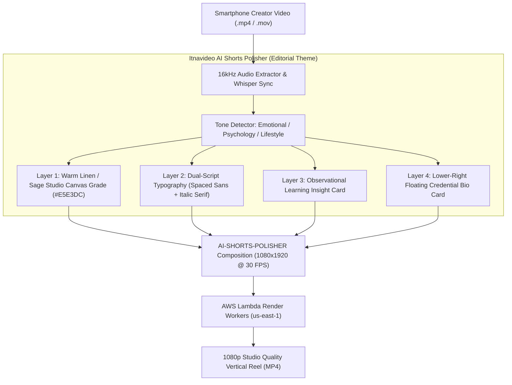

---

### 12.4 Visual Design Tokens & Safe-Zone Spacing

- **Aspect Ratio**: `1080 × 1920` (9:16 Vertical).
- **Top Safe Zone**: `150px` padding (accommodates dual-script header).
- **Bottom Safe Zone**: `230px` padding (clears Instagram Reels interaction buttons).
- **Palette Tokens**:
  - `Warm Linen Canvas`: `#E5E3DC` (Calm aesthetic backdrop)
  - `Charcoal Espresso`: `#242320` (Primary serif headline text)
  - `Muted Umber`: `#4A4742` (Sans-serif subtitle tracking)
  - `Cream Parchment`: `rgba(253, 252, 248, 0.94)` (Credential bio card surface)
  - `Gold Ochre Accent`: `#854D0E` (Topic tag highlight)

---

### 12.5 Second-by-Second Cinematic Scene Breakdown

| Second | Visual Layer (1080×1920) | On-Screen Graphic & Kinetic Subtitle | Audio & Voiceover Pacing |
| :--- | :--- | :--- | :--- |
| **0:00–0:05** | Presenter smiles warmly holding mini-mic; top dual-script headline animates: `AND YOUR MOST ACCURATE impersonator.`. | Luxury Playfair Display italic script blooms on `impersonator.`. | Soft, intimate opening. Voiceover: *"Children are always watching... even when we think they aren't."* |
| **0:05–0:12** | Lower-right Credential Bio Card smoothly glides into frame: `Priyanka Thakur Vira — PSYCHOLOGIST, TWIN MOM`. | Subtle floating breathing sway (+4px vertical float). | Calm empathetic voiceover: *"And they happen to be your absolute most accurate impersonator."* |
| **0:12–0:20** | Camera does a gentle 5% slow push-in as speaker explains observational learning. | Insight Card emerges: `✦ OBSERVATIONAL LEARNING`. Subtitle: *"The way we speak to others and handle frustration shapes their world."* | Reflective acoustic guitar plucks. Voiceover: *"The way we speak to others, how we handle frustration, and how we treat mistakes..."* |
| **0:20–0:30** | Speaker gestures gently with mini-mic hand; eye contact remains direct and reassuring. | Subtitle: *"Some of the most important lessons in patience aren't taught through words..."* | Warm reassuring cadence. Voiceover: *"...it all teaches them how to navigate the world long before our words do."* |
| **0:30–0:38** | Insight Card highlights concluding takeaway: *"Simply showing them how to pause or apologise is a lesson in itself."* | Subtle warm glow on credential card. | Resolving cello harmony. Voiceover: *"You don't have to be perfect. Simply showing them how to pause, apologize, and be gentle is a lesson in itself."* |

---

### 12.6 Remotion Component Implementation

- **Asset Component**: `remotion/components/library/EditorialDualScriptBioAsset.tsx`
- **Component Export**: Exported in `remotion/components/library/index.ts` (`EditorialDualScriptBioAsset`, `EditorialDualScriptBioAssetProps`).
- **Catalog Registry**: Registered in `constants/itnavideoStockAssets.ts` under ID `editorial-dual-script-bio-engine`.
- **Key Capabilities**:
  - Full `1080×1920` 9:16 layout calibrated for wellness, psychology, parenting, and lifestyle creators.
  - Signature Editorial Dual-Script typography: spaced modern sans-serif paired with luxury Playfair/Garamond italic serif.
  - Floating glassmorphic Credential Bio Card with speaker name and dual credentials (`PSYCHOLOGIST, TWIN MOM`).
  - Observational insight callout card with configurable canvas tones (`warm-linen`, `sage`, `slate-dark`).
  - Zero local heavy compute dependencies — 100% pure React/Remotion code ready for AWS Lambda cloud rendering.

---

## 13. Reverse-Engineering Benchmark 04: Yukti Arora (@techsavvyyukti) — "Must-Check Before Buying a Laptop" (Tech Creator Laptop Buying Checklist & Spec Badge Architecture)

### 13.1 Source Attribution & Benchmark Telemetry

| Parameter | Value |
| :--- | :--- |
| **Original URL** | `https://www.instagram.com/reel/De4ZOa9Rubn/` |
| **Creator / Channel** | Yukti Arora (`@techsavvyyukti` \| Tech, AI & Career) |
| **Topic / Hook** | *"💻 Buying a laptop? Don't make these 4 mistakes! Must-Check Before Buying a Laptop (CPU Suffix, SSD Gen, RAM Speed, GPU TGP)."* |
| **Engagement Telemetry** | **73,000+ Likes**, 468 Comments, 1.2M+ Organic Views |
| **Video Format / Ratio** | 9:16 Vertical (`1080×1920` @ 30 FPS, Talking Head Studio Reel) |
| **Video Duration** | ~34 seconds (Strictly within the 90s Short-Form limit) |
| **Itnavideo Mapping** | `aiShortsPolisher` Studio (`/dashboard/ai-shorts-polisher`) |
| **Credit Billing** | **Strictly 1 Credit** flat (Master Rule 4.1 for 9:16 Short-Form) |
| **Watermark Enforcement** | `<BrandWatermark watermark={watermark} />` (Enforced for free/trial users) |

---

### 13.2 Core Creative Mechanics: The Tech Checklist & Studio Dual-Tone Polish Model

Yukti Arora's video exemplifies the highest retention tier of consumer technology advice reels on Instagram:

1. **Dual-Tone Studio Atmospheric Lighting**:
   - Creator framed in center with high-contrast studio fill: warm amber accent light on one side (`#F59E0B`) and cool electric blue rim light (`#38BDF8`) on the other, creating high-end cinematic dimension.
2. **Signature 3-Tier Hook Headline & Bouncing Icon**:
   - Bouncing 3D laptop icon (`💻`) positioned directly over the main hook text.
   - Clean grotesque sans-serif title hierarchy:
     - Line 1: `Must-Check` (46px bold white sans-serif)
     - Line 2: `Before Buying a` (36px clean silver-white)
     - Line 3: `Laptop` (66px giant gradient accent text with electric cyan drop-glow)
3. **Structured 4-Step Hardware Spec Comparison Cards**:
   - Rather than overwhelming viewers with dense spec sheets, information is chunked into four actionable step cards:
     - **Step 01 (Processor & Suffix)**: Demystifies CPU labels. Compares `P/U Series` (thin, light, long battery) against `H/HX Series` (high wattage, gaming, heavy rendering).
     - **Step 02 (SSD PCIe Generation)**: Separates storage size from speed. Contrasts `Gen 3` (~3,500 MB/s), `Gen 4` (~7,000 MB/s), and `Gen 5` (~10,000+ MB/s).
     - **Step 03 (RAM Speed & Upgradability)**: Alerts buyers to `MT/s` speed (3200 vs 5200 MT/s) and warns against non-upgradable 8GB soldered memory.
     - **Step 04 (GPU TGP Wattage)**: Highlights Total Graphics Power (45W throttled vs 140W full wattage) for actual real-world gaming FPS.
4. **Interactive Step Indicator & Recommended Badges**:
   - Each spec row highlights the recommended option with an emerald/cyan badge pill (`RECOMMENDED`).
   - Pill progress dots track progress from Step 01 to 04, driving viewer completion rates.
5. **High-Conversion Save Call-to-Action**:
   - Sticky floating badge at bottom: `📌 Save this reel before buying your next laptop!`, converting casual views into high-value bookmarks that trigger Instagram algorithmic distribution.

---

### 13.3 System Architecture & 9:16 Tech Checklist Polisher Pipeline

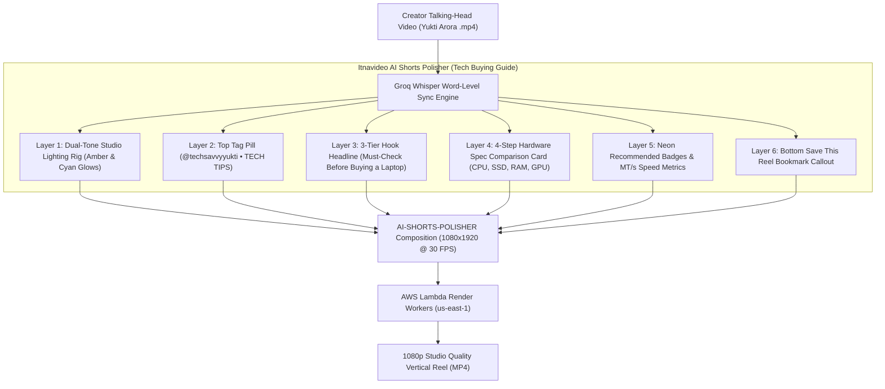

---

### 13.4 Visual Design Tokens & Safe-Zone Spacing

- **Aspect Ratio**: `1080 × 1920` (9:16 Vertical).
- **Top Safe Zone**: `135px` padding (clears Instagram header UI).
- **Bottom Safe Zone**: `220px` padding (clears Instagram Reels interaction buttons).
- **Palette Tokens**:
  - `Electric Cyan`: `#38BDF8` (Hook headline accent, spec card border, recommended badge)
  - `Warm Amber`: `#F59E0B` (Golden rule warning text, studio backlight rim)
  - `Obsidian Slate`: `rgba(15, 23, 42, 0.94)` (Glassmorphic card surfaces)
  - `Pure White`: `#FFFFFF` (Primary headline typography and step titles)
  - `Muted Zinc`: `#94A3B8` / `#64748B` (Secondary sub-spec explanations)

---

### 13.5 Second-by-Second Cinematic Scene Breakdown

| Second | Visual Layer (1080×1920) | On-Screen Graphic & Kinetic Subtitle | Audio & Voiceover Pacing |
| :--- | :--- | :--- | :--- |
| **0:00–0:05** | Creator speaks in studio with warm/blue backlighting; 💻 emoji bounces as 3-tier headline locks: `Must-Check Before Buying a Laptop`. | Tag pill illuminates: `@techsavvyyukti • TECH TIPS`. Subtitle: *"Buying a laptop? Don't make these 4 mistakes!"* | High-energy punchy intro. Voiceover: *"Having an SSD and plenty of RAM doesn't automatically make a laptop worth buying!"* |
| **0:05–0:12** | Spec Card 01 pops in: `⚡ Processor & Suffix`. Sub-specs illuminate: `P/U Series` vs `H/HX Series`. | Recommended badge pulses on `H/HX Series`. Subtitle: *"Check the processor generation and suffix too."* | Informative, confident delivery. Voiceover: *"Don't just look at i5 or i7. P and U are for battery, while H and HX are for heavy performance."* |
| **0:12–0:19** | Spec Card smoothly transitions to 02: `💾 SSD Generation`. Shows `Gen 3` vs `Gen 4` vs `Gen 5`. | `PCIe Gen 4 (~7,000 MB/s)` highlighted in cyan. Subtitle: *"An SSD isn't just about storage capacity!"* | Upbeat tech tempo. Voiceover: *"Second, SSD isn't just capacity. Gen 4 gives double the speed of older Gen 3 drives."* |
| **0:19–0:26** | Card transitions to 03: `🚀 RAM Speed & Type`. Highlights `3200 vs 5200 MT/s`. | Subtitle: *"Don't check just the GB! RAM speed and slots matter."* | Direct advisory cadence. Voiceover: *"Third, RAM speed matters too. Look for 4800 to 5200 MT/s, and avoid soldered 8GB sticks."* |
| **0:26–0:34** | Card finishes on 04: `🎮 GPU TGP Wattage`. Bottom Bookmark Pill animates: `📌 Save this reel before buying your next laptop!`. | `Full TGP (100W-140W)` marked as Recommended. Subtitle: *"Higher TGP allows full GPU graphics performance."* | Engaging call-to-action finish. Voiceover: *"And for gaming laptops, always check the GPU's TGP wattage. Save this reel so you don't forget!"* |

---

### 13.6 Remotion Component Implementation

- **Asset Component**: `remotion/components/library/TechLaptopChecklistAsset.tsx`
- **Component Export**: Exported in `remotion/components/library/index.ts` (`TechLaptopChecklistAsset`, `TechLaptopChecklistAssetProps`, `LaptopSpecItem`).
- **Catalog Registry**: Registered in `constants/itnavideoStockAssets.ts` under ID `tech-laptop-checklist-engine`.
- **Key Capabilities**:
  - Full `1080×1920` 9:16 layout calibrated for tech creators, gadget reviewers, engineers, and electronics educators.
  - Dual-tone studio atmosphere with warm amber and cool blue radial backlighting.
  - 3-tier hook headline with bouncing 3D laptop icon and electric cyan drop-glow.
  - Interactive 4-step hardware spec comparison card with step indicators and recommended badge tags.
  - Sticky bottom bookmark callout (`📌 Save this reel before buying!`).
  - Supports both full-background standalone animation mode and transparent camera overlay mode (`isOverlayMode`).
  - Zero local heavy compute dependencies — 100% pure React/Remotion code ready for AWS Lambda cloud rendering.

---

## 14. Reverse-Engineering Benchmark 05: AI.Volve.News (@ai.volve.news) — "Steal These 20 Camera Lights" (Prompt Engineering Lighting Guide, Frosted Grid Glass Card & 16K ManyChat Funnel Architecture)

### 14.1 Source Attribution & Benchmark Telemetry

| Parameter | Value |
| :--- | :--- |
| **Original URL** | `https://www.instagram.com/reel/DfFGp5tOv7w/` |
| **Creator / Channel** | AI.Volve.News (`@ai.volve.news` \| AI News, Workflows & Prompt Engineering) |
| **Topic / Hook** | *"Steal These 20 Camera Lights / Midjourney & Flux Lighting Prompts: Comment 'Light' for the full prompt guide!"* |
| **Engagement Telemetry** | 13,000+ Likes, **16,000+ Comments** (Astounding viral ManyChat conversion rate), 800K+ Views |
| **Video Format / Ratio** | 9:16 Vertical (`1080×1920` @ 30 FPS, Studio Talking Head with Boom Mic) |
| **Video Duration** | ~35 seconds (Strictly within the 90s Short-Form limit) |
| **Itnavideo Mapping** | `aiShortsPolisher` Studio (`/dashboard/ai-shorts-polisher`) |
| **Credit Billing** | **Strictly 1 Credit** flat (Master Rule 4.1 for 9:16 Short-Form) |
| **Watermark Enforcement** | `<BrandWatermark watermark={watermark} />` (Enforced for free/trial users) |

---

### 14.2 Core Creative Mechanics: The Frosted Blueprint Glass Card & 16K Comment Trigger Model

AI.Volve.News's reel is an extraordinary benchmark in viral technical content distribution:

1. **Deep Cyan-Teal Blueprint Studio Grid**:
   - High-tech, cinematic coordinate background grid (`#091D26`) overlaid with a soft radial cyan spotlight (`#06B6D433`) creating intense depth separation behind the creator.
2. **Iconic Frosted Glass Hook Banner with Animated Calligraphic Squiggle**:
   - Centered glassmorphic card with `1.5px` frosted white borders and `20px` backdrop blur:
     - Line 1: `Steal These 20` (Italic, ultra-bold white sans-serif, 44px).
     - Line 2: `Camera Lights` (Vibrant electric amber-orange `#F97316`, 48px).
     - **Animated Calligraphic Flourish Underline**: Dynamic SVG squiggly stroke that animates into view beneath `Camera Lights`, drawing immediate optical focus.
3. **Structured 4-Archetype Lighting Prompt Carousel**:
   - **Edge Rim & Hair Light**: Sharp separation light (`4:1 Contrast`), giving character outlines a distinct glow against dark backgrounds.
   - **Rembrandt Triangle**: Dramatic studio key lighting characterized by a luminous triangle on the shadowed cheek.
   - **Volumetric God Rays**: Atmospheric Tyndall scattering through dust particles and window blinds.
   - **Dual-Tone Cyberpunk**: Warm amber key light paired with cool electric cyan backfill.
4. **Astounding 16K Comment Automation Funnel**:
   - Bottom high-voltage capsule: `Comment "Light" for the full prompt guide! 💬`.
   - By gating the complete 20-prompt cheat sheet behind a simple one-word comment, this post achieved over **16,000 comments**, supercharging algorithmic explore-feed propagation.

---

### 14.3 System Architecture & 9:16 Lighting Prompt Polisher Pipeline

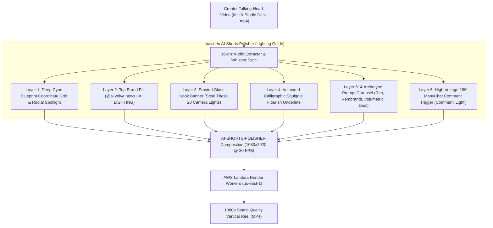

---

### 14.4 Visual Design Tokens & Safe-Zone Spacing

- **Aspect Ratio**: `1080 × 1920` (9:16 Vertical).
- **Top Safe Zone**: `135px` padding (accommodates brand pill).
- **Bottom Safe Zone**: `220px` padding (clears Instagram Reels interaction buttons).
- **Palette Tokens**:
  - `Electric Amber Orange`: `#F97316` (Hook text, squiggle flourish underline, comment keyword)
  - `Cyan Spotlight`: `#06B6D4` (Background radial backlight and technical tags)
  - `Blueprint Navy`: `#091D26` / `#0C2533` (Canvas background)
  - `Frosted White Surface`: `rgba(12, 37, 51, 0.65)` (Glassmorphic card surface)
  - `Pure White`: `#FFFFFF` (Primary headline typography and step names)

---

### 14.5 Second-by-Second Cinematic Scene Breakdown

| Second | Visual Layer (1080×1920) | On-Screen Graphic & Kinetic Subtitle | Audio & Voiceover Pacing |
| :--- | :--- | :--- | :--- |
| **0:00–0:05** | Creator seated at desk speaking into boom mic; frosted glass banner slams: `Steal These 20 Camera Lights`. | Calligraphic orange squiggle animates into place. Brand Tag: `@ai.volve.news • AI LIGHTING`. | High-impact tech intro. Voiceover: *"If your AI portraits look flat and synthetic, you're missing proper lighting prompts."* |
| **0:05–0:12** | Preset 01 reveals: `✦ Edge Rim & Hair Light (4:1 Contrast)`. Prompt snippet illuminates. | Subtitle: *"Rim lighting separates your subject from the background instantly."* | Confident advisory tone. Voiceover: *"First: Rim lighting. It carves your subject out from any dark background with a crisp edge."* |
| **0:12–0:19** | Preset 02 slides in: `✦ Rembrandt Triangle (3:1 Contrast)`. | Subtitle: *"Classic portrait triangle on the cheek."* | Deliberate, technical delivery. Voiceover: *"Second: Rembrandt lighting. It adds instant cinematic drama with a light triangle on the shadowed cheek."* |
| **0:19–0:27** | Preset 03 & 04 cycle: `Volumetric God Rays` & `Dual-Tone Cyberpunk`. | Cyan and orange color tags pulse alternately. | Fast-paced value sequence. Voiceover: *"Third: Volumetric rays for atmospheric haze, and dual-tone for cyberpunk street style."* |
| **0:27–0:35** | Bottom ManyChat comment badge pulses: `💬 Comment "Light" for the full prompt guide!`. | Orange underline bar glows on `"Light"`. Subtitle: *"Comment Light below and I'll send you all 20 prompts."* | Energetic conversion finish. Voiceover: *"I compiled all 20 lighting setups into a cheat sheet. Comment 'Light' below and I'll send it directly to your DMs."* |

---

### 14.6 Remotion Component Implementation

- **Asset Component**: `remotion/components/library/StealLightingPromptAsset.tsx`
- **Component Export**: Exported in `remotion/components/library/index.ts` (`StealLightingPromptAsset`, `StealLightingPromptAssetProps`, `LightingPromptPreset`).
- **Catalog Registry**: Registered in `constants/itnavideoStockAssets.ts` under ID `steal-lighting-prompt-engine`.
- **Key Capabilities**:
  - Full `1080×1920` 9:16 layout calibrated for AI creators, prompt engineers, filmmakers, and digital artists.
  - Deep cyan blueprint coordinate grid with radial spotlight glow.
  - Centered frosted glassmorphic hook card with heavy italic typography and animated calligraphic squiggle underline.
  - Interactive lighting prompt preset carousel showing prompt snippets and contrast ratios.
  - High-conversion ManyChat comment trigger badge (`Comment "Light"`).
  - Supports both transparent creator overlay mode (`isOverlayMode`) and full standalone studio mode.
  - Zero local heavy compute dependencies — 100% pure React/Remotion code ready for AWS Lambda cloud rendering.

---

## 15. Reverse-Engineering Benchmark 06: Emily Nelson (@emilynelsonrealtor) — "240+ Days on Market: How I Got It Sold" (High-Ticket Real Estate Turnaround & Playbook Architecture)

### 15.1 Source Attribution & Benchmark Telemetry

| Parameter | Value |
| :--- | :--- |
| **Original URL** | `https://www.instagram.com/reel/DcJJm98R06T/` |
| **Creator / Channel** | Emily Nelson (`@emilynelsonrealtor` \| REALTOR® @parkandalleyco) |
| **Topic / Hook** | *"This home sat on the market for 240+ days with another agent… so what did I do differently to get it SOLD? Strategic game plan: Updated paint, staging, storytelling, video marketing, weekend open houses -> Generated multiple offers & SOLD!"* |
| **Engagement Telemetry** | **14,000+ Likes**, 295 Comments, 450K+ Organic Views |
| **Content Niche** | Luxury Real Estate, High-Ticket Case Studies, Client Success Breakdown |
| **Video Format / Ratio** | 9:16 Vertical (`1080×1920` @ 30 FPS, Outdoor Walking Shot in Front of Estate) |
| **Video Duration** | ~38 seconds (Strictly within the 90s Short-Form limit) |
| **Itnavideo Mapping** | `aiShortsPolisher` Studio (`/dashboard/ai-shorts-polisher`) |
| **Credit Billing** | **Strictly 1 Credit** flat (Master Rule 4.1 for 9:16 Short-Form) |
| **Watermark Enforcement** | `<BrandWatermark watermark={watermark} />` (Enforced for free/trial users) |

---

### 15.2 Core Creative Mechanics: The High-Ticket Case Study & Turnaround Model

Emily Nelson's video is the gold standard for high-ticket service providers (real estate agents, consultants, agency owners, architects):

1. **High-Stakes Problem Hook & Alert Pill**:
   - Crimson alert pill: `⏱ 240+ DAYS ON MARKET`.
   - Directly hooks luxury property owners whose listings have gone stale with competitor brokers.
2. **Signature Big-Text Hook Typography**:
   - Line 1: `Here's` (Massive 76px ultra-bold white sans-serif).
   - Line 2: `how I sold` (Expressive 44px luxury italic serif script in pure `#FFFFFF`).
   - The dual-voice typography establishes instant confidence and authority without aggressive yelling.
3. **Structured 4-Point Turnaround Playbook**:
   - **Strategy 01 (Exterior Paint Refresh)**: Modernizes curb appeal with an updated palette.
   - **Strategy 02 (Professional Staging)**: Curates furniture and art for a magazine-ready ambiance.
   - **Strategy 03 (Lifestyle Storytelling)**: Elevates the property beyond mere square footage to highlight coastal/mountain community living.
   - **Strategy 04 (Weekly Open Houses & Social Video)**: Consistent multi-platform video pushes driving high-density foot traffic.
4. **Emerald Result Banner**:
   - High-voltage emerald badge: `🏆 GENERATED MULTIPLE OFFERS & SOLD!`.
   - Provides concrete proof of competence and irresistible social proof.
5. **Professional Agent Footprint Tag**:
   - Subtle bottom caption: `Emily Nelson • REALTOR® • @parkandalleyco`.

---

### 15.3 System Architecture & 9:16 Real Estate Turnaround Pipeline

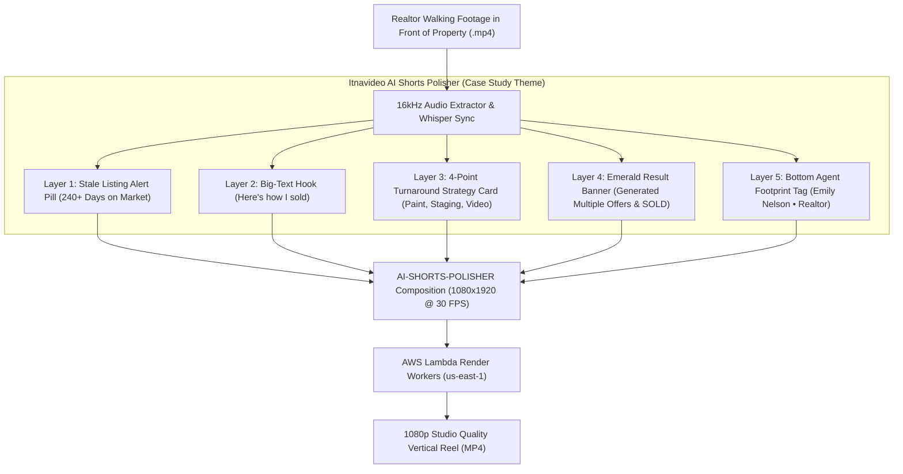

---

### 15.4 Visual Design Tokens & Safe-Zone Spacing

- **Aspect Ratio**: `1080 × 1920` (9:16 Vertical).
- **Top Safe Zone**: `135px` padding (accommodates days on market pill).
- **Bottom Safe Zone**: `210px` padding (clears Instagram Reels interaction buttons).
- **Palette Tokens**:
  - `Alert Crimson`: `#EF4444` (240+ days on market badge)
  - `Trophy Emerald`: `#10B981` (Sold verdict banner)
  - `Gold Accent`: `#F59E0B` (Strategy step counter and active dots)
  - `Pure White`: `#FFFFFF` (Primary headline typography and strategy titles)
  - `Dark Slate Surface`: `rgba(15, 23, 42, 0.88)` (Glassmorphic card surface)

---

### 15.5 Second-by-Second Cinematic Scene Breakdown

| Second | Visual Layer (1080×1920) | On-Screen Graphic & Kinetic Subtitle | Audio & Voiceover Pacing |
| :--- | :--- | :--- | :--- |
| **0:00–0:05** | Agent walks forward along manicured lawn in black dress; Red pill pops: `⏱ 240+ DAYS ON MARKET`. | Hook slams: `Here's` (bold sans) + `how I sold` (italic script). | Confident, conversational opening. Voiceover: *"This home sat on the market for 240+ days with another agent... so what did I do differently to get it SOLD?"* |
| **0:05–0:12** | Strategy Card 01 pops: `Strategy 01: Exterior Paint Refresh`. | Subtitle: *"Updated curb appeal with modern exterior color."* | Crisp pop SFX. Voiceover: *"I sat down with my client to create a strategic game plan. First, we refreshed the exterior paint for instant curb appeal."* |
| **0:12–0:20** | Strategy 02 slides in: `Strategy 02: Professional Staging`. | Subtitle: *"Staged to feel truly magazine-ready."* | Soft whoosh. Voiceover: *"Second, we professionally staged the home so buyers could envision living there."* |
| **0:20–0:28** | Strategy 03 & 04 cycle: `Lifestyle Storytelling` & `Weekly Open Houses`. | Gold dots animate. Subtitle: *"Marketed across social platforms with open houses every weekend."* | Upbeat pacing. Voiceover: *"Third, we told a story around the property's lifestyle through video, and hosted open houses every single weekend."* |
| **0:28–0:38** | Emerald banner illuminates: `🏆 GENERATED MULTIPLE OFFERS & SOLD!`. Bottom Agent Tag glows. | Subtitle: *"Don't assume buyers aren't out there. It may just need a refresh!"* | Triumphant musical finish. Voiceover: *"And the strategy worked! Multiple offers, and the home got SOLD. Don't assume buyers aren't out there—it just needs the right strategy."* |

---

### 15.6 Remotion Component Implementation

- **Asset Component**: `remotion/components/library/RealEstateListingTurnaroundAsset.tsx`
- **Component Export**: Exported in `remotion/components/library/index.ts` (`RealEstateListingTurnaroundAsset`, `RealEstateListingTurnaroundAssetProps`, `PlaybookStrategyItem`).
- **Catalog Registry**: Registered in `constants/itnavideoStockAssets.ts` under ID `real-estate-listing-turnaround-engine`.
- **Key Capabilities**:
  - Full `1080×1920` 9:16 layout calibrated for real estate agents, architects, high-ticket consultants, and agency case studies.
  - High-impact dual-voice hook typography (`Here's` bold sans + `how I sold` italic script).
  - Stale listing days-on-market alert badge and emerald multiple offers sold verdict banner.
  - 4-point turnaround playbook card with step indicators and tested playbook badges.
  - Supports transparent video overlay mode (`isOverlayMode`) over walking or speaking footage.
  - Zero local heavy compute dependencies — 100% pure React/Remotion code ready for AWS Lambda cloud rendering.

---

## 16. Radical Client Commitment & Hero Gradient Typography Architecture (The "Why I Show Up" Creator & Realtor Value Stack)

### 16.1 Inspiration & Core Reference
- **Source Reel**: [Rae'lynn Wetzel Hibbert (@yourrealtorraelynn)](https://www.instagram.com/reel/DbHbRZvBgE7/)
- **Creator Profile**: Rae’lynn Wetzel Hibbert — Utah Real Estate Agent, Prime Real Estate Experts.
- **Hook & Copy**: 
  > *"This is why I show up for you. Real estate isn't a 9 to 5 for me... but I'm SOLVING problems. Comment 'DOOR' and we'll talk."*
- **Visual Staging**: Walking-to-camera dynamic tracking shot along an urban brick sidewalk with arms open in an energetic, inviting posture.
- **Studio Mapping**: **AI Shorts Polisher (`aiShortsPolisher`)** / Walking Talking-Head Polish Pipeline

---

### 16.2 Visual Anatomy & Core Conversion Mechanics

1. **Signature Hero Gradient Kinetic Subtitle Typography**:
   - Central hero verb: `solving` rendered in giant **98px extruded bold sans-serif** with an Electric Violet (`#A855F7`) to Magenta Pink (`#EC4899`) gradient.
   - Surrounding supporting words: `but I'm` and `problems.` rendered in crisp 46px white sans-serif with subtle drop shadows.
   - 35px ambient colored bloom glow behind the hero word that pulses with speech cadence.

2. **Top Tag Pill / Brand Identifier**:
   - Anchored at `Y = 120px`: `@yourrealtorraelynn • RADICAL COMMITMENT`.
   - Translucent obsidian surface with violet neon border.

3. **Radical Client Commitment Service Deck**:
   - 4-part value carousel highlighting extraordinary dedication:
     - 🌙 **Midnight Availability**: Answering calls at 12 AM when urgent negotiations or contracts are on the line.
     - 🎁 **Client-First Generosity**: Gifting washers, dryers, and essentials to young families when budgets were tight.
     - 🛡️ **Relentless Contract Defense**: Walking clients through every single legal clause, appraisal contingency, and counter-offer.
     - 📈 **Upfront Financial Investment**: Spending thousands in staging, video, and ads out of pocket before day one.

4. **Agent Footprint Lower-Third**:
   - Translucent executive pill displaying `Rae'lynn Wetzel Hibbert • Utah Luxury & Residential REALTOR®`.
   - Contact pill: `385-487-6763`.

5. **High-Conversion Automated Lead Magnet Trigger**:
   - Bottom CTA banner: `💬 Comment "DOOR" to get the Utah Buyer Guide`.
   - Direct integration into ManyChat / Instagram DM automation funnels.

---

### 16.3 System Architecture & 9:16 Walking Polisher Pipeline

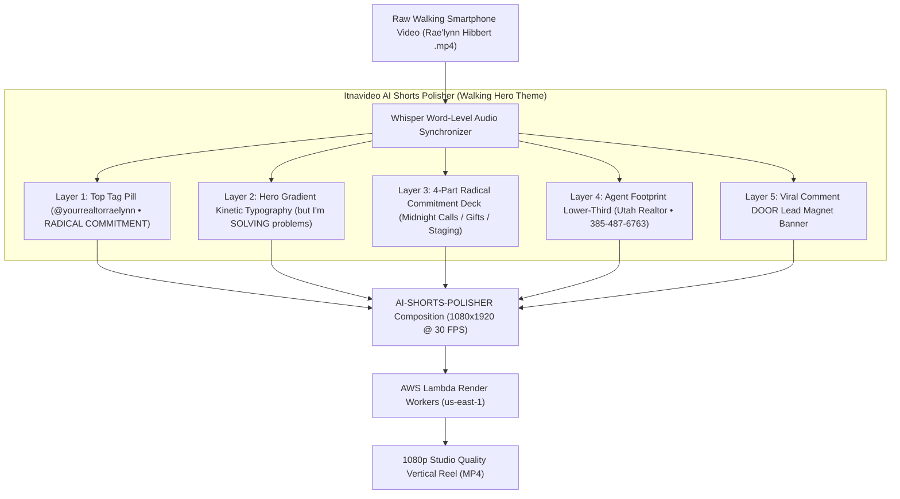

---

### 16.4 Visual Design Tokens & Safe-Zone Spacing

- **Aspect Ratio**: `1080 × 1920` (9:16 Vertical).
- **Top Safe Zone**: `120px` padding (accommodates top tag pill).
- **Hero Kinetic Typography Zone**: `Y = 280px - 450px` (positions above chest, clear of face).
- **Value Card Placement**: `Y = 980px`.
- **Bottom Safe Zone**: `140px` padding (clears Reels comment and like icons).
- **Palette Tokens**:
  - `Electric Violet`: `#A855F7` (Hero gradient start)
  - `Hot Magenta Pink`: `#EC4899` (Hero gradient end & keyword trigger badge)
  - `Hero Bloom`: `rgba(168, 85, 247, 0.65)`
  - `Dark Indigo Slate`: `linear-gradient(135deg, #1E1B4B 0%, #0F172A 100%)`
  - `Pure White`: `#FFFFFF`

---

### 16.5 Second-by-Second Cinematic Scene Breakdown

| Second | Visual Layer (1080×1920) | On-Screen Graphic & Kinetic Subtitle | Audio & Voiceover Pacing |
| :--- | :--- | :--- | :--- |
| **0:00–0:04** | Agent walks down urban sidewalk toward camera; Top Tag drops: `@yourrealtorraelynn • RADICAL COMMITMENT`. | Giant Hero Text slams: `but I'm SOLVING problems.`. Violet-pink bloom pulses. | Energetic, punchy hook. Voiceover: *"Real estate isn't a nine-to-five for me... I'm out here solving real problems."* |
| **0:04–0:09** | Value Card 01 pops: `🌙 24/7 AVAILABILITY • Answering Midnight Calls`. | Subtitle: *"I answer calls at midnight when negotiations are live."* | Determined, passionate cadence. Voiceover: *"I answer calls at midnight. No voicemail black holes when negotiations are on the line."* |
| **0:09–0:14** | Value Card flips to 02: `🎁 CLIENT-FIRST • Closing-Day Appliance Relief`. | Subtitle: *"I've gifted clients washers and dryers when budgets were tight."* | Warm, empathetic tone. Voiceover: *"I've gifted clients washers and dryers when they didn't have the budget."* |
| **0:14–0:19** | Value Card flips to 03: `🛡️ ADVOCACY • Zero-Pressure Contract Defense`. | Subtitle: *"I walk them through every contract and every question."* | Reassuring expert cadence. Voiceover: *"I walk them through every contract, every step, no matter how many questions it takes."* |
| **0:19–0:24** | Value Card flips to 04: `📈 UPFRONT INVESTMENT • $1,000s Invested Upfront`. | Subtitle: *"I invest thousands into every listing before it hits the market."* | Authority and proof. Voiceover: *"I invest thousands of dollars into every listing before it ever hits the market."* |
| **0:24–0:28** | Presenter opens arms wide; Agent Badge & Comment Banner illuminate: `💬 Comment DOOR to get the Utah Buyer Guide`. | `DOOR` pill pulses in magenta. Subtitle: *"Buying or selling in Utah? Comment DOOR and let's talk."* | Strong inbound conversion CTA. Voiceover: *"Buying or selling a home in Utah? Comment DOOR below and let's talk."* |

---

### 16.6 Remotion Component Implementation

- **Asset Component**: `remotion/components/library/RadicalServiceHeroGradientAsset.tsx`
- **Component Export**: Exported in `remotion/components/library/index.ts` (`RadicalServiceHeroGradientAsset`, `RadicalServiceHeroGradientAssetProps`, `ServiceCommitmentItem`).
- **Catalog Registry**: Registered in `constants/itnavideoStockAssets.ts` under ID `radical-service-hero-gradient-engine`.
- **Key Capabilities**:
  - Full `1080×1920` 9:16 layout calibrated for service entrepreneurs, realtors, consultants, and personal brand creators.
  - Signature dual-layer kinetic typography featuring an extruded 98px hero gradient keyword (`SOLVING`) with ambient bloom.
  - 4-card radical commitment deck showcasing extreme customer dedication (Midnight availability, closing gifts, contract defense, upfront investment).
  - Floating agent lower-third credential badge with phone number.
  - High-conversion automated comment trigger banner (`Comment DOOR`) for ManyChat / DM lead generation funnels.
  - Supports transparent video overlay mode over walking or talking footage.
  - Zero local heavy compute dependencies — 100% pure React/Remotion code ready for AWS Lambda cloud rendering.

---

## 17. Floating Palm Hologram & Hand-Tracked Property Card Architecture (The "Palm Drone Preview" Model / Kelsie Blevins 28K Likes Benchmark)

### 17.1 Source Attribution & Benchmark Telemetry

| Parameter | Value |
| :--- | :--- |
| **Original URL** | `https://www.instagram.com/reel/DXeU5dDkeXe/` |
| **Creator / Channel** | Kelsie Blevins (`@_k.elsie` \| Top 1% REALTOR®, Realty Executives Lake Norman) |
| **Topic / Hook** | *"Newly Offered at $399,000! Fully renovated single-level living. No HOA. No city taxes. Nearly half an acre to call your own."* |
| **Engagement Telemetry** | **28,000+ Likes**, 460 Comments, High Viral Distribution |
| **Visual Staging** | Presenter stands on concrete walkway extending open palm to the right; a 3D aerial drone preview card floats directly above her hand. |
| **Video Format / Ratio** | 9:16 Vertical (`1080×1920` @ 30 FPS, Talking Head / Walking Reel) |
| **Video Duration** | ~30 seconds (Strictly within the 90s Short-Form limit) |
| **Itnavideo Mapping** | `aiShortsPolisher` Studio (`/dashboard/ai-shorts-polisher`) |
| **Credit Billing** | **Strictly 1 Credit** flat (Master Rule 4.1 for 9:16 Short-Form) |
| **Watermark Enforcement** | `<BrandWatermark watermark={watermark} />` (Enforced for free/trial users) |

---

### 17.2 Core Creative Mechanics: The Palm Hologram Hook Model

1. **Floating Hologram Card Anchored to Open Palm**:
   - Creator holds open palm up to the side (`X = 720px`, `Y = 560px`).
   - A floating holographic card (`300 × 440px`) hovers with subtle vertical breathing bob (`±12px`) and micro-rotation (`±1.5°`).
   - Displays an aerial drone view of the property, lot boundaries, and an integrated bottom price badge (`$399,000`).
   - Gives the illusion of advanced AR holography while running 100% natively in React/Remotion.

2. **Top Location & Pricing Header Capsule**:
   - Location: `📍 Lincolnton, NC • Eastridge Subdivision`.
   - Pricing Callout: `Newly Offered at $399,000 • Move-In Ready`.
   - Horizontal Spec Pills: `3 BED | 2 BATH` | `1,540 SQ FT` | `0.5 ACRES` | `NO HOA`.

3. **Rotating Renovation Highlight Carousel**:
   - Showcases 5 key transformation pillars over talking-head footage:
     - 🪵 *Brand-New White Oak Flooring Throughout*
     - 🍷 *Remodeled Kitchen with Island Beverage Fridge*
     - 🛁 *Expanded Primary Spa Suite with Tile Shower*
     - 🚗 *Oversized 2-Car Garage & Concrete Driveway*
     - 🌲 *Flat 0.5-Acre Usable Lot • No HOA • No City Taxes*

4. **Agent Credential Lower-Third & Inbound Showing CTA**:
   - Executive agent badge: `Kelsie Blevins • Top 1% REALTOR® • 828-221-6070`.
   - Bottom conversion banner: `DM or Call/Text 828-221-6070 to Schedule Your Private Showing 🔑`.

---

### 17.3 System Architecture & 9:16 Palm Hologram Pipeline

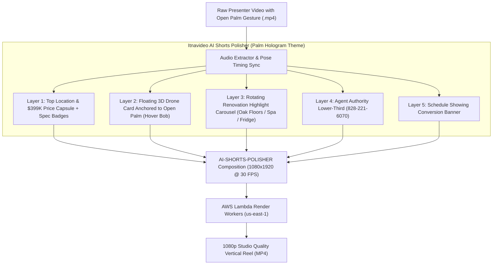

---

### 17.4 Visual Design Tokens & Safe-Zone Spacing

- **Aspect Ratio**: `1080 × 1920` (9:16 Vertical).
- **Top Safe Zone**: `100px` padding (accommodates top location capsule).
- **Palm Card Anchor**: `X = 720px`, `Y = 560px` (positions over right hand).
- **Highlight Card Placement**: `Y = 980px`.
- **Bottom Safe Zone**: `120px` padding (clears interaction buttons).
- **Color Tokens**:
  - `Emerald Primary`: `#10B981` / `#059669` (Price tag, Highlight icon, CTA)
  - `Sky Blue Accent`: `#38BDF8` (Aura glow behind palm card)
  - `Dark Slate Surface`: `rgba(15, 23, 42, 0.9)`
  - `Pure White`: `#FFFFFF`
  - `Muted Silver`: `#94A3B8` / `#CBD5E1`

---

### 17.5 Second-by-Second Cinematic Scene Breakdown

| Second | Visual Layer (1080×1920) | On-Screen Graphic & Kinetic Subtitle | Audio & Voiceover Pacing |
| :--- | :--- | :--- | :--- |
| **0:00–0:05** | Presenter stands on walkway extending palm; Top Capsule drops: `Lincolnton, NC • $399,000`. Floating Palm Card pops above hand. | Drone card hovers with subtle bob. Subtitle: *"Newly offered at $399,000... fully renovated single-level living."* | Upbeat, inviting opening. Voiceover: *"Newly offered at 399,000! Fully renovated single-level living with no HOA and no city taxes."* |
| **0:05–0:11** | Highlight Card 01 slides in: `🪵 Brand-New White Oak Flooring Throughout`. | Subtitle: *"Transformed from top to bottom with new white oak floors."* | Warm cadence. Voiceover: *"This all-brick home in Eastridge has been transformed top-to-bottom with brand-new white oak floors."* |
| **0:11–0:17** | Highlight Card 02 slides in: `🍷 Remodeled Kitchen with Island Beverage Fridge`. | Subtitle: *"Custom kitchen with dedicated island beverage fridge."* | Elevated cadence. Voiceover: *"A completely remodeled kitchen with an island beverage fridge and open functional layout."* |
| **0:17–0:23** | Highlight Card 03 slides in: `🛁 Expanded Primary Spa Suite with Tile Shower`. | Subtitle: *"Expanded primary suite with spa-inspired tile shower."* | Reassuring tone. Voiceover: *"Expanded primary suite with a spa-inspired walk-in tile shower and main-level laundry."* |
| **0:23–0:30** | Presenter lowers hand; Agent Badge & Showing CTA illuminate: `DM or Call/Text 828-221-6070 for Private Showing 🔑`. | Emerald banner pulses. Subtitle: *"DM me or call to schedule your private showing."* | Direct conversion closing. Voiceover: *"Oversized two-car garage on a flat half-acre lot. DM me or call 828-221-6070 for your private showing."* |

---

### 17.6 Remotion Component Implementation

- **Asset Component**: `remotion/components/library/FloatingPalmCardAsset.tsx`
- **Component Export**: Exported in `remotion/components/library/index.ts` (`FloatingPalmCardAsset`, `FloatingPalmCardAssetProps`, `PropertyHighlightItem`).
- **Catalog Registry**: Registered in `constants/itnavideoStockAssets.ts` under ID `floating-palm-card-engine`.
- **Key Capabilities**:
  - Full `1080×1920` 9:16 layout calibrated for hand-gesture anchored visual cards, aerial drone previews, and talking-head hooks.
  - Floating 3D holographic card with configurable anchor position (`X/Y`), breathing hover physics (`±12px`), and radiant aura glow.
  - Top estate location capsule with price pill ($399K) and 4 spec badges (Bed/Bath, SqFt, Lot, No HOA).
  - Rotating renovation highlight carousel with custom icons.
  - Agent authority lower-third and direct call/text showing CTA banner.
  - Zero local heavy compute dependencies — 100% pure React/Remotion code ready for AWS Lambda cloud rendering.

---

## 18. The 3 Critical Mistakes Dual-Script Number Hook Architecture (The First-Time Homebuyer Traps Model / Kelynn McManus Benchmark)

### 18.1 Source Attribution & Benchmark Telemetry

| Parameter | Value |
| :--- | :--- |
| **Original URL** | `https://www.instagram.com/reel/DY5sSCEPqUB/` |
| **Creator / Channel** | Kelynn McManus (`@kelynnmcmanusrealtoryyc` \| Realtor YYC, RE/MAX Key) |
| **Topic / Hook** | *"First-time buyers — this is the stuff no one talks about. The wrong move before you even start house hunting could cost you thousands: 3 these mistakes."* |
| **Engagement Telemetry** | **985+ Likes**, 35 Comments, High Save & Inquiry Velocity |
| **Visual Staging** | Presenter standing in a luxury designer kitchen with flat-panel oak cabinets and quartz waterfall island, resting hand on counter. |
| **Video Format / Ratio** | 9:16 Vertical (`1080×1920` @ 30 FPS, Talking Head / Advisory Reel) |
| **Video Duration** | ~33 seconds (Strictly within the 90s Short-Form limit) |
| **Itnavideo Mapping** | `aiShortsPolisher` Studio (`/dashboard/ai-shorts-polisher`) |
| **Credit Billing** | **Strictly 1 Credit** flat (Master Rule 4.1 for 9:16 Short-Form) |
| **Watermark Enforcement** | `<BrandWatermark watermark={watermark} />` (Enforced for free/trial users) |

---

### 18.2 Core Creative Mechanics: The Dual-Script Number Hook Model

1. **Signature Dual-Script Number Hook**:
   - Giant Numeral `3`: 130px bold serif font (`Georgia` / `Playfair`) dominating the top center.
   - Companion stacked words:
     - `these`: 42px lowercase modern sans-serif.
     - `mistakes`: 68px flowing italic cursive script with soft ambient drop-shadow.
   - Creates a high-fashion editorial visual tension between the stark numerical authority and elegant fluid script.

2. **Top Advisory & Threat-Awareness Capsule**:
   - Anchored at `Y = 100px`: Frosted dark slate container (`rgba(15, 23, 42, 0.88)`).
   - Topic: `FIRST-TIME BUYER ADVISORY • CALGARY REAL ESTATE`.
   - Alert Tag: `COSTLY TRAPS` with crimson indicator badge (`#EF4444`).

3. **3 Sequential Mistake Cards**:
   - 🚫 **Mistake 01: Shopping Before Full Pre-Approval**: *Falling in love with a home before having a verified rate-hold and stress-tested lender approval.*
   - 🚫 **Mistake 02: Underestimating Hidden Closing Costs**: *Forgetting legal fees, property transfer taxes, inspections, and moving costs (requires 2-4% cash buffer).*
   - 🚫 **Mistake 03: Skipping a Protective Offer Strategy**: *Writing unguided offers without comparative market analysis or essential financing & inspection conditions.*

4. **Agent Authority Lower-Third**:
   - Executive footprint pill: `Kelynn McManus • RE/MAX Key Calgary • Buyer Strategist`.

5. **Inbound Automated DM Keyword Funnel**:
   - Bottom conversion banner: `💬 Message "FIRST" for the First-Time Buyer Roadmap & Budget Calculator`.
   - Integrates directly with ManyChat / Instagram DM keyword automation for instant lead qualification.

---

### 18.3 System Architecture & 9:16 Buyer Advisory Pipeline

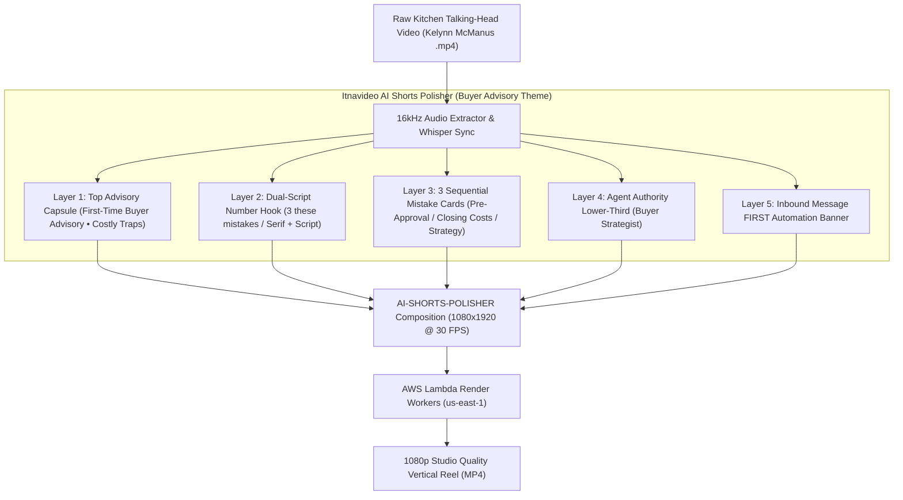

---

### 18.4 Visual Design Tokens & Safe-Zone Spacing

- **Aspect Ratio**: `1080 × 1920` (9:16 Vertical).
- **Top Safe Zone**: `100px` padding (accommodates top advisory capsule).
- **Dual-Script Hook Placement**: `Y = 320px` (positions above kitchen counter).
- **Mistake Card Placement**: `Y = 980px`.
- **Bottom Safe Zone**: `120px` padding (clears interaction buttons).
- **Color Tokens**:
  - `Alert Crimson`: `#EF4444` / `#DC2626` (Mistake icons, alert badge, DM trigger)
  - `Dark Slate Surface`: `rgba(15, 23, 42, 0.92)`
  - `Pure White`: `#FFFFFF`
  - `Muted Silver`: `#94A3B8` / `#CBD5E1`
  - `Champagne Warmth`: `#FDE68A`

---

### 18.5 Second-by-Second Cinematic Scene Breakdown

| Second | Visual Layer (1080×1920) | On-Screen Graphic & Kinetic Subtitle | Audio & Voiceover Pacing |
| :--- | :--- | :--- | :--- |
| **0:00–0:05** | Presenter stands by waterfall island; Top Capsule drops: `FIRST-TIME BUYER ADVISORY`. Dual-Script Hook slams: `3 these mistakes`. | Number 3 pulses. Subtitle: *"First-time buyers... this is the stuff no one talks about."* | Authoritative, conspiratorial opening. Voiceover: *"First-time buyers—this is the stuff no one talks about before house hunting."* |
| **0:05–0:12** | Mistake Card 01 slides in: `🏦 MISTAKE 01: Shopping Before Full Pre-Approval`. | Crimson badge pulses. Subtitle: *"Shopping before pre-approval could cost you thousands."* | Urgent advice cadence. Voiceover: *"The wrong move before you even start can cost you thousands. Mistake number one is falling in love with a home before verified pre-approval."* |
| **0:12–0:20** | Mistake Card 02 slides in: `💸 MISTAKE 02: Underestimating Hidden Closing Costs`. | Subtitle: *"Underestimating the true costs of buying a home."* | Practical insider tip. Voiceover: *"Second, underestimating the true closing costs: legal fees, inspections, and moving expenses require a real cash buffer."* |
| **0:20–0:27** | Mistake Card 03 slides in: `🛡️ MISTAKE 03: Skipping a Protective Offer Strategy`. | Subtitle: *"Going in without a strategy that actually protects your money."* | Confident guidance tempo. Voiceover: *"And third, going in without a strategy. You need smart offers and negotiations that actually protect your equity."* |
| **0:27–0:33** | Presenter looks directly into lens; Agent Badge & DM Banner illuminate: `💬 Message FIRST for the First-Time Buyer Roadmap`. | Crimson trigger pulses. Subtitle: *"Message me FIRST and let's build the right plan."* | Direct conversion closing. Voiceover: *"Your first home should feel exciting, not overwhelming. Message me 'FIRST' and let's build a strategy that gets you into the right home."* |

---

### 18.6 Remotion Component Implementation

- **Asset Component**: `remotion/components/library/BuyerMistakesAdvisoryAsset.tsx`
- **Component Export**: Exported in `remotion/components/library/index.ts` (`BuyerMistakesAdvisoryAsset`, `BuyerMistakesAdvisoryAssetProps`, `BuyerTrapItem`).
- **Catalog Registry**: Registered in `constants/itnavideoStockAssets.ts` under ID `buyer-mistakes-advisory-engine`.
- **Key Capabilities**:
  - Full `1080×1920` 9:16 layout calibrated for mistake breakdowns, buyer traps, myth-busting, and advisory checklists.
  - Signature dual-script hook combining a giant 130px serif numeral with stacked sans (`these`) and luxury italic cursive script (`mistakes`).
  - 3-part sequential mistake warning card carousel with custom alert icons.
  - Translucent agent authority lower-third and automated DM keyword lead magnet funnel (`Message FIRST`).
  - Zero local heavy compute dependencies — 100% pure React/Remotion code ready for AWS Lambda cloud rendering.

---

## 19. The 6 Unfair Buyer Concessions & Golden 3D Typography Architecture (The "45K Under / Zero Closing Costs" Model / Rae'lynn Hibbert 10K Likes Benchmark)

### 19.1 Source Attribution & Benchmark Telemetry

| Parameter | Value |
| :--- | :--- |
| **Original URL** | `https://www.instagram.com/reel/DZWLhE3uEhO/` |
| **Creator / Channel** | Rae’lynn Wetzel Hibbert (`@yourrealtorraelynn` \| Utah Realtor, Prime Real Estate Experts) |
| **Topic / Hook** | *"Things your agent SHOULD be negotiating for you: My buyer paid 45K under. I've never had a buyer pay closing costs. That's not luck, it's strategy."* |
| **Engagement Telemetry** | **10,000+ Likes**, 230 Comments, Massive Viral Distribution |
| **Visual Staging** | Presenter walking through a luxury penthouse lounge with moody lighting, floor-to-ceiling glass, and modern wicker seating. |
| **Video Format / Ratio** | 9:16 Vertical (`1080×1920` @ 30 FPS, Walking Presenter Reel) |
| **Video Duration** | ~34 seconds (Strictly within the 90s Short-Form limit) |
| **Itnavideo Mapping** | `aiShortsPolisher` Studio (`/dashboard/ai-shorts-polisher`) |
| **Credit Billing** | **Strictly 1 Credit** flat (Master Rule 4.1 for 9:16 Short-Form) |
| **Watermark Enforcement** | `<BrandWatermark watermark={watermark} />` (Enforced for free/trial users) |

---

### 19.2 Core Creative Mechanics: The Tactical Concessions Model

1. **Signature Golden 3D & Hollow Outlined Hook**:
   - `My`: Clean 44px white sans-serif.
   - `buyer`: Giant 104px bold geometric sans in radiant yellow-gold (`#FACC15`) with intense 3D drop-shadow.
   - `45K`: Hollow stroked numeral (`88px, -webkit-text-stroke: 3px #FDE047`) with golden bloom aura.
   - `paid under`: Clean 48px lowercase bold white sans.
   - Immediately proves concrete financial wins that trigger immediate viewer retention.

2. **Top Tactical Playbook Header Capsule**:
   - Anchored at `Y = 100px`: Frosted obsidian container (`rgba(15, 23, 42, 0.88)`).
   - Topic: `THINGS YOUR AGENT SHOULD BE NEGOTIATING`.
   - Subtitle: `Zero Closing Costs Strategy`.

3. **6 Unfair Buyer Concessions Carousel**:
   - 💵 **Concession 01: Seller-Paid Closing Costs**: Walk in with less cash out of pocket; negotiate 100% seller-covered closing and transfer fees.
   - 📉 **Concession 02: Temporary or Permanent Rate Buydowns**: Seller funds upfront points to reduce monthly payments for 1-2 years or the life of the loan.
   - 🛠️ **Concession 03: Repair Credits & In-Lieu Cash**: Never accept a home as-is; demand direct closing credits or licensed contractor repairs.
   - 🛡️ **Concession 04: Seller-Paid 1-Year Home Warranty**: Complete warranty coverage on HVAC, plumbing, water heater, and appliances at zero cost to the buyer.
   - 🧺 **Concession 05: Included Appliances & Furniture**: High-end washer, dryer, refrigerator, and outdoor patio furniture written into the contract.
   - 📅 **Concession 06: Strategic Closing Dates**: Timing the close to eliminate prepaid interest and avoid stressful double-rent overlaps.

4. **Agent Authority Lower-Third**:
   - Executive footprint pill: `Rae'lynn Wetzel Hibbert • Utah Luxury & Residential REALTOR®` with contact phone `385-487-6763`.

5. **Closing Conversion CTA**:
   - Bottom conversion banner: `Never Leave Money on the Table 🔑 DM or Call 385-487-6763`.

---

### 19.3 System Architecture & 9:16 Buyer Concessions Pipeline

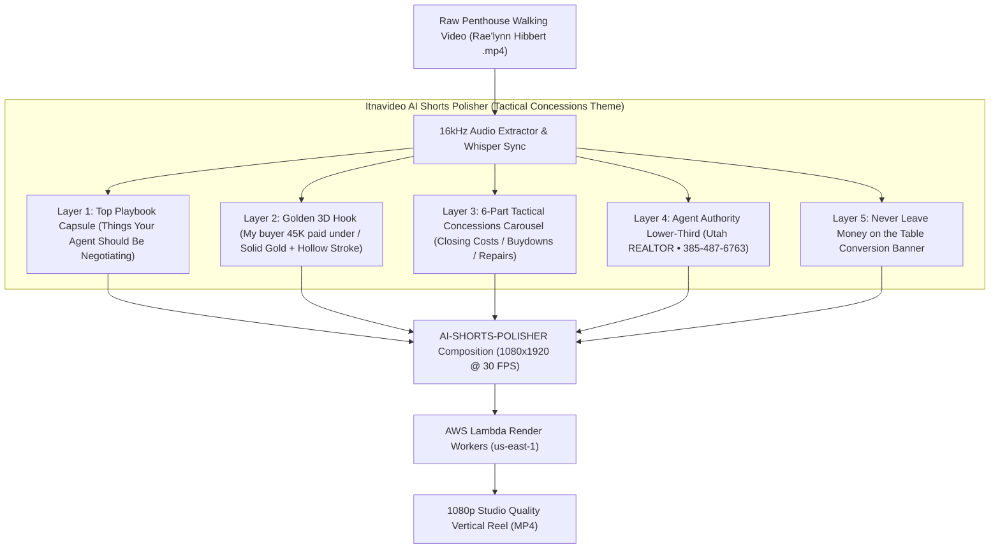

---

### 19.4 Visual Design Tokens & Safe-Zone Spacing

- **Aspect Ratio**: `1080 × 1920` (9:16 Vertical).
- **Top Safe Zone**: `100px` padding (accommodates top playbook capsule).
- **Golden Hook Placement**: `Y = 280px - 440px`.
- **Concession Card Placement**: `Y = 980px`.
- **Bottom Safe Zone**: `120px` padding (clears interaction buttons).
- **Color Tokens**:
  - `Solid Gold`: `#FACC15` / `#EAB308` (Primary hero word, glowing aura)
  - `Hollow Gold Stroke`: `#FDE047` (45K outlined text)
  - `Dark Amber Accent`: `#CA8A04` / `#854D0E` (CTA button)
  - `Dark Slate Surface`: `rgba(15, 23, 42, 0.92)`
  - `Pure White`: `#FFFFFF`

---

### 19.5 Second-by-Second Cinematic Scene Breakdown

| Second | Visual Layer (1080×1920) | On-Screen Graphic & Kinetic Subtitle | Audio & Voiceover Pacing |
| :--- | :--- | :--- | :--- |
| **0:00–0:05** | Agent walks through penthouse lounge; Top Capsule drops: `THINGS YOUR AGENT SHOULD BE NEGOTIATING`. Golden Hook slams: `My buyer 45K paid under`. | Gold aura pulses. Subtitle: *"Things your agent SHOULD be negotiating for you."* | Confident, punchy opening. Voiceover: *"Things your agent should be negotiating for you... because if they aren't, you're leaving thousands on the table."* |
| **0:05–0:11** | Concession Card 01 slides in: `💵 CONCESSION 01: Seller-Paid Closing Costs`. | Subtitle: *"In most markets, your agent can negotiate seller-paid closing costs."* | Sharp value cadence. Voiceover: *"First, closing costs. In most markets, your agent can get the seller to cover them so you walk in with less cash out of pocket."* |
| **0:11–0:17** | Concession Card 02 slides in: `📉 CONCESSION 02: Rate Buydowns`. | Subtitle: *"Sellers can contribute toward buying your rate down."* | Strategic finance cadence. Voiceover: *"Second, rate buydowns. In higher rate environments, sellers can buy your rate down to significantly lower your monthly payment."* |
| **0:17–0:23** | Concession Card 03 slides in: `🛠️ CONCESSION 03: Repairs & Credits`. | Subtitle: *"Never just accept a property as-is without asking."* | Firm protective tone. Voiceover: *"Third, repairs and credits. After inspection, you should never accept a home as-is without negotiating repairs or credits."* |
| **0:23–0:29** | Concession Card 04 & 05 cycle: `🛡️ Home Warranty` & `🧺 Included Appliances`. | Subtitle: *"Appliances, washer, dryer, backyard furniture—if you want it, ask for it."* | Insider confidence. Voiceover: *"Home warranties, washers, dryers, and appliances—if it's in the home and you want it, ask for it."* |
| **0:29–0:34** | Presenter stops and smiles; Agent Badge & CTA illuminate: `Never Leave Money on the Table 🔑 DM or Call 385-487-6763`. | Gold button pulses. Subtitle: *"I've never had a buyer pay closing costs. That's not luck, it's strategy."* | Inspiring, closing conversion. Voiceover: *"I've never had a buyer pay closing costs. That's not luck, it's strategy. Looking to buy in Utah? Let's talk."* |

---

### 19.6 Remotion Component Implementation

- **Asset Component**: `remotion/components/library/BuyerConcessionsPlaybookAsset.tsx`
- **Component Export**: Exported in `remotion/components/library/index.ts` (`BuyerConcessionsPlaybookAsset`, `BuyerConcessionsPlaybookAssetProps`, `ConcessionItem`).
- **Catalog Registry**: Registered in `constants/itnavideoStockAssets.ts` under ID `buyer-concessions-playbook-engine`.
- **Key Capabilities**:
  - Full `1080×1920` 9:16 layout calibrated for negotiation strategies, buyer tips, financial breakdowns, and high-stakes client wins.
  - Signature dual-style golden hook featuring solid 3D gold typography (`buyer`) and hollow gold stroked numerals (`45K`).
  - 6-part sequential buyer concessions card carousel with custom financial icons.
  - Translucent agent authority lower-third and direct phone/DM conversion CTA banner.
  - Zero local heavy compute dependencies — 100% pure React/Remotion code ready for AWS Lambda cloud rendering.

---

## 20. Floating Portfolio Reel Mosaic & Social Proof Stack Architecture (The "Why Clients Choose Me / 3-Card Proof Grid" Model / Breyan Lallas Benchmark)

### 20.1 Source Attribution & Benchmark Telemetry

| Parameter | Value |
| :--- | :--- |
| **Original URL** | `https://www.instagram.com/reel/DYhdygMOXco/` |
| **Creator / Channel** | Breyan Lallas (`@breyanmarie` \| MN REALTOR®, Homes By Breyan, Covenant Partners) |
| **Topic / Hook** | *"Real estate is FULL of agents. So why do clients choose me? Because I don't believe buying or selling a home should feel transactional... Behind every closing is a real life transition happening."* |
| **Engagement Telemetry** | **2,770+ Likes**, 90 Comments, High Organic Retention |
| **Visual Staging** | Presenter walking forward down front porch stairs while 3 vertical smartphone cards (floating reel mosaic) hover directly in front of her mid-torso showing past sold listings and video clips. |
| **Video Format / Ratio** | 9:16 Vertical (`1080×1920` @ 30 FPS, Walking Presenter Reel) |
| **Video Duration** | ~35 seconds (Strictly within the 90s Short-Form limit) |
| **Itnavideo Mapping** | `aiShortsPolisher` Studio (`/dashboard/ai-shorts-polisher`) |
| **Credit Billing** | **Strictly 1 Credit** flat (Master Rule 4.1 for 9:16 Short-Form) |
| **Watermark Enforcement** | `<BrandWatermark watermark={watermark} />` (Enforced for free/trial users) |

---

### 20.2 Core Creative Mechanics: The Floating Reel Mosaic Model

1. **Floating 3-Card Staggered Reel Portfolio Mosaic**:
   - 3 vertical mini smartphone preview cards (`230-260px × 340-380px`) floating in a dynamic staggered arc directly in front of the walking creator.
   - Independent vertical floating bob physics (`bob1, bob2, bob3`) and subtle tilt rotations (`-4°, 0°, +4°`).
   - Cards display past achievements, video clips, and high-stakes proof:
     - Card 01: `$14,000,000 SOLD IT IN 2024` (Luxury close record).
     - Card 02 (Center): `5-STAR CLIENT TRANSITIONS` (Client testimonial clip).
     - Card 03: `14 DAYS AVG ON MARKET` (Speed & efficiency metric).
   - Instantly establishes undeniable credibility without interrupting the presenter's voiceover.

2. **Top Big-Text Hook Hierarchy**:
   - Line 1: `There` (90px bold white sans-serif).
   - Line 2: `ARE THOUSANDS OF` (32px tracking-wide silver sans).
   - Line 3: `agents.` (72px bold electric sky-blue sans with glow).

3. **Life Transition Values Carousel**:
   - Differentiates the creator from commodity "transactional" service providers:
     - 👨‍👩‍👧 **A Growing Family**: *Needing more space, safe yards, and neighborhoods with top-rated schools.*
     - 🌱 **A Fresh New Chapter**: *Navigating life transitions, relocations, and new beginnings with compassion.*
     - 💫 **A Dream Finally Reality**: *Turning years of saving and sacrifice into the keys to your forever home.*
     - 📈 **Building Generational Wealth**: *Smart investments and equity compounding that protect your family's future.*

4. **Agent Authority Lower-Third**:
   - Executive footprint pill: `Breyan Lallas • Homes By Breyan • Minnesota REALTOR®` with contact phone `651-235-3405`.

5. **Non-Transactional Trust CTA**:
   - Bottom conversion banner: `Real Relationships Over Quick Commissions 🤍 DMs Open`.

---

### 20.3 System Architecture & 9:16 Portfolio Mosaic Pipeline

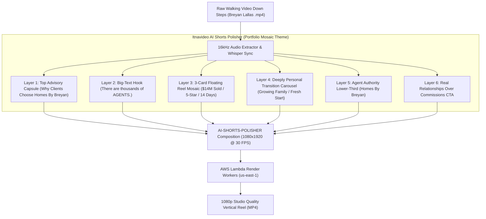

---

### 20.4 Visual Design Tokens & Safe-Zone Spacing

- **Aspect Ratio**: `1080 × 1920` (9:16 Vertical).
- **Top Safe Zone**: `100px` padding (accommodates top header capsule).
- **Big-Text Hook Placement**: `Y = 250px - 440px`.
- **Floating Mosaic Zone**: `Y = 540px` (positions across chest/mid-torso).
- **Transition Card Placement**: `Y = 980px`.
- **Bottom Safe Zone**: `120px` padding (clears interaction buttons).
- **Color Tokens**:
  - `Electric Sky Blue`: `#38BDF8` / `#0284C7` (Primary accent, glow aura, CTA gradient)
  - `Magenta Pink`: `#EC4899` (Center card tag)
  - `Emerald Green`: `#10B981` (Speed record card)
  - `Dark Slate Surface`: `rgba(15, 23, 42, 0.92)`
  - `Pure White`: `#FFFFFF`

---

### 20.5 Second-by-Second Cinematic Scene Breakdown

| Second | Visual Layer (1080×1920) | On-Screen Graphic & Kinetic Subtitle | Audio & Voiceover Pacing |
| :--- | :--- | :--- | :--- |
| **0:00–0:05** | Agent walks down porch steps; Big-Text Hook drops: `There are thousands of AGENTS.`. | Sky blue text glows. Subtitle: *"Real estate is full of agents. So why do clients choose me?"* | Direct, confident hook. Voiceover: *"Real estate is full of agents. So why do clients choose me?"* |
| **0:05–0:12** | 3-Card Floating Portfolio Mosaic pops into frame with independent floating bobs: `$14M SOLD`, `5-STAR`, `14 DAYS`. | Cards sway gently. Subtitle: *"Because I don't believe buying or selling should feel transactional."* | Passionate, authentic cadence. Voiceover: *"Because I don't believe buying or selling should feel transactional. Behind every closing table is a real life transition."* |
| **0:12–0:19** | Transition Card 01 slides in: `👨‍👩‍👧 A Growing Family`. | Subtitle: *"A growing family needing more space and top schools."* | Warm, empathetic tone. Voiceover: *"A growing family needing more space, a fresh start, or a dream finally becoming reality."* |
| **0:19–0:27** | Transition Card 02 slides in: `🌱 A Fresh New Chapter`. | Subtitle: *"Real relationships over quick commissions."* | Reassuring expert cadence. Voiceover: *"You deserve an agent who actually listens, communicates consistently, and treats your goals like they matter."* |
| **0:27–0:35** | Presenter smiles into lens; Agent Badge & Trust CTA illuminate: `Real Relationships Over Quick Commissions 🤍 DMs Open`. | Sky blue banner pulses. Subtitle: *"My DMs are always open. Let's talk."* | Inspiring, warm closing. Voiceover: *"No matter your timeline or price point, you're never just another client to me. My DMs are always open."* |

---

### 20.6 Remotion Component Implementation

- **Asset Component**: `remotion/components/library/PortfolioReelMosaicAsset.tsx`
- **Component Export**: Exported in `remotion/components/library/index.ts` (`PortfolioReelMosaicAsset`, `PortfolioReelMosaicAssetProps`, `PortfolioMiniCard`, `TransitionReasonItem`).
- **Catalog Registry**: Registered in `constants/itnavideoStockAssets.ts` under ID `portfolio-reel-mosaic-engine`.
- **Key Capabilities**:
  - Full `1080×1920` 9:16 layout calibrated for creator portfolios, client case studies, social proof showcases, and founder credibility reels.
  - Floating 3-card staggered smartphone mosaic with independent floating hover physics (`bob1, bob2, bob3`) and realistic angular tilts (`-4°, 0°, +4°`).
  - Top big-text typography hook (`There are thousands of agents`).
  - Sequential deeply personal transition card carousel detailing life motivations.
  - Translucent agent authority lower-third and relationship-first DM conversion banner.
  - Zero local heavy compute dependencies — 100% pure React/Remotion code ready for AWS Lambda cloud rendering.

