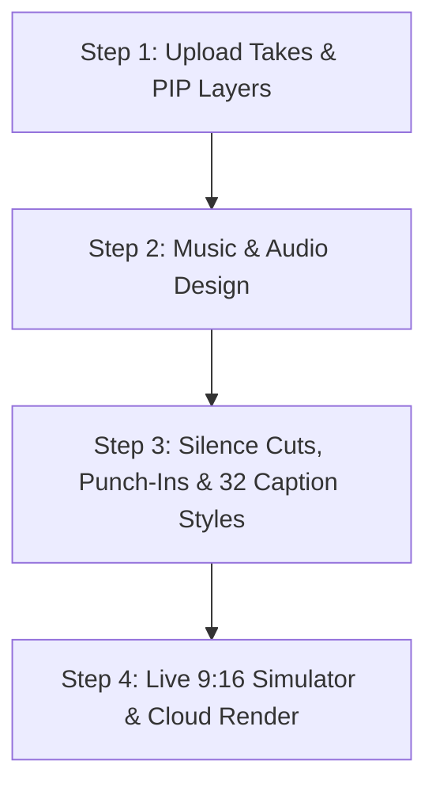
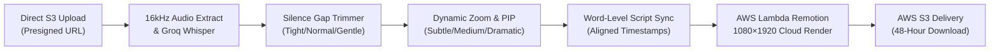

# AI Shorts Polisher (`ai-shorts-polisher.md`)

> **Single Source of Truth** for the 9:16 Vertical Shorts & Reels Polishing Workflow in [Itnavideo](https://www.itnavideo.com).
> Specially designed for mobile vloggers, talking-head influencers, and vertical smartphone shoots on YouTube Shorts, Instagram Reels, and TikTok.

---

## 1. Overview & Purpose

**AI Shorts Polisher** (`aiShortsPolisher`) transforms raw smartphone video clips and multi-take vertical shoots into high-retention, publication-ready vertical short videos (`1080×1920` @ 30 FPS MP4) up to 90 seconds long.

It automates the essential mobile creator editing workflow:
1. **Auto Silence & Gap Cutter with Sensitivity**: Identifies pauses, stuttered takes, and dead-air with 3 sensitivity levels: **Tight** (fast-paced TikToks), **Normal** (balanced), or **Gentle** (conversational).
2. **Dynamic Camera Punch-Ins (+5% to +18% Zoom)**: Alternates scale with customizable strength: **Subtle (+5%)**, **Standard (+12%)**, or **Dramatic (+18%)** to break visual monotony on mobile screens.
3. **Multi-Take Reordering & Trimming**:
   - Creators can upload multiple smartphone takes, reorder them up/down with 1 click, and set in/out trim seconds directly inside the dashboard.
4. **Picture-in-Picture (PIP) with Flexible Positioning**:
   - Floating graphics, product shots, tweets, or reaction videos positioned in **Top-Right**, **Top-Left**, **Bottom-Right**, **Bottom-Left**, or **Center/Split**.
5. **Word-Level Script & Misheard Name Corrector**:
   - Correct mistranscribed words, brand names, or slang while maintaining strict millisecond audio timing.
6. **40+ Viral Subtitle Presets**:
   - Hormozi viral pop, MrBeast impact, karaoke, documentary, and clean minimal presets with instant search and category filters.
7. **Visual Retention Callouts**:
   - Built-in UI controls for Animated Curved Arrows, Multi-Step Equation/Formula Cards, and Side-By-Side Comparison Banners.
8. **Live Dynamic 9:16 Smartphone Preview Simulator & Audio Spectrum**:
   - An interactive dark preview phone mockup showing live punch-in scale, PIP position, and animated speech activity bars.

---

## 2. Key Specifications & Limits

| Attribute | Specification |
| :--- | :--- |
| **Video Type ID** | `aiShortsPolisher` / `ai-shorts-polisher` |
| **Remotion Composition ID**| `AI-SHORTS-POLISHER` |
| **Template Location** | `remotion/templates/AI_SHORTS_POLISHER/template.tsx` |
| **Dashboard Studio** | `components/dashboard/AiShortsPolisherStudio.tsx` |
| **Subpage Client** | `components/dashboard/subpages/AiShortsPolisherPageClient.tsx` |
| **Dashboard Route** | `/dashboard/ai-shorts-polisher` |
| **Aspect Ratio** | **Strictly 9:16 Vertical Only** (`1080×1920` Full HD) |
| **Frame Rate** | 30 FPS MP4 |
| **Max Video Duration** | Up to **90 Seconds (90s / 2,700 frames)** |
| **Credit Rate** | **Strictly 1 Credit** per video (Master Rule 4.1 for 9:16 Short-Form) |
| **Primary Media Input** | Fullscreen 9:16 smartphone video takes / images (MP4, MOV, WebM, PNG, JPG) |
| **Layer Media Input** | Floating Picture-in-Picture overlay graphics, screenshots, or secondary clips |
| **Audio Ducking** | Background music defaulted to **12% volume (`0.12`)** during speech |
| **Transcription Engine** | Extracted 16kHz mono audio → Groq Whisper Cloud API (Fallback: Google Gemini 2.0 Flash) |
| **Cloud Render Engine** | AWS Lambda Remotion Engine |
| **Storage & Lifecycle** | AWS S3 with 48-hour secure signed download lifecycle |

---

## 3. Dedicated Internal Components (Rule 8.B.4 Compliance)

Per **Rule 8.B.4 of `AGENTS.md` (Anti-Repetition & Visual Diversity Policy)**, this video type utilizes dedicated visual components tailored for vertical short-form engagement:

- **Neon Stat Proof Callouts (`NeonStatCallout.tsx`)**: High-contrast vertical stat badge with glowing rings and particle effects for viral numbers (`$290K`, `81%`, `5000+`).
- **Blackout Retention Cards (`BlackoutRetentionCard.tsx`)**: Sudden vertical blackout frame with spring-centered keyword (`WAIT`, `THE SECRET`, `STEP 1`) resetting viewer scroll reflexes.
- **Animated Curved Arrow Callouts (`CurvedArrowCallout.tsx`)**: Dynamic SVG path drawing with spring-bounced arrowheads that point directly toward important on-screen items.
- **Step-by-Step Equation & Formula Cards (`EquationFormulaCard.tsx`)**: Mobile-optimized 3-box calculation card (`[A] × [B] = [C]`) with staggered spring entrance.
- **Side-by-Side Comparison Banners (`SideBySideComparisonBanner.tsx`)**: Stacked vertical comparison cards showing "Bad Way" vs "Winning Pro Way".
- **Vertical Safe-Zone Captions**: Positioned in the middle-lower third (above Instagram/TikTok action bars and below profile headers) with bold font weights and high-contrast color highlights.
- **Floating PIP Card**: Spring-animated card layout with rounded corners (`rounded-2xl`) and shadow elevation suited for smartphone screen proportions.
- **Dynamic Camera Punch-In Controller**: High-retention spring zoom calibrated specifically for talking-head smartphone framing.
- **Jump-Cut Splicer**: Eliminates dead air between takes without introducing audio clicks or visual artifacts.

---

## 4. Modernized 4-Step Studio Architecture (Aligned with Unified Studio Standard)

The AI Shorts Polisher Studio (`components/dashboard/AiShortsPolisherStudio.tsx`) adheres strictly to the unified 4-step stepper workflow established in `ImageToVideoStudio`:



### The 4 Interactive Steps:
1. **Step 1: Upload Takes & PIP Overlays (`Upload`)**:
   - Primary Vertical Video Takes: Dropzone for smartphone vertical videos/takes with multi-take reordering (Move Up/Down), in/out trimming, duration detection, and waveform scrubber.
   - Picture-in-Picture (PIP) / Floating Overlay Layers: Add screenshot / reaction clip / graphic with position selector (Top-Right, Top-Left, Bottom-Right, Bottom-Left, Center).
   - Video Title input.
   - Pricing notice: 1 Credit / Video (9:16 vertical MP4 up to 90s).
2. **Step 2: Music & Audio Design (`Music`)**:
   - 14 AWS S3 background tracks with in-card audio auditioning.
   - Ducked volume slider with default set to 12% (`0.12`).
   - Viral SFX hook transitions toggle and custom music upload.
3. **Step 3: Retention Cuts & 32 Caption Styles (`Style`)**:
   - Smart Silence Jump-Cuts: Toggle + Sensitivity (`Tight` 300ms for TikTok, `Normal` 450ms, `Gentle` 600ms).
   - Dynamic Camera Punch-Ins: Toggle + Intensity (`Subtle` +5%, `Medium` +12%, `Dramatic` +18%).
   - 32 animated typography styles with category filtering and live animated word previews.
   - Caption positioning: Bottom, Center, Top.
   - Visual Callouts (Curved Arrow, Equation Card, Comparison Banner).
4. **Step 4: Live Simulator & Cloud Render (`Preview`)**:
   - Interactive 9:16 vertical phone mockup showing live punch-in preview, PIP card, animated captions, and speech waveform equalizer.
   - Watermark remover toggle and compulsory review gate checkbox.
   - 1-click cloud render button (1 Credit).

---

## 5. Pipeline Stages & Execution Flow



1. **Upload Staging**: Primary vertical clips and overlay layers upload directly to AWS S3 via presigned multipart URLs, bypassing server payload bottlenecks.
2. **Speech Transcription**: Groq Whisper extracts word-by-word millisecond timestamps from 16kHz mono audio. If rate limits occur, failover routes seamlessly to Google Gemini 2.0 Flash.
3. **Word-Level Script Alignment**: Creators can correct names or jargon, and the backend aligns token updates without losing millisecond timestamp alignment.
4. **Pacing & Punch-In Synthesis**: The pipeline calculates silence gaps based on selected sensitivity (`tight`, `normal`, `gentle`) and tags camera zoom punch-in frames (+5%, +12%, +18%) at sentence breaks.
5. **Interactive Preview**: The creator views their draft in the 9:16 smartphone preview simulator with live zoom and PIP positioning.
6. **Cloud Render & Delivery**: AWS Lambda renders 1080×1920 frames across distributed cores. The completed MP4 is saved to AWS S3 and delivered via a signed download URL.

---

## 5. Remotion Input Props Schema (`inputProps`)

```typescript
export interface AiShortsPolisherProps {
  // Source Media
  mediaSrc: string;                  // Primary video or image URL
  mediaItems?: Array<{               // Multi-take sequential clips
    id: string;
    url: string;
    type?: 'video' | 'image';
    durationSeconds?: number;
  }>;
  layerItems?: Array<{               // Picture-in-Picture overlay media
    id: string;
    url: string;
    type: 'video' | 'image';
    title?: string;
    startSeconds?: number;
    durationSeconds?: number;
    position?: 'top-right' | 'top-left' | 'bottom-right' | 'bottom-left' | 'center';
    isCutaway?: boolean;             // Full-screen B-roll cutaway toggle
  }>;

  // Editing Directives
  silenceJumpCuts?: boolean;
  silenceSensitivity?: 'tight' | 'normal' | 'gentle';
  smartPunchIns?: boolean;
  punchInIntensity?: 'subtle' | 'medium' | 'dramatic';

  // Subtitles & Audio
  captions?: CaptionSegment[];
  captionStyle?: string;
  captionPosition?: 'bottom' | 'center' | 'top';  // TikTok safe-zone caption placement
  faceFraming?: 'center' | 'left' | 'right';      // Subject alignment for off-center clips
  bgmUrl?: string;
  bgmVolume?: number;
  enableSfx?: boolean;
  durationSeconds?: number;

  // Visual Callouts
  curvedArrows?: ArrowItem[];
  equationFormula?: EquationFormulaData;
  comparisonBanner?: ComparisonBannerData;
}
```
