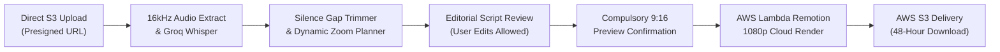

# AI Shorts Polisher (`ai-shorts-polisher.md`)

> **Single Source of Truth** for the 9:16 Vertical Shorts & Reels Polishing Workflow in [Itnavideo](https://www.itnavideo.com).
> Specially designed for mobile vloggers, talking-head influencers, and vertical smartphone shoots on YouTube Shorts, Instagram Reels, and TikTok.

---

## 1. Overview & Purpose

**AI Shorts Polisher** (`aiShortsPolisher`) transforms raw smartphone video clips and multi-take vertical shoots into high-retention, publication-ready vertical short videos (`1080×1920` @ 30 FPS MP4) up to 90 seconds long.

It automates the essential mobile creator editing workflow:
1. **Auto Silence & Gap Cutter (Jump Cuts)**: Identifies pauses, stuttered takes, and dead-air, instantly slicing them out to produce the fast, punchy pacing expected on TikTok and Reels.
2. **Dynamic Camera Punch-Ins (+12% Zoom)**: Alternates scale between 1.0× and 1.12× on key phrases using smooth spring physics to break visual monotony on mobile screens.
3. **Dual Media Handling**:
   - **Primary Vertical Media**: Full-screen 9:16 smartphone clips or multi-take shoot footage.
   - **Floating Layer Overlays (Picture-in-Picture)**: Floating graphics, product shots, tweets, or reaction videos positioned with subtle drop shadows and entrance spring animations.
4. **50 Kinetic Word-Highlighting Caption Styles**: Word-by-word active highlighting with bright yellow and orange emphasis positioned cleanly within the mobile safe viewing zone (avoiding UI icons).
5. **Ducked 12% Background Music & SFX**: 13 curated AWS S3 background tracks or custom uploads ducked to 12% volume during speech, with synchronized transition sound effects.
6. **Compulsory Visual Review Gate**: Interactive 9:16 smartphone preview simulator with a mandatory confirmation checkbox gating the final render.

---

## 2. Key Specifications & Limits

| Attribute | Specification |
| :--- | :--- |
| **Video Type ID** | `aiShortsPolisher` / `ai-shorts-polisher` |
| **Remotion Composition ID**| `AI-SHORTS-POLISHER` |
| **Template Location** | `remotion/templates/AI_SHORTS_POLISHER/template.tsx` |
| **Dashboard Studio** | `components/dashboard/AiShortsPolisherStudio.tsx` |
| **Subpage Client** | `components/dashboard/subpages/AiShortsPolisherPageClient.tsx` |
| **Dashboard Route** | `/dashboard/ai-shorts-polisher` |
| **Aspect Ratio** | **Strictly 9:16 Vertical Only** (`1080×1920` Full HD) |
| **Frame Rate** | 30 FPS MP4 |
| **Max Video Duration** | Up to **90 Seconds (90s / 2,700 frames)** |
| **Credit Rate** | **Strictly 1 Credit** per video (Master Rule 4.1 for 9:16 Short-Form) |
| **Primary Media Input** | Fullscreen 9:16 smartphone video takes / images (MP4, MOV, WebM, PNG, JPG) |
| **Layer Media Input** | Floating Picture-in-Picture overlay graphics, screenshots, or secondary clips |
| **Audio Ducking** | Background music defaulted to **12% volume (`0.12`)** during speech |
| **Transcription Engine** | Extracted 16kHz mono audio → Groq Whisper Cloud API (Fallback: Google Gemini 2.0 Flash) |
| **Cloud Render Engine** | AWS Lambda Remotion Engine |
| **Storage & Lifecycle** | AWS S3 with 48-hour secure signed download lifecycle |

---

## 3. Dedicated Internal Components (Rule 8.B.4 Compliance)

Per **Rule 8.B.4 of `AGENTS.md` (Anti-Repetition & Visual Diversity Policy)**, this video type utilizes dedicated visual components tailored for vertical short-form engagement:

- **Neon Stat Proof Callouts (`NeonStatCallout.tsx`)**: High-contrast vertical stat badge with glowing rings and particle effects for viral numbers (`$290K`, `81%`, `5000+`).
- **Blackout Retention Cards (`BlackoutRetentionCard.tsx`)**: Sudden vertical blackout frame with spring-centered keyword (`WAIT`, `THE SECRET`, `STEP 1`) resetting viewer scroll reflexes.
- **Animated Curved Arrow Callouts (`CurvedArrowCallout.tsx`)**: Dynamic SVG path drawing with spring-bounced arrowheads that point directly toward important on-screen items.
- **Step-by-Step Equation & Formula Cards (`EquationFormulaCard.tsx`)**: Mobile-optimized 3-box calculation card (`[A] × [B] = [C]`) with staggered spring entrance.
- **Side-by-Side Comparison Banners (`SideBySideComparisonBanner.tsx`)**: Stacked vertical comparison cards showing "Bad Way" vs "Winning Pro Way".
- **Vertical Safe-Zone Captions**: Positioned in the middle-lower third (above Instagram/TikTok action bars and below profile headers) with bold font weights and high-contrast color highlights.
- **Floating PIP Card**: Spring-animated card layout with rounded corners (`rounded-2xl`) and shadow elevation suited for smartphone screen proportions.
- **Dynamic Camera Punch-In Controller**: High-retention spring zoom calibrated specifically for talking-head smartphone framing.
- **Jump-Cut Splicer**: Eliminates dead air between takes without introducing audio clicks or visual artifacts.

---

## 4. Pipeline Stages & Execution Flow



1. **Direct Cloud Upload**: Vertical video takes and overlay graphics upload directly to AWS S3 using presigned multipart URLs.
2. **Neural Speech Transcription**: Groq Whisper transcribes speech audio into millisecond-accurate word timestamps (with automatic failover to Google Gemini 2.0 Flash).
3. **Editorial Markdown Editor**: Creators can edit spelling or transcript typos directly in the dashboard before initiating render.
4. **Pacing & Jump-Cut Processing**: Dead pauses and breath gaps are trimmed, and dynamic camera punch-ins (+12%) are computed at natural spoken sentence breaks.
5. **Compulsory Preview Gate**: Creators review their draft inside a realistic 9:16 phone mockup and confirm their approval.
6. **AWS Cloud Render**: AWS Lambda renders 1080×1920 frames at 30 FPS. The completed short is stored on AWS S3 with a 48-hour download link.

---

## 5. Remotion Input Props Schema (`inputProps`)

```typescript
export interface AiShortsPolisherProps {
  // Source Media
  mediaUrl: string;                  // Primary 9:16 video or image URL
  mediaType?: "video" | "image";     // Media type indicator
  additionalClips?: Array<{          // Multi-take sequential clips
    url: string;
    durationInSeconds?: number;
  }>;
  layerMediaUrl?: string;            // Picture-in-Picture overlay media
  layerMediaType?: "video" | "image";
  layerPosition?: "top-right" | "center" | "top-left";

  // Editing Directives
  autoJumpCuts?: boolean;            // Enable silence gap removal
  dynamicZoom?: boolean;             // Enable +12% camera punch-in
  zoomIntensity?: number;            // Default: 1.12 (12% punch-in)

  // Subtitles & Captions
  transcript?: Array<{
    text: string;
    start: number;
    end: number;
    words?: Array<{ word: string; start: number; end: number }>;
  }>;
  captionStyleId?: string;           // One of 50 kinetic caption presets
  captionFontSize?: number;          // Default: 52px for vertical readability

  // Audio Controls
  backgroundMusicUrl?: string;       // AWS S3 curated track or custom upload
  backgroundMusicVolume?: number;    // Default: 0.12 (12% ducked volume)
  sfxEnabled?: boolean;              // Enable zoom & callout SFX

  // Timeline & Canvas
  durationInFrames: number;          // Clamped up to 2,700 frames (90 seconds)
  fps: number;                       // 30 FPS
  width: number;                     // 1080
  height: number;                    // 1920
}
```

---

## 6. Error Handling & Credit Protection

- **Silence / No Speech Detected**: Automatically triggers a full credit refund; user is informed to upload footage with clear speech.
- **Upload Interruption**: Client-side chunk retries ensure large phone video files upload reliably without server crashes. Zero credits deducted on upload failure.
- **Render Worker Failure**: AWS Lambda timeout automatically invokes `releaseReservedRenderUsageFromServer` to restore credits immediately.
- **Secure File Delivery**: Generated shorts remain available via signed AWS S3 links for 48 hours, automatically re-signed on demand.
