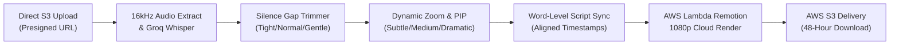

# AI YouTube Video Polisher (`ai-video-polisher.md`)

> **Single Source of Truth** for the 16:9 Widescreen YouTube Video Polishing & Auto-Editing Workflow in [Itnavideo](https://www.itnavideo.com).
> Engineered for YouTube creators, vloggers, educators, podcasters, and multi-take smartphone shoots that need publication-ready jump-cuts, dynamic punch-in zooms, and picture-in-picture graphics.

---

## 1. Overview & Purpose

**AI YouTube Video Polisher** (`aiVideoPolisher`) takes raw recorded video footage and automatically produces a broadcast-quality 16:9 widescreen video (`1920×1080` @ 30 FPS MP4) up to 5 minutes long.

It automates tedious post-production steps via a unified **4-Step Stepper**:
1. **Auto Silence & Gap Cutter with Sensitivity**: Detects awkward pauses, breath gaps, and silent dead-air with 3 sensitivity levels: **Tight** (fast-paced), **Normal** (standard YouTube), or **Gentle** (relaxed podcasts).
2. **Smart Camera Punch-Ins (Dynamic Zoom)**: Automatically alternates scale at sentence boundaries with customizable strength: **Subtle (+5%)**, **Standard (+12%)**, or **Dramatic (+18%)**.
3. **Multi-Take Reordering & Trimming**:
   - Creators can upload multiple video takes, reorder them up/down with 1 click, and set in/out trim seconds directly inside the dashboard.
4. **Picture-in-Picture (PIP) with Flexible Positioning**:
   - Floating callout images, product screenshots, or secondary reaction videos positioned in **Top-Right**, **Top-Left**, **Bottom-Right**, **Bottom-Left**, or **Center/Split**.
5. **Word-Level Script & Misheard Name Corrector**:
   - A dedicated quick-replacer allows creators to correct mistranscribed brand names or jargon while preserving audio timestamp synchronization.
6. **32 Broadcast & Kinetic Subtitle Presets**:
   - Clean Netflix-style documentary, studio podcast, Huberman lecture, Vox, and kinetic motion styles with search and category filters.
7. **Visual Retention Callouts**:
   - Built-in UI controls for Animated Curved Arrows, Multi-Step Equation/Formula Cards, and Side-By-Side Comparison Banners.
8. **Live Dynamic 16:9 Cinema Simulator**:
   - An interactive dark preview player showing live punch-in scale, PIP position, and animated caption style before launching cloud render.

---

## 2. Key Specifications & Limits

| Attribute | Specification |
| :--- | :--- |
| **Video Type ID** | `aiVideoPolisher` / `ai-video-polisher` |
| **Remotion Composition ID**| `AI_VIDEO_POLISHER` |
| **Template Location** | `remotion/templates/AI_VIDEO_POLISHER/template.tsx` |
| **Dashboard Studio** | `components/dashboard/AiVideoPolisherStudio.tsx` |
| **Subpage Client** | `components/dashboard/subpages/AiVideoPolisherPageClient.tsx` |
| **Dashboard Route** | `/dashboard/ai-video-polisher` |
| **Aspect Ratio** | **Strictly 16:9 Widescreen Only** (`1920×1080` Full HD) |
| **Frame Rate** | 30 FPS MP4 |
| **Max Video Duration** | Up to **5 Minutes (300 seconds / 9,000 frames)** |
| **Credit Rate** | **1 Min = 1 Credit** (1m=1, 2m=2, 3m=3, 4m=4, 5m=5 Credits Max) |
| **Primary Media Input** | Single or multiple sequential 16:9 video takes / images (MP4, MOV, WebM, PNG, JPG) |
| **Layer Media Input** | Floating Picture-in-Picture overlay graphics or secondary video clips |
| **Audio Ducking** | Background music defaulted to **12% volume (`0.12`)** during speech |
| **Transcription Engine** | Extracted 16kHz mono audio → Groq Whisper Cloud API (Fallback: Google Gemini 2.0 Flash) |
| **Cloud Render Engine** | AWS Lambda Remotion Engine |
| **Storage & Lifecycle** | AWS S3 with 48-hour secure signed download lifecycle |

---

## 3. Standard 4-Step Guided Stepper Pipeline

### Step 1: Upload (Primary Takes & PIP Callouts)
- Project Headline / Topic Name.
- Multi-Take Primary Widescreen Upload (Drag & drop with 1-click move up/down sequence reordering and deletion).
- Picture-in-Picture (PIP) Callout Overlays with custom placement (Top-Right, Top-Left, Bottom-Right, Bottom-Left, Center).

### Step 2: Music (Soundtrack & Audio Design)
- 14 AWS S3 Curated Background Tracks (Lo-fi, Ambient Piano, Upbeat, Story, Cinematic, Chill).
- In-card audio audition player with play/pause.
- BGM Volume Ducking slider (0% to 50%, 12% default).
- Custom audio upload support (MP3/WAV/AAC).
- Dynamic transition SFX toggle.

### Step 3: Style (Zooms, Cuts, Captions & Callouts)
- Auto Silence Gap Cutter (Tight, Normal, Gentle).
- Smart Camera Punch-In Zooms (Subtle +5%, Standard +12%, Dramatic +18%).
- 32 Kinetic & Broadcast Subtitle Presets with category filters and search.
- Misheard Word / Brand Name quick-replace tool.
- Visual Retention Callout Cards (Curved Arrow, Equation Formula, Comparison Banner).

### Step 4: Preview (16:9 Cinema Simulator)
- Real-time 16:9 Widescreen Cinema Simulator with live zoom scale, PIP callout, and kinetic caption text.
- Summary recap card (Clips count, silence sensitivity, punch-in scale, soundtrack, caption style).
- Single-click AWS Lambda 1080p Cloud Render trigger.

---

## 4. Pipeline Stages & Execution Flow

1. **Upload Staging**: Primary clips and overlay layers upload directly to AWS S3 via presigned multipart URLs, bypassing server payload bottlenecks.
2. **Speech Transcription**: Groq Whisper extracts word-by-word millisecond timestamps from 16kHz mono audio. If rate limits occur, failover routes seamlessly to Google Gemini 2.0 Flash.
3. **Word-Level Script Alignment**: Creators can correct names or jargon, and the backend aligns token updates without losing millisecond timestamp alignment.
4. **Pacing & Punch-In Synthesis**: The pipeline calculates silence gaps based on selected sensitivity (`tight`, `normal`, `gentle`) and tags camera zoom punch-in frames (+5%, +12%, +18%) at sentence breaks.
5. **Interactive Preview**: The creator views their draft in the 16:9 live preview simulator with live zoom and PIP positioning.
6. **Cloud Render & Delivery**: AWS Lambda renders 1080p frames across distributed cores. The completed MP4 is saved to AWS S3 and delivered via a signed download URL.
