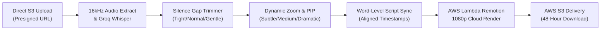

# AI YouTube Video Polisher (`ai-video-polisher.md`)

> **Single Source of Truth** for the 16:9 Widescreen YouTube Video Polishing & Auto-Editing Workflow in [Itnavideo](https://www.itnavideo.com).
> Engineered for YouTube creators, vloggers, educators, podcasters, and multi-take smartphone shoots that need publication-ready jump-cuts, dynamic punch-in zooms, and picture-in-picture graphics.

---

## 1. Overview & Purpose

**AI YouTube Video Polisher** (`aiVideoPolisher`) takes raw recorded video footage and automatically produces a broadcast-quality 16:9 widescreen video (`1920×1080` @ 30 FPS MP4) up to 5 minutes long.

It automates the tedious post-production steps that YouTubers spend hours doing manually:
1. **Auto Silence & Gap Cutter with Sensitivity**: Detects awkward pauses, breath gaps, and silent dead-air with 3 sensitivity levels: **Tight** (fast-paced), **Normal** (standard YouTube), or **Gentle** (relaxed podcasts).
2. **Smart Camera Punch-Ins (Dynamic Zoom)**: Automatically alternates scale at sentence boundaries with customizable strength: **Subtle (+5%)**, **Standard (+12%)**, or **Dramatic (+18%)**.
3. **Multi-Take Reordering & Trimming**:
   - Creators can upload multiple video takes, reorder them up/down with 1 click, and set in/out trim seconds directly inside the dashboard.
4. **Picture-in-Picture (PIP) with Flexible Positioning**:
   - Floating callout images, product screenshots, or secondary reaction videos positioned in **Top-Right**, **Top-Left**, **Bottom-Right**, **Bottom-Left**, or **Center/Split**.
5. **Word-Level Script & Misheard Name Corrector**:
   - A dedicated quick-replacer allows creators to correct mistranscribed brand names or jargon while preserving audio timestamp synchronization.
6. **40+ Broadcast & Kinetic Subtitle Presets**:
   - Clean Netflix-style documentary, studio podcast, Huberman lecture, Vox, and kinetic motion styles with search and category filters.
7. **Visual Retention Callouts**:
   - Built-in UI controls for Animated Curved Arrows, Multi-Step Equation/Formula Cards, and Side-By-Side Comparison Banners.
8. **Live Dynamic 16:9 Preview Simulator & Audio Spectrum**:
   - An interactive dark preview player showing live punch-in scale, PIP position, and animated speech activity bars.

---

## 2. Key Specifications & Limits

| Attribute | Specification |
| :--- | :--- |
| **Video Type ID** | `aiVideoPolisher` / `ai-video-polisher` |
| **Remotion Composition ID**| `AI_VIDEO_POLISHER` |
| **Template Location** | `remotion/templates/AI_VIDEO_POLISHER/template.tsx` |
| **Dashboard Studio** | `components/dashboard/AiVideoPolisherStudio.tsx` |
| **Subpage Client** | `components/dashboard/subpages/AiVideoPolisherPageClient.tsx` |
| **Dashboard Route** | `/dashboard/ai-video-polisher` |
| **Aspect Ratio** | **Strictly 16:9 Widescreen Only** (`1920×1080` Full HD) |
| **Frame Rate** | 30 FPS MP4 |
| **Max Video Duration** | Up to **5 Minutes (300 seconds / 9,000 frames)** |
| **Credit Rate** | **1 Min = 1 Credit** (1m=1, 2m=2, 3m=3, 4m=4, 5m=5 Credits Max) |
| **Primary Media Input** | Single or multiple sequential 16:9 video takes / images (MP4, MOV, WebM, PNG, JPG) |
| **Layer Media Input** | Floating Picture-in-Picture overlay graphics or secondary video clips |
| **Audio Ducking** | Background music defaulted to **12% volume (`0.12`)** during speech |
| **Transcription Engine** | Extracted 16kHz mono audio → Groq Whisper Cloud API (Fallback: Google Gemini 2.0 Flash) |
| **Cloud Render Engine** | AWS Lambda Remotion Engine |
| **Storage & Lifecycle** | AWS S3 with 48-hour secure signed download lifecycle |

---

## 3. Dedicated Internal Components (Rule 8.B.4 Compliance)

Per **Rule 8.B.4 of `AGENTS.md` (Anti-Repetition & Visual Diversity Policy)**, this video type uses dedicated visual components engineered specifically for 16:9 widescreen YouTube aesthetics:

- **Neon Stat Proof Callouts (`NeonStatCallout.tsx`)**: Spring-loaded numeric callouts with glowing emerald/cyan particle rings for high-impact proof figures (e.g., `$293,071`, `81%`, `₹5,000`).
- **Blackout Retention Cards (`BlackoutRetentionCard.tsx`)**: Full-frame blackout pattern interrupts with bold kinetic typography resetting viewer attention at key beats (`RETHINK`, `THE PROOF`, `RULE #1`).
- **Animated Curved Arrow Callouts (`CurvedArrowCallout.tsx`)**: Dynamic SVG path drawing with spring-bounced arrowheads that guide the viewer's eyes directly toward UI buttons, thumbnails, or screenshot evidence.
- **Step-by-Step Equation & Formula Cards (`EquationFormulaCard.tsx`)**: 3-box calculation card (`[Views] × [RPM] = [Revenue]`) with staggered spring entrance for financial and tutorial breakdowns.
- **Side-by-Side Comparison Banners (`SideBySideComparisonBanner.tsx`)**: Dual-column contrast banner comparing "Standard Method" (in subtle red) vs "Pro Winner" (in glowing emerald).
- **Widescreen Lower-Third Captions**: Wide-format text containers designed for 1920×1080 resolution, avoiding vertical reel word flashes.
- **Picture-in-Picture (PIP) Callout Window**: Multi-position container (top-right, top-left, bottom-right, bottom-left, center) with spring-loaded scale-in and soft cinematic elevation.
- **Dynamic Camera Punch-In Controller**: Spring-interpolated frame zoom (+5%, +12%, +18%) that alternates scale on sentence boundaries.
- **Jump-Cut Transition Blends**: Clean cuts on audio silence thresholds to maintain video pacing without visual warping.

---

## 4. Pipeline Stages & Execution Flow



1. **Upload Staging**: Primary clips and overlay layers upload directly to AWS S3 via presigned multipart URLs, bypassing server payload bottlenecks.
2. **Speech Transcription**: Groq Whisper extracts word-by-word millisecond timestamps from 16kHz mono audio. If rate limits occur, failover routes seamlessly to Google Gemini 2.0 Flash.
3. **Word-Level Script Alignment**: Creators can correct names or jargon, and the backend aligns token updates without losing millisecond timestamp alignment.
4. **Pacing & Punch-In Synthesis**: The pipeline calculates silence gaps based on selected sensitivity (`tight`, `normal`, `gentle`) and tags camera zoom punch-in frames (+5%, +12%, +18%) at sentence breaks.
5. **Interactive Preview**: The creator views their draft in the 16:9 live preview simulator with live zoom and PIP positioning.
6. **Cloud Render & Delivery**: AWS Lambda renders 1080p frames across distributed cores. The completed MP4 is saved to AWS S3 and delivered via a signed download URL.

---

## 5. Remotion Input Props Schema (`inputProps`)

```typescript
export interface AiVideoPolisherProps {
  // Source Media
  mediaSrc: string;                  // Primary video or image URL
  mediaItems?: Array<{               // Multi-take sequential clips
    id: string;
    url: string;
    type?: 'video' | 'image';
    durationSeconds?: number;
  }>;
  layerItems?: Array<{               // Picture-in-Picture overlay media
    id: string;
    url: string;
    type: 'video' | 'image';
    title?: string;
    startSeconds?: number;
    durationSeconds?: number;
    position?: 'top-right' | 'top-left' | 'bottom-right' | 'bottom-left' | 'center';
  }>;

  // Editing Directives
  silenceJumpCuts?: boolean;
  silenceSensitivity?: 'tight' | 'normal' | 'gentle';
  smartPunchIns?: boolean;
  punchInIntensity?: 'subtle' | 'medium' | 'dramatic';

  // Subtitles & Audio
  captions?: CaptionSegment[];
  captionStyle?: string;
  bgmUrl?: string;
  bgmVolume?: number;
  enableSfx?: boolean;
  durationSeconds?: number;

  // Visual Callouts
  curvedArrows?: ArrowItem[];
  equationFormula?: EquationFormulaData;
  comparisonBanner?: ComparisonBannerData;
}
```
