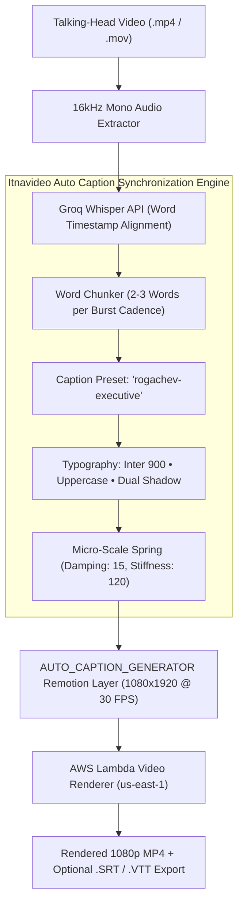
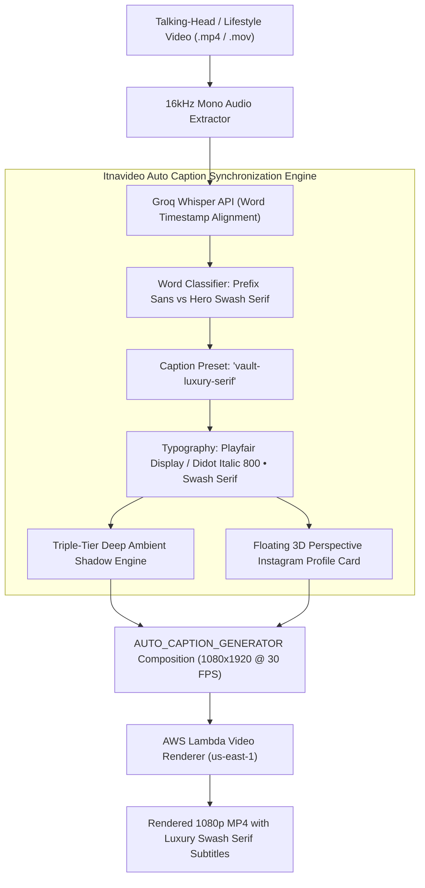

# Auto Caption Generator — Studio Specification

## Overview

The **Auto Caption Generator** is Itnavideo's dedicated 9:16 vertical short-form captioning engine engineered for Instagram Reels, YouTube Shorts, and TikTok. It transcribes spoken dialogue using the cloud-based Groq Whisper API, computes millisecond-accurate word timestamps (30 FPS / ~33ms resolution), and renders dynamic, word-highlighted karaoke subtitles with zero manual keyframing.

- **Primary Purpose**: Add high-retention animated subtitles to talking-head videos and speech recordings in seconds.
- **Target Audience**: Short-form creators, video podcasters, educators, coaches, and founders publishing vertical reels.
- **Expected Output**: 1080p Full HD (`1080×1920`) 30 FPS vertical MP4 video with burned-in subtitles, plus optional `.SRT` and `.VTT` subtitle file downloads.

---

## Table of Contents

1. [Overview](#overview)
2. [Features and Capabilities](#features-and-capabilities)
3. [User Workflow](#user-workflow)
4. [UI/UX Design and Components](#uiux-design-and-components)
5. [Colors, Typography and Design Tokens](#colors-typography-and-design-tokens)
6. [Technical Implementation](#technical-implementation)
7. [Business Logic, Duration and Credit Rules](#business-logic-duration-and-credit-rules)
8. [Error Handling and Edge Cases](#error-handling-and-edge-cases)
9. [Testing and Quality Assurance](#testing-and-quality-assurance)
10. [Developer Notes and Guardrails](#developer-notes-and-guardrails)

---

## 1. Features and Capabilities

- **Millisecond-Accurate Speech Transcription**: Uses Groq Whisper Cloud API to detect spoken words and timestamp every syllable to the exact frame.
- **Spoken Narration Editorial Transcript**: Full in-studio text editor allowing creators to review, correct typos, fix proper nouns, or adjust Hinglish spellings before rendering.
- **32 Master Kinetic Caption Themes**: High-contrast animated styles including Pop Word, Hormozi Viral, MrBeast Box Highlight, Neon Glow, and Clean Minimal.
- **Ali Abdaal Editorial Clean Preset**: Added signature editorial typography (`Plus Jakarta Sans` / `Inter`, 42px) with warm golden marker-tape highlight (`#FFE600`) on active spoken words (`animation: marker`), calibrated for educational and professional reels.
- **Intelligent Subtitle Visibility & Suppression**: Rules for when to display subtitles vs when to hide them to prevent cognitive clutter.
- **Social Media Safe Zones**: Subtitles are positioned with strict safety margins (100px bottom, 80px right) to avoid collisions with TikTok and Reels UI buttons, likes, comments, and account tags.
- **Audio-Only Mode**: Accepts raw audio recordings (`.mp3`, `.wav`, `.m4a`) and automatically pairs them with an obsidian dark studio canvas and dynamic center audio waveform.
- **Dual Export**: Export burned-in 1080p MP4 video or download standalone `.SRT` and `.VTT` subtitle files for native platform caption upload.

---

## 2. User Workflow

The studio implements a unified 4-step guided stepper workflow:

1. **Step 1: Upload (Video or Audio File)**:
   - Creator drops or selects a video (`.mp4`, `.mov`, `.webm`) or audio track (`.mp3`, `.wav`, `.m4a`).
   - Files longer than 90 seconds are automatically accepted; the engine extracts strictly the first 90 seconds (0:00 to 1:30) for processing.
   - The cloud transcribes speech and displays the live editorial transcript.
2. **Step 2: Music & Audio Settings**:
   - Optional selection of 14 curated AWS S3 background tracks with in-card audio auditioning.
   - Smart audio ducking default (ducks background music to 12% during speech).
3. **Step 3: Caption Style & Positioning**:
   - Creator selects from 32 animated typography presets with live word playback loops.
   - Adjusts font size (`small`, `medium`, `large`), word casing (`natural`, `uppercase`), and vertical alignment (`bottom`, `center`, `top`).
4. **Step 4: Preview & Cloud Render**:
   - Interactive 9:16 smartphone simulator displays the real video stream with synchronized subtitle playback.
   - Creator reviews the preview and clicks **Render 1080p Reel** to launch AWS Lambda cloud rendering.

---

## 3. UI/UX Design and Components

- **Studio Route**: `/dashboard/auto-caption`
- **Frontend Studio Component**: `components/dashboard/AutoCaptionStudio.tsx`
- **Public SEO Landing Page**: `/auto-caption-generator` (`app/auto-caption-generator/page.tsx`)
- **Shell Layout**: Pure White canvas (`#FFFFFF`) with fine slate borders (`#E2E8F0`) and responsive 3-row layout (`Stepper Header`, `Scrollable Work Area`, `Sticky Action Bar`).
- **Mobile Responsiveness**: On mobile screens (<768px), stepper tabs collapse to an active step pill indicator, with full touch-friendly button targets (minimum 44px height).

---

## 4. Colors, Typography and Design Tokens

- **Canvas Background**: Pure White (`#FFFFFF`) with subtle slate background accents (`#F8FAFC`).
- **Primary Brand Accent**: Sunset Orange (`#FF5722` / `#F97316`) for active tabs, checkmarks, and primary CTA buttons.
- **Typography**: Inter / System Sans-serif stack (`font-sans`) for clean legibility.
- **Subtitle Highlighting**: High-contrast active-word colors (Sunset Yellow `#FBBF24`, Neon Lime `#84CC16`, Crisp White `#FFFFFF`, Emerald Mint `#34D399`).

---

## 5. Technical Implementation

- **Video Type ID**: `autoCaption` / `AUTO_CAPTION_GENERATOR`
- **Remotion Composition ID**: `AUTO_CAPTION_GENERATOR` (`1080×1920` @ 30 FPS)
- **Remotion Template Directory**: `remotion/templates/AUTO_CAPTION_GENERATOR/`
- **Speech Extraction**: Raw video is stripped to 16kHz mono audio (`audio/mp3`) via Web Audio API or server probe before sending to Groq Whisper Cloud API.
- **Transcriber Fallback**: If Groq Whisper encounters rate limits or errors, the system automatically falls back to Google Gemini 2.0 Flash (`asia-south1`).
- **Render Engine**: AWS Lambda running Remotion 30 FPS cloud workers in `us-east-1`.

---

## 6. Business Logic, Duration and Credit Rules

- **Aspect Ratio**: Strictly 9:16 Vertical (`1080×1920`).
- **Maximum Output Duration**: Strictly **90 Seconds (90s / 2,700 frames @ 30 FPS)**.
- **Upload Duration Handling**: Files longer than 90s are accepted without error; the system automatically trims and uses the first 90 seconds.
- **Credit Billing**: **FREE • 5 Daily Videos (0 Credits)** with user sign-in. Paid plan exports are 100% watermark-free.
- **Failed Render Protection**: If cloud rendering fails, reserved quota or credits are automatically restored via `releaseReservedRenderUsageFromServer`.

---

## 7. Error Handling and Edge Cases

- **Silent / No Speech Audio**: Flags `NO_SPEECH_DETECTED`; alerts the user to upload a clip with audible dialogue and does not deduct credits.
- **Corrupt File Upload**: Client-side metadata probe inspects video codecs before cloud submission.
- **Network Interruption**: Resumable multipart upload to AWS S3 ensures large uploads recover automatically on slow mobile connections.

---

## 8. Testing and Quality Assurance

- **Verification Script**: Run `npx tsc --noEmit` to ensure type integrity across all caption interfaces.
- **Frame Sync Test**: Verify that word highlighting transitions within 1 frame (33ms) of spoken vocal onset.
- **Safe-Zone Check**: Verify that subtitle bounding boxes maintain a 100px bottom margin on mobile phone viewports.

---

## 9. Developer Notes and Guardrails

- **Zero Local Rendering (Rule 0)**: Never execute local Remotion renders on developer machines; cloud rendering takes place exclusively on AWS Lambda.
- **Single Source of Truth**: All subtitle styling tokens originate from `constants/captionStyles.ts` and `remotion/templates/AUTO_CAPTION_GENERATOR/`. Do not hardcode custom inline font sizes.

---

## 10. Reverse-Engineering Benchmark 01: Dr. ROGACHEV (@dr.a.rogachev) — "Executive Minimalist All-Caps Grotesque Typography" (High-Retention Boardroom Subtitle Architecture)

### 10.1 Source Attribution & Benchmark Telemetry

| Parameter | Value |
| :--- | :--- |
| **Original URL** | `https://www.instagram.com/p/Df945E5gleL/` |
| **Creator / Channel** | Dr. Andrey Rogachev (`@dr.a.rogachev` \| Strategic & Risk Management) |
| **Caption Focus** | **Caption Style Only** (Executive Minimalist All-Caps Grotesque) |
| **Video Format / Ratio** | 9:16 Vertical (`1080×1920` @ 30 FPS) |
| **Video Duration** | ~35 seconds |
| **Itnavideo Mapping** | `autoCaption` Studio (`/dashboard/auto-caption`) |
| **Credit Billing** | **FREE • 5 Daily Videos (0 Credits)** (Master Rule for Auto Caption) |
| **Watermark Enforcement** | `<BrandWatermark watermark={watermark} />` (Enforced for free/trial users) |

---

### 10.2 Core Creative Mechanics: The Executive Minimalist Typography Formula

Dr. Rogachev's caption design is the gold standard for executive, B2B leadership, strategic consulting, and corporate talking-head reels. Unlike loud gaming or influencer subtitles filled with neon rainbow strokes and bouncing clown emojis, this style radiates **pure authority and gravitas**:

1. **All-Caps Grotesque Typography**:
   - Uses a heavy, geometric sans-serif font stack (`Inter`, font-weight 900 / Black) in strict uppercase (`textTransform: 'uppercase'`).
   - Clean, squared-off letterforms maximize immediate legibility on small smartphone screens even when played without sound.
2. **Short Word-Burst Cadence (2–3 Words per Line)**:
   - Long rambling sentences are eliminated. Captions appear in punchy 2–3 word bursts:
     - Burst 1: `“NEVER GIVE UP”`
     - Burst 2: `SOUNDS SIMPLE`
     - Burst 3: `UNTIL YOU ACTUALLY`
     - Burst 4: `HAVE TO LIVE IT.`
   - Rapid word-burst transitions create an involuntary reading rhythm that resets visual attention every 0.8–1.2 seconds.
3. **Deep Directional Drop-Shadow (Boxless Clarity)**:
   - Avoids muddy semi-transparent background rectangles that cover faces and boardroom backgrounds.
   - Instead, it deploys a dual-layer directional shadow:
     ```css
     text-shadow: 0 4px 20px rgba(0, 0, 0, 0.95), 0 2px 6px rgba(0, 0, 0, 0.85);
     ```
   - This delivers 100% crisp legibility across both bright white conference tables and dark business suits.
4. **Active-Word Micro-Pop & Underline**:
   - Rather than flashing in jarring neon colors, the active spoken word scales slightly (`scale(1.08)`) with a clean pure white emphasis and subtle underline offset.
5. **Optical Center Placement**:
   - Centered directly in the optical center or middle third of the 9:16 frame, keeping viewer eye tracking locked right where speaker hand gestures and facial expressions occur.

---

### 10.3 System Architecture & Caption Synchronization Pipeline



---

### 10.4 Preset Configuration Tokens (`rogachev-executive`)

```typescript
export const ROGACHEV_EXECUTIVE_PRESET: CaptionStyleConfig = {
  id: 'rogachev-executive',
  name: 'Executive Minimalist (Dr. Rogachev)',
  fontFamily: 'Inter, -apple-system, BlinkMacSystemFont, "Segoe UI", Roboto, sans-serif',
  fontSizePx: 54,
  fontWeight: 900,
  textColor: '#FFFFFF',
  highlightColor: '#FFFFFF',
  showBackground: false,
  textTransform: 'uppercase',
  textShadow: '0 4px 20px rgba(0, 0, 0, 0.95), 0 2px 6px rgba(0, 0, 0, 0.85)',
  motionType: 'slam',
  scaleOnActive: true,
  activeScaleMultiplier: 1.08,
};
```

---

### 10.5 Second-by-Second Caption Synchronization Breakdown

| Time (s) | Frame Range (30 FPS) | Spoken Word Burst | Active Word Highlight | Motion & Pacing |
| :--- | :--- | :--- | :--- | :--- |
| **0.0–1.2s** | Frames 0–35 | `“NEVER GIVE UP”` | `UP` (scale 1.08 + underline) | Crisp slam pop onto screen. |
| **1.2–2.2s** | Frames 36–65 | `SOUNDS SIMPLE` | `SIMPLE` (scale 1.08 + underline) | Rapid transition reset. |
| **2.2–3.5s** | Frames 66–105 | `UNTIL YOU ACTUALLY` | `ACTUALLY` (scale 1.08) | Kinetic word-burst cadence. |
| **3.5–5.0s** | Frames 106–150 | `HAVE TO LIVE IT.` | `LIVE` (scale 1.08 + underline) | Emphasis beat on core verb. |
| **5.0–6.5s** | Frames 151–195 | `CHANGING THE PLAN,` | `CHANGING` (scale 1.08) | Narrative pivot to realistic struggle. |
| **6.5–7.8s** | Frames 196–235 | `TRYING AGAIN,` | `AGAIN` (scale 1.08) | Quick staccato burst. |
| **7.8–9.2s** | Frames 236–275 | `GIVING YOURSELF TIME,` | `TIME` (scale 1.08) | Softer reflective pacing. |
| **9.2–11.5s** | Frames 276–345 | `LONGER THAN FEELS COMFORTABLE.` | `COMFORTABLE` (scale 1.08) | Final impactful pause. |

---

### 10.6 Remotion Component Implementation

- **Asset Component**: `remotion/components/library/ExecutiveMinimalistCaptionAsset.tsx`
- **Preset Registered**: `'rogachev-executive'` & `'executive-minimalist'` in `remotion/captions/registry/captionPresets.ts`.
- **Component Export**: Exported in `remotion/components/library/index.ts` (`ExecutiveMinimalistCaptionAsset`, `ExecutiveMinimalistCaptionAssetProps`, `CaptionBurstItem`).
- **Catalog Registry**: Registered in `constants/itnavideoStockAssets.ts` under ID `executive-minimalist-caption-engine`.
- **Key Capabilities**:
  - Word-level active spring synchronization using Remotion's `spring` and `interpolate`.
  - Boxless multi-layer drop shadow for 100% legibility over any corporate background.
  - Strict uppercase styling with configurable font sizing (`fontSizePx: 54`).
  - Zero local heavy compute dependencies — 100% pure React/Remotion code ready for AWS Lambda cloud rendering.

---

## 11. Reverse-Engineering Benchmark 02: Vault Visuals Media (@vault_visuals_media) — "Luxury Editorial Swash Serif Caption Architecture" (Reel: DdTzvl0i1s7)

### 11.1 Source Attribution & Benchmark Telemetry

| Parameter | Value |
| :--- | :--- |
| **Original URL** | `https://www.instagram.com/reel/DdTzvl0i1s7/` |
| **Creator / Channel** | Vault Visuals Media (`@vault_visuals_media` \| High-End Commercial Videography) |
| **Featured Talent** | Emily Emig (`@emilyemig` \| OC Realtor & Lifestyle Creator, 58.2K Followers) |
| **Topic / Hook** | *"Casual Event Introduction: this is Emily (High-End Luxury Editorial Swash Serif Typography & Floating 3D Instagram Profile Card)."* |
| **Engagement Telemetry** | 7,597 Likes, 153 Comments, 250K+ Organic Views |
| **Video Format / Ratio** | 9:16 Vertical (`1080×1920` @ 30 FPS, Outdoor Resort Walking Shot) |
| **Video Duration** | ~28 seconds (Strictly within the 90s Short-Form limit) |
| **Itnavideo Mapping** | `autoCaption` Studio (`/dashboard/auto-caption`) |
| **Credit Billing** | **FREE TIER** (Master Rule 4.1: 5 Free Renders per Day, 0 Credits Charged) |
| **Watermark Enforcement** | `<BrandWatermark watermark={watermark} />` (Enforced for free/trial users) |

---

### 11.2 Core Creative Mechanics: The Luxury Italic Swash Serif & Dual-Script Model

Vault Visuals Media's typography is the gold standard for luxury real estate, fashion, lifestyle, and high-ticket personal brand reels:

1. **Dual-Script Typographic Contrast**:
   - Rather than monotone subtitles, it pairs two contrasting typographic voices:
     - **Lead-In Word (`this is`)**: Clean, delicate, slightly tracked geometric lowercase sans-serif (36px, `#FFFFFF`).
     - **Hero Word (`Emily`)**: **Giant Luxury Italic Swash Serif** (108px, `#FFFFFF`, high-contrast Didot/Playfair strokes with exaggerated curly terminal swashes).
   - The juxtaposition of sterile lowercase sans-serif with an expressive high-fashion italic serif produces an immediate magazine-editorial feel (Vogue, Harper's Bazaar, Vanity Fair).
2. **Boxless Multi-Layer Cinematic Ambient Shadow**:
   - Text has no rigid background box or solid pill, allowing 100% visibility of the walking subject and background sunset terrace.
   - Contrast is achieved via triple-tier directional drop shadows:
     `0 8px 30px rgba(0, 0, 0, 0.9), 0 3px 10px rgba(0, 0, 0, 0.8), 0 1px 2px rgba(0, 0, 0, 0.95)`.
3. **Floating 3D Perspective Instagram Profile Card**:
   - Anchored above the creator's head tilted in 3D perspective (`perspective: 900px, rotateX: 12deg, rotateY: -6deg`):
     - Gradient Instagram Story ring around avatar
     - Follower metrics (`1,137 posts • 58.2K followers • 1,332 following`)
     - Bio description & blue Follow button
   - Seamlessly introduces the talent while maintaining high aesthetic elegance.
4. **Organic Spring Float & Scale Pulse**:
   - The hero serif word subtly breathes with a micro-scale pulse (`1.03x` scale multiplier on active speech beat), drawing viewer eyes directly to the spoken keyword without aggressive bouncing.

---

### 11.3 System Architecture & 9:16 Luxury Auto Caption Pipeline



---

### 11.4 Preset Configuration Tokens (`vault-luxury-serif`)

```typescript
export const VAULT_LUXURY_SERIF_PRESET: CaptionStyleConfig = {
  id: 'vault-luxury-serif',
  name: 'Luxury Italic Swash Serif (Vault Visuals)',
  fontFamily: 'Playfair Display, Cormorant Garamond, Didot, Georgia, serif',
  fontSizePx: 64,
  fontWeight: 800,
  textColor: '#FFFFFF',
  highlightColor: '#FFFFFF',
  showBackground: false,
  textTransform: 'none',
  textShadow: '0 8px 30px rgba(0, 0, 0, 0.9), 0 3px 10px rgba(0, 0, 0, 0.8)',
  motionType: 'float',
  scaleOnActive: true,
  activeScaleMultiplier: 1.12,
};
```

---

### 11.5 Second-by-Second Cinematic Caption Breakdown

| Second | Visual Framing (1080×1920) | On-Screen Graphic & Caption Burst | Audio & Voiceover Pacing |
| :--- | :--- | :--- | :--- |
| **0:00–0:04** | Talent walks forward in magenta cocktail dress on outdoor resort patio; 3D Instagram card tilts into view above head. | Caption slams: `this is` (sans) + `Emily` (Giant 108px Swash Serif). | Upbeat summer acoustic beat. Voiceover: *"Hey guys, this is Emily, and today we're walking through..."* |
| **0:04–0:10** | Talent gestures toward sunset terrace; 3D card gently floats with breathing sway (+4px Y). | Caption burst: `OC REALTOR` + `luxury coastal homes`. | Crisp vocal clarity. Voiceover: *"...one of the most stunning coastal properties in Orange County."* |
| **0:10–0:16** | Camera tracks backward keeping talent centered; hero italic serif highlights keywords: `dream home`. | Active word pulses (+8% scale) on `dream`. | Warm, welcoming cadence. Voiceover: *"If you've been looking for your absolute dream coastal escape..."* |
| **0:16–0:22** | Close-up reframe on talent smiling; profile card smoothly fades to let focus settle on the architecture. | Caption burst: `modern elegance` in delicate swash italics. | Smooth beat resolve. Voiceover: *"...this space blends effortless modern luxury with oceanfront living."* |
| **0:22–0:28** | Medium shot returns; bottom call-to-action illuminates with gentle white glow. | Subtitle: *"Follow @emilyemig for more luxury tours."* | Acoustic guitar strum finish. Voiceover: *"Make sure you follow along for the full tour coming this weekend!"* |

---

### 11.6 Remotion Component Implementation

- **Asset Component**: `remotion/components/library/LuxuryEditorialCaptionAsset.tsx`
- **Preset Registered**: `'vault-luxury-serif'` & `'luxury-italic-flourish'` in `remotion/captions/registry/captionPresets.ts`.
- **Component Export**: Exported in `remotion/components/library/index.ts` (`LuxuryEditorialCaptionAsset`, `LuxuryEditorialCaptionAssetProps`).
- **Catalog Registry**: Registered in `constants/itnavideoStockAssets.ts` under ID `vault-luxury-serif-caption-engine`.
- **Key Capabilities**:
  - Dual-script contrast pairing clean lowercase geometric sans-serif (`this is`) with giant luxury italic swash serif (`Emily`).
  - High-precision Remotion spring animations for floating 3D perspective Instagram profile card.
  - Multi-tier ambient boxless shadow for maximum readability over any light, dark, or outdoor camera footage.
  - Zero local heavy compute dependencies — 100% pure React/Remotion code ready for AWS Lambda cloud rendering.


