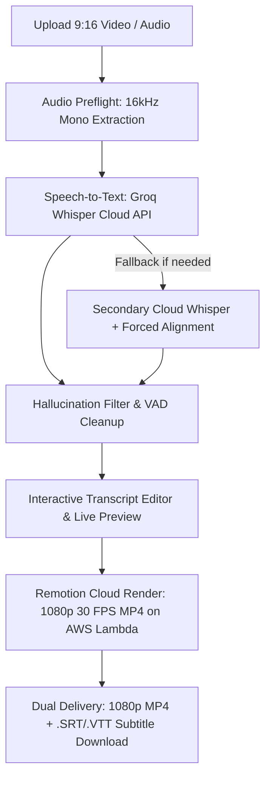

# Auto Caption Generator (`autocaption.md`)

## 1. Overview & Purpose
**Auto Caption Generator** is Itnavideo's executive and high-retention video captioning engine built exclusively for 9:16 short-form video (TikTok, Instagram Reels, YouTube Shorts). Widescreen 16:9 YouTube subtitles use the separate YouTube Subtitle Generator (`youtubesubtitles.md`).

It transcribes spoken dialogue with Groq Whisper, calculates frame-accurate word timestamps (30 FPS / ~33ms resolution), and burns in high-impact animated captions. Creators can review and edit transcripts, preview animations in real time, and export clean 1080×1920 MP4 files in under 45 seconds.

### Target Audience & Use Cases
- **Short-Form Creators**: Instagram Reels, YouTube Shorts, and TikTok creators who need bold, synchronized captions to hook viewers who watch on mute.
- **Podcast Clip Editors**: Creators converting long interviews into bite-sized talking-head reels.
- **Educators & Coaches**: Instructors sharing lessons, tutorials, and quick tips.
- **Founders & Executives**: Leaders publishing company updates, keynote excerpts, and thought leadership.

### What Problem It Solves
Adding word-level animated captions manually takes **15 to 30 minutes per video** in Premiere, CapCut, or After Effects. Auto Caption automates this in seconds with frame-accurate sync, professional typography, safe-zone compliance, and 1-click text editing.

### Core Value Proposition
1. **Frame-Accurate Sync**: Subtitle transitions are locked to video frames (~33ms at 30 FPS) with speech audio.
2. **Transcript Editor (P0)**: Spoken words, names, and Hinglish spellings can be edited directly before rendering.
3. **Structured 3-Axis Style Engine**: Clean combination of Animation × Look × Color without confusing duplicate presets.
4. **Platform Safe Zones**: Guaranteed clearance for Instagram Reels and TikTok bottom handles and right-side action buttons.
5. **Dual Export**: Download burned-in 1080p MP4 or export standalone `.SRT` and `.VTT` subtitle files.

---

## 2. Key Specifications & Limits

| Attribute | Specification |
| :--- | :--- |
| **Video Type ID** | `autoCaption` / `AUTO_CAPTION_GENERATOR` |
| **Internal ID** | `AUTO_CAPTION_REEL` |
| **Composition ID** | `AUTO_CAPTION_GENERATOR` |
| **Template Location** | `remotion/templates/AUTO_CAPTION_GENERATOR/template.tsx` |
| **Dashboard Studio** | `components/dashboard/AutoCaptionStudio.tsx` |
| **Dashboard Route** | `/dashboard/auto-caption` |
| **Aspect Ratio** | **9:16 Vertical Only (1080×1920 Full HD)** |
| **Resolution & Frame Rate** | **1080p Full HD (1080×1920 @ 30 FPS MP4)** |
| **Video Duration** | **3 Seconds to 90 Seconds (90s Max)** |
| **Export Formats** | 1080p MP4 (H.264 + AAC) + Optional `.SRT` / `.VTT` Subtitles |
| **Original Audio** | 100% Preserved (plays exactly as uploaded with zero re-encoding loss) |
| **Free Tier Policy** | **5 Free Renders Daily** (0 Credits, sign-in required). Subtle top-right watermark. |
| **Paid Tier Policy** | **100% Unbranded** (Zero watermarks, full commercial license). |
| **Failed Render Protection**| **Automatic Quota Refund**: If a render or transcription fails, the daily slot or credit is immediately restored. |
| **Design System** | Google Analytics Obsidian Baseline (`#070B14`, `#0E1526`) + Warm Orange Accents |
| **Primary Transcription** | Extracted 16kHz mono audio → Groq Whisper Cloud API (Word-level timestamps) |
| **Fallback Transcription** | Secondary Cloud Whisper API + Forced Alignment (Frame-accurate alignment preserved) |
| **Cloud Engine** | AWS Lambda (Remotion in `us-east-1`) |

---

## 3. User Inputs & Audio-Only Handling

### Supported Inputs
| Input Type | Supported Formats | Visual Canvas Handling |
|:---|:---|:---|
| **Video** | MP4, MOV, WEBM | Plays full-screen behind captions. |
| **Audio-Only** | MP3, WAV, M4A, AAC | Automatically renders on an **Obsidian Dark Studio Canvas** (`#070B14` to `#0E1526` gradient) with a subtle glowing center audio waveform. |

### Input Controls
1. **Media Upload**: File dropzone accepting video or audio up to 90 seconds. If video exceeds 90s, an interactive trim slider allows the creator to select the exact 90-second segment before processing.
2. **Language Toggle**: Simple 2-way toggle:
   - `English` (Default)
   - `Hinglish` (Roman Hindi/Urdu — transcribes Hindi speech into Latin Roman script, eliminating broken Devanagari text).
3. **Style Selector**: 3-Axis visual style picker (Animation × Look × Palette).
4. **Position & Safe Zone**:
   - `Bottom` (Default, 77% down, safe from TikTok/Reels UI)
   - `Center` (50% down)
   - `Top` (20% down)
5. **Transcript Editor (P0)**: Review and edit detected words before burning into the final video.
6. **Text Case Toggle**: `UPPERCASE` (High-energy punch) or `Sentence case` (Standard).
7. **Optional Pop Sound (`wordClickSound`)**: Opt-in (Default: **OFF**). Adds a subtle 120ms debounced typewriter/pop click on word transitions.

### Strict Boundaries — Inputs NOT Collected
- ❌ **No stock B-roll or AI images**: User footage or the Obsidian gradient is the sole background.
- ❌ **No background music**: User video audio is 100% preserved. No BGM is injected.
- ❌ **No AI storyboarding or scene splitting**: Auto Caption is a single-scene continuous overlay.

---

## 4. 9:16 Canvas Layout & Safe Zone Geometry

Short-form platforms (TikTok, Instagram Reels, YouTube Shorts) place dense interface buttons on top of videos. The layout engine enforces strict asymmetrical safe zones:

```
┌─────────────────────────────────────────┐
│              TOP SAFE ZONE              │ ← Profile & Search Bar (~120px)
│                                         │
│                                         │
│                                         │
│                                         │
│               USER VIDEO                │
│           (1080×1920 Canvas)            │
│                                         │
│                                         │
│                                         │
├───────────────────────────────────┬─────┤
│   ┌───────────────────────────┐   │  ♥  │ ← Right UI Action Column
│   │    ANIMATED CAPTIONS      │   │  💬 │   Clearance: 140px right margin
│   │   (Max width: 800px)      │   │  ↗  │   (Likes, Comments, Shares)
│   └───────────────────────────┘   │  ♫  │
├───────────────────────────────────┴─────┤
│             BOTTOM SAFE ZONE            │ ← Handles, Captions & Sound Bar
│              (~23% / 440px)             │   Clearance: Y-position clamped at 77%
└─────────────────────────────────────────┘
```

### Safe Zone Parameters
- **Bottom Clearance**: Default caption placement sits at `bottom: 23%` (Y-center at 77% of canvas height, ~1480px). This keeps text strictly above usernames, sound titles, and scrubber bars.
- **Right UI Clearance**: Right margin is padded by **140px** to avoid the vertical like, comment, share, and remix buttons.
- **Left Margin**: Padded by **60px** for balanced visual weight.
- **Maximum Text Container Width**: Clamped at **840px** (leaving 240px buffer across the 1080px canvas).
- **Non-9:16 Video Handling**:
  - `Center Cover Crop` (Default): Zooms to fill 9:16 canvas.
  - `Fit with Blurred Background`: Preserves entire 16:9 or square frame at center with Gaussian-blurred duplicated video filling the vertical top and bottom.

---

## 5. Structured 3-Axis Style Taxonomy

Rather than managing 50 disconnected style presets, Auto Caption organizes typography into **3 Modular Axes**:

$$\text{Caption Style} = \text{Animation Engine} \times \text{Container Look} \times \text{Color Palette}$$

### Axis 1: Animation Engine (How words appear)
1. `Word Pop`: Words scale in with an elastic spring (`1.00x` $\to$ `1.12x` $\to$ `1.00x`).
2. `Karaoke Fill`: Words reveal color fill smoothly from left to right as spoken.
3. `Shorts Focus`: Only the currently active word is highlighted; previous words fade to clean neutral gray.
4. `Slam Headline`: High-energy single-word punch in the screen center.
5. `Typewriter`: Letter-by-letter mechanical reveal with optional pop sound.
6. `Slide Flow`: Words glide upward gently with subtle opacity fade.

### Axis 2: Container Look (Typography & Background shape)
1. `Clean Floating`: Pure typography with high-contrast text stroke and ambient drop shadow (No bounding box).
2. `Solid Pill`: Rounded pill badge container (`border-radius: 9999px`) behind words.
3. `Highlight Box`: Crisp rectangular backdrop with slight rounded corners (`border-radius: 8px`).
4. `Marker Stroke`: Organic hand-drawn highlighter brush stroke behind the active word.
5. `Editorial Serif`: Elegant serif typography (*Playfair Display* / *Newsreader*) with subtle frosted glass pill.
6. `3D Extruded`: Thick condensed bold font with 3D bottom extrusion and black outline.

### Axis 3: Color Palette (High-contrast presets)
1. `Canary Gold`: Crisp White text + Electric Canary Yellow (`#FACC15`) active word.
2. `Neon Mint`: Crisp White text + Vibrant Mint Green (`#10B981`) active word.
3. `Cyan Pulse`: Crisp White text + Vivid Cyan (`#06B6D4`) active word.
4. `Sunset Coral`: Crisp White text + Coral Orange (`#F97316`) active word.
5. `Crimson Urgent`: Bold White text + Emergency Crimson (`#EF4444`) active word.
6. `Monochrome Minimal`: Pure White text + Neutral Silver (`#94A3B8`) inactive words.

### Master Preset Catalog (Stable IDs)
Common combinations are exposed as 1-click presets in the studio:
- `bold_impact` (Word Pop × Clean Floating × Canary Gold)
- `shorts_focus` (Shorts Focus × Clean Floating × Cyan Pulse)
- `karaoke_flow` (Karaoke Fill × Highlight Box × Canary Gold)
- `executive_pill` (Word Pop × Solid Pill × Monochrome Minimal)
- `marker_explainer` (Word Pop × Marker Stroke × Canary Gold)
- `editorial_luxury` (Slide Flow × Editorial Serif × Canary Gold)
- `comic_pop` (Word Pop × 3D Extruded × Canary Gold)

---

## 6. Dynamic Word Cadence & Deterministic Emphasis

### Smart Cadence Chunking
- **Single-Word Modes (`slam_headline`)**: Strictly 1 word per frame group.
- **Phrase Modes (`bold_impact`, `karaoke_flow`)**: Dynamically groups words into natural spoken phrases of **2 to 4 words** (Maximum duration: 1.4 seconds per group).
- **Silence Tail Protection**: Caption chunk end timestamp is extended by **+120ms tail** (`chunk.end = lastWord.end + 0.12`). This prevents subtitles from abruptly blinking out between rapid sentence pauses.
- **Number & Currency Shield**: Currency symbols, percentages, and numbers (e.g. `\$10,000`, `45%`, `2.5M`, `₹500`) are guaranteed never to be split across line breaks.

### Automatic Keyword Emphasis
Without requiring expensive LLM tokens, the caption engine deterministically highlights key trigger words:
- **Numbers & Metrics**: Any token containing digits (`10x`, `100%`, `\$5,000`) automatically renders in the accent color with `1.08x` scale.
- **UPPERCASE Words**: Spoken words capitalized for emphasis inherit the primary highlight.
- **Click-to-Emphasize**: In the Transcript Editor, creators can click any word to toggle its highlight star on/off.

---

## 7. Dedicated Processing Pipeline (UI Stepper)



### Pipeline Stages
1. **Audio Preflight & Normalization**:
   - Extracts lightweight 16kHz mono audio. Raw video is never sent directly to transcription APIs.
   - Normalizes audio stream and detects true speech duration.
2. **Groq Whisper Transcription**:
   - Generates frame-accurate word timestamps (`start` and `end` times).
   - Hallucination Filter: Automatically purges common Whisper silence hallucinations (`"Thank you for watching"`, `"[Music]"`, `"[Applause]"`).
3. **Interactive Transcript Review (P0)**:
   - Creator can review transcribed sentences in the studio, correct misheard names or brand spellings, and toggle word highlights.
   - Remotion player provides instantaneous in-browser preview without server re-renders.
4. **Lambda 1080p Cloud Render**:
   - Compiles composition with `delayRender()` font verification to prevent fallback font pop-in.
   - Burns in chosen 3-axis styles with frame-accurate sync.
5. **Dual Delivery**:
   - Direct download of final 1080×1920 MP4 (served via high-speed 48-hour S3 presigned URL).
   - One-click export of clean `.SRT` and `.VTT` subtitle caption files.

---

## 8. Remotion Composition Props & Stable Schema

```typescript
export interface SubtitleWord {
  word: string;
  start: number; // in seconds
  end: number;   // in seconds
  isEmphasized?: boolean;
}

export interface SubtitleChunk {
  text: string;
  words: SubtitleWord[];
  start: number;
  end: number;
}

export type CaptionStyleId =
  | 'bold_impact'
  | 'shorts_focus'
  | 'karaoke_flow'
  | 'executive_pill'
  | 'marker_explainer'
  | 'editorial_luxury'
  | 'comic_pop';

export interface AutoCaptionGeneratorProps {
  mediaSrc: string;
  mediaType: 'video' | 'audio';
  subtitleChunks: SubtitleChunk[];
  captionStyle: CaptionStyleId;
  captionPosition: 'top' | 'center' | 'bottom';
  textCase: 'uppercase' | 'original';
  activeWordColor?: string;
  inactiveWordColor?: string;
  fontSize: 'small' | 'medium' | 'large' | 'xlarge';
  fontFamily?: string;
  showWatermark: boolean;
  wordClickSound: boolean;
  non916FitMode?: 'cover_crop' | 'blurred_background';
  durationSeconds: number;
}
```

---

## 9. Edge Cases & Fallback Matrix

| Edge Case | Root Cause | Automated System Action | User Feedback |
|:---|:---|:---|:---|
| **No speech detected** | Background music or silent clip | Renders clean video without caption overlay | "No dialogue detected; video exported without captions." |
| **Whisper API spike** | Rate limit or server error | Seamless fallback to Secondary Whisper + Forced Alignment | Transparent processing, zero delay |
| **Video > 90s** | Long-form video uploaded | Studio opens interactive 90s trim scrubber | "Please select your 90s clip to caption." |
| **Video < 3s** | Ultra-short file | Accepted and rendered normally down to 3s | Normal completion |
| **Whisper hallucination** | Audio silence or room tone | VAD filter strips out repeat thank-you/music tags | Clean transcript generated |
| **Long word ($\ge 12$ chars)** | Long technical terms | `adaptiveFontScaling` reduces word size by 15% | Word fits safely within container |
| **16:9 widescreen video** | Landscape media | User can choose `Center Crop` or `Blurred Background` | Clean framing without black bars |
| **Render failure** | Lambda memory or network drop | Status route logs failure and restores quota | "Render failed. Your daily slot has been refunded." |

---

## 10. Watermark & Branding Rules

- **Free Tier (5 Daily Renders)**:
  - Watermark: Subtle semi-transparent `Itnavideo` watermark mark.
  - Position: **Top-Right corner** (`top: 40px; right: 40px; opacity: 0.6`).
  - Collision Safety: Positioned at the top of the canvas, strictly separated from bottom captions (77% down) and right-side UI buttons.
- **Paid Tier**:
  - **100% Unbranded**: Zero watermarks, zero tags, ready for commercial publishing.

---

## 11. Exhaustive Quality Assurance (QA) Checklist

- [ ] Video renders in full 1080×1920 portrait without letterboxing or black borders.
- [ ] Subtitle sync is frame-accurate to speech (~33ms at 30 FPS).
- [ ] Active spoken word is distinct in color and subtle spring scale.
- [ ] Bottom captions sit at 77% height with 140px right clearance (avoids all TikTok/Reels UI).
- [ ] Transcript Editor correctly reflects user edits (fixed spellings, custom words).
- [ ] Audio-only uploads render with Obsidian dark gradient and animated waveform.
- [ ] Numbers, currency symbols, and percentages never break across line breaks.
- [ ] Hinglish audio generates clean Roman script captions without broken Devanagari characters.
- [ ] Non-9:16 videos apply chosen fit mode (Center Crop or Blurred Background).
- [ ] Free tier renders display watermark in top-right only; paid renders are completely clean.
- [ ] In the event of a failed render, the user's daily render slot or credit is automatically refunded.
- [ ] Lambda `delayRender()` verifies web font readiness before frame encoding.

---

## 12. Strict Prohibitions (What to Avoid)

- ❌ **DO NOT** use trademarked creator names (e.g. Hormozi, MrBeast) in code, props, or user UI. Use neutral descriptive names (`bold_impact`, `creator_punch`).
- ❌ **DO NOT** inject background music or audio effects automatically.
- ❌ **DO NOT** output Devanagari script for Hindi audio (Roman Hinglish only).
- ❌ **DO NOT** let captions enter the right 140px margin in the bottom third of the screen.
- ❌ **DO NOT** run visual asset matching or AI B-roll director logic.
- ❌ **DO NOT** use sentence-level timestamps when word-level timestamps are required.
