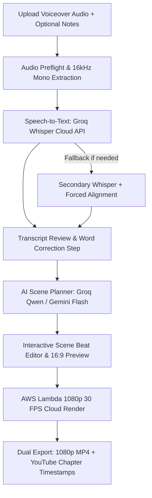

# Book Summary Video (`bookSummary`) — Master Specification & Architecture

> **Master Spec Reference**: 16:9 Cinema Widescreen Book Summary & Chapter Video Generator.
> Single source of truth for the `bookSummary` pipeline across Studio UI, Remotion rendering, and Cloud API routes.

---

## 1. Overview & Purpose

**Book Summary Video** turns raw book notes, chapter outlines, key takeaways, and voiceover audio into **1080p Full HD (1920×1080)** cinematic widescreen video summaries. 

Designed for non-fiction book reviewers, executive coaches, educators, and YouTube creators who need structured chapter-by-chapter visual summaries without spending hours editing in Premiere or After Effects.

### Target Audience & Use Cases
- **Book Review & Education Channels**: YouTube creators producing animated summaries of business, psychology, and personal development books.
- **Executive Coaches & Consultants**: Professionals breaking down frameworks, methodologies, and leadership lessons.
- **Authors & Publishers**: Writers promoting key ideas from their books with visual trailers and chapter deep-dives.

### Core Value Proposition
1. **Dynamic 8-Scene Non-Repeating Engine**: Automatically selects from 8 distinct visual layouts so scenes never look repetitive.
2. **Text Notes Ground Truth (P0)**: Creators can upload or paste their book notes and key takeaways, giving the AI planner perfect factual accuracy.
3. **Editable Scene Beats (P0)**: Creators can swap layouts, tweak takeaways, and adjust quotes directly in the studio before cloud rendering.
4. **YouTube Ready (P1)**: Generates video with instant YouTube chapter description timestamps (`00:00 Intro`, `01:15 Chapter 1`, etc.) and a 1280×720 video thumbnail.
5. **Frame-Accurate Subtitles**: Word-level kinetic highlights synced to spoken audio using the shared caption engine.

---

## 2. Key Specifications & Boundaries

| Parameter | Specification |
| :--- | :--- |
| **Video Type ID** | `bookSummary` |
| **Internal ID** | `BOOK_SUMMARY` |
| **Composition ID** | `BOOK-SUMMARY` (`1920×1080`) |
| **Template Location** | `remotion/templates/BOOK_SUMMARY/template.tsx` |
| **Dashboard Studio** | `components/dashboard/BookSummaryStudio.tsx` |
| **Dashboard Route** | `/dashboard/book-summary` |
| **Output Resolution** | **1080p Full HD (1920×1080 Landscape Widescreen)** |
| **Aspect Ratio** | **Strictly 16:9 Landscape Only (1920×1080)** — Zero 9:16 vertical mixing |
| **Frame Rate** | 30 FPS |
| **Maximum Duration** | **Up to 5 Minutes (300 Seconds Max)** per Master Rule 4.1 |
| **Minimum Duration** | 30 Seconds |
| **Credit Billing** | **1 Min = 1 Credit** ($\lceil\text{durationSeconds} / 60\rceil$). 1m=1, 2m=2, 3m=3, 4m=4, 5m=5 Credits Max. |
| **Preview Cost** | **100% FREE (0 Credits)** — Unlimited in-browser interactive preview. |
| **Billing Timing** | Credits are reserved only when the final render is submitted. |
| **Automatic Refund** | **100% Refund**: If transcription, planning, or cloud rendering fails at any stage, credits are immediately restored. |
| **Input Assets** | Voiceover Audio (MP3/WAV/M4A) + Optional Book Notes/Outline + Optional Book Cover Image |
| **Audio Extraction** | 16kHz mono audio extracted locally before cloud upload (max 25MB payload) |
| **Transcription Engine**| Primary: Groq Whisper Cloud API (Fallback: Secondary Cloud Whisper + Forced Alignment) |
| **AI Scene Director** | Groq Qwen 2.5 72B / Google Gemini 2.0 Flash (`asia-south1`) with strict JSON schema validation |
| **Render Engine** | AWS Lambda (Remotion in `us-east-1`) |
| **Studio UI Theme** | Google Analytics Obsidian Dark (`#070B14`, `#0E1526`) with warm amber accents |
| **Rendered Video Theme**| Clean Editorial Canvas (`#FAFAFA` / `#FFFFFF`) with high-contrast text (`#0F172A`) and warm accent tokens |

---

## 3. Strict Pipeline Execution Order

> [!IMPORTANT]
> **Correct Pipeline Sequencing**: Text editing MUST occur before scene planning so the AI planner works on 100% accurate, user-approved words.



### Detailed Stages:
1. **Upload & Preflight**:
   - Voiceover audio (MP3, WAV, M4A up to 300s). Normalized to -16 LUFS.
   - Optional: Book Title, Author Name, and Book Cover image (JPG/PNG).
   - Optional: Pasted chapter notes or outline text to guide factual planning.
2. **Groq Whisper Transcription**:
   - Generates word-level timestamps with hallucination filter.
3. **Transcript Review (P0)**:
   - Creator fixes any mispronounced author names, book titles, or terminology.
4. **AI Scene Planner (Structured LLM Execution)**:
   - Evaluates the approved transcript and book notes.
   - Plans sequential scene beats (typically 8–14 scenes for a 3–5 minute video).
   - Assigns layout types adhering to the non-repeating rotation rules.
5. **Interactive Scene Beat Editor & Live Preview**:
   - Creator can scrub through the 16:9 monitor, swap any scene's layout, edit bullet points or quotes, and reorder scenes.
6. **Lambda Cloud Render**:
   - AWS Lambda renders 1080p 30 FPS MP4 with burned-in subtitles and synchronized cards.
7. **Delivery**:
   - 48-hour presigned S3 download link + formatted YouTube description timestamps text.

---

## 4. 8 Dynamic Non-Repeating Scene Layouts

The scene director rotates across 8 visual templates to maintain high viewer engagement:

| Layout Type ID | Position Rules | Primary Visual Purpose | Key Elements |
|:---|:---|:---|:---|
| `BOOK_COVER` | **Scene 0 Only (Intro, 6–12s)** | Hook & Book Identity | 2.5D book cover perspective, title, author, reading time pill. |
| `LESSON_TITLE` | Mid-video transitions (10–18s) | Chapter or Beat Transition | Bold chapter number, primary premise, animated divider line. |
| `KEY_IDEA` | Body scenes (18–30s) | Core Thesis / Big Takeaway | Centered key takeaway card, highlighted keyword springs. |
| `COMPARISON` | Body scenes (20–35s) | Concept Contrast | 2-column split (Old Way vs. Book Way / Problem vs. Solution). |
| `KEY_STEPS` | Body scenes (25–40s) | Actionable Framework | 3 to 5 sequential step cards with progress pill indicators. |
| `STAT_INSIGHT` | Body scenes (15–25s) | Data & Metrics | Giant bold statistic (e.g. `80/20`, `1% Better`), context label. |
| `QUOTE` | Body scenes (15–30s) | Memorable Author Quote | Floating quotation marks, italicized quote, author credit. |
| `CONCLUSION` | **Final Scene Only (Outro, 10–20s)**| Closing Wrap-Up | Key summary takeaway, next actionable step, channel CTA. |

### Layout Sequencing Rules:
- **Intro Constraint**: Scene 0 must always be `BOOK_COVER`.
- **Outro Constraint**: The final scene must always be `CONCLUSION`.
- **Zero Adjacent Repeats**: The same layout type can never occur twice in a row.
- **Pacing Constraint**: Body scenes must stay between 15s and 40s in duration.
- **Audio Duration Lock**: The final scene's end time must equal the exact audio duration (`scenes[last].endTimeSeconds === durationSeconds`) to eliminate trailing dead frames.

---

## 5. Strongly Typed Scene Schema (Discriminated Union)

To ensure Remotion renders every layout without missing properties, each scene layout implements a strict, typed payload:

```typescript
export interface BookCoverPayload {
  layoutType: 'BOOK_COVER';
  bookTitle: string;
  authorName: string;
  coverImageUrl?: string;
  readingTimeMinutes?: number;
}

export interface LessonTitlePayload {
  layoutType: 'LESSON_TITLE';
  chapterNumber: number;
  chapterTitle: string;
  subtitle?: string;
}

export interface KeyIdeaPayload {
  layoutType: 'KEY_IDEA';
  headline: string;
  takeawayText: string;
  highlightedKeywords: string[];
}

export interface ComparisonPayload {
  layoutType: 'COMPARISON';
  headline: string;
  leftSide: { label: string; description: string };
  rightSide: { label: string; description: string };
}

export interface KeyStepsPayload {
  layoutType: 'KEY_STEPS';
  headline: string;
  steps: Array<{ stepNumber: number; title: string; detail?: string }>;
}

export interface StatInsightPayload {
  layoutType: 'STAT_INSIGHT';
  metricValue: string; // e.g. "80 / 20" or "+300%"
  metricLabel: string; // e.g. "Effort to Result Ratio"
  contextDescription: string;
}

export interface QuotePayload {
  layoutType: 'QUOTE';
  quoteText: string;
  authorAttribution: string;
}

export interface ConclusionPayload {
  layoutType: 'CONCLUSION';
  headline: string;
  finalTakeaway: string;
  callToAction?: string;
}

export type BookSummaryScenePayload =
  | BookCoverPayload
  | LessonTitlePayload
  | KeyIdeaPayload
  | ComparisonPayload
  | KeyStepsPayload
  | StatInsightPayload
  | QuotePayload
  | ConclusionPayload;

export interface BookSummarySceneBeat {
  id: string;
  startTimeSeconds: number;
  endTimeSeconds: number;
  payload: BookSummaryScenePayload;
}
```

---

## 6. Shared Subtitle Schema & Caption Presets

Book Summary leverages the shared caption engine with word-level kinetic highlight:

```typescript
export interface SubtitleWord {
  word: string;
  start: number; // in seconds
  end: number;   // in seconds
}

export interface BookSummarySubtitleChunk {
  text: string;
  words: SubtitleWord[];
  start: number;
  end: number;
}
```

### 8 Curated Editorial Caption Styles:
Rather than exposing 50 unrelated styles, Book Summary provides 8 high-signal typography presets:
1. `editorial_luxury` (Default): Clean *Playfair Display* / *Inter* pairing on a translucent frosted glass capsule.
2. `studio_clean`: Modern sans-serif text with yellow active word highlight.
3. `executive_pill`: Rounded dark pill container with crisp white text.
4. `marker_explainer`: Subtle amber highlighter brush behind active words.
5. `shorts_focus`: Active word highlighted in bright cyan; prior words remain neutral gray.
6. `bold_impact`: Heavy condensed bold with drop shadow.
7. `karaoke_flow`: Smooth left-to-right color fill.
8. `monochrome_minimal`: Understated white text with subtle opacity transitions.

---

## 7. Master Remotion Props Interface

```typescript
export interface BookSummaryVideoProps {
  mediaSrc: string; // S3 Presigned URL to audio track
  durationSeconds: number;
  bookTitle: string;
  authorName?: string;
  coverImageUrl?: string;
  scenes: BookSummarySceneBeat[];
  subtitles?: BookSummarySubtitleChunk[];
  captionStyle: string; // Selected from the 8 curated editorial presets
  bgmUrl?: string; // Curated AWS S3 track or 'none'
  bgmVolume?: number; // Default: 0.12 (12% volume ducking)
  accentColor?: string; // Default: '#EA580C' (Warm Flame Orange)
  visualTheme?: string; // Master visual theme identifier
  showWatermark?: boolean; // false for paid renders
}
```

---

## 8. Language, Script & Audio Preflight Rules

- **Language Support**: English and Roman Hinglish.
- **Hinglish Policy**: Hindi speech is automatically transcribed into clean Latin Roman script (Roman Hinglish). Devanagari script is strictly prevented to avoid font clipping and layout shifts.
- **Audio Preflight & Normalization**:
  - Automatically normalized to **-16 LUFS** for consistent, broadcast-ready volume.
  - Speech gaps $>600\text{ms}$ are flagged as natural scene transition points.
  - Max audio file upload size: 25MB (automatically compressed to 16kHz mono MP3).
- **Background Music Ducking**:
  - Music volume is set to a fixed **12% volume** (`bgmVolume: 0.12`), ensuring spoken voiceover remains 100% intelligible at all times.
  - Selecting background music is optional (default: subtle lofi guitar or no music).

---

## 9. Error Checklist & Auto-Fix Matrix

| Pipeline Stage | Error Code | Root Cause | Automated Recovery / Fix | User-Facing Feedback |
|:---|:---|:---|:---|:---|
| **1. Upload** | `DURATION_EXCEEDED` | Voiceover $>300\text{s}$ (5 minutes) | Studio preflight shows trim scrubber | "Please trim your audio under 5 minutes (300s) for Book Summary." |
| **1. Upload** | `UNSUPPORTED_CODEC` | Rare or uncompressed audio | Cloud FFmpeg normalizes to 16kHz mono MP3 | Audio accepted and processed smoothly |
| **2. Transcription** | `WHISPER_RATE_LIMIT`| Groq concurrency spike | Immediate failover to secondary cloud Whisper | Seamless continuation without delay |
| **2. Transcription** | `NO_SPEECH_DETECTED`| Silent audio or room noise | VAD flags zero words | "No clear spoken dialogue detected in your audio file." |
| **3. Scene Planner** | `LLM_INVALID_SCHEMA`| Model returned incomplete JSON | Automatically falls back to deterministic sentence boundary planner | Scenes generated reliably using sentence timing |
| **4. Visual Assets** | `COVER_IMAGE_MISSING`| User omitted book cover | Renders high-end 2.5D CSS typographic book cover | Stylized fallback book graphic displayed |
| **5. Lambda Render** | `LAMBDA_OOM_CRASH` | Frame memory spike on long video | Status route catches error and restores credits | "Render encountered an issue. Your credits have been refunded." |
| **6. Delivery** | `S3_LINK_EXPIRED` | User downloaded after 48h | Polling endpoint signs fresh 48-hour URL | Fresh download link provided instantly |

---

## 10. Quality Assurance (QA) Checklist

- [ ] Video renders strictly in **16:9 Landscape (1920×1080)** with zero letterboxing.
- [ ] Final scene end time matches the exact voiceover duration (`scenes[last].endTimeSeconds === durationSeconds`).
- [ ] Scene 0 is always `BOOK_COVER` and the final scene is always `CONCLUSION`.
- [ ] No two identical scene layouts appear consecutively.
- [ ] Credit calculation follows $\lceil\text{durationSeconds} / 60\rceil$ (e.g. 59s = 1 Cr, 61s = 2 Cr, 300s = 5 Cr max).
- [ ] In-browser previews are 100% free and do not consume credits.
- [ ] If a render or transcription fails, reserved credits are 100% refunded immediately.
- [ ] Long text fields automatically scale down by 15%–20% without clipping borders.
- [ ] Book notes/outline text input correctly influences AI scene planning.
- [ ] Hinglish speech produces clean Roman script captions without broken Devanagari text.
- [ ] Web fonts are verified via `delayRender()` before Lambda frame capture.
- [ ] YouTube chapter timestamp description is generated upon render completion.

---

## 11. Strict Prohibitions (What to Avoid)

- ❌ **DO NOT** render 9:16 vertical video in this pipeline — Book Summary is **Strictly 16:9 Landscape Only (1920×1080)**. (Any 9:16 vertical format will be created as an independent, standalone video type in the future; never mix them).
- ❌ **DO NOT** generate fake book ratings (rating badges are user-provided or omitted).
- ❌ **DO NOT** execute scene planning before user transcript review.
- ❌ **DO NOT** split scenes using arbitrary mathematical cuts; always use sentence boundaries or silence gaps.
- ❌ **DO NOT** exceed 5 minutes (300 seconds) audio duration per Master Rule 4.1.
- ❌ **DO NOT** use heavy 3D WebGL / Three.js canvas; book covers are styled using lightweight 2.5D CSS perspective transforms.
- ❌ **DO NOT** deduct credits for in-studio preview playback.
