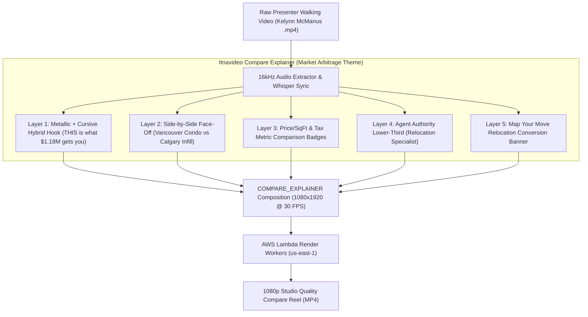

# Compare Explainer Generator — Studio Specification

## Overview

The **Compare Explainer Generator** (`compare`) generates side-by-side Versus comparison reels (`1080×1920` @ 30 FPS MP4) up to 90 seconds long. Featuring animated sticker presenter characters, split comparison image cards, animated VS badges, and synchronized subtitles, it turns product reviews, debates, and concept face-offs into engaging, digestible short-form content.

- **Primary Purpose**: Create engaging side-by-side versus comparison videos for product reviews and conceptual debates.
- **Target Audience**: Tech reviewers, finance analysts, educators, and social media debate channels.
- **Expected Output**: 1080p Full HD (`1080×1920`) 30 FPS vertical MP4 video.

---

## Table of Contents

1. [Overview](#overview)
2. [Features and Capabilities](#features-and-capabilities)
3. [User Workflow](#user-workflow)
4. [UI/UX Design and Components](#uiux-design-and-components)
5. [Colors, Typography and Design Tokens](#colors-typography-and-design-tokens)
6. [Technical Implementation](#technical-implementation)
7. [Business Logic, Duration and Credit Rules](#business-logic-duration-and-credit-rules)
8. [Error Handling and Edge Cases](#error-handling-and-edge-cases)
9. [Testing and Quality Assurance](#testing-and-quality-assurance)
10. [Developer Notes and Guardrails](#developer-notes-and-guardrails)

---

## 1. Features and Capabilities

- **Side-by-Side Dual Comparison Stage**: Compares two products, features, or concepts simultaneously with clean split image cards and labels.
- **16 Animated Presenter Sticker Characters**: Select from 16 distinct sticker characters with 6 dynamic reactive poses (Pointing Left, Pointing Right, Thinking, Shocked, Happy, Neutral).
- **Animated VS Center Badge**: High-impact center Versus badge with pulsing energy ring.
- **Word-Level Kinetic Subtitles**: Synchronized subtitles with active-word color pops placed in mobile safe areas.
- **Multiple Visual Themes**: Supports 4 distinct visual themes (`White Studio`, `Soft Gradient Light`, `Midnight Dark`, `Electric Purple`).
- **Sound Design**: Curated tension-building background music and swoosh sound effects on character pose transitions.

---

## 2. User Workflow

The studio follows a guided 4-step workflow:

1. **Step 1: Upload (Voiceover Audio, Left Image & Right Image)**:
   - Creator uploads narration audio (`.mp3`, `.wav`, `.m4a`).
   - Uploads Left comparison item photo (e.g., iPhone 15) and Right item photo (e.g., Galaxy S24).
   - Enters optional Left Title and Right Title labels.
   - Cloud transcribes speech and displays the live editorial transcript for verification.
2. **Step 2: Music & Audio Design**:
   - Creator selects background music from 14 curated AWS S3 tracks.
   - Sets background music volume with auto-ducking to maintain vocal clarity.
3. **Step 3: Character Selection & Caption Theme**:
   - Chooses presenter character and default theme.
   - Selects animated typography style with live word previews.
4. **Step 4: Live Phone Preview & Render**:
   - Interactive 9:16 phone simulator previews the split-screen cards and sticker character reactions.
   - Creator clicks **Render 1080p Compare Reel** to execute AWS Lambda cloud rendering.

---

## 3. UI/UX Design and Components

- **Studio Route**: `/dashboard/compare-explainer`
- **Frontend Studio Component**: `components/dashboard/CompareExplainerStudio.tsx`
- **Public SEO Landing Page**: `/compare-explainer` (`app/compare-explainer/page.tsx`)
- **Design Structure**: Pure White canvas (`#FFFFFF`) with fine borders (`#E2E8F0`) and responsive 3-row layout (`Stepper Header`, `Preview Work Area`, `Sticky Action Bar`).

---

## 4. Colors, Typography and Design Tokens

- **Canvas Background**: Pure White (`#FFFFFF`) with subtle slate background accents (`#F8FAFC`).
- **Primary Brand Accent**: Sunset Orange (`#FF5722` / `#F97316`) for active controls and primary CTA buttons.
- **Comparison Split Accents**: Cyan Blue (`#0EA5E9`) for left item and Amber Orange (`#F59E0B`) for right item.
- **Typography**: Inter / System Sans-serif stack (`font-sans`).

---

## 5. Technical Implementation

- **Video Type ID**: `compare` / `comparisonImages`
- **Remotion Composition ID**: `comparisonImages` (`1080×1920` @ 30 FPS)
- **Remotion Template Directory**: `remotion/templates/comparisonImages/`
- **Sticker Asset Library**: Vector PNG/SVG sticker character assets stored in `public/assets/stickman/`.
- **Speech Transcription**: Groq Whisper Cloud API.
- **Render Engine**: AWS Lambda running Remotion cloud workers in `us-east-1`.

---

## 6. Business Logic, Duration and Credit Rules

- **Aspect Ratio**: Strictly 9:16 Vertical Only (`1080×1920`).
- **Maximum Output Duration**: Strictly **90 Seconds Max (90s / 2,700 frames @ 30 FPS)**.
- **Credit Billing**: **Strictly 1 Credit** per video (Master Rule 4.1 for 9:16 Short-Form).
- **Draft Preview**: 100% Free interactive browser preview before rendering.

---

## 7. Error Handling and Edge Cases

- **No Speech Detected**: Flags `NO_SPEECH_DETECTED`; prompts user to upload audio with clear speech without deducting credits.
- **Missing Side Image**: Fallback renders a clean high-contrast text badge displaying the item title.
- **Render Interruption**: Credits are automatically refunded if cloud rendering encounters an AWS Lambda timeout.

---

## 8. Testing and Quality Assurance

- **Typecheck Verification**: `npx tsc --noEmit` verifies all comparison props and composition interfaces.
- **Sticker Alignment**: Confirm that presenter character does not obscure comparison image cards or subtitles.
- **Side Switch Timing**: Confirm that sticker pointing transitions correspond to the spoken item being discussed.

---

## 9. Developer Notes and Guardrails

- **Zero Local Rendering (Rule 0)**: Do not run local Remotion renders on developer machines; all rendering executes on AWS Lambda.
- **Character Asset Index**: Any new sticker characters must be registered in `public/assets/stickman/` and indexed via `npm run assets:index`.

---

## 10. Reverse-Engineering Benchmarks Overview

This section documents real-world high-retention 9:16 vertical comparison reels analyzed and reverse-engineered into production Remotion components.

---

## 11. Market Arbitrage & Relocation Compare Engine Architecture ($1.18M City Face-Off / Kelynn McManus Benchmark)

### 11.1 Source Attribution & Benchmark Telemetry

| Parameter | Value |
| :--- | :--- |
| **Original URL** | `https://www.instagram.com/reel/DXhlXBNgdWM/` |
| **Creator / Channel** | Kelynn McManus (`@kelynnmcmanusrealtoryyc` \| RE/MAX Key Calgary) |
| **Topic / Hook** | *"This is what $1.18M gets you... just not in Vancouver or Toronto. Same budget — completely different life."* |
| **Engagement Telemetry** | **5,130+ Likes**, 75 Comments, High Save & Share Velocity |
| **Video Format / Ratio** | 9:16 Vertical (`1080×1920` @ 30 FPS, Walking Presenter in front of Calgary Modern Infill) |
| **Video Duration** | ~32 seconds (Strictly within the 90s Short-Form limit) |
| **Itnavideo Mapping** | `compare` / `comparisonImages` Studio (`/dashboard/compare-explainer`) |
| **Credit Billing** | **Strictly 1 Credit** flat (Master Rule 4.1 for 9:16 Short-Form) |
| **Watermark Enforcement** | `<BrandWatermark watermark={watermark} />` (Enforced for free/trial users) |

---

### 11.2 Core Creative Mechanics: The Market Arbitrage Model

1. **Signature Metallic Champagne + Cursive Hybrid Hook**:
   - `THIS`: Giant 88px condensed italic sans in warm metallic champagne bronze (`linear-gradient(135deg, #FEF3C7 0%, #F59E0B 50%, #B45309 100%)`).
   - `is what`: Crisp 42px bold sans + 52px fluid italic cursive serif (`Georgia` / `Playfair`).
   - `$1.18 million`: 46px white sans + 50px bright yellow-gold gradient text.
   - `gets you`: 42px bold sans + 52px fluid cursive script.
   - Instantly triggers curiosity and high watch-time by framing a direct financial comparison.

2. **Side-by-Side Market Face-Off (Split Comparison Stage)**:
   - **Market A (Tier-1 Constraints / Vancouver & Toronto)**:
     - Crimson badge: `TRADE-OFFS`.
     - 680 SQ FT, 1 Bed + Den, high strata fees ($850/mo), no private yard, 13%–15% sales tax.
     - Price: ~$1,735 / sq ft.
   - **Market B (The Upgrade / Calgary Inner-City)**:
     - Emerald badge: `THE UPGRADE`.
     - 2,850 SQ FT, 4 Beds, 3.5 Baths, $0 strata fees, private yard + double garage, 0% provincial sales tax.
     - Price: ~$414 / sq ft.

3. **Psychological Frame**:
   - *"In Vancouver or Toronto, $1.18M means trade-offs. In Calgary... it means control. More space. More privacy. More home. Calgary isn't the backup plan — it's the upgrade."*

4. **Agent Authority Lower-Third & Relocation Conversion CTA**:
   - Executive footprint pill: `Kelynn McManus • RE/MAX Key Calgary • Relocation Pro`.
   - Bottom conversion banner: `Thinking about relocating? Let's map your move 📩 Link in Bio`.

---

### 11.3 System Architecture & 9:16 Market Arbitrage Pipeline

---

### 11.4 Visual Design Tokens & Safe-Zone Spacing

- **Aspect Ratio**: `1080 × 1920` (9:16 Vertical).
- **Top Safe Zone**: `130px` padding (accommodates 4-line hybrid hook).
- **Split Cards Placement**: `Y = 920px` (positions below presenter torso).
- **Bottom Safe Zone**: `140px` padding (clears interaction buttons).
- **Palette Tokens**:
  - `Champagne Bronze`: `linear-gradient(135deg, #FEF3C7 0%, #F59E0B 50%, #B45309 100%)`
  - `Market A Crimson`: `#EF4444` (`rgba(239, 68, 68, 0.5)`)
  - `Market B Emerald`: `#10B981` (`rgba(16, 185, 129, 0.7)`)
  - `Dark Slate Surface`: `rgba(15, 23, 42, 0.9)`
  - `Pure White`: `#FFFFFF`

---

### 11.5 Second-by-Second Cinematic Scene Breakdown

| Second | Visual Layer (1080×1920) | On-Screen Graphic & Kinetic Subtitle | Audio & Voiceover Pacing |
| :--- | :--- | :--- | :--- |
| **0:00–0:05** | Agent walks down pathway in front of modern stone/wood infill; Metallic Hook animates: `THIS is what $1.18 million gets you`. | Champagne text blooms. Subtitle: *"This is what $1.18 million gets you... just not in Vancouver or Toronto."* | Confident, conversational hook. Voiceover: *"This is what 1.18 million gets you... just not in Vancouver or Toronto."* |
| **0:05–0:12** | Split Cards slide up from bottom: Market A (Condo, 680 sq ft) vs Market B (Infill, 2,850 sq ft). | Crimson vs Emerald badges pulse. Subtitle: *"In Vancouver or Toronto, $1.18M means trade-offs."* | Sharp contrast cadence. Voiceover: *"In Vancouver or Toronto, 1.18 million often means compromises: 600 square feet and high strata fees."* |
| **0:12–0:20** | Camera cuts to B-roll interior: 10ft ceilings, chef kitchen, natural light. | Market B expands: `2,850 SQ FT • 4 BEDS • 0% PST`. Subtitle: *"In Calgary, it means control. More space, more privacy."* | Expansive, elevated tone. Voiceover: *"In Calgary, it means control: nearly 3,000 square feet of inner-city luxury, four bedrooms, and zero provincial sales tax."* |
| **0:20–0:28** | Agent footprint badge and Relocation CTA illuminate: `Thinking about relocating? Let's map your move 📩`. | Gold gradient tag glows. Subtitle: *"Calgary isn't the backup plan — it's the upgrade."* | Inspiring, conclusive finish. Voiceover: *"Same budget, completely different lifestyle. Calgary isn't the backup plan—it's the upgrade. Tap the link in bio to map out your move."* |

---

### 11.6 Remotion Component Implementation

- **Asset Component**: `remotion/components/library/MarketArbitrageCompareAsset.tsx`
- **Component Export**: Exported in `remotion/components/library/index.ts` (`MarketArbitrageCompareAsset`, `MarketArbitrageCompareAssetProps`, `MarketItemSpec`).
- **Catalog Registry**: Registered in `constants/itnavideoStockAssets.ts` under ID `market-arbitrage-compare-engine`.
- **Key Capabilities**:
  - Full `1080×1920` 9:16 layout calibrated for market comparisons, regional price face-offs, tech versus reviews, and relocation guides.
  - Multi-tier typography featuring bold metallic champagne bronze (`THIS`) and cursive script highlights (`is what`, `gets you`).
  - Side-by-side comparison stage contrasting Market A (Trade-offs / Condo) against Market B (The Upgrade / Detached Infill) with price per sq ft and feature checklists.
  - Agent authority lower-third with brokerage credentials.
  - High-conversion bottom relocation inquiry CTA banner.
  - Zero local heavy compute dependencies — 100% pure React/Remotion code ready for AWS Lambda cloud rendering.

