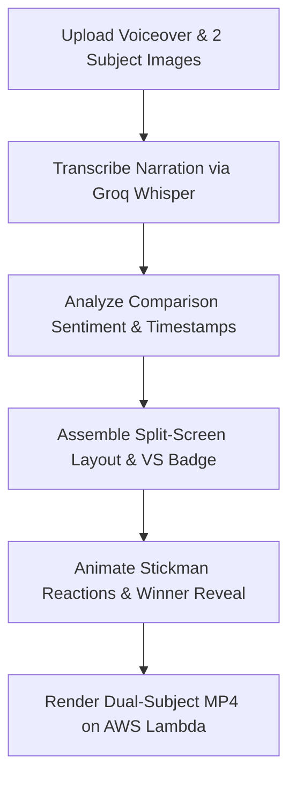

# Compare Explainer Video (`compareexplainer.md`)

## 1. Overview & Purpose
**Compare Explainer Video** creates high-converting versus comparison reels and head-to-head product showdowns (e.g., *iPhone vs Android*, *React vs Vue*, *Good Habit vs Bad Habit*). It utilizes a dual-subject split screen, animated sticker presenter avatars, dynamic VS badges, score counters, and bottom-strip subtitles.

---

## 2. Key Specifications & Limits

| Attribute | Specification |
| :--- | :--- |
| **Video Type ID** | `compare-explainer` / `COMPARE_EXPLAINER` |
| **Composition ID** | `comparisonImages` |
| **Template Location** | `remotion/templates/COMPARE_EXPLAINER/template.tsx` |
| **Dashboard Studio** | `components/dashboard/CompareExplainerStudio.tsx` |
| **Dashboard Route** | `/dashboard/compare-explainer` |
| **Aspect Ratio** | **9:16 Vertical Shorts Only** |
| **Resolution & Quality** | **1080p Full HD** (`1080×1920` @ 30 FPS MP4) |
| **Frame Rate** | 30 FPS |
| **Max Video Duration** | **Up to 90 Seconds (90s)** |
| **Primary Category** | 9:16 Vertical Short-Form |
| **Credit Cost** | 1 Credit |
| **Design System** | Google Analytics Obsidian Baseline (`#070B14`, `#0E1526`) + Intentional Color & Typography Variety Policy + Material Design 3 |
| **Transcription Engine**| Extracted 16kHz audio → Groq Whisper Cloud API (Fallback: Google Gemini 2.0 Flash `asia-south1`) |
| **Image Backdrop** | Adaptive blurred ambient backdrop (`blur(22px)`) eliminating empty letterboxing |
| **Safe Collisions** | Caption layered at `z-index: 25`, presenter avatar scaled and clamped with dedicated margin |

---

## 3. User Inputs & 4-Step Studio Architecture

> [!IMPORTANT]
> **Core Architecture & Dashboard Principle**:
> **"User controls only what changes the content. System AI controls everything else."**

The studio is organized into a clean 4-step guided progression matching the unified Itnavideo design system:

1. **Step 1: Upload (Voiceover & 2 Subjects)**:
   - Voiceover audio discussing comparison points, pros, cons, and verdict (`.mp3`, `.wav`, `.m4a` or `.mp4`).
   - Limit: **Up to 90 Seconds (90s)** per Master Credit Policy Rule 4.1 (1 Credit flat).
   - Audio waveform visualizer with playback controls and duration detector.
   - Dual split visual cards: Option A (Left) Image + Title, and Option B (Right) Image + Title.
   - Topic headline and creator watermark handle.
   - Audio-synced editable comparison script editor.

2. **Step 2: Music (Soundtrack & Volume)**:
   - 14 AWS S3 curated BGM tracks with in-card audio auditioning (play/pause).
   - Volume slider (Default: 12% subtle ducking) with presets (0%, 12%, 20%, 35%).
   - Dynamic auto-ducking toggle (lowers music during voiceover speech).
   - Versus sound effects (SFX) toggle (VS slam, whooshes, point hits, winner chime).

3. **Step 3: Style (Characters, Theme & Winner)**:
   - Presenter Character Avatar:
     - **3D Presenter Pro** (`3d-presenter-man`)
     - **2D Teacher Pro** (`2d-presenter-man`)
     - **Stickman Pro** (`character-1`)
     - **Sketch Artist** (`character-2`)
     - **Doodle Explainer** (`character-4`)
   - Winner Crown Reveal: No Winner / Option A Wins 👑 / Option B Wins 👑.
   - Comparison Tone: Versus Battle (Blue vs Purple) / Good vs Bad (Emerald vs Crimson).
   - 32 master kinetic caption themes with live interactive word previews and search filter.

4. **Step 4: Preview (9:16 Shorts & Review)**:
   - 9:16 Vertical Shorts Live Monitor simulating split-screen layout, central VS badge, active side highlight, and bottom subtitle strip.
   - Watermark remover toggle.
   - Sticky bottom action bar with battle title, 9:16 format badge, 1 Credit flat cost, and "Create Compare Explainer" CTA.

---

## 4. Dedicated Processing Pipeline (UI Stepper)

> [!CAUTION]
> **No Stock Asset Search**: Visual subjects are provided directly by user uploads. Stepper must never claim to search external libraries.



### UI Stepper Stages:
1. **Upload Verification**: Checking Subject A & B assets and voiceover track.
2. **Transcribe Voiceover**: Groq Whisper extracting timestamps and dialogue structure.
3. **Assemble Split Layout**: Positioning dual cards, subject labels, and center VS badge.
4. **Animate Reactions**: Synchronizing sticker presenter gestures and winner highlight.
5. **Render Comparison MP4**: Remotion Lambda rendering 30 FPS composition.

---

## 5. Remotion Composition Props

```typescript
export interface CompareExplainerProps {
  audioUrl: string;
  totalDurationInFrames: number;
  fps: number;
  leftSubject: {
    title: string;
    imageUrl: string;
    score?: number;
  };
  rightSubject: {
    title: string;
    imageUrl: string;
    score?: number;
  };
  theme: 'light' | 'dark' | 'bold';
  tone: 'versus' | 'goodBad';
  winner: 'left' | 'right' | 'none';
  stickmanPreset?: 'thinking' | 'pointing' | 'winner';
  subtitles?: {
    text: string;
    startFrame: number;
    endFrame: number;
  }[];
}
```

---

## 6. Layout & Motion Specifications
- **Split Ratio**: 50/50 vertical division (top/bottom on 9:16, left/right on 16:9).
- **VS Center Badge**: Scale pulse spring (`scale: 1.0 -> 1.15`) on beat drops.
- **Winner Reveal**: At 80% video mark, the winning card scales up with a gold/amber glowing border while the runner-up dims to 60% opacity.

---

## 7. Edge Cases & Safeguards
- **Missing One Image**: Studio validation blocks render trigger until both Subject A & Subject B images are uploaded.
- **No Speech**: Groq returns `NO_SPEECH_DETECTED`; render is aborted with clear prompt.
- **Aspect Ratio Fit**: Images are auto-contained with clean padding and shadow to avoid distortion.

---

## 8. Showcase & Homepage Assets
- **Demo Video URL**: `https://storage.googleapis.com/itnavideo-assets/homepage/compare-explainer-demovideo.mp4`
- **Output Verified**: 9:16 vertical MP4 comparing Coupon vs Voucher with dual cards, animated presenter character, and synced bottom subtitles.

---

## 9. Pipeline Error Checklist & Auto-Fix Matrix

| Pipeline Stage | Potential Error / Failure | Root Cause | Automated Recovery / Fix | User-Facing Action / Feedback |
| :--- | :--- | :--- | :--- | :--- |
| **1. Upload & Media Validation** | `MISSING_COMPARISON_IMAGES` | User uploaded only 1 image instead of both left and right | Preflight validation blocks submission with explicit 400 error | "Compare requires exactly 2 visuals: one left and one right" |
| **1. Upload & Media Validation** | `LONG_FILENAME_OR_SPECIAL_CHARS` | Filename > 100 chars or containing brackets/commas | `sanitizeFileName` isolates base and preserves extension, cleaning URL unsafe chars | Safe S3 presigned URL generation and instant download |
| **1. Upload & Media Validation** | `NON_AUDIO_PRIMARY_FILE` | User uploaded non-audio file as main track | Extracts 16kHz audio or converts video audio seamlessly | Audio track processed reliably |
| **2. Speech Transcription** | `WHISPER_RATE_LIMIT_429` | Groq Whisper concurrency burst | Seamless failover to Google Gemini 2.5 Flash / Flash Latest | Instant zero-downtime transcription |
| **2. Speech Transcription** | `NO_SPEECH_DETECTED` | Audio lacks audible vocal track | Fails with explicit `NO_SPEECH_DETECTED` reason code | "No clear speech detected. Please upload clear narration audio." |
| **3. Sticker & Pose Sync** | `MISSING_STICKER_SET` | Custom presenter stickman graphic unavailable | Auto-falls back to standard 3D presenter stickman avatar set | Presenter avatar always renders properly |
| **4. Layout Formatting** | `IMAGE_ASPECT_DISTORTION` | Images of vastly different aspect ratios (e.g. 1:1 vs 16:9) | Auto-scales with aspect-fit containment and subtle blurred ambient backing | Perfectly balanced dual-subject presentation |
| **5. Remotion Lambda Render** | `LAMBDA_OOM_OR_TIMEOUT` | Dual image composition timeout | Clamps frameRange to `[0, totalFrames - 1]` and optimizes Lambda concurrency | Fast Full HD 30 FPS MP4 export |
| **5. Remotion Lambda Render** | `FATAL_RENDER_CRASH` | AWS Lambda instance crash | Status route catches error and refunds reserved credits via `releaseReservedRenderUsageFromServer` | Immediate credit refund + retry prompt |
| **6. File Delivery** | `S3_DOWNLOAD_LINK_EXPIRED` | User returns to download link after 48h | Polling status route auto-renews S3 presigned URL on demand | Direct download link re-activated instantly |

