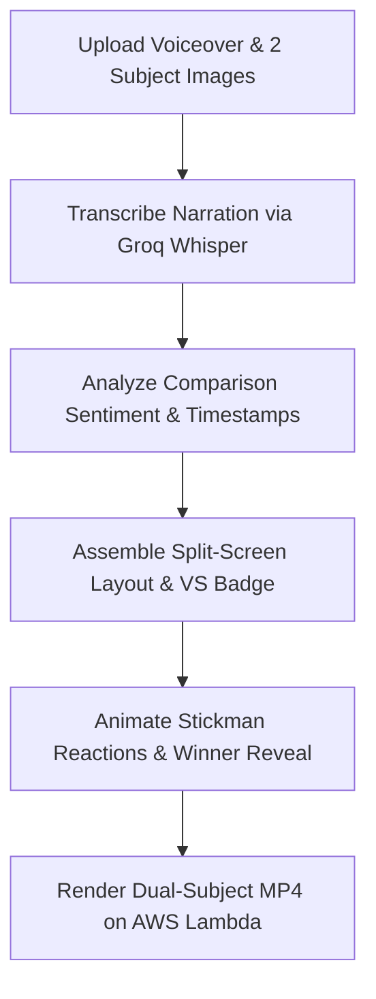

# Compare Explainer Video (`compareexplainer.md`)

## 1. Overview & Purpose
**Compare Explainer Video** creates high-converting versus comparison reels and head-to-head product showdowns (e.g., *iPhone vs Android*, *React vs Vue*, *Good Habit vs Bad Habit*). It utilizes a dual-subject split screen, animated sticker presenter avatars, dynamic VS badges, score counters, and bottom-strip subtitles.

---

## 2. Key Specifications & Limits

| Attribute | Specification |
| :--- | :--- |
| **Video Type ID** | `compare-explainer` / `COMPARE_EXPLAINER` |
| **Composition ID** | `comparisonImages` |
| **Template Location** | `remotion/templates/COMPARE_EXPLAINER/template.tsx` |
| **Dashboard Studio** | `components/dashboard/CompareExplainerStudio.tsx` |
| **Dashboard Route** | `/dashboard/compare-explainer` |
| **Aspect Ratio** | **9:16 Vertical Shorts Only** |
| **Resolution & Quality** | **1080p Full HD** (`1080×1920` @ 30 FPS MP4) |
| **Frame Rate** | 30 FPS |
| **Max Video Duration** | **Up to 90 Seconds (90s)** |
| **Primary Category** | 9:16 Vertical Short-Form |
| **Credit Cost** | 1 Credit |
| **Design System** | Google Analytics Obsidian Baseline (`#070B14`, `#0E1526`) + Intentional Color & Typography Variety Policy + Material Design 3 |
| **Transcription Engine**| Extracted 16kHz audio → Groq Whisper Cloud API (Fallback: Google Gemini 2.0 Flash `asia-south1`) |
| **Image Backdrop** | Adaptive blurred ambient backdrop (`blur(22px)`) eliminating empty letterboxing |
| **Safe Collisions** | Caption layered at `z-index: 25`, presenter avatar scaled and clamped with dedicated margin |

---

## 3. User Inputs & 4-Step Studio Architecture

> [!IMPORTANT]
> **Core Architecture & Dashboard Principle**:
> **"User controls only what changes the content. System AI controls everything else."**
> 
> - **User Inputs (Content Essentials Only)**:
>   1. Voiceover Narration
>   2. Image A
>   3. Image B
>   4. Name A
>   5. Name B
>   6. Presenter Character
>   7. Instagram handle (optional)
> 
> - **System AI Automation Engine (Zero Manual Burden)**:
>   - ⚡ **Poses & Gestures**: Synced dynamically with spoken beats.
>   - ⚡ **Expressions**: Emotion-matched (thinking, confident, winner reveal).
>   - ⚡ **Pacing & Timing**: Millisecond-accurate word alignments from Groq Whisper.
>   - ⚡ **Transitions**: Automatic split-screen whips, zooms, and dual-focus shifts.
>   - ⚡ **SFX**: Sound design (whooshes, versus dings, point hits).
>   - ⚡ **Captions**: High-contrast kinetic auto-subtitles.
>   - ⚡ **Animations & Scene Changes**: Deterministic 1080p 30 FPS composition.
> 
> *(Removing heavy Live Canvas Previews perfectly aligns with this engine, reducing client memory footprint to zero and delivering flawless final outputs on cloud render).*

1. **Top Showcase: 5 Featured Cloudinary Demo Videos**:
   - High-retention 9:16 vertical shorts player cards with instant poster previews:
     - `Dajjal & Yajooj Majooj` (Stickman Trial)
     - `Passport vs Visa Explained` (Viral Education)
     - `Indian Govt Departments in Simple Words` (India Facts)
     - `Coding vs Programming` (Tech & Software)
     - `90% People Confuse These Two` (Viral English)
   - 1-Click "Use Example Concept" pre-fills comparison titles.

2. **Step 1: Your Voiceover (Required)**:
   - Voice discussing comparison points, pros, cons, and verdict (`.mp3`, `.wav`, `.m4a` or `.mp4`).
   - Limit: **Up to 90 Seconds (90s)** per Master Credit Policy Rule 4.1 (1 Credit flat).

3. **Step 2: Your Comparison (Required)**:
   - **Option A (Left)**: Upload Image A + assign Name A (Title).
   - **Option B (Right)**: Upload Image B + assign Name B (Title).
   - Clean paired visual cards with instant preview and live 2/2 ready status.

4. **Step 3: Choose Character (Required)**:
   - 100% Verified Cloudinary Assets (HTTP 200 OK across all poses):
     - **3D Characters**: `3d-presenter-man` (3D Teacher Pro - 6 poses: welcome, left, right, thinking, warning, success).
     - **2D Characters**: `2d-presenter-man` (2D Teacher Pro), `character-1` (Stickman Pro), `character-2` (Sketch Artist), `character-3` (Stickman Presenter), `character-4` (Doodle Explainer).
   - *All missing 3D placeholders removed to ensure clean, bug-free dashboard display.*

5. **Step 4: Styling & Watermark (Optional)**:
   - Background Theme: Light Studio / Dark Slate / Bold Contrast.
   - Comparison Tone: Neutral A vs B / Good vs Bad.
   - Winner Crown Reveal: No Crown / Option A Wins 👑 / Option B Wins 👑.
   - Channel Watermark: Optional Instagram / Channel Handle tag (`@yourchannel`).

---

## 4. Dedicated Processing Pipeline (UI Stepper)

> [!CAUTION]
> **No Stock Asset Search**: Visual subjects are provided directly by user uploads. Stepper must never claim to search external libraries.



### UI Stepper Stages:
1. **Upload Verification**: Checking Subject A & B assets and voiceover track.
2. **Transcribe Voiceover**: Groq Whisper extracting timestamps and dialogue structure.
3. **Assemble Split Layout**: Positioning dual cards, subject labels, and center VS badge.
4. **Animate Reactions**: Synchronizing sticker presenter gestures and winner highlight.
5. **Render Comparison MP4**: Remotion Lambda rendering 30 FPS composition.

---

## 5. Remotion Composition Props

```typescript
export interface CompareExplainerProps {
  audioUrl: string;
  totalDurationInFrames: number;
  fps: number;
  leftSubject: {
    title: string;
    imageUrl: string;
    score?: number;
  };
  rightSubject: {
    title: string;
    imageUrl: string;
    score?: number;
  };
  theme: 'light' | 'dark' | 'bold';
  tone: 'versus' | 'goodBad';
  winner: 'left' | 'right' | 'none';
  stickmanPreset?: 'thinking' | 'pointing' | 'winner';
  subtitles?: {
    text: string;
    startFrame: number;
    endFrame: number;
  }[];
}
```

---

## 6. Layout & Motion Specifications
- **Split Ratio**: 50/50 vertical division (top/bottom on 9:16, left/right on 16:9).
- **VS Center Badge**: Scale pulse spring (`scale: 1.0 -> 1.15`) on beat drops.
- **Winner Reveal**: At 80% video mark, the winning card scales up with a gold/amber glowing border while the runner-up dims to 60% opacity.

---

## 7. Edge Cases & Safeguards
- **Missing One Image**: Studio validation blocks render trigger until both Subject A & Subject B images are uploaded.
- **No Speech**: Groq returns `NO_SPEECH_DETECTED`; render is aborted with clear prompt.
- **Aspect Ratio Fit**: Images are auto-contained with clean padding and shadow to avoid distortion.

---

## 8. Showcase & Homepage Assets
- **Demo Video URL**: `https://storage.googleapis.com/itnavideo-assets/homepage/compare-explainer-demovideo.mp4`
- **Output Verified**: 9:16 vertical MP4 comparing Coupon vs Voucher with dual cards, animated presenter character, and synced bottom subtitles.

---

## 9. Pipeline Error Checklist & Auto-Fix Matrix

| Pipeline Stage | Potential Error / Failure | Root Cause | Automated Recovery / Fix | User-Facing Action / Feedback |
| :--- | :--- | :--- | :--- | :--- |
| **1. Upload & Media Validation** | `MISSING_COMPARISON_IMAGES` | User uploaded only 1 image instead of both left and right | Preflight validation blocks submission with explicit 400 error | "Compare requires exactly 2 visuals: one left and one right" |
| **1. Upload & Media Validation** | `NON_AUDIO_PRIMARY_FILE` | User uploaded non-audio file as main track | Extracts 16kHz audio or converts video audio seamlessly | Audio track processed reliably |
| **2. Speech Transcription** | `WHISPER_RATE_LIMIT_429` | Groq Whisper concurrency burst | Seamless failover to Google Gemini 2.0 Flash (`asia-south1`) | Instant zero-downtime transcription |
| **2. Speech Transcription** | `NO_SPEECH_DETECTED` | Audio lacks audible vocal track | Fails with explicit `NO_SPEECH_DETECTED` reason code | "No clear speech detected. Please upload clear narration audio." |
| **3. Sticker & Pose Sync** | `MISSING_STICKER_SET` | Custom presenter stickman graphic unavailable | Auto-falls back to standard 3D presenter stickman avatar set | Presenter avatar always renders properly |
| **4. Layout Formatting** | `IMAGE_ASPECT_DISTORTION` | Images of vastly different aspect ratios (e.g. 1:1 vs 16:9) | Auto-scales with aspect-fit containment and subtle blurred ambient backing | Perfectly balanced dual-subject presentation |
| **5. Remotion Lambda Render** | `LAMBDA_OOM_OR_TIMEOUT` | Dual image composition timeout | Clamps frameRange to `[0, totalFrames - 1]` and optimizes Lambda concurrency | Fast Full HD 30 FPS MP4 export |
| **5. Remotion Lambda Render** | `FATAL_RENDER_CRASH` | AWS Lambda instance crash | Status route catches error and refunds reserved credits via `releaseReservedRenderUsageFromServer` | Immediate credit refund + retry prompt |
| **6. File Delivery** | `S3_DOWNLOAD_LINK_EXPIRED` | User returns to download link after 48h | Polling status route auto-renews S3 presigned URL on demand | Direct download link re-activated instantly |

