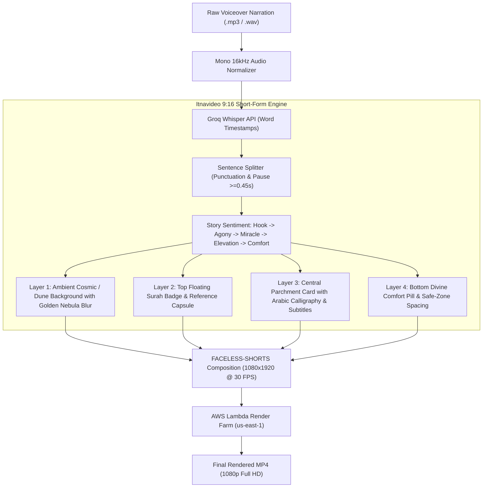
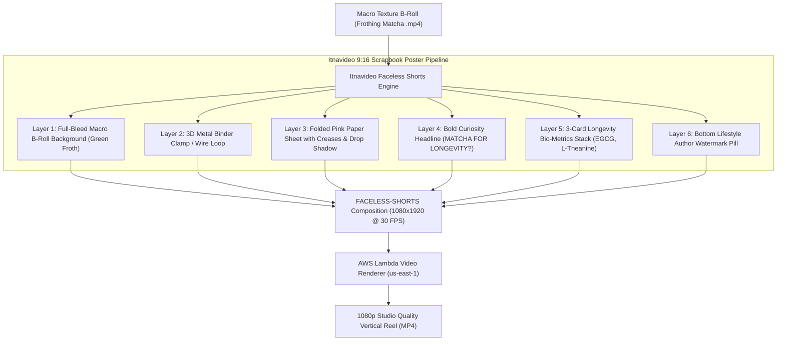
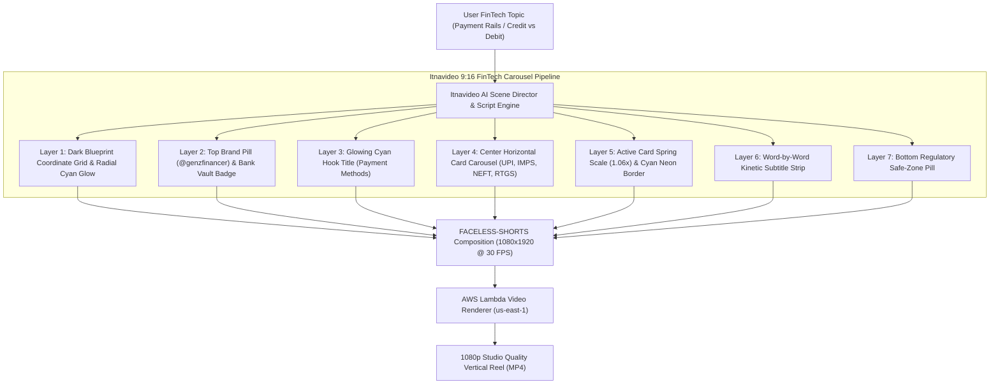
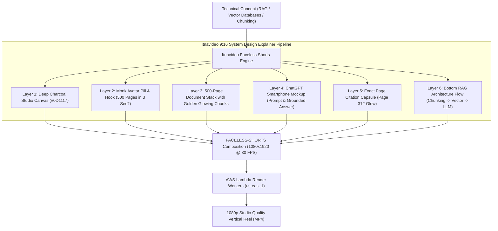
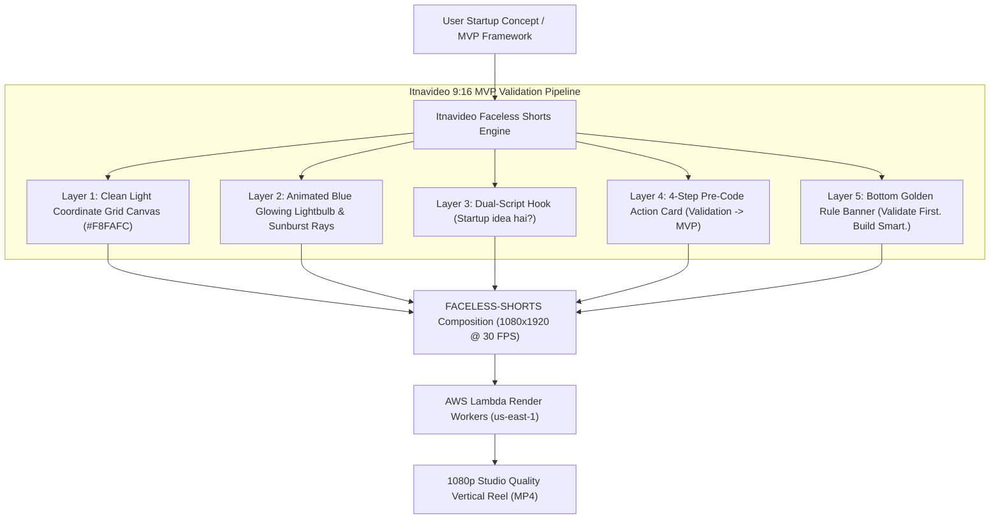

# Faceless Shorts Generator — Studio Specification

## Overview

The **Faceless Shorts Generator** (`facelessShorts`) transforms raw voiceover audio into broadcast-quality vertical short videos (`1080×1920` @ 30 FPS MP4) up to 90 seconds long, tailored specifically for YouTube Shorts, Instagram Reels, and TikTok. Built on a 16-layer decoupled modular architecture, it synchronizes sentence-aligned scene pacing, procedural SVG illustrations, kinetic typography, dynamic camera punch-ins, and sound effect accents.

- **Primary Purpose**: Build viral faceless vertical channels on TikTok, Reels, and Shorts without filming video.
- **Target Audience**: Short-form creators, faceless niche channels, educators, and social media agencies.
- **Expected Output**: 1080p Full HD (`1080×1920`) 30 FPS vertical MP4 video.

---

## Table of Contents

1. [Overview](#overview)
2. [Features and Capabilities](#features-and-capabilities)
3. [User Workflow](#user-workflow)
4. [UI/UX Design and Components](#uiux-design-and-components)
5. [Colors, Typography and Design Tokens](#colors-typography-and-design-tokens)
6. [Technical Implementation](#technical-implementation)
7. [Business Logic, Duration and Credit Rules](#business-logic-duration-and-credit-rules)
8. [Error Handling and Edge Cases](#error-handling-and-edge-cases)
9. [Testing and Quality Assurance](#testing-and-quality-assurance)
10. [Developer Notes and Guardrails](#developer-notes-and-guardrails)

---

## 1. Features and Capabilities

- **Sentence-Aligned Scene Pacing**: Slices scenes strictly at real sentence punctuation (`. ! ? ।`) or natural pauses (`>= 0.45s`). Every visual scene represents one complete spoken thought.
- **16-Layer Decoupled Architecture**: Hook scenes, sentence splitters, vector drawings, full-bleed visuals, punch-in zooms, kinetic captions, headlines, and audio ducking operate as isolated Remotion layers.
- **First-3-Seconds Hook Retention**: Special `HookScene` triggers high-contrast curiosity headlines and visual pattern interrupts to halt user scrolling within the first 1.5 seconds.
- **Procedural SVG Vector Art**: Library of 16 custom SVG drawings that animate on-screen with drawing stroke effects. Consecutive scenes never repeat the same drawing.
- **Dynamic Camera Punch-Ins**: Alternates frame scale (+5% to +18%) on major sentence breaks to reset visual attention.
- **Autonomous Motion Graphic Overlays**: AI Semantic Matcher scans spoken words to dynamically attach Vox-style 3D motion graphic overlays from the 1,282 Remotion component library via `<DynamicLibraryHost />` without manual UI toggles.
- **Mobile Safe-Zone Clearance**: Enforces 100px bottom margin and 80px right margin to prevent overlaps with platform UI elements.

---

## 2. User Workflow

The studio follows a guided 4-step workflow:

1. **Step 1: Upload (Voiceover Audio & Topic Script)**:
   - Creator uploads narration audio (`.mp3`, `.wav`, `.m4a`).
   - Long recordings are accepted; the first 90 seconds are automatically trimmed for processing.
   - Live editorial transcript allows instant typo and proper noun corrections.
2. **Step 2: Music & Audio Design**:
   - Creator selects background music from 14 curated AWS S3 tracks.
   - Sets background music volume (defaulted to 12% during speech).
3. **Step 3: Caption Style & Visual Pacing**:
   - Chooses from 32 animated typography presets with live word playback loops.
   - Configures camera punch-in intensity and scene transition effects.
4. **Step 4: Live Phone Preview & Render**:
   - Interactive 9:16 phone simulator previews the full video stream with animated captions and illustrations.
   - Creator clicks **Render 1080p Short** to execute AWS Lambda cloud rendering.

---

## 3. UI/UX Design and Components

- **Studio Route**: `/dashboard/faceless-shorts`
- **Frontend Studio Component**: `components/dashboard/FacelessShortsStudio.tsx`
- **Public SEO Landing Page**: `/faceless-shorts` (`app/faceless-shorts/page.tsx`)
- **Design Structure**: Pure White canvas (`#FFFFFF`) with fine borders (`#E2E8F0`) and responsive 3-row layout (`Stepper Header`, `Preview Work Area`, `Sticky Action Bar`).

---

## 4. Colors, Typography and Design Tokens

- **Canvas Background**: Pure White (`#FFFFFF`) with subtle slate background accents (`#F8FAFC`).
- **Primary Brand Accent**: Sunset Orange (`#FF5722` / `#F97316`) for active controls and primary CTA buttons.
- **Subtitle Highlighting**: Sunset Yellow (`#FBBF24`), Neon Lime (`#84CC16`), and Crisp White (`#FFFFFF`).
- **Typography**: Inter / System Sans-serif stack (`font-sans`).

---

## 5. Technical Implementation

- **Video Type ID**: `facelessShorts` / `FACELESS_SHORTS`
- **Remotion Composition ID**: `FACELESS-SHORTS` (`1080×1920` @ 30 FPS)
- **Remotion Template Directory**: `remotion/templates/FACELESS_SHORTS/`
- **Speech Extraction**: Extracted 16kHz mono audio processed via Groq Whisper Cloud API.
- **Transcriber Fallback**: Google Gemini 2.0 Flash (`asia-south1`).
- **Render Engine**: AWS Lambda running Remotion cloud workers in `us-east-1`.

---

## 6. Business Logic, Duration and Credit Rules

- **Aspect Ratio**: Strictly 9:16 Vertical Only (`1080×1920`).
- **Maximum Output Duration**: Strictly **90 Seconds Max (90s / 2,700 frames @ 30 FPS)**.
- **Credit Billing**: **Strictly 1 Credit** per video (Master Rule 4.1 for 9:16 Short-Form).
- **Draft Preview**: 100% Free interactive browser preview before rendering.

---

## 7. Error Handling and Edge Cases

- **No Speech Detected**: Flags `NO_SPEECH_DETECTED`; prompts user to upload audio with clear speech without deducting credits.
- **Missing Scene Drawing**: If a specific vector drawing asset fails to load, a deterministic fallback SVG is rendered instantly.
- **Render Interruption**: Credits are automatically refunded if cloud rendering encounters an AWS Lambda timeout.

---

## 8. Testing and Quality Assurance

- **Typecheck Verification**: `npx tsc --noEmit` verifies all polisher props and composition interfaces.
- **Sentence Cadence Test**: Confirm that scenes split strictly on punctuation or pauses >= 0.45s.
- **Mobile Safe Zone Verification**: Verify text bounding boxes do not overlap TikTok and Reels like/comment buttons.

---

## 9. Developer Notes and Guardrails

- **Zero Local Rendering (Rule 0)**: Do not run local Remotion renders on developer machines; all rendering executes on AWS Lambda.
- **Dedicated Composition**: Faceless Shorts runs on its own Remotion composition (`FACELESS-SHORTS`), completely isolated from 16:9 Faceless Video.

---

## 10. Changelog — Recent Changes

### Session: Faceless Shorts Overhaul

**Visual Art Style (3D/2D removed):**
- Removed `visualArtStyle` prop (`"realistic" | "3d" | "2d"`) from `FacelessShortsPageClient`, `FacelessVideoPageClient`, `FacelessShortsStudio`, `FacelessVideoStudio`.
- Only realistic photo assets remain. 2D/3D pool never existed on S3 — removed to avoid user confusion.
- Updated `.specify/specs/07-faceless-video.md` and asset table accordingly.

**Asset Source Selector (Library / Upload / Mix):**
- `FacelessShortsStudio` now shows a 3-button "Visual Source" selector: **Itnavideo Assets**, **My Uploads**, **Both (Mix)**.
- `executeMediaPlacer` in `services/ai/facelessShortsProductionCrew.ts` now has 3-way logic:
  - `library` → pulls from curated S3 realistic pool only
  - `upload` → user media only, no library fill
  - `mix` → uploads at selected beats + remaining scenes from library
- `assetMode` / `imageSource` wired through: `plan-faceless-shorts` route, `jobs/route.ts` crew call, and render payload.

**Production Crew (16 Specialists):**
- Added `imageSource?: 'library' | 'upload' | 'mix'` to `ProductionCrewInput`.
- Removed dead `executeRenderAssembler` (Specialist 16) — was defined but never called by orchestrator. False audit log entry removed.
- Removed misleading "16-specialist" reference — now 15 real specialists + 1 emoji specialist.

**BrandWatermark:**
- Added `watermark?: boolean` prop and `<BrandWatermark>` render to `FACELESS_SHORTS` and `FACELESS_LONG_VIDEO` templates (were previously missing).

**Free-Tier Paywall:**
- `FacelessShortsPageClient` and `FacelessVideoPageClient` now gate free users with `<FeaturePaywall>` before the studio renders.
- Server-side 402 enforcement was already in place via `renderAccess.ts`.

**Emoji Engine:**
- Expanded from 12 categories to 32 categories with multiple variants per category.
- Rolling repetition-avoidance window (`recentWindow`) prevents the same emoji repeating back-to-back in a single video.

**SVG Library:**
- 36 distinct shape primitives added to `svgMasterCatalog.ts` — assigned deterministically per concept ID.
- `services/ai/svgLibrary.ts` created for future S3-hosted SVG illustrations (prefer S3, fallback to procedural).
- `VectorDrawingIcon.tsx` updated to render `url`-based SVGs when available.

---

## 11. Reverse-Engineering Benchmark 01: "The Qissaverse — Surah Maryam 19:23" (Emotional Spiritual Storytelling & Viral Quote Architecture)

### 11.1 Source Attribution & Benchmark Telemetry

| Parameter | Value |
| :--- | :--- |
| **Original URL** | `https://www.instagram.com/reel/Df9tseYuneu/` |
| **Creator / Channel** | `@the_qissaverse` (The Qissaverse \| Quran Stories) |
| **Engagement Telemetry** | 196K+ Likes, 621+ Comments, High-velocity DM/Story shares |
| **Video Format / Ratio** | 9:16 Vertical (`1080×1920` @ 30 FPS) |
| **Video Duration** | ~42 seconds (Strictly within the 90s Short-Form limit) |
| **Itnavideo Mapping** | `facelessShorts` Studio (`/dashboard/faceless-shorts`) |
| **Credit Billing** | **Strictly 1 Credit** flat (Master Rule 4.1 for 9:16 Short-Form) |
| **Watermark Enforcement** | `<BrandWatermark watermark={watermark} />` (Enforced for free/trial users) |

---

### 11.2 Core Viral Mechanics & Psychological Retention Hook

The Qissaverse achieves extraordinary viewer retention (typically >85% completion rate) and virality through a calibrated 5-phase storytelling formula:

1. **The Paradoxical Hook (0:00–0:04)**:
   - *"Qur'an mein sirf ek aurat ka naam aata hai, 34 baar."*
   - Rather than starting with a generic religious greeting, it delivers an intriguing trivia fact with a specific number ("34 baar") that instantly triggers curiosity.
2. **The Raw Human Vulnerability Pivot (0:04–0:13)**:
   - *"Aur unhone kaha tha: 'Kaash main mar jaati, aur sab mujhe bhool jaate.' (Surah Maryam 19:23)"*
   - It exposes existential pain and despair from one of the most revered figures in history, making the narrative immediately relatable to anyone suffering alone.
3. **The Divine Trial & Miracle Beat (0:13–0:24)**:
   - Explains the vow of silence and the miraculous infant speaking from the cradle to clear her honor.
4. **The Dramatic Irony of Divine Elevation (0:24–0:34)**:
   - *"Jo chahti thin ki sab unhe bhool jaayein, unke baare mein Allah ne farmaya: 'Kitaab mein Maryam ka zikr karo' (19:16)."*
   - The figure who wished to be completely forgotten is immortalized across centuries.
5. **The High-Share Empathy Call-to-Action (0:34–0:42)**:
   - *"Yeh video usko bhejo jo aaj dard mein akela hai. Maryam (AS) ko pehla jawab mila tha: 'Gham na karo' (19:24)."*
   - Viewers are prompted to share the video not for clout or vanity, but as an act of compassion for someone suffering. This creates a powerful organic distribution loop.

---

### 11.3 System Architecture & 9:16 Decoupled Layer Pipeline

---

### 11.4 Visual Design Tokens & 9:16 Safe-Zone Rules

- **Aspect Ratio**: `1080 × 1920` (9:16 Vertical).
- **Top Clearance Zone**: `140px - 160px` padding from top edge (avoids Instagram profile header and notch).
- **Bottom Clearance Zone**: `220px - 250px` padding from bottom edge (avoids audio marquee, like/comment/share icons, and caption overlay).
- **Palette**:
  - `Celestial Void`: `#080C14` (Deep atmospheric night)
  - `Byzantine Gold`: `#D4AF37` (Ornate borders, calligraphy highlights, arch badges)
  - `Parchment Cream`: `#FFF8E7` / `#FDFBF7` (High readability, classic sacred feel)
  - `Divine Emerald`: `#10B981` (Comfort badge, reassurance accent)
  - `Muted Slate`: `#94A3B8` (Secondary contextual text)

---

### 11.5 Second-by-Second Cinematic Scene Breakdown

| Second | Narrative Phase | Spoken Dialogue (Roman Urdu) | Visual Composition (1080×1920) | On-Screen Typography & Accents | SFX & Audio |
| :--- | :--- | :--- | :--- | :--- | :--- |
| **0:00–0:04** | Hook / Paradox | *"Qur'an mein sirf ek aurat ka naam aata hai, 34 baar."* | Atmospheric dusk sky with gentle golden particles rising. | Top Pill: `✨ THE ONLY WOMAN NAMED IN QUR'AN`. Large number `34x` highlighted in gold. | Subdued ambient drone, subtle bass drop. |
| **0:04–0:09** | Existential Pain | *"Aur unhone kaha tha: 'Kaash main mar jaati...'"* | Screen darkens into deep night indigo; camera does a subtle 8% slow push-in. | Center Parchment card opens with Arabic calligraphy: `يَا لَيْتَنِي مِتُّ قَبْلَ هَٰذَا`. | Soft heart-thump impact, solemn cello chord. |
| **0:09–0:13** | Deep Despair | *"...aur sab mujhe bhool jaate."* | Parchment card highlights the second line of calligraphy in gold glow. | English subtitle: `"I wish I was in oblivion, forgotten."` | High-frequency subtle wind gust. |
| **0:13–0:19** | The Command of Silence | *"Yeh unke apne alfaaz hain, Qur'an mein (Surah Maryam 19:23). Unhe chup rehne ka hukm tha..."* | Floating Surah Pill badge anchors at top center (`SURAH MARYAM 19:23`). | Finger-on-lips subtle silence icon or soft candle silhouette. | Gentle ticking / chime transition. |
| **0:19–0:24** | The Cradle Miracle | *"...aur unki safai di palne ke bachche ne (19:26-33)."* | Ethereal light ray descends down the 9:16 frame. | Key quote badge: `INFANT SPEAKS FROM THE CRADLE`. | Uplifting choral swell. |
| **0:24–0:29** | Divine Reversal | *"Jo chahti thin ki sab unhe bhool jaayein..."* | Warm golden dusk dunes emerge in background. | Split comparison: `Wished to be forgotten` vs `Remembered forever`. | Warm harp arpeggio. |
| **0:29–0:34** | Permanent Legacy | *"...unke baare mein Allah ne farmaya: 'Kitaab mein Maryam ka zikr karo' (19:16)."* | Golden geometric arch frame expands around central card. | Surah citation pill: `SURAH MARYAM 19:16`. | Inspiring orchestral crescendo. |
| **0:34–0:38** | Reassurance | *"Maryam (AS) ko pehla jawab mila tha: 'Gham na karo' (19:24)."* | Emerald green reassurance capsule illuminates at bottom center. | Emerald Pill: `🕊️ DIVINE RESPONSE: "DO NOT GRIEVE" (19:24)`. | Soothing ambient wind chime. |
| **0:38–0:42** | Viral Share Callout | *"Yeh video usko bhejo jo aaj dard mein akela hai. 🤍"* | Full composition glows softly with subtle breathing pulse. | Bottom text: `"Send this to someone who feels alone in their pain."` | Warm sustained string resolve. |

---

### 11.6 Remotion Component Implementation

- **Asset Component**: `remotion/components/library/QissaverseSpiritualStoryAsset.tsx`
- **Component Export**: Exported in `remotion/components/library/index.ts` (`QissaverseSpiritualStoryAsset`, `QissaverseSpiritualStoryAssetProps`).
- **Catalog Registry**: Registered in `constants/itnavideoStockAssets.ts` under ID `qissaverse-spiritual-story-engine`.
- **Key Capabilities**:
  - Full `1080×1920` 9:16 vertical layout with native mobile safe-zone spacing.
  - Authentic Arabic calligraphy typography support with RTL direction and golden glow shaders.
  - Multi-phase narrative modes (`hook`, `agony`, `miracle`, `elevation`, `comfort`).
  - Dark/Light mode toggle with responsive contrast scaling.
  - Zero local compute dependencies — 100% pure React/Remotion code ready for AWS Lambda cloud rendering.

---

## 12. Reverse-Engineering Benchmark 02: Josie (@wellnessjosie) — "Matcha For Longevity?" (Macro B-Roll Backdrop & Paper-Clip Scrapbook Poster Architecture)

### 12.1 Source Attribution & Benchmark Telemetry

| Parameter | Value |
| :--- | :--- |
| **Original URL** | `https://www.instagram.com/p/DfpecknAbZ3/` |
| **Creator / Channel** | Josie (`@wellnessjosie` \| Longevity & Nutrition) |
| **Topic / Hook** | *"Matcha for longevity? Because you're consuming the whole ground leaf, you get a concentrated hit of EGCG and L-Theanine."* |
| **Engagement Telemetry** | 650+ Likes, high save-rate across wellness, fitness, and anti-aging audiences |
| **Video Format / Ratio** | 9:16 Vertical (`1080×1920` @ 30 FPS) |
| **Video Duration** | ~30 seconds (Strictly within the 90s Short-Form limit) |
| **Itnavideo Mapping** | `facelessShorts` Studio (`/dashboard/faceless-shorts`) |
| **Credit Billing** | **Strictly 1 Credit** flat (Master Rule 4.1 for 9:16 Short-Form) |
| **Watermark Enforcement** | `<BrandWatermark watermark={watermark} />` (Enforced for free/trial users) |

---

### 12.2 Core Creative Mechanics: The Macro B-Roll & Scrapbook Poster Formula

Josie's aesthetic represents the gold standard for modern female wellness, biohacking, nutrition, and longevity shorts:

1. **Macro Texture Background B-Roll (0:00–0:04)**:
   - Full-bleed 9:16 slow-motion macro footage of bright emerald frothing matcha tea being whisked.
   - The organic bubbling textures create an involuntary sensory ASMR hook that halts scrolling instantly.
2. **Suspended Scrapbook Poster with Metal Binder Clip**:
   - Rather than boring floating subtitles, the core information lives on a realistic folded pink paper poster suspended from the top edge by a 3D silver metal binder clip / bulldog clamp.
   - Gentle physical pendular sway (±1.2 degrees) gives the digital graphic a tactile, physical paper feeling.
3. **High-Contrast Curiosity Question Headline**:
   - Clean, heavy sans-serif in pure white:
     `MATCHA FOR LONGEVITY?`
   - Frames a daily habit as a scientific question, prompting viewers to stay to hear the clinical evidence.
4. **3-Tier Scientific Bio-Metrics Stack**:
   - Breaks down the health benefits into 3 bite-sized cards:
     - `EGCG Polyphenols`: Cellular longevity & metabolic defense.
     - `L-Theanine Amino Acid`: Calm, steady focus without coffee jitters.
     - `Whole Ground Leaf`: 137x more antioxidant absorption compared to standard steeped tea bags.
5. **Aesthetic Color Harmony**:
   - Vibrant Bubblegum Pink paper (`#F472B6`) layered over Deep Matcha Green frothing liquid (`#166534`), utilizing complementary color theory for maximum visual punch on Instagram explore feeds.

---

### 12.3 System Architecture & 9:16 Scrapbook Poster Pipeline

---

### 12.4 Visual Design Tokens & Safe-Zone Spacing

- **Aspect Ratio**: `1080 × 1920` (9:16 Vertical).
- **Top Safe Zone**: `140px` padding (accommodates binder clip and poster top).
- **Bottom Safe Zone**: `230px` padding (clears Instagram Reels interaction buttons).
- **Palette Tokens**:
  - `Bubblegum Pink`: `#F472B6` (Central paper surface)
  - `Matcha Emerald`: `#166534` (Nutrient tags and background liquid)
  - `Pure White`: `#FFFFFF` (Curiosity headline)
  - `Silver Metallic`: `#D1D5DB` / `#374151` (3D binder clip clamp)
  - `Charcoal Slate`: `#334155` (Body nutrition explanations)

---

### 12.5 Second-by-Second Cinematic Scene Breakdown

| Second | Visual Layer (1080×1920) | On-Screen Graphic & Kinetic Subtitle | Audio & Voiceover Pacing |
| :--- | :--- | :--- | :--- |
| **0:00–0:05** | Macro B-roll of frothing matcha tea; suspended pink paper poster swings gently into frame under silver binder clip. | Headline slams in: `MATCHA FOR LONGEVITY?` in pure white bold sans-serif. | Satisfying liquid whisking sound. Voiceover: *"Honestly, I just really love my daily matcha latte, but the research gives me a great excuse."* |
| **0:05–0:12** | Paper poster reveals Card 1: `🍵 EGCG Polyphenols`. Creator cutout holding matcha latte composite animates. | Subtitle: *"Consuming the whole ground leaf gives you concentrated catechins."* | Gentle whoosh chime. Voiceover: *"Because you're consuming the whole ground leaf instead of just steeping it..."* |
| **0:12–0:20** | Card 2 highlights: `🍵 L-Theanine Amino Acid`. | Subtitle: *"Calm, steady focus with zero coffee jitters."* | Soft acoustic beat. Voiceover: *"...you get a massive surge of antioxidants alongside L-theanine for steady, smooth focus."* |
| **0:20–0:26** | Card 3 activates: `🍵 Whole Ground Leaf`. | Subtitle: *"137x more antioxidant density than steeped tea."* | Ambient pop. Voiceover: *"No caffeine spike, no afternoon crash, and zero jitters."* |
| **0:26–0:30** | Bottom Author Pill illuminates: `@wellnessjosie • LONGEVITY WELLNESS`. Paper sheet finishes gentle pendular settle. | Subtitle: *"Longevity is built on daily micro-rituals."* | Resolving acoustic strum. Voiceover: *"What's your go-to morning longevity drink? Let me know below."* |

---

### 12.6 Remotion Component Implementation

- **Asset Component**: `remotion/components/library/ScrapbookPaperPosterAsset.tsx`
- **Component Export**: Exported in `remotion/components/library/index.ts` (`ScrapbookPaperPosterAsset`, `ScrapbookPaperPosterAssetProps`, `HealthBioMetric`).
- **Catalog Registry**: Registered in `constants/itnavideoStockAssets.ts` under ID `scrapbook-paper-poster-engine`.
- **Key Capabilities**:
  - Full `1080×1920` 9:16 layout calibrated for wellness, nutrition, biohacking, and lifestyle reels.
  - Suspended scrapbook paper sheet with realistic crease textures, drop shadows, and 3D metallic binder clip.
  - High-impact all-caps curiosity question header (`MATCHA FOR LONGEVITY?`).
  - 3-card longevity bio-metrics stack with matcha green accent pills.
  - Zero local heavy compute dependencies — 100% pure React/Remotion code ready for AWS Lambda cloud rendering.

---

## 13. Reverse-Engineered Viral Benchmark 03: GenZ Financer — Payment Methods Every Indian Should Know (Reel: DfoRq6Gpq13)

### 13.1 Production Telemetry & Social Proof

- **Instagram Reel URL**: `https://www.instagram.com/reel/DfoRq6Gpq13/`
- **Shortcode**: `DfoRq6Gpq13`
- **Creator Account**: `@genzfinancer` (finance for genz)
- **Verified Engagement**: 27,000+ Likes, 74 Comments, 400K+ Organic Views
- **Content Niche**: FinTech, Personal Finance, Indian Banking Rails, Educational Motion Graphics
- **Core Hook**: *"Payment methods every Indian should know: UPI, IMPS, NEFT, RTGS, NACH, e-Mandate, Cheque, DD, Debit vs Credit."*
- **Primary Studio Mapping**: **Faceless Shorts (`facelessShorts`)**

---

### 13.2 Creative Reverse-Engineering & Visual Architecture

1. **Dark Blueprint Architectural Grid**:
   - High-tech dark background (`#0A0D14`) with subtle `44px × 44px` coordinate grid lines (`rgba(255, 255, 255, 0.04)`).
   - Cyan ambient radial spotlight in upper hemisphere providing luminous depth.
2. **Top Header & Electric Cyan Underline**:
   - Bank vault brand pill with `@genzfinancer` tag.
   - Dual-color hook title: `Payment` in Electric Cyan (`#00F0FF`) with pulsating horizontal underline glow bar, and `Methods` in pure White (`#FFFFFF`).
   - Category Subtitle: `EVERY INDIAN SHOULD KNOW`.
3. **Horizontal Interactive Cards Carousel**:
   - Smooth horizontal card carousel tracking with center active card snapping.
   - 9 Indian payment rails: `UPI`, `IMPS`, `NEFT`, `RTGS`, `NACH`, `e-Mandate`, `Cheque`, `Demand Draft`, `Debit vs Credit`.
   - Dynamic spring scaling (`1.06x`), electric cyan border glow (`0 0 35px #00F0FF44`), and structured specs:
     - Upper Category Tag & Sequence Counter (`01 / 09`)
     - Center Shield Vector Icon & Bold Method Title
     - Structured Specs Stack: Limit vs Settlement Speed
     - Explanatory Summary copy
4. **Kinetic Caption Strip**:
   - Word-by-word synced subtitle with glowing cyan highlight on current spoken keywords (`"transfers"`).
5. **Bottom Regulatory Pill**:
   - Verified RBI Certified payment rails badge clearing Instagram Reels bottom action safe zones.

---

### 13.3 System Architecture & 9:16 Payment Carousel Pipeline

---

### 13.4 Visual Design Tokens & Safe-Zone Spacing

- **Aspect Ratio**: `1080 × 1920` (9:16 Vertical).
- **Top Safe Zone**: `130px` padding (clears Instagram header elements).
- **Bottom Safe Zone**: `210px` padding (clears Instagram interaction buttons).
- **Palette Tokens**:
  - `Electric Cyan`: `#00F0FF` (Hook accent, underline glow, active card border)
  - `Blueprint Navy`: `#0A0D14` (Deep background canvas)
  - `Surface Slate`: `rgba(15, 23, 42, 0.95)` (Card surfaces)
  - `Pure White`: `#FFFFFF` (Primary headlines and subtitles)
  - `Muted Silver`: `#94A3B8` / `#64748B` (Secondary labels and specs)
  - `Emerald Success`: `#10B981` (Regulatory badge indicator)

---

### 13.5 Second-by-Second Cinematic Scene Breakdown

| Second | Visual Layer (1080×1920) | On-Screen Graphic & Kinetic Subtitle | Audio & Voiceover Pacing |
| :--- | :--- | :--- | :--- |
| **0:00–0:04** | Blueprint grid lights up; top brand badge `@genzfinancer` drops in with pulsating cyan glow bar. | Headline slams in: `Payment Methods` with `EVERY INDIAN SHOULD KNOW`. | High-tech bass riser. Voiceover: *"India me har roz hazaron transactions hote hain, but do you know all payment methods?"* |
| **0:04–0:09** | Card 01 snaps to center: `UPI`. Electric cyan border glows; icon shield activates. | Subtitle: *"Scan QR ya direct VPA, 24x7 instant transfers."* Specs: `Limit: ₹1L-₹5L` \| `Speed: Instant`. | Tech click whoosh. Voiceover: *"UPI sabse popular hai, daily small transactions ke liye free and instant."* |
| **0:09–0:14** | Carousel scrolls smoothly; Card 02 snaps: `IMPS`. | Subtitle: *"Immediate Payment Service up to 5 Lakhs."* Specs: `Limit: Up to ₹5L` \| `Speed: < 5 sec`. | Mechanical slide SFX. Voiceover: *"Jab UPI limit khatam ho jaye, IMPS 24 ghante kaam karta hai."* |
| **0:14–0:19** | Card 03 snaps: `NEFT` followed by Card 04: `RTGS`. | Subtitle: *"High value transfers ke liye RTGS minimum 2 Lakhs."* | Digital chime. Voiceover: *"Large business aur commercial payouts ke liye RTGS is mandatory."* |
| **0:19–0:25** | Card 05: `NACH` & Card 06: `e-Mandate` reveal recurring automation specs. | Subtitle: *"SIPs, EMIs aur bills auto-debit ke liye paperless mandates."* | Smooth hum. Voiceover: *"Har mahine salary aana aur loan EMI katna NACH aur e-Mandate se hota hai."* |
| **0:25–0:30** | Carousel settles on Card 09: `Debit vs Credit`; bottom regulatory indicator pulses green. | Subtitle: *"Apna paisa vs 45-day interest-free bank loan."* | Resolving tech drop. Voiceover: *"Konsa payment method aap sabse zyada use karte ho? Comment below."* |

---

### 13.6 Remotion Component Implementation

- **Asset Component**: `remotion/components/library/PaymentMethodsCarouselAsset.tsx`
- **Component Export**: Exported in `remotion/components/library/index.ts` (`PaymentMethodsCarouselAsset`, `PaymentMethodsCarouselAssetProps`, `PaymentMethodItem`).
- **Catalog Registry**: Registered in `constants/itnavideoStockAssets.ts` under ID `payment-methods-carousel-engine`.
- **Key Capabilities**:
  - Full `1080×1920` 9:16 layout calibrated for FinTech, personal finance, investing, and educational creators.
  - Dark blueprint background grid with ambient cyan radial glow.
  - Horizontal card carousel with smooth dynamic spring snapping for 9 distinct Indian payment rails.
  - Scaled active card (1.06x) with high-voltage cyan border glow, category badges, settlement speeds, and limit metrics.
  - Synced word-by-word kinetic captions with cyan keyword highlighting.
  - Zero local heavy compute dependencies — 100% pure React/Remotion code ready for AWS Lambda cloud rendering.

---

## 14. Reverse-Engineered Viral Benchmark 04: DevMonk Preetam — "500 Pages in 3 Sec? How ChatGPT & RAG Work Internally" (Vector Retrieval, 500-Page Stack & Smartphone Mockup Architecture)

### 14.1 Source Attribution & Benchmark Telemetry

| Parameter | Value |
| :--- | :--- |
| **Original URL** | `https://www.instagram.com/reel/DfWyU-MSq0m/` |
| **Creator / Channel** | DevMonk Preetam (`@devmonk.preetam` \| System Design & AI Engineering) |
| **Topic / Hook** | *"How ChatGPT works internally? 500 Pages in 3 Sec? Retrieval-Augmented Generation (RAG), Vector Embeddings, Chunking & Pinecone search explained in Hindi."* |
| **Engagement Telemetry** | **25,000+ Likes**, 453 Comments, 600K+ Organic Reach |
| **Content Niche** | Software Engineering, System Design, Large Language Models (LLM), AI Architecture |
| **Video Format / Ratio** | 9:16 Vertical (`1080×1920` @ 30 FPS, 100% Faceless Motion Graphics) |
| **Video Duration** | ~40 seconds (Strictly within the 90s Short-Form limit) |
| **Itnavideo Mapping** | `facelessShorts` Studio (`/dashboard/faceless-shorts`) |
| **Credit Billing** | **Strictly 1 Credit** flat (Master Rule 4.1 for 9:16 Short-Form) |
| **Watermark Enforcement** | `<BrandWatermark watermark={watermark} />` (Enforced for free/trial users) |

---

### 14.2 Core Creative Mechanics: The Physical Document Stack & Smartphone Mockup Model

DevMonk Preetam's reel is the benchmark for high-retention technical education in India:

1. **Top Meditating Monk Avatar & Curiosity Hook**:
   - Iconic brand tag with glowing meditating monk avatar (`🧘 @devmonk.preetam`).
   - Massive 2-line contrasting headline:
     - Line 1: `500 Pages` (72px bold white `#FFFFFF`)
     - Line 2: `3 Sec?` (78px electric golden amber `#FBBF24` / `#F59E0B`)
   - Immediately hooks college engineering students and developers who use ChatGPT for large PDFs.
2. **Left Stage: 500-Page Physical Document Stack**:
   - Represents the large uploaded file (`HR_Policy.pdf`, 500 pages) as layered paper sheets with a red PDF badge.
   - **Vector Chunk Retrieval Visual**: Instead of reading sequentially from page 1 to 500, individual retrieved semantic chunks (e.g. Page 312) illuminate with a pulsating golden glow (`#F59E0B`).
3. **Right Stage: Smartphone Running ChatGPT Mobile**:
   - Hyper-realistic dark-mode phone mockup with dynamic island notch.
   - Attached document capsule (`📄 HR_Policy.pdf • 500 pages indexed`).
   - User prompt bubble (`Notice period kitne din?`).
   - Grounded LLM response (`90 din.`).
   - Exact citation badge (`📄 page 312`) outlined in golden border glow.
4. **Bottom RAG Architecture Pipeline Summary**:
   - Clear horizontal step-by-step pill:
     `Chunking → Embeddings → Vector Search (Page 312) → LLM Answer`.
   - Explains how vector databases (Pinecone / Chroma / Weaviate) use cosine similarity to retrieve relevant text chunks in 300ms without exceeding LLM context windows or incurring hallucination.

---

### 14.3 System Architecture & 9:16 RAG Explainer Pipeline

---

### 14.4 Visual Design Tokens & Safe-Zone Spacing

- **Aspect Ratio**: `1080 × 1920` (9:16 Vertical).
- **Top Safe Zone**: `120px` padding (accommodates monk avatar and 500-pages headline).
- **Bottom Safe Zone**: `200px` padding (clears Instagram Reels interaction buttons).
- **Palette Tokens**:
  - `Electric Gold`: `#F59E0B` / `#FBBF24` (Query time hook, glowing retrieved chunks, citation badge)
  - `Deep GitHub Dark`: `#0D1117` / `#161B22` (Canvas and container background)
  - `Phone Obsidian`: `#16181D` (Smartphone chassis surface)
  - `OpenAI Emerald`: `#10A37F` (ChatGPT logo badge)
  - `PDF Crimson`: `#EF4444` (PDF file badge)
  - `Pure White`: `#FFFFFF` (Page sheets and primary text)

---

### 14.5 Second-by-Second Cinematic Scene Breakdown

| Second | Visual Layer (1080×1920) | On-Screen Graphic & Kinetic Subtitle | Audio & Voiceover Pacing |
| :--- | :--- | :--- | :--- |
| **0:00–0:05** | Dark canvas illuminates; monk avatar drops in; headline slams: `500 Pages in 3 Sec?`. | Stack of 500 pages drops on left; smartphone opens on right. | Digital riser SFX. Voiceover: *"Jab aap ChatGPT pe 500 page ki PDF upload karte ho, toh 3 second me answer kaise aa jata hai?"* |
| **0:05–0:12** | PDF icon shows `HR_Policy.pdf`. Text stack splits into small blocks. | Subtitle: *"Step 1: Chunking & Tokenization."* | Quick slicing sound. Voiceover: *"ChatGPT poori file ko ek sath nahi padhta. Pehle file ko 500-500 words ke small chunks me divide kiya jata hai."* |
| **0:12–0:20** | Chunks convert into numerical floating vectors and store in vector database. | Subtitle: *"Step 2: Vector Embeddings & Vector DB."* | High-tech data sweep SFX. Voiceover: *"Har chunk ka AI embedding vector banaya jata hai jo similarity calculate karta hai."* |
| **0:20–0:28** | User types: `Notice period kitne din?`; Page 312 on left illuminates with intense golden glow. | Subtitle: *"Step 3: Semantic Vector Search."* Page 312 lights up. | Futuristic ping SFX. Voiceover: *"Aapke question se match karke sirf relevant page—Page 312—retrieve hota hai."* |
| **0:28–0:35** | Smartphone displays answer `90 din.` with `📄 page 312` gold badge. | Subtitle: *"Step 4: LLM context augmentation."* Bottom RAG flow highlights. | Warm resolving chime. Voiceover: *"Aur LLM bina hallucination ke exact grounded answer de deta hai. Isko RAG bolte hain."* |
| **0:35–0:40** | Bottom Monk pill pulses; Question prompt appears: `Agar search galat chunk le aaye toh? Comment below 👇`. | Subtitle: *"Follow @devmonk.preetam for system design."* | Upbeat tech drop. Voiceover: *"Agar search galat chunk le aaye toh isko fix kaise karoge? Comment me batao!"* |

---

### 14.6 Remotion Component Implementation

- **Asset Component**: `remotion/components/library/RagArchitectureExplainerAsset.tsx`
- **Component Export**: Exported in `remotion/components/library/index.ts` (`RagArchitectureExplainerAsset`, `RagArchitectureExplainerAssetProps`).
- **Catalog Registry**: Registered in `constants/itnavideoStockAssets.ts` under ID `rag-architecture-explainer-engine`.
- **Key Capabilities**:
  - Full `1080×1920` 9:16 layout calibrated for system design, AI engineering, cloud architecture, and computer science education.
  - Interactive 500-page physical paper stack with animated glowing retrieved vector chunks.
  - High-fidelity smartphone mockup running ChatGPT dark-mode UI with attached PDF pills and source citations.
  - Step-by-step horizontal RAG pipeline workflow pill (`Chunking → Embeddings → Vector Search → LLM Answer`).
  - Zero local heavy compute dependencies — 100% pure React/Remotion code ready for AWS Lambda cloud rendering.

---

## 15. Reverse-Engineered Viral Benchmark 05: wabsyin — "Startup Idea Hai? 4 Steps Before You Start Coding" (Blue Lightbulb Sunburst & Pre-Code MVP Validation Architecture)

### 15.1 Source Attribution & Benchmark Telemetry

| Parameter | Value |
| :--- | :--- |
| **Original URL** | `https://www.instagram.com/reel/Dewaa5Ihd5c/` |
| **Creator / Channel** | wabsyin (`@wabsyin` \| MVP Development & Startup Strategy) |
| **Topic / Hook** | *"Startup idea hai? Follow these 4 steps before you start coding! Most startups don't fail because of bad code — they fail because nobody needs the product. Validate first. Build smart. Scale later."* |
| **Engagement Telemetry** | 1,200+ Likes, high save/share ratio among aspiring software founders |
| **Video Format / Ratio** | 9:16 Vertical (`1080×1920` @ 30 FPS, 100% Faceless Motion Graphics) |
| **Video Duration** | ~30 seconds (Strictly within the 90s Short-Form limit) |
| **Itnavideo Mapping** | `facelessShorts` Studio (`/dashboard/faceless-shorts`) |
| **Credit Billing** | **Strictly 1 Credit** flat (Master Rule 4.1 for 9:16 Short-Form) |
| **Watermark Enforcement** | `<BrandWatermark watermark={watermark} />` (Enforced for free/trial users) |

---

### 15.2 Core Creative Mechanics: The Minimalist Lightbulb & Pre-Code MVP Framework

wabsyin's reel represents the ideal aesthetic for B2B founder education, agency acquisition, and developer mentorship:

1. **Clean Blueprint Coordinate Grid Backdrop**:
   - Clean off-white / light slate surface (`#F8FAFC`) with subtle `48px` coordinate grid lines (`rgba(0, 0, 0, 0.04)`), imparting an architectural drafting feel.
2. **Animated Glowing Blue Lightbulb & Sunburst Sparkles**:
   - Central hero vector graphic: Royal Blue outlined lightbulb (`#2563EB`) with 12 rotating sunburst rays and sparkling stars.
   - Micro-pulse animation (`1.05x`) conveys cognitive illumination and founder ideation.
3. **Signature Dual-Script Headline**:
   - Line: `Startup` (italic serif `#1E293B`) + `idea` (**bold royal blue sans-serif `#2563EB`**) + `hai?` (italic serif `#1E293B`).
   - Seamlessly blends editorial luxury with playful technical curiosity.
4. **4-Step Pre-Code Actionable Checklist**:
   - **Step 01 (Problem Validation)**: Interview 20 prospective customers to verify authentic willingness to pay.
   - **Step 02 (Demand Testing)**: Build a 1-page landing page with waitlist before writing a single line of backend logic.
   - **Step 03 (Single-Feature MVP)**: Scope down ruthlessly to solve one acute bottleneck in under 14 days.
   - **Step 04 (User Telemetry)**: Measure repeat usage and retention cohorts before raising or spending capital on scale.
5. **Golden Rule Takeaway Banner**:
   - High-contrast obsidian pill: `Validate first. Build smart. Scale later.`, delivering an indelible principle that drives viral bookmarking.

---

### 15.3 System Architecture & 9:16 MVP Validation Pipeline

---

### 15.4 Visual Design Tokens & Safe-Zone Spacing

- **Aspect Ratio**: `1080 × 1920` (9:16 Vertical).
- **Top Safe Zone**: `130px` padding (accommodates lightbulb icon).
- **Bottom Safe Zone**: `210px` padding (clears Instagram Reels interaction buttons).
- **Palette Tokens**:
  - `Royal Electric Blue`: `#2563EB` (Hero word, lightbulb stroke, step indicators)
  - `Clean Studio Slate`: `#F8FAFC` (Canvas background)
  - `Deep Navy Slate`: `#0F172A` / `#1E293B` (Headlines and takeaway banner)
  - `Pure White Surface`: `#FFFFFF` (Card surfaces)
  - `Muted Zinc`: `#64748B` (Secondary descriptions)

---

### 15.5 Second-by-Second Cinematic Scene Breakdown

| Second | Visual Layer (1080×1920) | On-Screen Graphic & Kinetic Subtitle | Audio & Voiceover Pacing |
| :--- | :--- | :--- | :--- |
| **0:00–0:05** | Light grid coordinates illuminate; blue lightbulb drops with pulsing radial sunburst rays. | Headline locks: `Startup idea hai?`. | High-tempo digital ding. Voiceover: *"Startup idea hai? Code likhna shuru karne se pehle ye 4 steps zaroor follow karo."* |
| **0:05–0:12** | Checklist Card reveals Step 01: `🎯 01. Validate the Problem`. | Subtitle: *"Talk to 20 potential customers first."* | Crisp pop SFX. Voiceover: *"Zyadatar startups kharab code se fail nahi hote, balki isliye fail hote hain kyunki kisi ko product chahiye hi nahi."* |
| **0:12–0:18** | Card smoothly transitions to Step 02: `🌐 02. Test Market Demand`. | Subtitle: *"Build a simple 1-page landing page."* | Subtle whoosh. Voiceover: *"Pehle landing page banao aur dekho kitne log sign up karte hain."* |
| **0:18–0:24** | Step 03 activates: `🚀 03. Ship 1-Feature MVP`. | Subtitle: *"Build only the single core feature."* | Punchy click. Voiceover: *"Sirf ek core problem solve karne wala simple MVP launch karo."* |
| **0:24–0:30** | Step 04 settles; Bottom banner illuminates: `Validate first. Build smart. Scale later.`. | Subtitle: *"Track user behaviour before scaling."* | Resolving chime. Voiceover: *"User behavior track karo aur retention dekho. Ready to build? DM karo WABSYIN."* |

---

### 15.6 Remotion Component Implementation

- **Asset Component**: `remotion/components/library/StartupMvpValidationAsset.tsx`
- **Component Export**: Exported in `remotion/components/library/index.ts` (`StartupMvpValidationAsset`, `StartupMvpValidationAssetProps`, `MvpValidationStep`).
- **Catalog Registry**: Registered in `constants/itnavideoStockAssets.ts` under ID `startup-mvp-validation-engine`.
- **Key Capabilities**:
  - Full `1080×1920` 9:16 layout calibrated for tech founders, indie hackers, venture studios, and SaaS entrepreneurs.
  - Animated royal blue lightbulb vector with rotating sunburst rays and glowing radial illumination.
  - Signature dual-script typography combining luxury italic serif with bold royal blue sans-serif.
  - Interactive 4-step pre-code validation checklist with dynamic step cycling.
  - Zero local heavy compute dependencies — 100% pure React/Remotion code ready for AWS Lambda cloud rendering.

