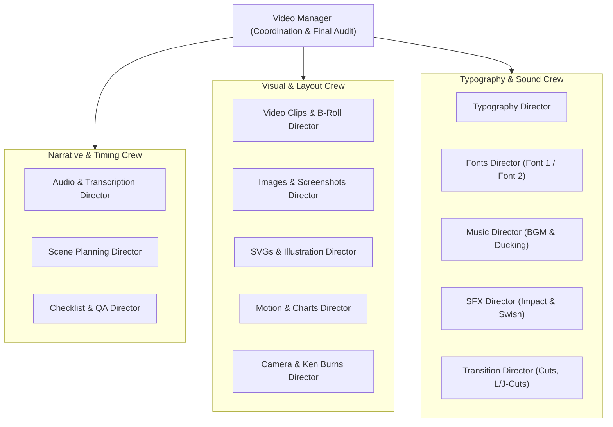

# 16:9 Faceless Video Generator — Master Technical & Architectural Specification

The **Faceless Video Generator** (`facelessVideo`) converts voiceover narration audio or text scripts into monetizable, studio-quality 16:9 Full HD widescreen documentary and educational videos (`1920×1080` @ 30 FPS MP4) up to 5 minutes long. Designed for YouTube video essayists, educational creators, digital marketing agencies, and automated media brands, it pairs spoken narration with semantic stock B-roll, procedural vector diagrams, multi-track audio, dynamic typography, and storyboard-directed visual layouts.

---

## Table of Contents

0. [Master Architecture & Modular Specification Files (Locked 2026 Engine)](#0-master-architecture--modular-specification-files-locked-2026-engine)
1. [Product Overview & The Core Wedge](#1-product-overview--the-core-wedge)
2. [The 8 Core Asset Categories](#2-the-8-core-asset-categories)
3. [User Inputs & Creator Controls](#3-user-inputs--creator-controls)
4. [A-Roll vs. B-Roll Architecture](#4-a-roll-vs-b-roll-architecture)
5. [Multi-Layer Timeline Architecture (10+ Layers)](#5-multi-layer-timeline-architecture-10-layers)
6. [Director Crew Hierarchy & Video Manager](#6-director-crew-hierarchy--video-manager)
7. [The 4-Step Storyboarding & Conceptualization Workflow](#7-the-4-step-storyboarding--conceptualization-workflow)
8. [Typography Engine & Font Pairing (Font 1 & Font 2)](#8-typography-engine--font-pairing-font-1--font-2)
9. [Images, Screenshots & Visual Layout Compositions](#9-images-screenshots--visual-layout-compositions)
10. [Bilingual & Special Speech Handling (Quranic & Arabic RTL)](#10-bilingual--special-speech-handling-quranic--arabic-rtl)
11. [Modular JSON Architecture (Scene-Level Blueprint)](#11-modular-json-architecture-scene-level-blueprint)
12. [Audio Processing & Background Music Module](#12-audio-processing--background-music-module)
13. [Transitions & Audio Overlaps (J-Cuts & L-Cuts)](#13-transitions--audio-overlaps-j-cuts--l-cuts)
14. [Frame Rate Architecture (FPS 30 & Millisecond Timing)](#14-frame-rate-architecture-fps-30--millisecond-timing)
15. [Production Audit, Quality Assurance & Boring Infrastructure](#15-production-audit-quality-assurance--boring-infrastructure)
16. [Credit Economics & Billing Policy](#16-credit-economics--billing-policy)
17. [Technical Infrastructure & Remotion Integration](#17-technical-infrastructure--remotion-integration)

---

## 0. Master Architecture & Modular Specification Files (Locked 2026 Engine)

The complete implementation architecture of the Faceless Video engine is divided into five modular, production-tested specification guides located in [`docs/video-types/01-faceless-video/`](file:///c:/Itnavideo%20Company/docs/video-types/01-faceless-video):

| Spec Document | Core Focus & Engineering Rules |
| :--- | :--- |
| **[00_INDEX_AND_DECISIONS.md](file:///c:/Itnavideo%20Company/docs/video-types/01-faceless-video/00_INDEX_AND_DECISIONS.md)** | Locked master decisions, 1920×1080 @ 30 FPS, millisecond standard, safe areas (120px/80px), 85% vector dominance, motion tokens, audio ducking, 14 visual layers + 4 audio tracks. |
| **[01_LAYOUT_CATALOG.md](file:///c:/Itnavideo%20Company/docs/video-types/01-faceless-video/01_LAYOUT_CATALOG.md)** | 17 dedicated layout recipes (L01 `HookTypographyScene` to L17 `OutroScene`), slots, element budgets, geometry, and choreography presets. |
| **[02_AI_PLANNER_AND_ROUTER.md](file:///c:/Itnavideo%20Company/docs/video-types/01-faceless-video/02_AI_PLANNER_AND_ROUTER.md)** | 2-Pass AI Planning (Story Director + Layout Director), schema, slot-filling, validators, repair loop, and fallback ladder preventing stickman looping. |
| **[03_DESIGN_SYSTEM_AND_POLISH.md](file:///c:/Itnavideo%20Company/docs/video-types/01-faceless-video/03_DESIGN_SYSTEM_AND_POLISH.md)** | Design tokens, type scale (hero 2× rule for Ali Abdaal / Warikoo aesthetic), light/dark canvas polarity, kinetic karaoke captions (`marker-tape`, `stacy-pill`), background depth stack, and procedural illustration system. |
| **[04_IMPLEMENTATION_GUIDE.md](file:///c:/Itnavideo%20Company/docs/video-types/01-faceless-video/04_IMPLEMENTATION_GUIDE.md)** | Developer implementation guide: Remotion schemas (zod), `core/time.ts`, `core/Animated.tsx`, `core/SceneRenderer.tsx`, layout registry, captions component, ducking envelope, and SFX checklist. |

> [!IMPORTANT]
> **Diagnosis on Basic Video Output**:
> Previous video generations suffered from **Stickman Asset Reuse & Monotony** because scenes defaulted to generic split-screen layouts instead of dynamically distributing across the 17 specialized layout recipes (`StatScene`, `ComparisonScene`, `HorizontalProcessStepsScene`, `WorkflowScene`, `RoadmapScene`, `CardConceptScene`, `ListScene`, `ChartScene`, `DrawingStoryScene`). Following the 5 guides above guarantees professional director-level visual pacing.

---

## 1. Product Overview & The Core Wedge

* **What is a Faceless Video?**: A video where the creator does not appear on camera. The narrative is driven by spoken voiceover, supported by stock footage, illustrations, dynamic typography, animated motion graphics, and synchronized background music.
* **Our Core Wedge**: 
  > **Upload a voiceover audio → Receive a clean, publish-ready, professionally directed 16:9 widescreen YouTube video.**
* **Target Platforms**: YouTube Long-Form, Educational Courses, Documentary Channels, LinkedIn Video Posts.
* **Primary Target Duration**: Up to 5 Minutes (300 seconds / 9,000 frames @ 30 FPS).
* **Aspect Ratio**: 16:9 Landscape (`1920×1080` pixels, zero letterboxing or vertical crop).
* **Core Philosophy**: *A video generator must direct the viewer's attention, not simply assemble a collection of assets on a timeline.*

---

## 2. The 8 Core Asset Categories

Every visual and acoustic element within the video belongs to one of eight core disciplines:

| Category | Components & Elements | Role in Composition |
| :--- | :--- | :--- |
| **1. Audio** | Voiceover (Backbone), Background Music, Sound Effects (SFX), Ambient Room Tone | Carries the core message, pace, and acoustic emotion. |
| **2. Visual Assets** | Stock video clips, AI-generated visuals, user photographs, screenshots, b-roll | Contextual visual evidence supporting spoken claims. |
| **3. Graphics** | Animated SVGs, UI icons, hand-drawn stickmen, geometric badges, logos | High-clarity visual metaphors that clarify complex ideas. |
| **4. Typography** | Hero titles, animated subtitles, kinetic punch words, statistic callouts, quotes | Reinforces retention, vocabulary, and numerical data. |
| **5. Motion Graphics** | Animated charts, growth curves, pointing arrows, comparison funnels, timelines | Visualizes abstract trends, metrics, and relationships. |
| **6. Effects (VFX)** | Transitions, camera blur, chromatic aberration, vignette, glow overlays, particles | Adds cinematic texture and visual polish. |
| **7. Backgrounds** | Deep dark canvas plates, subtle mesh gradients, abstract paper textures, grids | Prevents visual emptiness and grounds layered assets. |
| **8. Animation** | 2D spring physics, kinetic typography, Ken Burns camera zooms, scale pop-ins | Keeps the canvas active (no static frames over 4s). |

---

## 3. User Inputs & Creator Controls

The dashboard interface (`/dashboard/faceless-video`) provides an intuitive creator workflow without cluttering the screen with nonlinear editing timelines:

```
┌────────────────────────────────────────────────────────────────────────┐
│                   FACELESS VIDEO STUDIO (DASHBOARD)                   │
├────────────────────────────────────────────────────────────────────────┤
│ 1. Audio Upload (Backbone)     : [ Upload Voiceover (MP3/WAV/M4A) ]     │
│ 2. Font Pairing Selection      : Font 1 (Headlines)  | Font 2 (Body)  │
│ 3. Background Selection        : [ Dark Luxury | Mesh | Custom Color ] │
│ 4. Background Music Module     : [ ON / OFF ] | [ Library / Upload ]   │
│ 5. Optional User Assets Upload : [ Drop Images, B-Roll, Logos, Clips ] │
│ 6. Caption Style Selector      : [ Bionic | Bold Kinetic | Minimal ]   │
│ 7. Action                      : [ 🚀 Generate 16:9 Master Video ]     │
└────────────────────────────────────────────────────────────────────────┘
```

### Input Rules & Safeguards:
1. **Audio as Master Reference**: Spoken audio is the ultimate source of truth. Scene durations, cut points, caption timestamps, and animations are strictly derived from the audio timeline.
2. **Dual-Font System**: Users select **Font 1** (e.g., *Cinzel* or *Montserrat* for bold titles and stats) and **Font 2** (e.g., *Plus Jakarta Sans* or *Inter* for body descriptions and continuous subtitles) to eliminate typographical monotony.
3. **Asset Prioritization**: When the user uploads custom assets (logos, company screenshots, specific b-roll), the AI scene matcher prioritizes user files over platform stock media whenever semantically relevant.

---

## 4. A-Roll vs. B-Roll Architecture

Understanding the storytelling balance between primary narrative and supporting visuals is fundamental:

```
┌────────────────────────────────────────────────────────────────────────┐
│ A-ROLL (Primary Foundation)                                            │
│ • In Faceless Videos, the VOICEOVER is the A-Roll.                    │
│ • Carries 100% of the narrative, facts, emotional pacing, and structure.│
└───────────────────────────────────┬────────────────────────────────────┘
                                    │ Directs
                                    ▼
┌────────────────────────────────────────────────────────────────────────┐
│ B-ROLL (Supplementary Visual Coverage)                                 │
│ • Stock video footage (people working, city traffic, office meetings) │
│ • Product UI walkthroughs & App Store / SaaS screenshots               │
│ • News article snippets (e.g. Forbes, Bloomberg, TechCrunch)           │
│ • Animated SVG diagrams, conversion funnels, and network graphs        │
│ • Data charts, counters, and kinetic typography cards                  │
└────────────────────────────────────────────────────────────────────────┘
```

---

## 5. Multi-Layer Timeline Architecture (10+ Layers)

To match professional editing software (Premiere Pro, DaVinci Resolve) without running heavy local timelines, Remotion structures each scene into isolated composable layers:

```
┌────────────────────────────────────────────────────────────────────────┐
│ 16:9 FULL HD MASTER COMPOSITION STACK (1920×1080 @ 30 FPS)             │
│                                                                        │
│ Layer 11: Multi-Track Audio (Voiceover, Ducked BGM, Impact SFX)        │
│ Layer 10: Brand Watermark (Free-tier / trial accounts only)            │
│ Layer 9 : Top Overlays (Notification badges, Subscribe bells, Emojis)   │
│ Layer 8 : Kinetic Typography & Subtitles (Word-level glow & color sync)│
│ Layer 7 : Dynamic Callouts (Magnifying zooms, Red boxes, Arrows)       │
│ Layer 6 : Motion Graphics (Growth curves, Funnels, Metric counters)    │
│ Layer 5 : Illustration & SVG Graphics (Stickmen, vector icons)         │
│ Layer 4 : Foreground UI Assets (Floating cards, Product screenshots)   │
│ Layer 3 : Color Grade Adjustment Layer (+15% Saturation, +20% Contrast)│
│ Layer 2 : B-Roll Footage & AI Images (Ken Burns camera drift)          │
│ Layer 1 : Base Background Plates (Mesh gradients, Vignette, Canvas)    │
└────────────────────────────────────────────────────────────────────────┘
```

> [!IMPORTANT]
> **Strict Layer Boundary**: Color adjustments (Layer 3) affect only B-Roll media and background plates below it. Typography (Layer 8) and SVG Graphics (Layer 5) render strictly above Layer 3 so text colors and brand logos are never distorted by video filters.

---

## 6. Director Crew Hierarchy & Video Manager

To solve the single-prompt hallucination problem, production planning is split across specialized autonomous directors reporting to a central **Video Manager**:



### Responsibilities of Key Directors:
1. **Scene Planning Director**: Divides the narration into semantic scenes (average 3.0 to 5.5s per scene; never leaves a static visual over 4.5s).
2. **Camera Director**: Applies continuous 5% slow Ken Burns scale drift (`1.0x` to `1.05x`) on screenshots and images so the canvas never feels frozen.
3. **Typography Director**: Handles word-level pronunciation highlights (e.g. shifts word color from white to vibrant accent at the exact audio millisecond).
4. **Transition Director**: Coordinates cut transitions, fades, and acoustic L-Cuts/J-Cuts between scenes.
5. **Video Manager**: Resolves cross-director conflicts, validates asset availability in S3/Cloudinary, and runs the **Final Production Audit** before dispatching to AWS Lambda.

---

## 7. The 4-Step Storyboarding & Conceptualization Workflow

Instead of naively placing a random stock video behind a sentence, the engine performs structured storyboard conceptualization:

```
┌──────────────┐     ┌───────────────┐     ┌──────────────┐     ┌──────────────┐
│  1. IDENTIFY │ ──> │ 2. CONCEPTUAL │ ──> │ 3. STRUCTURE │ ──> │ 4. DISPATCH  │
│  Transcript  │     │ Visual Intent │     │ Modular JSON │     │ AWS Lambda   │
│  & Cadence   │     │ & Layout Plan │     │ Scene Blueprint│   │ 30 FPS Render│
└──────────────┘     └───────────────┘     └──────────────┘     └──────────────┘
```

### Segment-Level Visual Intent Mapping:
| Spoken Narration Segment | Wrong / Basic AI Output | Storyboard-Directed Production |
| :--- | :--- | :--- |
| *"Build a strong personal brand"* | Random person sitting at laptop | Animated profile card pop-in with follower counter and verification badge. |
| *"Grow your audience across platforms"* | Generic crowd walking in city | Expanding network node graphic connecting YouTube, Instagram, and LinkedIn. |
| *"Convert casual visitors into paying customers"* | Cash register or money stack | Multi-stage conversion funnel animation with dropping percentage stats. |
| *"Your brain is constantly learning from content"* | Student writing in notebook | Stylized SVG brain with glowing synaptic connections and incoming data streams. |

---

## 8. Typography Engine & Font Pairing (Font 1 & Font 2)

Typography is a primary storytelling medium in faceless videos. The engine enforces strict design rules:

### Dual Font Strategy:
* **Font 1 (Headlines & Numbers)**: High-impact, heavy geometric sans-serif or classic editorial serif (*Cinzel*, *Montserrat*, *Cabinet Grotesk*).
* **Font 2 (Subtitles & Explanations)**: Ultra-clean, neutral reading font (*Plus Jakarta Sans*, *Inter*, *Noto Sans*).

### Text Animation Specs:
* **Word-Level Audio Synchronization**: Words highlight or switch color (e.g., `#FFFFFF` to `#EA580C` or `#A855F7`) on exact audio peaks.
* **Element-Level Control**: Every text node independently defines font family, weight, tracking, line-height, entry spring physics, exit time, and drop shadow.
* **Punch Accents**: Red warning boxes, magnifying zooms, and pointing arrows pop in within **3 frames** (0.10s) and snap away when the speaker advances to the next point.

---

## 9. Images, Screenshots & Visual Layout Compositions

Static images must feel alive and intentionally presented.

### The 75%–80% Screenshot Rule:
* Screenshots (software UIs, tweets, dashboard metrics, news articles) occupy **75% to 80%** of the canvas frame, surrounded by subtle background shadows and padding.
* **Continuous Motion**: A slow, continuous **5% Ken Burns zoom-in** is applied across the entire segment duration to prevent a frozen-canvas look.

### Supported Image Compositions:
1. **Single Hero Asset**: Centered image card with floating accent badges.
2. **Side-by-Side Comparison**: Dual card layout with central "VS" or comparative metrics.
3. **Picture-in-Picture (PiP)**: Primary B-roll video background with floating foreground screenshot.
4. **Multi-Card Cascade**: Staggered floating cards entering via spring physics.
5. **Timeline Sequence**: Horizontal milestone sequence tracking dates or progress.

---

## 10. Bilingual & Special Speech Handling (Quranic & Arabic RTL)

When non-English or specialized spoken segments appear in the narration, the system adapts autonomously:

### Arabic & Quranic Verse Handling:
* **Autonomous Detection**: Identifies Arabic speech segments and checks Quranic phrasing confidence.
* **Right-to-Left (RTL) Rendering**: Switches text direction strictly to RTL using specialized Arabic typography (*Amiri*, *Noto Naskh Arabic*).
* **Isolated Overlay Card**: Displays the Arabic text on a dedicated, elegant overlay card instead of mixing RTL text awkwardly inside left-to-right English subtitles.
* **English Translation Sub-Track**: Simultaneously displays the clean English translation underneath in Font 2.

---

## 11. Modular JSON Architecture (Scene-Level Blueprint)

Rather than generating an unmaintainable monolithic JSON file or describing 9,000 individual frames manually, the AI outputs clean, modular JSON schemas:

```
┌────────────────────────────────────────────────────────┐
│                   MODULAR SCENE BLUEPRINT              │
├───────────────────┬────────────────────────────────────┤
│ transcription.json│ Word-level millisecond timestamps  │
│ scenes.json       │ Scene boundaries, intent, layout   │
│ typography.json   │ Font selections, positions, colors │
│ visuals.json      │ B-roll video URLs, S3 assets, PiP  │
│ sound.json        │ Music ducking, SFX cue points      │
│ motion.json       │ Charts, SVG arrows, entry springs  │
└───────────────────┴────────────────────────────────────┘
```

### Division of Responsibilities:
* **AI Engine Responsibility**: Determines scene boundaries, meaning, visual layout types, copy, asset prompts, and timing in **milliseconds**.
* **Remotion Lambda Responsibility**: Converts milliseconds to exact frames (`frames = (ms / 1000) * 30`), performs sub-pixel coordinate interpolation, mixes audio channels, and renders the 1080p MP4.

---

## 12. Audio Processing & Background Music Module

The voiceover is the backbone. Audio controls follow strict rules:

### Background Music (BGM) Controls:
* **BGM Toggle**: `ON / OFF` (If `OFF`, zero music is rendered).
* **Music Sources**: Platform curated royalty-free library OR Custom user upload.
* **User Override Priority**: If a user uploads custom music, it always takes precedence over platform tracks.
* **Smart Volume Ducking**:
  * Voiceover active: BGM automatically ducks down to **10%–14%** volume.
  * Voiceover pause (>0.6s): BGM smoothly rises to **24%–28%** volume.
  * Attack time: `120ms` | Release time: `250ms`.

---

## 13. Transitions & Audio Overlaps (J-Cuts & L-Cuts)

Visual and acoustic transitions are coordinated to prevent jarring cuts:

* **Hard Cuts**: Clean cut at natural sentence stops.
* **Crossfade & Dissolve**: Opacity blending across 8–15 frames between thematic scenes.
* **L-Cut (Audio Lead-Out)**: Voiceover or ambient sound from Scene A continues for 0.4s into Scene B's visual entrance.
* **J-Cut (Audio Lead-In)**: Sound effect or next scene voiceover begins 0.3s before the visual cut occurs, creating an addictive narrative pull.

---

## 14. Frame Rate Architecture (FPS 30 & Millisecond Timing)

* **Why 30 FPS?**: 30 FPS delivers crisp, broadcast-standard motion while saving 50% cloud render compute and egress cost compared to 60 FPS.
* **Millisecond Storage Standard**: All timings in backend JSON are stored strictly in milliseconds:
  $$\text{Render Frame} = \left\lfloor \frac{\text{timeMs}}{1000} \times 30 \right\rfloor$$
* **Total Frame Budget**:
  * 1 Minute = 1,800 frames
  * 3 Minutes = 5,400 frames
  * 5 Minutes (Max Duration) = 9,000 frames

---

## 15. Production Audit, Quality Assurance & Boring Infrastructure

A great product succeeds on the reliability of its foundational infrastructure:

### Mandatory Boring Infrastructure:
1. **Secure File Uploads**: Direct-to-S3 presigned URLs (no large video streams passing through Cloud Run memory).
2. **Job Queue & Status Polling**: Real-time polling `/api/reels/jobs/status` with self-healing retry logic.
3. **Render History & 48h Download Vault**: Expiring presigned S3 download links.
4. **Safe Error Refunds**: Failed renders automatically release credit reservations.

### Pre-Render Production Audit:
Before invoking AWS Lambda, the Video Manager executes an automated audit checklist:
* [x] Audio file duration $\le 300.0\text{s}$ (5 minutes).
* [x] Every scene has at least one visible background/media layer.
* [x] Subtitles do not overflow canvas title-safe zones (54px top/bottom, 96px sides).
* [x] All stock video and user asset URLs return `HTTP 200 OK`.
* [x] Captions do not exceed audio file end-time.

---

## 16. Credit Economics & Billing Policy

* **Pricing Formula**: **1 Minute = 1 Credit** (Rounded up to nearest minute).
* **Tier Schedule**:
  * $\le 60\text{ seconds}$ = 1 Credit
  * $61\text{ to }120\text{ seconds}$ = 2 Credits
  * $121\text{ to }180\text{ seconds}$ = 3 Credits
  * $181\text{ to }240\text{ seconds}$ = 4 Credits
  * $241\text{ to }300\text{ seconds}$ = 5 Credits
* **Max Cap**: 5 Credits per render job (5 minutes maximum limit).
* **Strict Paid-Tier Requirement**: `facelessVideo` is a premium studio tool. Free-tier users must upgrade to access cloud rendering.

---

## 17. Technical Infrastructure & Remotion Integration

| Component | Technical Specification |
| :--- | :--- |
| **Studio Route** | `/dashboard/faceless-video` |
| **Landing Marketing Page** | `/faceless-video` |
| **Tool Identifier** | `facelessVideo` |
| **Remotion Composition ID**| `FACELESS_LONG_VIDEO` (in `remotion/index.ts`) |
| **Cloud Hosting** | Google Cloud Run (`itnavideo-web` in `us-central1`) |
| **Render Engine** | AWS Lambda (`remotionlambda-useast1-2zq6twaok1` in `us-east-1`) |
| **Transcription API** | Groq Whisper Cloud API (`whisper-large-v3-turbo`) |
| **AI Fallback & Direction** | Google Gemini 2.0 Flash (`asia-south1`) |
| **Output Codec** | H.264 MP4, 30 FPS, AAC 192kbps Audio |

---

*Last Updated: November 2026 — Official Master Documentation for Itnavideo Company.*
