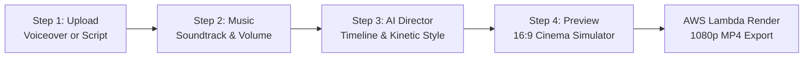
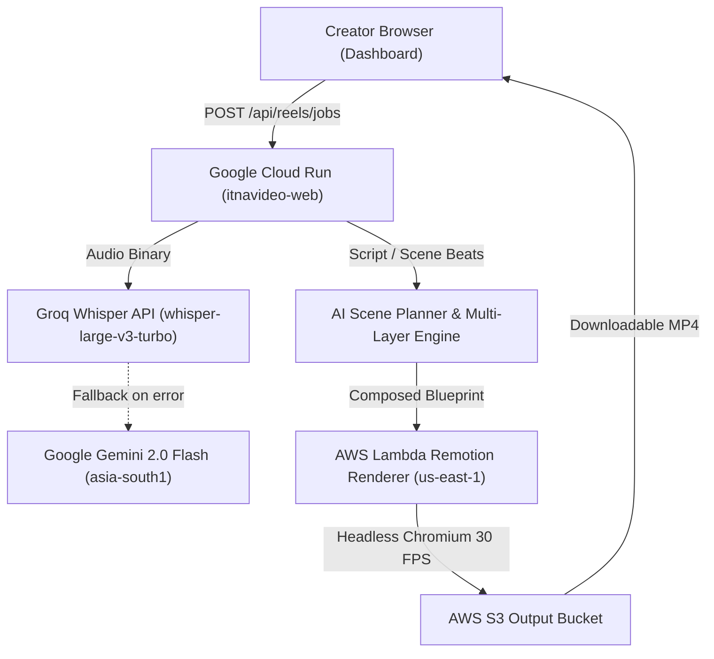

# 16:9 Faceless Video Generator — Master Technical & Product Specification

The **Faceless Video Generator** (`facelessVideo`) turns voiceover narration audio or text scripts into monetizable, 16:9 Full HD widescreen documentary videos (`1920×1080` @ 30 FPS MP4) up to 5 minutes long. Designed for YouTube video essayists, educational channels, and automated media brands, it pairs spoken narration with semantic stock B-roll, procedural vector diagrams, multi-track audio, and kinetic typography.

---

## Table of Contents

1. [Product Overview & Target Audience](#1-product-overview--target-audience)
2. [Multi-Layer Timeline Architecture](#2-multi-layer-timeline-architecture)
3. [AI Autonomous Typography Engine](#3-ai-autonomous-typography-engine)
4. [The 25-Kinetic Animation Library](#4-the-25-kinetic-animation-library)
5. [Cinematic Color Grade & Asset Treatment](#5-cinematic-color-grade--asset-treatment)
6. [Smart Jump Cuts, Repeats & Pause Trimming](#6-smart-jump-cuts-repeats--pause-trimming)
7. [Scene Direction, Pacing & Script Workflow](#7-scene-direction-pacing--script-workflow)
8. [Creator Studio UX & Manual Overrides](#8-creator-studio-ux--manual-overrides)
9. [Technical Stack, Remotion & Infrastructure Contracts](#9-technical-stack-remotion--infrastructure-contracts)
10. [Credit Economics, Billing & Failure Policies](#10-credit-economics-billing--failure-policies)
11. [Audio Standards, Title-Safe Zones & Export Specs](#11-audio-standards-title-safe-zones--export-specs)
12. [Error Handling, Fallbacks & Quality Assurance](#12-error-handling-fallbacks--quality-assurance)

---

## 1. Product Overview & Target Audience

* **Primary Purpose**: Produce high-retention, documentary-style 16:9 YouTube videos without appearing on camera or recording physical footage.
* **Target Audience**: YouTube video essayists, educational creators, digital marketing agencies, and automated content publishers.
* **Output Format**: 1080p Full HD (`1920×1080`) @ 30 FPS progressive H.264 / AAC MP4.
* **Aspect Ratio**: Strictly 16:9 Widescreen Landscape (Zero vertical cropping).
* **Maximum Duration**: 5 Minutes (300 seconds / 9,000 frames @ 30 FPS).
* **YouTube Content Policy Compliance**: Generates original, transformative educational and editorial media with procedural diagrams and kinetic annotations, fully compliant with YouTube's monetization guidelines regarding repetitive content.

---

## 2. Multi-Layer Timeline Architecture

Every visual and acoustic element operates as an independent, composable layer. The composition stack is structured strictly to ensure color grading and overlays never distort typography or vector assets:

```
┌─────────────────────────────────────────────────────────────┐
│ 16:9 FULL HD COMPOSITION STACK (1920×1080 @ 30 FPS)        │
│                                                             │
│  Layer 5: Multi-Track Audio (Voiceover, BGM, SFX, Ambience) │
│  Layer 4: Brand Watermark (Free-tier / trial only)          │
│  Layer 3: Kinetic Typography & Captions (Crisp White/Colors)│
│  Layer 2: SVG Graphics, Curved Arrows, Infographic Badges   │
│ ────────────────── COLOR GRADE BOUNDARY ─────────────────── │
│  Layer 1: Color Adjustment Layer (+15% Sat, +20% Contrast)  │
│  Layer 0B: Media Overlays (B-Roll Video / Images / Ken Burns)│
│  Layer 0A: Base Background (Gradient / Mesh / Vignette Plate)│
└─────────────────────────────────────────────────────────────┘
```

> [!IMPORTANT]
> **Color Grading Boundary**: The `MultiLayerAdjustmentOverlay` is rendered on **Layer 1**, directly above video and image media, and strictly **below** SVG diagrams and typography. This ensures B-roll footage is enriched without shifting typography hex values or muddying pure white text.

### Layer Specifications

| Layer | Type | Max Concurrency | Key Responsibilities |
| :--- | :--- | :--- | :--- |
| **Layer 0A/B** | Background & Media | 4 per scene | Looping background gradient/mesh, full-screen B-roll via Remotion `OffthreadVideo`, and Ken Burns image camera easing (`1.0x` to `1.08x`). |
| **Layer 1** | Color Grade Filter | 1 global | Non-destructive `backdrop-filter` boosting saturation by 15% and contrast by 20% with deep shadow levels. |
| **Layer 2** | SVG & Data Graphics | Up to 6 simultaneous | Directional arrows, growth curves, multi-node comparison charts, timeline milestones, and metric progress bars. |
| **Layer 3** | Text Overlays | Up to 10 active tracks | 11 dedicated typography presets (Hero Headline, Subheading, Description, Key Point, Stat Callout, Stat Label, Kicker Pill, Editorial Quote, Kinetic Punch, Highlighted Word, Footnote). |
| **Layer 4** | Brand Watermark | 1 optional | Semi-transparent Itnavideo watermark applied only to free-tier or trial exports. Omitted on all paid plans. |
| **Layer 5** | Multi-Track Audio | 4 parallel tracks | Primary voiceover, ducked background music, atmospheric room tone/ambience, and synchronized SFX transition accents. |

---

## 3. AI Autonomous Typography Engine

Instead of static, repetitive subtitles, the engine analyzes sentence sentiment, importance, and cadence to determine typography attributes dynamically:

### Decision Matrix

| Attribute | Deterministic Decision Logic | Supported Values |
| :--- | :--- | :--- |
| **Case** | • **ALL CAPS (`TT`)**: High-energy opening hooks, shout words, and numeric stats.<br>• **Title Case (`Tt`)**: Core concepts, takeaways, and proper nouns.<br>• **lowercase (`tt`)**: Casual conversational phrases and transitional breathing gaps. | `TT`, `Tt`, `tt` |
| **Pattern** | • **`Bold` (900 weight)**: High-retention keywords and statistical figures.<br>• **`Underline` stroke**: Warnings, critical mistakes to avoid, and common traps.<br>• **`Italic` slant**: Direct quotes, reflections, and philosophical internal thoughts. | `bold`, `underline`, `italic`, `normal` |
| **Color & Contrast** | Text defaults to crisp **Pure White (`#FFFFFF`)** against dark surfaces.<br>Keywords shift to semantic contrast accents:<br>• **Neon Yellow (`#FACC15`)**: High-energy opening hooks.<br>• **Emerald Green (`#10B981`)**: Financial statistics, revenue, and proof metrics.<br>• **Electric Orange (`#EA580C`)**: Action callouts and core takeaways.<br>• **Cyber Sky (`#38BDF8`)**: Code, technical concepts, and SaaS terminology.<br>• **Coral Red (`#EF4444`)**: Warnings, traps, and errors. | Hex color tokens |
| **Transform & Tilt** | Micro-scale adjustments (`1.0x` to `1.10x`) and alternating tilt **Rotation (`-3°` to `+3°`)** to prevent visual fatigue while keeping text within safe viewing margins. | Scale: `1.0 - 1.10`<br>Rotation: `-3.0° to +3.0°` |
| **Fonts (Cross-Platform)** | Managed via `@remotion/google-fonts` to guarantee 100% identical rendering across Linux AWS Lambda and local preview:<br>• **Cinematic Authority**: `Cinzel`<br>• **Modern Tech**: `Plus Jakarta Sans`, `Montserrat`<br>• **Hindi / Regional Subtitles**: `Noto Sans Devanagari`, `Tiro Devanagari Hindi`<br>• **Code / Walkthroughs**: `Fira Code` | Google Fonts Catalog |

---

## 4. The 25-Kinetic Animation Library

### Dynamics & Clamping Rule
To eliminate robotic keyframing, animation durations are calculated dynamically from speech cadence while remaining strictly clamped within safe visual boundaries:
* **Minimum Clamp**: **4 frames** (~130ms) for high-impact punch words (e.g. *"Boom"*, *"Stop"*).
* **Maximum Clamp**: **45 frames** (1.50s) for elongated vocal delivery.
* **Physics Stability**: Spring stiffness (`290`), damping (`13`), and mass (`0.5`) remain deterministic to ensure fluid motion across all frame rates.

### Animation Catalog Reference

| Animation Name | Category | Dynamics / Clamping | Best Visual Context |
| :--- | :--- | :--- | :--- |
| **Zoom Out 2** | Impact | Scale: `1.7x` down to `1.0x` (6–18 frames) | Major thesis reveals and dramatic statements |
| **Jolt Forward** | Impact | Scale punch to `1.22x` with elastic snap | Punchy statistics, single-word callouts |
| **Flicker** | Glitch | Luminance strobe across initial 6 frames | Tech warnings, cyberpunk themes, urgent traps |
| **Faulty Text** | Glitch | Chromatic horizontal jitter (`±4px`) | Dramatic tension, counter-intuitive facts |
| **Spring** | Motion | Physics overshoot (`stiffness: 290, damping: 13`) | Standard conversational sentence transitions |
| **Karaoke** | Editorial | Word-by-word progressive fill synced to audio | High-retention narrative storytelling |
| **Mini Zoom** | Impact | Subtle scale drift (`0.94x` to `1.0x`) | Secondary explanations and bullet points |
| **Blur Dissolve** | Editorial | Gaussian blur (`12px` to `0px`) | Philosophical quotes, reflective takeaways |
| **Concentrate** | Editorial | Letter-spacing tracking (`0.2em` to `normal`) | Technical summaries, definitions |
| **Bounce Left** | Motion | Horizontal spring entry from left margin | Side-by-side comparison lists |
| **Wave In** | Motion | Sinusoidal vertical character ripple | Fluid narrative introductions |
| **Bounce Right** | Motion | Horizontal spring entry from right margin | Opposing viewpoints, counter-arguments |
| **Zoom Out** | Impact | Oversized (`2.2x`) snap into safe bounds | Opening video hook statement |
| **Open Curtain** | Motion | Vertical clip-path split reveal | Chapter transitions, major section headers |
| **Wipe Right** | Motion | Linear horizontal reveal edge | Data statements, sequential processes |
| **Roll In** | Playful | Rotational 3D tilt (`15°` to `0°`) with scale | Creative tips, lighthearted examples |
| **Slide Right** | Motion | Horizontal momentum slide (`-40px` to `0px`) | Step-by-step sequential tutorials |
| **Slide Up** | Motion | Upward elevation from lower third | Lower-third speaker title or source citation |
| **Boing** | Playful | Squash and stretch physics (`0.7x` to `1.05x`) | Surprising trivia, myth-busting moments |
| **Showing Up** | Editorial | Pop entrance with radial backlight bloom | Single high-value keywords |
| **Throw Out** | Impact | Centrifugal acceleration entry | Fast-paced montage scenes |
| **Grow** | Impact | Continuous slow scale drift (`1.0x` to `1.06x`) | Long uninterrupted explanatory sentences |
| **Judder Up** | Glitch | Mechanical stepped vertical jitter | Machine-learning, terminal, or system topics |
| **Trail** | Motion | Motion ghost echo across initial 5 frames | High-speed transitions between scene beats |
| **Float Down** | Motion | Atmospheric descent with subtle sway | Calm reflective conclusions and summaries |

---

## 5. Cinematic Color Grade & Asset Treatment

Stock footage libraries feature inconsistent lighting, color balances, and contrast ratios. To deliver a unified cinema aesthetic, the engine applies:

1. **Saturation Boost (`+15% / saturate(1.15)`)**: Restores rich natural skin tones, vibrant landscapes, and glowing UI screenshots.
2. **Contrast Expansion (`+20% / contrast(1.20)`)**: Deepens shadows and clarifies midtone detail.
3. **Black Point Floor (`brightness(0.96)`)**: Lowers lifted gray floor levels to establish rich, dark-luxury contrast.
4. **Vignette Falloff**: Subtle radial falloff around canvas edges (`opacity: 0.18`) drawing visual focus to center-screen data and typography.

---

## 6. Smart Jump Cuts, Repeats & Pause Trimming

Voiceover audio is automatically preprocessed by the speech trimmer (`services/ai/faceCamSilenceCleaner.ts`):

* **Silence Threshold**: Audio pauses longer than **0.40 seconds** are automatically snipped.
* **Acoustic Breathing Padding**: Retains **60ms of natural breathing padding** before the first word and after the last word of each segment to prevent unnatural clipping.
* **Verbal Retake & False-Start Removal**:
  * Scans for English and Hinglish retake triggers (*"let me rephrase that"*, *"let me start over"*, *"scratch that"*, *"sorry let me"*, *"ek minute ruko"*, *"phir se bolta hoon"*).
  * Automatically discards the aborted take (up to 4 seconds prior) along with the trigger words, keeping only the clean final take.
* **Repeated Clause Pruning**: Detects identical 3+ word sequences repeated within a 5.5-second window and prunes the earlier stuttered attempt.
* **Timestamp Re-Alignment**: Re-anchors all Whisper word timestamps onto the compressed timeline so subtitle sync remains millisecond-accurate.

---

## 7. Scene Direction, Pacing & Script Workflow

### Scene Beat Cadence
* Scene cuts occur every **3.0 to 5.5 seconds** (averaging 4.2 seconds per scene).
* No single static visual remains on screen longer than 6.0 seconds.

### Input Modes Supported

#### Mode A: Audio Narration Upload (Primary)
* Creator uploads pre-recorded voiceover audio (`.mp3`, `.wav`, `.m4a`, `.aac`).
* Transcribed via Groq Whisper (`whisper-large-v3-turbo`) with millisecond word timestamps.
* Loudness analysis pass detects emphasis peaks for kinetic punch typography.

#### Mode B: Script-to-Speech (TTS Flow)
* Creator enters a raw script text.
* Speech is synthesized using neural TTS models (warm documentary baritone, natural conversational cadence).
* Generated audio is fed directly into the transcription and alignment pipeline.

---

## 8. Creator Studio UX & Manual Overrides

The studio interface (`components/dashboard/FacelessVideoStudio.tsx`) is structured around a 4-step creation pipeline:



### Manual Creator Overrides (Full Creative Control)
While the AI plans scenes automatically, creators have 100% manual override capability:
1. **B-Roll Clip Swapping**: Click any scene card to replace stock footage with alternative library clips or custom media uploads.
2. **Transcript & Spelling Editor**: Live inline transcript editor allows fixing mispronounced names, jargon, or brand terms.
3. **Scene Regeneration**: Single-click "Regenerate Scene" requests an alternate visual angle and layout from the AI Director.
4. **Volume & Ducking Overrides**: Sliders for voice volume, music ducking depth (`8%` to `30%`), and transition SFX level.

---

## 9. Technical Stack, Remotion & Infrastructure Contracts

### System Architecture



### Core Configuration Parameters

| Parameter | Specification |
| :--- | :--- |
| **Studio Route** | `/dashboard/faceless-video` |
| **Marketing Landing Page** | `/faceless-video` |
| **Internal Mode Key** | `facelessVideo` |
| **Remotion Composition ID** | `FACELESS_LONG_VIDEO` (Registry: `remotion/index.ts`) |
| **Canvas Dimensions** | `1920 × 1080` (16:9 Full HD) |
| **Frame Rate** | `30 FPS` |
| **Maximum Frame Allocation** | `9,000 frames` (300 seconds / 5 minutes) |
| **Lambda Memory** | `2048 MB` per worker instance with chunked frame distribution |
| **Lambda Timeout** | `240 seconds` |
| **Speech Transcription** | Groq Whisper Cloud API (`whisper-large-v3-turbo`) |
| **AI Fallback & Direction** | Google Cloud Gemini 2.0 Flash (`asia-south1`) |

### Render Job State Machine

```
[idle] ──> [uploading] ──> [transcribing] ──> [planning] ──> [rendering] ──> [ready]
                                                                   │
                                                                   └──> [error] (Credits Refunded)
```

---

## 10. Credit Economics, Billing & Failure Policies

### Duration-Based Credit Rules
* **1 Minute = 1 Credit**:
  * 0 to 60 seconds (up to 1:00) = **1 Credit**
  * 61 to 120 seconds (up to 2:00) = **2 Credits**
  * 121 to 180 seconds (up to 3:00) = **3 Credits**
  * 181 to 240 seconds (up to 4:00) = **4 Credits**
  * 241 to 300 seconds (up to 5:00) = **5 Credits**
* **Duration Measurement**: Billed duration is measured strictly on the **final cleaned video duration** after silence trimming: $\text{Credits} = \max(1, \lceil\text{cleanedSeconds} / 60\rceil)$.
* **Audio Length Safeguard**: If uploaded audio exceeds 5 minutes, it is truncated at the nearest natural sentence boundary under 300.0s (never sliced mid-word).

### Safe Transaction Ledger
* **Reservation on Dispatch**: Credits are reserved upon render dispatch.
* **Settlement on Success**: Credits are finalized only when AWS Lambda successfully writes the completed MP4 to S3.
* **Automatic Refund on Failure**: If rendering fails or times out, reserved credits are immediately released back to the user account with zero penalty.

---

## 11. Audio Standards, Title-Safe Zones & Export Specs

### Broadcast Audio Standards
* **Integrated Loudness**: Normalized to **-14 LUFS (±1.0 LUFS)** per YouTube broadcast delivery specifications.
* **Sample Rate**: `48 kHz`, 24-bit PCM internal processing, exported to `192 kbps` AAC stereo.
* **Music Ducking Attack / Release**:
  * **Attack Time**: `120ms` exponential fade-down to 12% volume upon speech onset.
  * **Release Time**: `280ms` smooth fade-up to 28% volume during speech pauses.

### Title-Safe Margins (YouTube 16:9 Safe Zones)
* All primary text overlays, subtitles, and SVG diagrams are anchored inside standard title-safe margins:
  * **Horizontal Inset**: `96px` (5% padding from left/right canvas edge).
  * **Vertical Inset**: `54px` (5% padding from top/bottom canvas edge).
  * Prevents collision with YouTube chapter bars, title watermarks, and smart TV bezel cropping.

---

## 12. Error Handling, Fallbacks & Quality Assurance

| Failure Scenario | Automatic Recovery Policy |
| :--- | :--- |
| **No Speech Detected in Audio** | Fails early during transcription; returns `NO_SPEECH_DETECTED` with an actionable prompt; **zero credits deducted**. |
| **Groq Whisper API Downtime** | Automatically fails over to Google Gemini 2.0 Flash. If word-level timestamps are unavailable, subtitle rendering smoothly falls back to sentence-level fade/pop presets. |
| **AI Scene Planning Malformed JSON** | Heuristic fallback engine constructs timed B-roll scene cuts and typography cards directly from transcription word intervals. |
| **Missing Stock Visual** | Procedural gradient and abstract mesh canvas with animated vector diagrams activate automatically to guarantee seamless visual playback. |
| **Lambda Worker Timeout** | Renders are distributed into parallel Lambda workers with frame chunking. Jobs exceeding 240s trigger an automatic retry before returning a refundable error. |

---

*Last Updated: November 2026 — Official Master Documentation for Itnavideo Company.*
