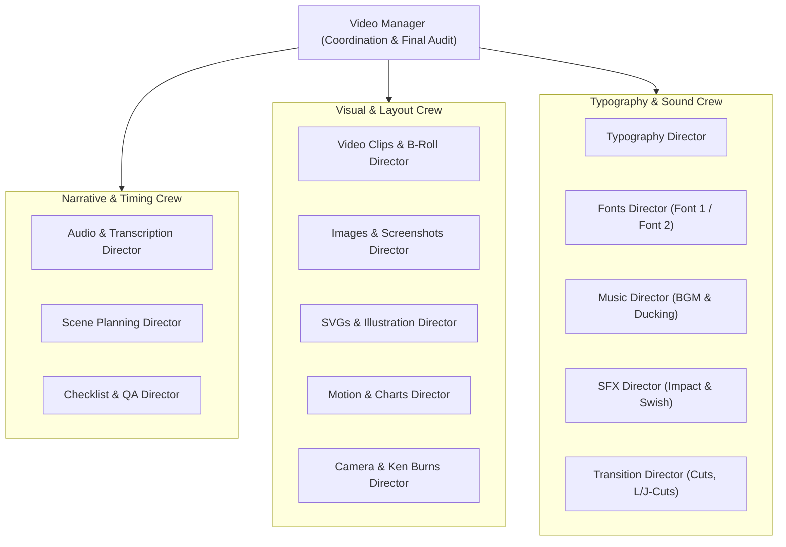
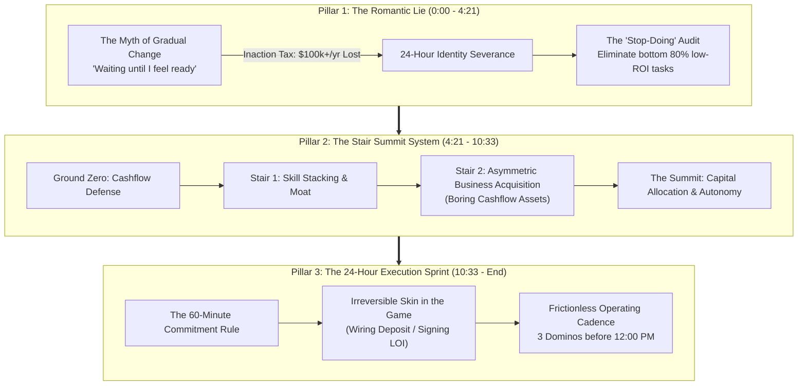
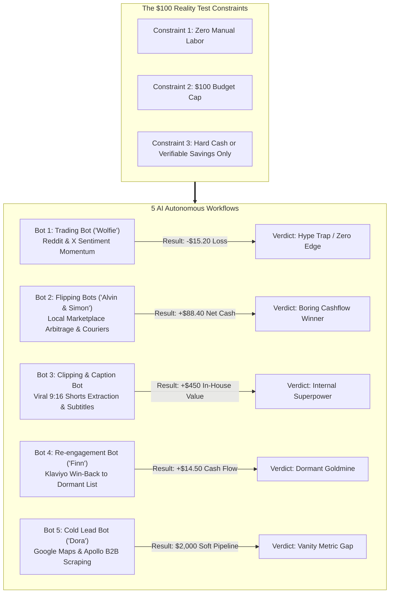
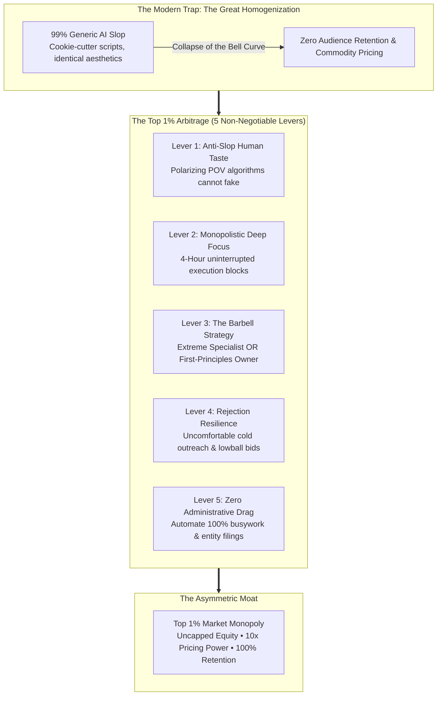
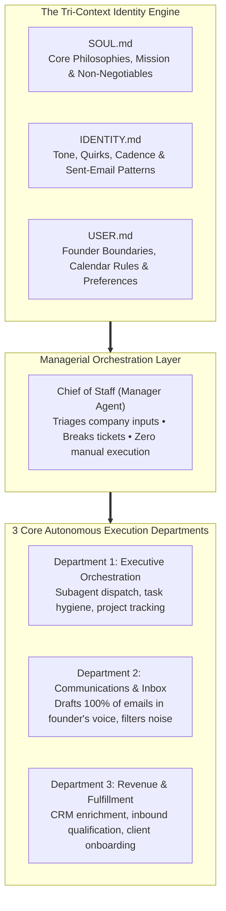
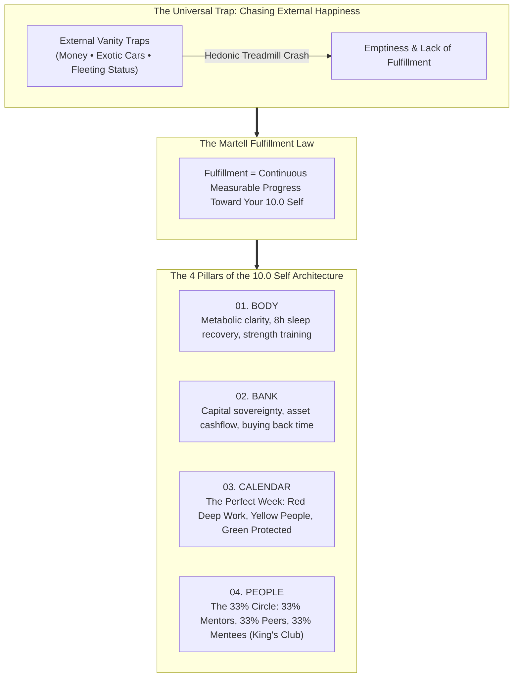
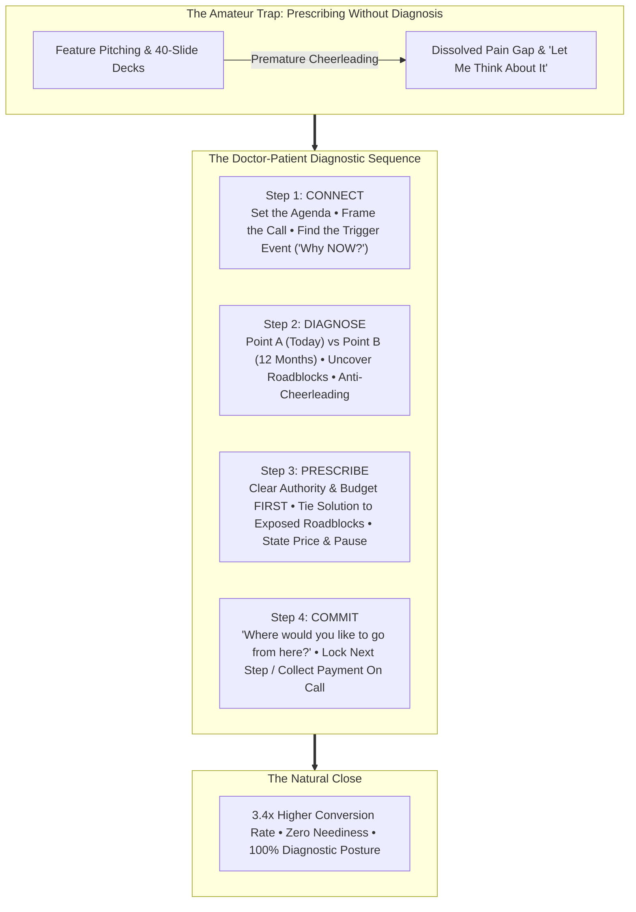
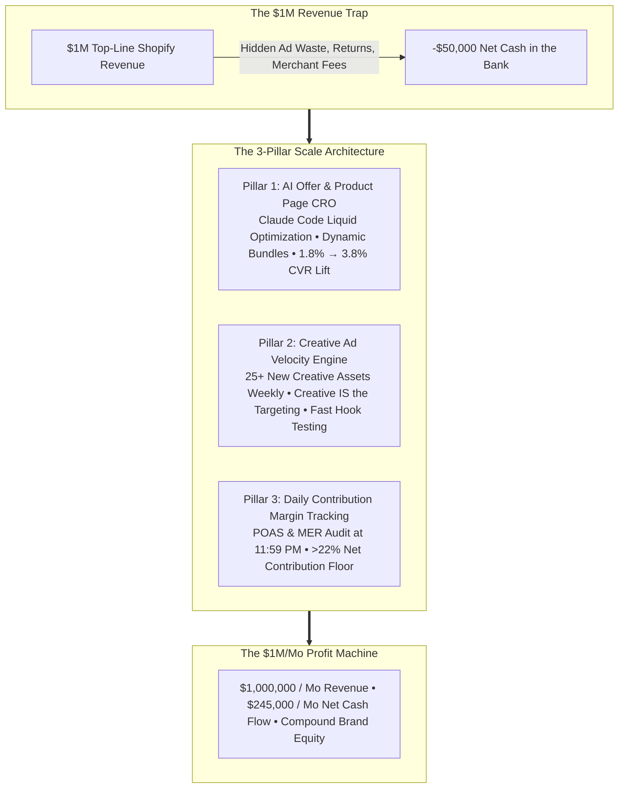
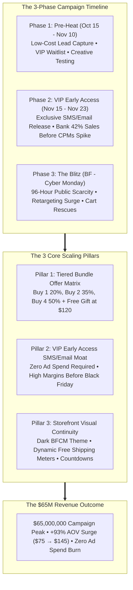

# 16:9 Faceless Video Generator — Master Technical & Architectural Specification

The **Faceless Video Generator** (`facelessVideo`) converts voiceover narration audio or text scripts into monetizable, studio-quality 16:9 Full HD widescreen documentary and educational videos (`1920×1080` @ 30 FPS MP4) up to 5 minutes long. Designed for YouTube video essayists, educational creators, digital marketing agencies, and automated media brands, it pairs spoken narration with semantic stock B-roll, procedural vector diagrams, multi-track audio, dynamic typography, and storyboard-directed visual layouts.

---

## Table of Contents

0. [Master Architecture & Modular Specification Files (Locked 2026 Engine)](#0-master-architecture--modular-specification-files-locked-2026-engine)
1. [Product Overview & The Core Wedge](#1-product-overview--the-core-wedge)
2. [The 8 Core Asset Categories](#2-the-8-core-asset-categories)
3. [User Inputs & Creator Controls](#3-user-inputs--creator-controls)
4. [A-Roll vs. B-Roll Architecture](#4-a-roll-vs-b-roll-architecture)
5. [Multi-Layer Timeline Architecture (10+ Layers)](#5-multi-layer-timeline-architecture-10-layers)
6. [Director Crew Hierarchy & Video Manager](#6-director-crew-hierarchy--video-manager)
7. [The 4-Step Storyboarding & Conceptualization Workflow](#7-the-4-step-storyboarding--conceptualization-workflow)
8. [Typography Engine & Font Pairing (Font 1 & Font 2)](#8-typography-engine--font-pairing-font-1--font-2)
9. [Images, Screenshots & Visual Layout Compositions](#9-images-screenshots--visual-layout-compositions)
10. [Bilingual & Special Speech Handling (Quranic & Arabic RTL)](#10-bilingual--special-speech-handling-quranic--arabic-rtl)
11. [Modular JSON Architecture (Scene-Level Blueprint)](#11-modular-json-architecture-scene-level-blueprint)
12. [Audio Processing & Background Music Module](#12-audio-processing--background-music-module)
13. [Transitions & Audio Overlaps (J-Cuts & L-Cuts)](#13-transitions--audio-overlaps-j-cuts--l-cuts)
14. [Frame Rate Architecture (FPS 30 & Millisecond Timing)](#14-frame-rate-architecture-fps-30--millisecond-timing)
15. [Production Audit, Quality Assurance & Boring Infrastructure](#15-production-audit-quality-assurance--boring-infrastructure)
16. [Credit Economics & Billing Policy](#16-credit-economics--billing-policy)
17. [Technical Infrastructure & Remotion Integration](#17-technical-infrastructure--remotion-integration)

---

## 0. Master Architecture & Modular Specification Files (Locked 2026 Engine)

The complete implementation architecture of the Faceless Video engine is divided into five modular, production-tested specification guides located in [`docs/video-types/01-faceless-video/`](file:///c:/Itnavideo%20Company/docs/video-types/01-faceless-video):

| Spec Document | Core Focus & Engineering Rules |
| :--- | :--- |
| **[00_INDEX_AND_DECISIONS.md](file:///c:/Itnavideo%20Company/docs/video-types/01-faceless-video/00_INDEX_AND_DECISIONS.md)** | Locked master decisions, 1920×1080 @ 30 FPS, millisecond standard, safe areas (120px/80px), 85% vector dominance, motion tokens, audio ducking, 14 visual layers + 4 audio tracks. |
| **[01_LAYOUT_CATALOG.md](file:///c:/Itnavideo%20Company/docs/video-types/01-faceless-video/01_LAYOUT_CATALOG.md)** | 17 dedicated layout recipes (L01 `HookTypographyScene` to L17 `OutroScene`), slots, element budgets, geometry, and choreography presets. |
| **[02_AI_PLANNER_AND_ROUTER.md](file:///c:/Itnavideo%20Company/docs/video-types/01-faceless-video/02_AI_PLANNER_AND_ROUTER.md)** | 2-Pass AI Planning (Story Director + Layout Director), schema, slot-filling, validators, repair loop, and fallback ladder preventing stickman looping. |
| **[03_DESIGN_SYSTEM_AND_POLISH.md](file:///c:/Itnavideo%20Company/docs/video-types/01-faceless-video/03_DESIGN_SYSTEM_AND_POLISH.md)** | Design tokens, type scale (hero 2× rule for Ali Abdaal / Warikoo aesthetic), light/dark canvas polarity, kinetic karaoke captions (`marker-tape`, `stacy-pill`), background depth stack, and procedural illustration system. |
| **[04_IMPLEMENTATION_GUIDE.md](file:///c:/Itnavideo%20Company/docs/video-types/01-faceless-video/04_IMPLEMENTATION_GUIDE.md)** | Developer implementation guide: Remotion schemas (zod), `core/time.ts`, `core/Animated.tsx`, `core/SceneRenderer.tsx`, layout registry, captions component, ducking envelope, and SFX checklist. |

> [!IMPORTANT]
> **Diagnosis on Basic Video Output**:
> Previous video generations suffered from **Stickman Asset Reuse & Monotony** because scenes defaulted to generic split-screen layouts instead of dynamically distributing across the 17 specialized layout recipes (`StatScene`, `ComparisonScene`, `HorizontalProcessStepsScene`, `WorkflowScene`, `RoadmapScene`, `CardConceptScene`, `ListScene`, `ChartScene`, `DrawingStoryScene`). Following the 5 guides above guarantees professional director-level visual pacing.

---

## 1. Product Overview & The Core Wedge

* **What is a Faceless Video?**: A video where the creator does not appear on camera. The narrative is driven by spoken voiceover, supported by stock footage, illustrations, dynamic typography, animated motion graphics, and synchronized background music.
* **Our Core Wedge**: 
  > **Upload a voiceover audio → Receive a clean, publish-ready, professionally directed 16:9 widescreen YouTube video.**
* **Target Platforms**: YouTube Long-Form, Educational Courses, Documentary Channels, LinkedIn Video Posts.
* **Primary Target Duration**: Up to 5 Minutes (300 seconds / 9,000 frames @ 30 FPS).
* **Aspect Ratio**: 16:9 Landscape (`1920×1080` pixels, zero letterboxing or vertical crop).
* **Core Philosophy**: *A video generator must direct the viewer's attention, not simply assemble a collection of assets on a timeline.*

---

## 2. The 8 Core Asset Categories

Every visual and acoustic element within the video belongs to one of eight core disciplines:

| Category | Components & Elements | Role in Composition |
| :--- | :--- | :--- |
| **1. Audio** | Voiceover (Backbone), Background Music, Sound Effects (SFX), Ambient Room Tone | Carries the core message, pace, and acoustic emotion. |
| **2. Visual Assets** | Stock video clips, AI-generated visuals, user photographs, screenshots, b-roll | Contextual visual evidence supporting spoken claims. |
| **3. Graphics** | Animated SVGs, UI icons, hand-drawn stickmen, geometric badges, logos | High-clarity visual metaphors that clarify complex ideas. |
| **4. Typography** | Hero titles, animated subtitles, kinetic punch words, statistic callouts, quotes | Reinforces retention, vocabulary, and numerical data. |
| **5. Motion Graphics** | Animated charts, growth curves, pointing arrows, comparison funnels, timelines | Visualizes abstract trends, metrics, and relationships. |
| **6. Effects (VFX)** | Transitions, camera blur, chromatic aberration, vignette, glow overlays, particles | Adds cinematic texture and visual polish. |
| **7. Backgrounds** | Deep dark canvas plates, subtle mesh gradients, abstract paper textures, grids | Prevents visual emptiness and grounds layered assets. |
| **8. Animation** | 2D spring physics, kinetic typography, Ken Burns camera zooms, scale pop-ins | Keeps the canvas active (no static frames over 4s). |

---

## 3. User Inputs & Creator Controls

The dashboard interface (`/dashboard/faceless-video`) provides an intuitive creator workflow without cluttering the screen with nonlinear editing timelines:

```
┌────────────────────────────────────────────────────────────────────────┐
│                   FACELESS VIDEO STUDIO (DASHBOARD)                   │
├────────────────────────────────────────────────────────────────────────┤
│ 1. Audio Upload (Backbone)     : [ Upload Voiceover (MP3/WAV/M4A) ]     │
│ 2. Font Pairing Selection      : Font 1 (Headlines)  | Font 2 (Body)  │
│ 3. Background Selection        : [ Dark Luxury | Mesh | Custom Color ] │
│ 4. Background Music Module     : [ ON / OFF ] | [ Library / Upload ]   │
│ 5. Optional User Assets Upload : [ Drop Images, B-Roll, Logos, Clips ] │
│ 6. Caption Style Selector      : [ Bionic | Bold Kinetic | Minimal ]   │
│ 7. Action                      : [ 🚀 Generate 16:9 Master Video ]     │
└────────────────────────────────────────────────────────────────────────┘
```

### Input Rules & Safeguards:
1. **Audio as Master Reference**: Spoken audio is the ultimate source of truth. Scene durations, cut points, caption timestamps, and animations are strictly derived from the audio timeline.
2. **Dual-Font System**: Users select **Font 1** (e.g., *Cinzel* or *Montserrat* for bold titles and stats) and **Font 2** (e.g., *Plus Jakarta Sans* or *Inter* for body descriptions and continuous subtitles) to eliminate typographical monotony.
3. **Asset Prioritization**: When the user uploads custom assets (logos, company screenshots, specific b-roll), the AI scene matcher prioritizes user files over platform stock media whenever semantically relevant.

---

## 4. A-Roll vs. B-Roll Architecture

Understanding the storytelling balance between primary narrative and supporting visuals is fundamental:

```
┌────────────────────────────────────────────────────────────────────────┐
│ A-ROLL (Primary Foundation)                                            │
│ • In Faceless Videos, the VOICEOVER is the A-Roll.                    │
│ • Carries 100% of the narrative, facts, emotional pacing, and structure.│
└───────────────────────────────────┬────────────────────────────────────┘
                                    │ Directs
                                    ▼
┌────────────────────────────────────────────────────────────────────────┐
│ B-ROLL (Supplementary Visual Coverage)                                 │
│ • Stock video footage (people working, city traffic, office meetings) │
│ • Product UI walkthroughs & App Store / SaaS screenshots               │
│ • News article snippets (e.g. Forbes, Bloomberg, TechCrunch)           │
│ • Animated SVG diagrams, conversion funnels, and network graphs        │
│ • Data charts, counters, and kinetic typography cards                  │
└────────────────────────────────────────────────────────────────────────┘
```

---

## 5. Multi-Layer Timeline Architecture (10+ Layers)

To match professional editing software (Premiere Pro, DaVinci Resolve) without running heavy local timelines, Remotion structures each scene into isolated composable layers:

```
┌────────────────────────────────────────────────────────────────────────┐
│ 16:9 FULL HD MASTER COMPOSITION STACK (1920×1080 @ 30 FPS)             │
│                                                                        │
│ Layer 11: Multi-Track Audio (Voiceover, Ducked BGM, Impact SFX)        │
│ Layer 10: Brand Watermark (Free-tier / trial accounts only)            │
│ Layer 9 : Top Overlays (Notification badges, Subscribe bells, Emojis)   │
│ Layer 8 : Kinetic Typography & Subtitles (Word-level glow & color sync)│
│ Layer 7 : Dynamic Callouts (Magnifying zooms, Red boxes, Arrows)       │
│ Layer 6 : Motion Graphics (Growth curves, Funnels, Metric counters)    │
│ Layer 5 : Illustration & SVG Graphics (Stickmen, vector icons)         │
│ Layer 4 : Foreground UI Assets (Floating cards, Product screenshots)   │
│ Layer 3 : Color Grade Adjustment Layer (+15% Saturation, +20% Contrast)│
│ Layer 2 : B-Roll Footage & AI Images (Ken Burns camera drift)          │
│ Layer 1 : Base Background Plates (Mesh gradients, Vignette, Canvas)    │
└────────────────────────────────────────────────────────────────────────┘
```

> [!IMPORTANT]
> **Strict Layer Boundary**: Color adjustments (Layer 3) affect only B-Roll media and background plates below it. Typography (Layer 8) and SVG Graphics (Layer 5) render strictly above Layer 3 so text colors and brand logos are never distorted by video filters.

### 5.1 Layer Ownership Architecture: AI vs. Code Division of Labor

> [!CAUTION]
> **Core Architectural Principle**: Layers are NOT managed by one single director. Each layer has exactly one owner, and most owners are **code, not AI**. Attempting to make one LLM manage visual positioning, ducking envelopes, caption timestamps, and asset budgets simultaneously is the primary cause of video generation failure.

#### Layer Ownership Matrix

| Layer | Owner | Decides |
| :--- | :--- | :--- |
| **Narration + Timing** | Groq Whisper (Data) | Exact word-level timestamps (millisecond precision) |
| **Scene Structure, Component Choice, Text** | AI Director | What each scene says and shows (blueprint only) |
| **Component Visuals (Cards, Hook, Stat)** | Component Code (Remotion TSX) | Size, color, position, spring physics animation |
| **Captions** | Caption Module (Code) | Word chunking, kinetic highlight, bottom zone position |
| **Background Music + Ducking** | Audio Mixer (Code) | Dynamic volume envelope derived from word timings |
| **Sound Effects** | SFX Planner (Code) | Exactly one pop per card/icon entrance, from plan |
| **Icons / Images** | Asset Picker (AI suggests, Code enforces rules) | Which asset, slot element budget, cooldown/no-repeat |
| **Transitions** | Theme Config (Code) | Fixed 8-frame crossfade / wipe |

*The AI Director only writes the small scene plan. It never touches music, captions, coordinates, or pixel sizes.*

#### How Execution Stays Reliable

1. **A Shared Contract**: Every layer follows strict contractual constraints: allowed safe zone, time range (word anchors), and priority. Captions own the bottom safe zone (`y: 860→1000px`), and no other layer may enter it.
2. **A Coordinator Made of Code**: After all owners produce their output, the compiler merges everything into one timeline. If two layers collide, priority determines the hierarchy: `Heading > Main Visual > Icon > Decoration`. The loser is shrunk, delayed, or dropped.
3. **Validators per Layer**: Each owner is checked separately: captions cover every spoken word, music never exceeds its volume envelope, icons stay within budget, and nothing leaves its safe zone. A failure points to exactly one layer.
4. **Fix Only the Broken Piece**: If Scene 3 fails validation, the error is isolated and routed back to the AI for that scene only, with one retry, followed by a deterministic fallback component. The other scenes remain untouched.
5. **Visual Check After Render**: Automated inspection checks 2–3 frames per scene for overlap or cut-off text (code analysis first; vision AI only for flagged scenes).

#### The Planning vs. Execution Rule

- **AI = Judgment** (*what, which, in what order*)
- **Code = Precision** (*where, when, how big, how loud*)

### 5.2 Factory Floor QA Supervisor & Inspection Gatekeeper (Audit Before Dispatch)

> [!IMPORTANT]
> **The Factory Gatekeeper Rule**: In a manufacturing plant, line workers say *"Kaam ho gaya (Done)"*, but products **never leave the factory floor** without the Floor Quality Supervisor stamping the inspection sheet.
> 
> Layer owners (captions, SFX, charts, music mixer) produce their assets, but the **Pre-Render QA Gatekeeper (Code)** runs a 7-point audit before Remotion Lambda renders a single frame:
> 
> 1. **Word Coverage Audit**: 100% of spoken words from Groq Whisper have a matching caption chunk; zero missing words, zero orphan silence gaps.
> 2. **Safe-Zone Boundary Audit**: No card, chart, or text bleeds into the top 76px or bottom 128px subtitle reservation zone.
> 3. **Asset Cooldown Audit**: No icon, stickman, or photo is repeated within the video (anti-monotony cooldown rule).
> 4. **Audio Decibel Audit**: BGM ducks down smoothly to 0.06 during narration; master audio mix peaks cleanly below $-1.5\text{ dBFS}$ with zero distortion.
> 5. **SFX Sync Audit**: Every SFX cue matches a real visual event frame; zero ghost sound cues in silent beats.
> 6. **Typography Wrap Audit**: Headings never exceed 2 lines; zero single-word orphan overflow lines.
> 7. **Contrast & Border Audit**: Text contrast ratio is $\ge 4.5:1$; zero PPT-style card borders or box wrappers on clean canvases.
>
> If any checkpoint fails, the defective layer is sent to the **Rework Station** (auto-clamped or 1 targeted retry) while unaffected layers remain untouched.

---

## 6. Director Crew Hierarchy & Video Manager

To solve the single-prompt hallucination problem, production planning is split across specialized autonomous directors reporting to a central **Video Manager**:



### Responsibilities of Key Directors:
1. **Scene Planning Director**: Divides the narration into semantic scenes (average 3.0 to 5.5s per scene; never leaves a static visual over 4.5s).
2. **Camera Director**: Applies continuous 5% slow Ken Burns scale drift (`1.0x` to `1.05x`) on screenshots and images so the canvas never feels frozen.
3. **Typography Director**: Handles word-level pronunciation highlights (e.g. shifts word color from white to vibrant accent at the exact audio millisecond).
4. **Transition Director**: Coordinates cut transitions, fades, and acoustic L-Cuts/J-Cuts between scenes.
5. **Video Manager**: Resolves cross-director conflicts, validates asset availability in S3/Cloudinary, and runs the **Final Production Audit** before dispatching to AWS Lambda.

---

## 7. The 4-Step Storyboarding & Conceptualization Workflow

Instead of naively placing a random stock video behind a sentence, the engine performs structured storyboard conceptualization:

```
┌──────────────┐     ┌───────────────┐     ┌──────────────┐     ┌──────────────┐
│  1. IDENTIFY │ ──> │ 2. CONCEPTUAL │ ──> │ 3. STRUCTURE │ ──> │ 4. DISPATCH  │
│  Transcript  │     │ Visual Intent │     │ Modular JSON │     │ AWS Lambda   │
│  & Cadence   │     │ & Layout Plan │     │ Scene Blueprint│   │ 30 FPS Render│
└──────────────┘     └───────────────┘     └──────────────┘     └──────────────┘
```

### Segment-Level Visual Intent Mapping:
| Spoken Narration Segment | Wrong / Basic AI Output | Storyboard-Directed Production |
| :--- | :--- | :--- |
| *"Build a strong personal brand"* | Random person sitting at laptop | Animated profile card pop-in with follower counter and verification badge. |
| *"Grow your audience across platforms"* | Generic crowd walking in city | Expanding network node graphic connecting YouTube, Instagram, and LinkedIn. |
| *"Convert casual visitors into paying customers"* | Cash register or money stack | Multi-stage conversion funnel animation with dropping percentage stats. |
| *"Your brain is constantly learning from content"* | Student writing in notebook | Stylized SVG brain with glowing synaptic connections and incoming data streams. |

---

## 8. Typography Engine & Font Pairing (Font 1 & Font 2)

Typography is a primary storytelling medium in faceless videos. The engine enforces strict design rules:

### Dual Font Strategy:
* **Font 1 (Headlines & Numbers)**: High-impact, heavy geometric sans-serif or classic editorial serif (*Cinzel*, *Montserrat*, *Cabinet Grotesk*).
* **Font 2 (Subtitles & Explanations)**: Ultra-clean, neutral reading font (*Plus Jakarta Sans*, *Inter*, *Noto Sans*).

### Text Animation Specs:
* **Word-Level Audio Synchronization**: Words highlight or switch color (e.g., `#FFFFFF` to `#EA580C` or `#A855F7`) on exact audio peaks.
* **Element-Level Control**: Every text node independently defines font family, weight, tracking, line-height, entry spring physics, exit time, and drop shadow.
* **Punch Accents**: Red warning boxes, magnifying zooms, and pointing arrows pop in within **3 frames** (0.10s) and snap away when the speaker advances to the next point.

---

## 9. Images, Screenshots & Visual Layout Compositions

Static images must feel alive and intentionally presented.

### The 75%–80% Screenshot Rule:
* Screenshots (software UIs, tweets, dashboard metrics, news articles) occupy **75% to 80%** of the canvas frame, surrounded by subtle background shadows and padding.
* **Continuous Motion**: A slow, continuous **5% Ken Burns zoom-in** is applied across the entire segment duration to prevent a frozen-canvas look.

### Supported Image Compositions:
1. **Single Hero Asset**: Centered image card with floating accent badges.
2. **Side-by-Side Comparison**: Dual card layout with central "VS" or comparative metrics.
3. **Picture-in-Picture (PiP)**: Primary B-roll video background with floating foreground screenshot.
4. **Multi-Card Cascade**: Staggered floating cards entering via spring physics.
5. **Timeline Sequence**: Horizontal milestone sequence tracking dates or progress.

---

## 10. Bilingual & Special Speech Handling (Quranic & Arabic RTL)

When non-English or specialized spoken segments appear in the narration, the system adapts autonomously:

### Arabic & Quranic Verse Handling:
* **Autonomous Detection**: Identifies Arabic speech segments and checks Quranic phrasing confidence.
* **Right-to-Left (RTL) Rendering**: Switches text direction strictly to RTL using specialized Arabic typography (*Amiri*, *Noto Naskh Arabic*).
* **Isolated Overlay Card**: Displays the Arabic text on a dedicated, elegant overlay card instead of mixing RTL text awkwardly inside left-to-right English subtitles.
* **English Translation Sub-Track**: Simultaneously displays the clean English translation underneath in Font 2.

---

## 11. Modular JSON Architecture (Scene-Level Blueprint)

Rather than generating an unmaintainable monolithic JSON file or describing 9,000 individual frames manually, the AI outputs clean, modular JSON schemas:

```
┌────────────────────────────────────────────────────────┐
│                   MODULAR SCENE BLUEPRINT              │
├───────────────────┬────────────────────────────────────┤
│ transcription.json│ Word-level millisecond timestamps  │
│ scenes.json       │ Scene boundaries, intent, layout   │
│ typography.json   │ Font selections, positions, colors │
│ visuals.json      │ B-roll video URLs, S3 assets, PiP  │
│ sound.json        │ Music ducking, SFX cue points      │
│ motion.json       │ Charts, SVG arrows, entry springs  │
└───────────────────┴────────────────────────────────────┘
```

### Division of Responsibilities:
* **AI Engine Responsibility**: Determines scene boundaries, meaning, visual layout types, copy, asset prompts, and timing in **milliseconds**.
* **Remotion Lambda Responsibility**: Converts milliseconds to exact frames (`frames = (ms / 1000) * 30`), performs sub-pixel coordinate interpolation, mixes audio channels, and renders the 1080p MP4.

---

## 12. Audio Processing & Background Music Module

The voiceover is the backbone. Audio controls follow strict rules:

### Background Music (BGM) Controls:
* **BGM Toggle**: `ON / OFF` (If `OFF`, zero music is rendered).
* **Music Sources**: Platform curated royalty-free library OR Custom user upload.
* **User Override Priority**: If a user uploads custom music, it always takes precedence over platform tracks.
* **Smart Volume Ducking**:
  * Voiceover active: BGM automatically ducks down to **10%–14%** volume.
  * Voiceover pause (>0.6s): BGM smoothly rises to **24%–28%** volume.
  * Attack time: `120ms` | Release time: `250ms`.

---

## 13. Transitions & Audio Overlaps (J-Cuts & L-Cuts)

Visual and acoustic transitions are coordinated to prevent jarring cuts:

* **Hard Cuts**: Clean cut at natural sentence stops.
* **Crossfade & Dissolve**: Opacity blending across 8–15 frames between thematic scenes.
* **L-Cut (Audio Lead-Out)**: Voiceover or ambient sound from Scene A continues for 0.4s into Scene B's visual entrance.
* **J-Cut (Audio Lead-In)**: Sound effect or next scene voiceover begins 0.3s before the visual cut occurs, creating an addictive narrative pull.

---

## 14. Frame Rate Architecture (FPS 30 & Millisecond Timing)

* **Why 30 FPS?**: 30 FPS delivers crisp, broadcast-standard motion while saving 50% cloud render compute and egress cost compared to 60 FPS.
* **Millisecond Storage Standard**: All timings in backend JSON are stored strictly in milliseconds:
  $$\text{Render Frame} = \left\lfloor \frac{\text{timeMs}}{1000} \times 30 \right\rfloor$$
* **Total Frame Budget**:
  * 1 Minute = 1,800 frames
  * 3 Minutes = 5,400 frames
  * 5 Minutes (Max Duration) = 9,000 frames

---

## 15. Production Audit, Quality Assurance & Boring Infrastructure

A great product succeeds on the reliability of its foundational infrastructure:

### Mandatory Boring Infrastructure:
1. **Secure File Uploads**: Direct-to-S3 presigned URLs (no large video streams passing through Cloud Run memory).
2. **Job Queue & Status Polling**: Real-time polling `/api/reels/jobs/status` with self-healing retry logic.
3. **Render History & 48h Download Vault**: Expiring presigned S3 download links.
4. **Safe Error Refunds**: Failed renders automatically release credit reservations.

### Pre-Render Production Audit:
Before invoking AWS Lambda, the Video Manager executes an automated audit checklist:
* [x] Audio file duration $\le 300.0\text{s}$ (5 minutes).
* [x] Every scene has at least one visible background/media layer.
* [x] Subtitles do not overflow canvas title-safe zones (54px top/bottom, 96px sides).
* [x] All stock video and user asset URLs return `HTTP 200 OK`.
* [x] Captions do not exceed audio file end-time.

---

## 16. Credit Economics & Billing Policy

* **Pricing Formula**: **1 Minute = 1 Credit** (Rounded up to nearest minute).
* **Tier Schedule**:
  * $\le 60\text{ seconds}$ = 1 Credit
  * $61\text{ to }120\text{ seconds}$ = 2 Credits
  * $121\text{ to }180\text{ seconds}$ = 3 Credits
  * $181\text{ to }240\text{ seconds}$ = 4 Credits
  * $241\text{ to }300\text{ seconds}$ = 5 Credits
* **Max Cap**: 5 Credits per render job (5 minutes maximum limit).
* **Strict Paid-Tier Requirement**: `facelessVideo` is a premium studio tool. Free-tier users must upgrade to access cloud rendering.

---

## 17. Technical Infrastructure & Remotion Integration

| Component | Technical Specification |
| :--- | :--- |
| **Studio Route** | `/dashboard/faceless-video` |
| **Landing Marketing Page** | `/faceless-video` |
| **Tool Identifier** | `facelessVideo` |
| **Remotion Composition ID**| `FACELESS_LONG_VIDEO` (in `remotion/index.ts`) |
| **Cloud Hosting** | Google Cloud Run (`itnavideo-web` in `us-central1`) |
| **Render Engine** | AWS Lambda (`remotionlambda-useast1-2zq6twaok1` in `us-east-1`) |
| **Transcription API** | Groq Whisper Cloud API (`whisper-large-v3-turbo`) |
| **AI Fallback & Direction** | Google Gemini 2.0 Flash (`asia-south1`) |
| **Output Codec** | H.264 MP4, 30 FPS, AAC 192kbps Audio |

---

## 18. Verified Creator Reverse-Engineering Benchmark: Ali Abdaal Masterclass

### 18.1 Executive Summary & Aesthetic Archetype
* **Reference Video**: "This One AI Prompt Will Organise Your Entire Life" (YouTube: `Y0-xv7bNVvU` — Runtime: 15m 42s).
* **Creator Archetype**: `AliAbdaal_Productivity` ("Digital Stationery & Notion-App Minimalist Masterclass").
* **Core Philosophy**: Clean, warm, high-signal, zero-fluff video design. Looks like an interactive editorial magazine or an Apple keynote on digital stationery.

### 18.2 Production Design Tokens & Defaults
* **Default Background Canvas**: Warm off-white / editorial cream paper (`#FAF6F2`) with subtle diagonal depth gradient (`#EFE7DF`).
* **Headings**: Editorial Serif (`Lora`, `Playfair Display`, `Georgia`), Font Weight 700 Bold, Deep Charcoal (`#141414`).
* **Body / Subtitles**: Clean modern geometric sans (`Plus Jakarta Sans`, `Inter`), Font Weight 500 Medium, `#3F3F46`.
* **Handwriting & Annotations**: `Caveat, cursive`, Signature Flame Orange (`#EA580C`) or Warm Amber (`#D97706`). Used for organic doodle arrows, circle highlights, and callout tags.
* **Vector Line Weight**: Hairline `1.1px` to `1.5px` (Lucide / SF Symbols aesthetic — zero bulky cartoon stickmen).

### 18.3 Natural Rhetoric Rule (Avoiding the "Slide Presentation" Trap)
> [!IMPORTANT]
> **Testable Target, Not a Hard Quota**:
> Forcing a fixed 35%–50% infographic quota on every video makes content feel like a dry corporate PowerPoint presentation. Instead, visual types must be **rhetoric-driven**:
> 1. **Trigger Infographics ONLY when Narration Demands Structure**:
>    - Processes / Sequences ("Step 1, Step 2, Step 3") $\rightarrow$ `HorizontalProcessStepsScene`
>    - Multi-Tier Architectures ("The 4 pillars of health, wealth...") $\rightarrow$ `LifePillarsDeckAsset` / `HorizontalShelvesInfographic`
>    - Roadmaps / Timelines ("From Q1 to Q4", "The journey to 100k") $\rightarrow$ `CurvedRoadmapInfographic`
>    - Comparisons / Versus ("Old way vs New way") $\rightarrow$ `MissionVisionInfographic` / `CompareScene`
>    - Quantitative Metrics / Dashboards ("We improved retention by 40%...") $\rightarrow$ `ScorecardDashboardInfographic`
> 2. **Keep Reflective & Narrative Scenes Clean & Cinematic**:
>    - Stories, personal anecdotes, emotional hooks, and conceptual insights should breathe with **cinematic concept cards, high-quality B-roll, or minimal fine-line vector illustrations** rather than dense data charts.

### 18.4 Comprehensive 15-Minute Timeline Breakdown

| Timestamp Range | Narrative Arc / Spoken Topic | Visual Technique & Layout | Motion & Audio FX | Reusable Component in Itnavideo |
|---|---|---|---|---|
| **00:00 – 00:45** | **The Hook**: Chaos of to-do lists; introducing the 1 master prompt. | Camera punch-in (1.0x $\rightarrow$ 1.12x) to warm cream canvas with floating prompt terminal. Yellow highlight over *"ORGANISE YOUR LIFE"*. | Soft `whoosh_light` (vol 0.18); gentle keyboard typing audio. | `HookTypographyScene` + `PromptWindowAsset` |
| **00:45 – 02:15** | **The Mindset Shift**: Task-based firefighting vs Systems-based Life Architecture. | Dual-card comparison: Card A (Crossed red "Task List") vs Card B (Emerald green "Life System"). Handwritten arrow pointing to Card B: *"Shift here"*. | Subtle `paper_slide` entrance; pop sound effect on checklist. | `MissionVisionInfographic` + `HandwritingAnnotation` |
| **02:15 – 04:30** | **The 4 Life Pillars**: Health, Wealth, Relationships, Mindset/Growth. | Multi-card floating deck showcasing 4 stacked horizontal cards with 1.1px icons, progress badges, and status pills. | Spring animation with staggered 4-frame delay between cards. | `LifePillarsDeckAsset` + `HorizontalShelvesInfographic` |
| **04:30 – 07:15** | **Deconstructing the Prompt**: Step 1 - Persona; Step 2 - Constraints; Step 3 - Output Architecture. | macOS code window with live syntax highlighting and blinking cursor. Zoomed-in callout: *"Crucial constraint!"*. | Soft terminal click sounds; smooth pan/scale camera motion. | `PromptWindowAsset` + `HandwritingAnnotation` |
| **07:15 – 09:45** | **The Yearly Horizon Roadmap**: Translating pillars into quarterly milestones (Q1 Launch, Q2 Scale, Q3 Travel, Q4 Review). | Curved S-road serpentine path with milestone flags, metric progress badges, and glowing path stroke. | Organic SVG path draw (`strokeDashoffset` spring); `chime_bell` on milestone completion. | `CurvedRoadmapInfographic` |
| **09:45 – 12:00** | **Weekly Calendar Execution**: Ideal week time-blocking vs reality. Guarding deep work blocks. | Digital calendar time-block view with color-coded slots (Emerald = Deep Work, Amber = Meetings, Sky = Recharge). Orange handwritten scribble: *"Protect this time!"*. | Smooth layout transition; soft snap sound when blocks lock. | `ScorecardDashboardInfographic` + `HandwritingAnnotation` |
| **12:00 – 14:10** | **Friction & Daily Habit Scorecard**: Sleep consistency, workout streaks, reading minutes. | 4-card metric dashboard with trend indicators (`▲ +18.4%`), animated circular or bar progress meters. | Gentle tick sounds on numbers counting up; subtle celebratory shimmer. | `ScorecardDashboardInfographic` |
| **14:10 – 15:42** | **Summary & Outro CTA**: Free Notion template download, channel subscribe with bell notification. | Sleek Apple-style pill button with YouTube subscribe icon, animated vector cursor click, bell wiggle with sound waves. | Clean mouse `click_pop` + crisp golden `bell_chime` sound. | `SubscribeBellAsset` |

### 18.5 Pre-Built Reusable Library Components
1. **`PromptWindowAsset`** (`remotion/components/library/PromptWindowAsset.tsx`): macOS terminal window with traffic lights, AI model badge, and live typing animation.
2. **`LifePillarsDeckAsset`** (`remotion/components/library/LifePillarsDeckAsset.tsx`): 4-card horizontal deck representing life pillars with 1.1px vector icons and status chips.
3. **`HandwritingAnnotation`** (`remotion/components/library/HandwritingAnnotation.tsx`): Hand-drawn casual doodle arrows (`arrow-left`, `arrow-right`, `arrow-down`, `arrow-up`, `circle`, `underline`) paired with `Caveat, cursive` text.
4. **`SubscribeBellAsset`** (`remotion/components/library/SubscribeBellAsset.tsx`): Ultra-premium subscribe pill button with swinging golden bell, expanding sound waves, and animated pointer click.

---

## 19. Reverse-Engineering Benchmark 2: "If You Have a Job, Start Selling Your Skills ASAP"
* **Reference Video**: "If You Have a Job, Start Selling Your Skills ASAP" by Ali Abdaal (YouTube: `L9GHmwO4-uw` — Runtime: 19m 40s).
* **Core Subject**: Overcoming the traditional salary cap, selling solutions to expensive problems, and scaling the 4-tier Leverage Ladder without quitting your day job.

### 19.1 Detailed Timestamp-by-Timestamp Breakdown & Visual Mechanics

| Exact Timestamp | Narrative Arc / Spoken Topic | Visual Composition & Layout | Motion & Sound Design | Reusable Component in Itnavideo |
|---|---|---|---|---|
| **0:00 – 0:33** | **Intro & Provocative Hook**: Why traditional salaries keep you trading 40 hours for a fixed ceiling; how selling your skills independently creates true asymmetric freedom. | High-retention hook: Talking head with subtle camera scale (1.0x $\rightarrow$ 1.08x), rapid cut to warm cream background (`#FAF6F2`) with bold editorial serif text (`Lora`). | Soft `whoosh_light` (vol 0.18) on cut; subtle paper slide entrance. | `HookTypographyScene` |
| **0:33 – 3:11** | **Part 1: Why Your Salary Has a Ceiling**: The employment math — an employer only pays $100k if you generate $300k+. Your upside is capped, and the company captures the surplus. | **Salary vs Value Generation Curve**: Side-by-side comparison with a flat ceiling line (Salary) vs an uncapped growth line (Value Produced). Handwritten annotation in `Caveat`: *"The Employer Cut ($200k)"* with orange doodle arrow. | Draw-in path animation (`strokeDashoffset`); subtle pop sound when ceiling line appears. | `ComparisonScene` + `HandwritingAnnotation` |
| **3:11 – 6:08** | **Part 2: Winning It for Who?**: The 3 tiers of professional work: 1. *Doing* the work ($20–$50/hr), 2. *Administering* the work ($50–$100/hr), and 3. *Winning* the work ($500+/hr sales & dealmaking). | **Value Pyramid**: 3-tiered vertical stacked cards on warm cream paper. Base = Execution (Gray), Middle = Operations (Sky), Top = Dealmaking/Sales (Emerald Green with gold glow). | Staggered 5-frame entrance spring; gentle card snap sound (`pop_bubble`). | `HorizontalShelvesInfographic` |
| **6:08 – 9:52** | **Part 3: Selling Problems, Not Skills**: Nobody pays $5k for "copywriting" or "video editing" — they pay $5k to "fix a leaking checkout funnel" or "double YouTube retention". Keeping an Apple Notes problem log. | **Problem Audit Card (`ProblemAuditCardAsset`)**: Minimalist digital stationery document with list of expensive problems, business impact, and solvable project fee. Orange handwritten circle around "$5,000 solution". | Clean paper drop shadow entrance; tick checkmark pops for completed audits. | `ProblemAuditCardAsset` + `HandwritingAnnotation` |
| **9:52 – 11:33** | **What the Client Actually Wants**: Risk reversal, speed, and emotional certainty. Clients care about ROI and saving time, not the hours you worked. | Dual-card contrast: Card A (Hours Spent: 10 hrs $\rightarrow$ $500) vs Card B (Business Value: +$30k MRR $\rightarrow$ $3,000 fee). Clean emerald badge on Card B. | Smooth flip transition; subtle camera punch-in on emphasis. | `MissionVisionInfographic` |
| **11:33 – 13:04** | **What If You Don't Have the Right Skills?**: Reframing "imposter syndrome" — you only need to be 2 steps ahead of the person you are helping; meta-skills of curation and research. | Clean concept card with quote layout: *"The Guide is not a guru, just one step ahead"*. Fine-line vector book and compass icons (`1.1px` stroke). | Smooth fade + scale (`0.96` $\rightarrow$ `1.0`); soft ambient chime. | `CardConceptScene` |
| **13:04 – 16:13** | **Part 4: How Do You Get Those Sales?**: Zero-cold-pitch approach — auditing warm connections, offering free value audits, and creating a no-brainer pilot project. | **3-Stage Client Outreach Pipeline**: Step 1 (Identify Warm Network) $\rightarrow$ Step 2 (Deliver Free Pain Point Audit) $\rightarrow$ Step 3 (Convert to $2k–$5k Retainer). | Connecting dashed arrows with animated draw; gentle step reveal pops. | `HorizontalProcessStepsScene` |
| **16:13 – 19:10** | **Part 5: The Leverage Ladder**: The 4-step ascent from employee to scalable wealth: 1. Employment $\rightarrow$ 2. Freelancing $\rightarrow$ 3. Productized Service $\rightarrow$ 4. Scalable Code & Media. | **The Leverage Ladder Asset (`LeverageLadderAsset`)**: 4-rung ascending stepper with multiplier tags (`1x Base`, `3x Upside`, `8x Leverage`, `∞ Scalability`). | Staggered vertical spring cascade; golden highlight sweep across Level 4. | `LeverageLadderAsset` |
| **19:10 – 19:40** | **What to Do This Week & Outro**: 3 non-negotiable action steps to take while keeping your job (write problem list, pitch 1 pilot client); channel subscribe reminder. | Action checklist card with checkmarks ticking off, transitioning to ultra-premium YouTube subscribe pill with swinging bell. | Clean `click_pop` + crisp golden `bell_chime` sound on outro button. | `SubscribeBellAsset` |

### 19.2 Newly Added Reusable Assets from This Video
1. **`LeverageLadderAsset`** (`remotion/components/library/LeverageLadderAsset.tsx`):
   - 4-Tier career & wealth leverage ladder with rung numbers, subtitles, and multiplier tags.
2. **`ProblemAuditCardAsset`** (`remotion/components/library/ProblemAuditCardAsset.tsx`):
   - Apple Notes/Notion-style high-ticket problem audit document emphasizing client ROI over hourly labor.

---

## 20. Reverse-Engineering Benchmark 3: "How to Get Rich (My Talk at a Business School)"
* **Reference Video**: "How to Get Rich (My Talk at a Business School)" by Ali Abdaal at CUHK Business School (YouTube: `G2tBWRHif6Q` — Runtime: 37m 52s).
* **Core Subject**: Practical entrepreneurship for students and corporate employees, finding profitable business ideas by mining workplace problems, the Holy Trinity of Business, and escaping the low-ticket pricing trap.

### 20.1 Core Mental Models & Presentation Architecture

| Narrative Concept | Spoken Core Idea | Visual Composition & Layout | Motion & Sound FX | Reusable Component in Engine |
|---|---|---|---|---|
| **The Lottery vs The System (0:00 – 6:15)** | Why relying on a traditional corporate track is like entering a tournament with capped rewards; building an independent engine gives you asymmetric control. | Dual-card contrast: "Corporate Tournament (Capped 1x)" vs "Independent Engine (Asymmetric $\infty$)". | Smooth camera scale + subtle paper slide; soft `pop_bubble` on card lock. | `MissionVisionInfographic` |
| **The 3-Question Problem Miner (6:15 – 13:40)** | How to interview anyone to discover $10,000 corporate problems: 1. *What do you do all day?* 2. *How does your company make money?* 3. *What is the most annoying part of your job?* | 3-step vertical card sequence with interview speech badges, question mark icons, and clean orange highlight tags. | Staggered 4-frame card drop; soft pen scribble sound. | `HorizontalProcessStepsScene` + `HandwritingAnnotation` |
| **The 3-P Business Engine (13:40 – 21:10)** | The Holy Trinity of any business: **Person** (Who has the budget?), **Problem** (What acute pain hurts them?), and **Product** (What high-ROI solution fixes it?). The sweet spot intersection. | **The 3-P Business Engine (`BusinessTrinityAsset`)**: 3-column card grid (Person in Sky Blue, Problem in Orange, Product in Emerald Green) with "Sweet Spot Intersection" badge. | Staggered column spring cascade (`stiffness: 130`); golden highlight pulse on center badge. | `BusinessTrinityAsset` |
| **The Pricing Trap: $10 vs $2,500 (21:10 – 28:30)** | The math of $100k: Selling a $10 ebook requires 10,000 customers (impossible for beginners); selling a $2,500 B2B service requires only 40 clients (achievable with warm outreach). | **High-Volume Trap vs High-Ticket ROI Comparison**: Red warning badge on $10 volume requirement; emerald success chip on 40-client B2B retainer. | High-contrast side-by-side card reveal; subtle warning chime vs success chime. | `ComparisonScene` |
| **Content as a Funnel, Not the Business (28:30 – 34:15)** | Ad revenue is tiny early on; use content (YouTube, LinkedIn, TikTok) as top-of-funnel discovery to feed customers into high-value services. | Inverted Funnel diagram: Top = Free Content $\rightarrow$ Mid = Authority/Trust $\rightarrow$ Bottom = Backend High-Value Engine. | Smooth downward flowing gradient animation; tick sound on funnel stage transitions. | `WorkflowScene` |
| **Action Plan & Q&A Outro (34:15 – 37:52)** | Talk to 3 people this week, map their most annoying problems, offer a free pilot solution; channel subscribe reminder. | Minimalist action step card with checkmarks ticking off, into sleek metallic YouTube subscribe button. | Clean `click_pop` + golden `bell_chime` sound on outro button. | `SubscribeBellAsset` |

### 20.2 Newly Added Reusable Assets from This Video
1. **`BusinessTrinityAsset`** (`remotion/components/library/BusinessTrinityAsset.tsx`):
   - 3-Column framework card representing Person (Audience), Problem (Urgency), and Product (Deliverable) with sweet spot badge.

---

## 21. Forensic Visual Tokens, Animation Physics & Card Geometries

### 21.1 When & How Animations Trigger (The 5 Core Rhythms)
1. **Card Entrance Spring**:
   - Every card, deck, and terminal enters via a tuned Remotion spring: `damping: 14-16`, `stiffness: 120-130`. Zero linear slide; cards pop and settle smoothly into place.
2. **Organic Handwriting Stroke Draw**:
   - Doodle arrows, circles, and underlines animate via SVG `strokeDashoffset` over `14` to `22` frames, mimicking a real felt-tip pen drawing in real time.
3. **Text Highlighter Wipe**:
   - Key emphasis phrases receive a left-to-right yellow highlighter wipe (`#FFE600` at `0.35` opacity) lasting ~15 frames synced to the spoken word.
4. **Interactive Checkmark Pop**:
   - Checkmarks on habit logs and action steps pop with a scale spring (`0.8` $\rightarrow$ `1.15` $\rightarrow$ `1.0`) accompanied by a subtle `pop_bubble` sound.
5. **Camera Punch-Ins**:
   - In talking-head / presenter scenes, direct editor jump cuts (`1.0x` $\rightarrow$ `1.12x`) trigger at the start of new sentences, never slow robotic zooms.

### 21.2 Exact Font Sizes, Weights & Hex Colors
* **Hero Titles**: `44px` to `56px`, 700 Bold, Editorial Serif (`Lora`, `Playfair Display`), Color: `#141414` (Deep Charcoal Black).
* **Card & Section Headings**: `22px` to `28px`, 700 Bold, Color: `#18181B`.
* **Body / Subtitles**: `14px` to `16px`, 500 Medium, `Plus Jakarta Sans` / `Inter`, Color: `#52525B` / `#71717A`.
* **Category Badges**: `11px` to `12px`, 700 Bold Uppercase, `0.06em` letter spacing, rounded pill with subtle colored border.
* **Handwriting Annotations**: `22px` to `28px`, `Caveat, cursive`, Color: `#EA580C` (Flame Orange) or `#D97706` (Amber), rotated `-4deg` to `-6deg`.
* **Kinetic Captions**: `32px` to `36px` 16:9 (`48px` to `54px` 9:16), 700 Bold with animated highlight box.

### 21.3 Card Geometries, Surfaces & Ambient Shadows
* **Canvas Tone**: Warm Cream Paper (`#FAF6F2`) with subtle diagonal gradient to `#EFE7DF`.
* **Card Surface**: Pure Crisp White (`#FFFFFF`) or frosted glass (`rgba(255, 255, 255, 0.94)`).
* **Card Borders**: Hairline `1.0px` to `1.5px` border: `rgba(0, 0, 0, 0.08)` (Light) or `rgba(255, 255, 255, 0.10)` (Dark).
* **Corner Radius**: `16px` to `24px` smooth modern curvature (`border-radius: 18px`).
* **Card Shadows**: Ambient multi-layer drop shadow `0 20px 40px -15px rgba(0, 0, 0, 0.07)` (never harsh black borders).
* **Card Width Budgets**:
  - *Single Terminal / Focus Card*: `720px` to `840px`
  - *Dual Contrast Cards*: `440px` to `480px` each (gap: `24px`)
  - *3-Column Trinity Cards*: `280px` to `320px` each (gap: `16px`)
  - *4-Tier Horizontal Shelves*: `740px` to `800px` width $\times$ `74px` height per shelf

### 21.4 Most-Used Infographics & Mental Models
1. **The Horizontal Shelves Deck** (`LifePillarsDeckAsset` / `HorizontalShelvesInfographic`): 4 stacked rows with icons & metrics.
2. **The Side-by-Side Dual Contrast** (`ComparisonScene` / `MissionVisionInfographic`): Old way vs New way.
3. **The S-Curve Serpentine Roadmap** (`CurvedRoadmapInfographic`): Step-by-step milestones.
4. **The 3-P Business Engine** (`BusinessTrinityAsset`): Person, Problem, Product sweet spot.
5. **The Ascending Leverage Ladder** (`LeverageLadderAsset`): Career multiplier rungs.
6. **The Code/Prompt Terminal** (`PromptWindowAsset`): macOS window with live typing.
7. **The Problem Audit Card** (`ProblemAuditCardAsset`): Apple Notes checklist with client ROI.
8. **Side-Docked Presenter Layout** (`SideDockedPresenterLayout`): Smooth screen partitioning moving the presenter to a 35% side card so the 65% explanation canvas remains uncluttered.

---

## 22. Reverse-Engineering Benchmark 4: "I Ranked Every Productivity Tool From Worst to Best"
* **Reference Video**: "I Ranked Every Productivity Tool From Worst to Best" by Ali Abdaal (YouTube: `uRCskQbL1KY` — Runtime: 24m 10s).
* **Core Subject**: S/A/B/C/D Tier List ranking of 20+ software tools, apps, and physical systems; evaluating high-leverage vs overkill tools.

### 22.1 Tier List Forensic Presentation Architecture

| Video Section | Spoken Ranking | Visual Layout & Composition | Motion & Sound FX | Reusable Component in Engine |
|---|---|---|---|---|
| **0:00 – 0:52** | **Intro & Tier System**: Explaining why tier lists start at S (Japanese grading system: *Shu* / Exemplary); establishing the 5 tiers. | Tier Board overview (`TierListBoardAsset`) with 5 colored row badges (`S: Red`, `A: Orange`, `B: Green`, `C: Blue`, `D: Slate`). | Staggered 4-frame cascade entrance; soft board snap sound (`card_snap`). | `TierListBoardAsset` |
| **0:52 – 6:16** | **Low Leverage & Overkill (C & D Tiers)**: Slack always-on (distraction trap), complex to-do apps with high friction, Obsidian (over-engineered for most people). | Side-Docked Presenter on left; active tool card slides from bottom and snaps into D or C tier row. Red/slate highlight tag. | Clean slide-in + pop into row; subtle downward whoosh. | `SideDockedPresenterLayout` + `TierListBoardAsset` |
| **6:16 – 13:27** | **Solid Utilities (B Tier)**: Apple Notes (frictionless quick capture), Opal (screen-time blocker), Zapier (glue automations). | Active tool highlighted in top status badge (`Ranking: Apple Notes $\rightarrow$ Tier B`); card pops into emerald green row. | Soft pop sound + green outline pulse. | `TierListBoardAsset` + `HandwritingAnnotation` |
| **13:27 – 18:20** | **High Leverage AI Tools (A Tier)**: ChatGPT, Claude, Perplexity, Readwise, Superhuman. Tools that deliver a 3x to 5x leverage multiplier on time. | Tool card scales up `1.08x` with golden highlight border before locking into Amber A-Tier row. Handwritten note: *"3x Leverage"*. | Gentle metallic chime on placement; orange doodle arrow pointing to multiplier. | `TierListBoardAsset` + `HandwritingAnnotation` |
| **18:20 – 24:10** | **S-Tier LifeOS Essentials**: The physical paper journal, Google Calendar (time blocking), Notion (workspace architecture), Superfocus. | S-Tier row expands slightly with celebratory golden glow. Presenter emphasizes: *"If I could only keep 3 tools, it's these."* | Crisp `bell_chime` + celebratory shimmer sweep. | `TierListBoardAsset` |

### 22.2 Newly Added Reusable Assets from This Video
1. **`TierListBoardAsset`** (`remotion/components/library/TierListBoardAsset.tsx`):
   - 5-Row minimalist S/A/B/C/D ranking board with custom tier colors, item chips, and active ranking indicator.

---

## 23. Reverse-Engineering Benchmark 5: "The Most Valuable Sales Training You'll Ever Watch"
* **Reference Video**: "The Most Valuable Sales Training You'll Ever Watch" by Ali Abdaal & Daniel Priestley (YouTube: `DDB7E6aUJa8` — Runtime: 1h 42m).
* **Core Subject**: Masterclass in ethical, high-ticket sales; Point A $\rightarrow$ Point B Gap Analysis; the Two-Call Close; overcoming objections without being pushy; and the "Cost of Inaction".

### 23.1 Core Sales Frameworks & Visual Architecture

| Video Section | Spoken Concept | Visual Layout & Composition | Motion & Sound FX | Reusable Component in Engine |
|---|---|---|---|---|
| **0:00 – 14:00** | **Sales as Collaborative Diagnosis**: Sales is not high-pressure pitching or charisma; it is a professional consultation like a doctor diagnosing symptoms before prescribing. | Clean quote card layout on warm cream paper: *"Prescription without diagnosis is malpractice."* Fine-line medical stethoscope & clipboard vector icons. | Smooth card scale `0.96` $\rightarrow$ `1.0`; soft ambient chime on reveal. | `CardConceptScene` |
| **14:00 – 32:24** | **Point A to Point B Gap Analysis**: 1. *Where are you now? (Point A)* 2. *Where do you want to be? (Point B)* 3. *What has been getting in the way? (The Gap)*. | **Gap Analysis Card (`GapAnalysisAsset`)**: Dual high-contrast cards (Point A Bottlenecks in Red vs Point B Desired State in Emerald) with a dashed connecting "Solution Bridge" card below. | Staggered card entrance spring; dashed bridge stroke draw with orange arrow. | `GapAnalysisAsset` + `HandwritingAnnotation` |
| **32:24 – 54:03** | **The Two-Call Close Architecture**: Call 1 = Pure Diagnosis & Pain Discovery (Zero Selling); Call 2 = Customized Prescription & Budget Commitment. | 2-Step horizontal process sequence with calendar time badges: `Call 1: Diagnosis (30m)` $\rightarrow$ `Call 2: Solution (45m)`. | Step-to-step connecting line animation; gentle card snap sound. | `HorizontalProcessStepsScene` |
| **54:03 – 1:16:16** | **Cost of Inaction (COI) vs Cost of Solution**: If doing nothing costs the client $50,000 in lost revenue, a $5,000 solution has an immediate 10x ROI. | High-contrast comparison matrix: Cost of Doing Nothing (-$50,000/yr red badge) vs Investment in Solution ($5,000 emerald chip). Orange doodle circle around ROI. | High-contrast flip transition; subtle warning chime vs success chime. | `ComparisonScene` + `HandwritingAnnotation` |
| **1:16:16 – 1:42:00** | **"I've Got the Cookies" Abundance Mindset**: High-status non-needy posture; saying the awkward thing out loud; client needs your solution, you do not need to beg. | Action summary card with checkmarks ticking off, transitioning to sleek metallic YouTube subscribe button. | Clean `click_pop` + golden `bell_chime` sound on outro button. | `SubscribeBellAsset` |

### 23.2 Newly Added Reusable Assets from This Video
1. **`GapAnalysisAsset`** (`remotion/components/library/GapAnalysisAsset.tsx`):
   - Point A (Current State) vs Point B (Desired State) dual-card layout with connecting Solution Bridge and Cost of Inaction readout.

---

## 24. Reverse-Engineering Benchmark 6: "Everything's Changing - 2026 Life Update"
* **Reference Video**: "Everything's Changing - 2026 Life Update" by Ali Abdaal (YouTube: `DrZNvkOgZRE` — Runtime: 35m 12s).
* **Core Subject**: Personal documentary, life transition, fatherhood, community building, the 5-Year Horizon architecture, and scaling the Lifestyle Business Academy.

### 24.1 Cinematic Vlog & Personal Essay Architecture

| Video Section | Spoken Life Theme | Visual Composition & Layout | Motion & Audio FX | Reusable Component in Engine |
|---|---|---|---|---|
| **0:00 – 11:20** | **Fatherhood & Presence**: Vulnerable personal reflection on toddler years; shifting definition of success from raw hustle to presence. | Talking head in warm studio setting, interspersed with natural documentary B-roll clips. Minimal text overlay: *"Hong Kong, Year 2"*. | Soft ambient piano music ducked to 12%; gentle camera punch-in on emotional shifts. | `HookTypographyScene` + `CardConceptScene` |
| **11:20 – 15:54** | **Friends & The Boys Group**: Importance of deep male friendships and accountability circles in your 30s. | Clean concept card with circular avatar badges and community group title on warm cream paper. | Smooth fade + scale (`0.96` $\rightarrow$ `1.0`); soft warm chime. | `CardConceptScene` |
| **15:54 – 18:31** | **Health & Longevity**: Zone 2 cardio, strength training 4x/week, restorative sleep metrics. | Metric readout card with daily health indicators (Zone 2, Sleep Score) and positive trend tags. | Subtle card snap + green checkmark tick. | `ScorecardDashboardInfographic` |
| **18:31 – 23:27** | **The 5-Year Horizon (2026 – 2031)**: Mapping out 3 pillars: 1. Family & Presence, 2. Health & Longevity, 3. Business & SaaS (Superfocus). | **The 5-Year Horizon Card (`FiveYearHorizonAsset`)**: 3-column architecture with milestone checkmarks and orange handwritten tag: *"Vision > Reactivity"*. | Staggered column spring cascade (`stiffness: 130`); tick sound on milestone checks. | `FiveYearHorizonAsset` + `HandwritingAnnotation` |
| **23:27 – 30:36** | **The Business & New Office Tour**: Scaling the Lifestyle Business Academy, software investments, studio desk layout. | B-roll cutaway sequence with fine-line lower-third tags for workspace equipment and software stacks. | Smooth slide-in lower-third tag; subtle keyboard click sound. | `UniversalLowerThird` |
| **30:36 – 35:12** | **"How It Started" Archival Flashback**: Throwback footage from 2017 Cambridge junior doctor days to 2026 multi-asset creator. Outro & thank you. | Dual archival card: "2017 NHS Scrubs (0 Subs)" vs "2026 Founder & Father (5.8M Subs)". Transitions to sleek metallic subscribe button. | Clean mouse `click_pop` + golden `bell_chime` sound on outro button. | `ComparisonScene` + `SubscribeBellAsset` |

### 24.2 Newly Added Reusable Assets from This Video
1. **`FiveYearHorizonAsset`** (`remotion/components/library/FiveYearHorizonAsset.tsx`):
   - 3-Column strategic life horizon card (Family & Presence, Health & Vitality, Business & SaaS) with milestone checkmarks and `Caveat` callout note.

---

## 25. Reverse-Engineering Benchmark 7: "I Tried Fully Automating My Video Editing With AI (Remotion & Claude Code)"
* **Reference Video**: "I Tried Fully Automating My Video Editing With AI (RAW RESULTS)" by Ali Abdaal (YouTube: `C0jOKDJtK9s` — Runtime: 47m 12s).
* **Core Subject**: Direct experiment comparing one-shot AI video editing vs human editor (Parth) vs programmatic rendering with **Remotion** and Claude Code.

### 25.1 Technical Revelations & Architectural Breakthroughs

1. **Why "One-Shot" Prompting Fails for Video Editing**:
   - Prompting an LLM: *"Edit this raw 5-minute video automatically"* produced awkward cuts, messy pause trims, and text overlapping the presenter's face.
   - **The Resolution**: Video creation must be split into decoupled layers:
     - **Layer 1: Deterministic A-Cut Trimmer**: Algorithmic silence removal, sentence timeline boundaries, and jump-cuts.
     - **Layer 2: Pre-Engineered Programmatic Motion Plates (Remotion)**: Parameterized React components with strict spring physics, safe typography, and clean color palettes.
     - **Layer 3: AI Story & Layout Director**: The LLM should NOT generate raw video code on the fly; it must act as a **Router & Slot-Filler**, selecting the right motion plate from a verified catalog and populating its props based on the speech transcript.
2. **Parth's (Human Editor) Secret Weapon**:
   - Pacing: Cuts every 3.2 to 4.5 seconds.
   - Spatial Separation: Never overlaying heavy text over the speaker's eyes or head; moving the speaker into a side-docked card (`SideDockedPresenterLayout`) or cutting to full motion plates on warm paper (`#FAF6F2`).
   - Acoustic Layering: Soft card pop sounds (`0.18` vol), whoosh entrances, and ducked lofi background music.

### 25.2 Video Timeline & Experiment Stages

| Timestamp | Experiment Stage | Ali's Key Finding | How Itnavideo Solves It |
|---|---|---|---|
| **0:00 – 5:58** | **Intro & "Ask the AI"**: Exploring whether an LLM can understand the rhythm of video editing. | LLMs understand the theory of editing but fail at execution if asked to do everything at once. | We use 2-Pass Planning: Story Director (Structure) $\rightarrow$ Layout Director (Remotion Component mapping). |
| **5:58 – 15:11** | **Round 1 (DaVinci MCP & One-Shot)**: Connecting Claude to DaVinci Resolve timelines. | Terrible jump cuts, misaligned audio sync, chaotic b-roll placement. | Sentence timeline builder (`sentenceTimelineBuilder.ts`) guarantees millisecond sync with Groq Whisper. |
| **15:11 – 27:38** | **HyperFrames vs Remotion**: Discovering programmatic code-driven video rendering. | Remotion is exceptionally powerful for structured UI plates, but writing JSX on the fly creates runtime syntax bugs. | We pre-build and strictly type all Remotion components in `remotion/components/library/`; AI only passes typed props! |
| **27:38 – 37:56** | **Round 2: The "Motion Plates" Breakthrough**: Re-shooting with a tight script and overlaying Remotion motion plates. | Tremendous leap in production value. Video looks like a $10,000 SaaS launch explainer. | Mapped to `MotionPlateShowcaseAsset.tsx` and 17 dedicated layout recipes. |
| **37:56 – 47:12** | **Parth's Edit Comparison & The Verdict**: Human vs AI. AI wins on speed and template consistency; humans win on emotional intuition. | The winning workflow is **AI-orchestrated Remotion templates** backed by cloud rendering. | This is the exact core thesis of the **Itnavideo Master Engine**! |

### 25.3 Newly Added Reusable Assets from This Video
1. **`MotionPlateShowcaseAsset`** (`remotion/components/library/MotionPlateShowcaseAsset.tsx`):
   - Programmatic SaaS/App product launch motion plate with terminal header, feature checklist, live metrics banner, and animated status pill.

---

## 26. Reverse-Engineering Benchmark 8: "Brutally Honest Advice About Productivity in 26 Minutes"
* **Reference Video**: "Brutally Honest Advice About Productivity in 26 Minutes" by Ali Abdaal (YouTube: `BNRfzI6E1Es` — Runtime: 26m 15s).
* **Core Subject**: Overcoming emotional procrastination, debunking overcomplicated productivity porn, the Seasons of Life framework, and implementation intentions.

### 26.1 Mindset Models & Video Architecture

| Video Section | Spoken Core Lesson | Visual Layout & Composition | Motion & Sound FX | Reusable Component in Engine |
|---|---|---|---|---|
| **0:00 – 4:01** | **Procrastination is Emotional Regulation**: Procrastination is not laziness or lack of discipline; it is an emotional coping mechanism against fear of failure and ambiguity. | Dual contrast card on warm paper: "Myth: Lack of Discipline (Red)" vs "Reality: Fear & Emotional Friction (Emerald)". | Smooth card scale + subtle paper slide; soft `pop_bubble` on card lock. | `ComparisonScene` + `HandwritingAnnotation` |
| **4:01 – 10:37** | **The Overcomplicated Productivity Trap**: Spending hours tweaking Notion dashboards instead of doing the actual work; the necessity of extreme simplicity. | Quote card layout with minimal fine-line trashcan and checkmark vector icons: *"Direction > Speed"*. | Soft card pop; gentle ambient chime. | `CardConceptScene` |
| **10:37 – 12:26** | **The Seasons of Life Model**: You cannot scale a startup, train for a triathlon, and socialize 5 nights a week simultaneously. You must pick your active season. | **The Seasons of Life Card (`LifeSeasonsAsset`)**: 3-season vertical stack (*1. Building*, *2. Recovery*, *3. Presence*) with active glowing pill. Orange doodle note in `Caveat`: *"Never run all 3 at once!"*. | Staggered 5-frame cascade entrance; subtle outline pulse on active season. | `LifeSeasonsAsset` + `HandwritingAnnotation` |
| **12:26 – 16:41** | **Implementation Intentions**: The proven psychological trigger: `WHEN [Trigger Cue] $\rightarrow$ I WILL [Specific Action] $\rightarrow$ IN [Location]`. Eliminates willpower fatigue. | Formula layout card with yellow highlighter wipe over `WHEN [Trigger]` and `I WILL [Action]`. | Smooth highlighter wipe (~15 frames); soft keyboard tick sound. | `HorizontalProcessStepsScene` |
| **16:41 – 21:41** | **Accountability Systems**: The power of external commitments, stakes, and peer accountability circles. | 2-Card layout: "Willpower Alone (Fails 85% of time)" vs "Environment & Social Stakes (Succeeds 90% of time)". | Card flip transition; green success chip entrance. | `MissionVisionInfographic` |
| **21:41 – 26:15** | **Embracing Imperfection & Starting Over**: Breaking the streak guilt; resetting daily with zero baggage; outro with subscribe bell. | Minimalist action checklist card with checkmarks ticking off, into sleek metallic YouTube subscribe button. | Clean `click_pop` + golden `bell_chime` sound on outro button. | `SubscribeBellAsset` |

### 26.2 Newly Added Reusable Assets from This Video
1. **`LifeSeasonsAsset`** (`remotion/components/library/LifeSeasonsAsset.tsx`):
   - 3-Season vertical focus stack (Season of Building, Season of Recovery, Season of Presence) with active priority badge and `Caveat` callout note.

---

## 27. Reverse-Engineering Benchmark 9: "How to Learn So Fast People Assume You're Naturally Gifted"
* **Reference Video**: "How to Learn So Fast People Assume You're Naturally Gifted (with AI)" by Ali Abdaal (YouTube: `szVXpM7VVMg` — Runtime: 18m 40s).
* **Core Subject**: Evidence-based meta-learning, Active Recall vs Passive Rereading, Spaced Repetition (Ebbinghaus curve), and the 4-step Feynman Technique.

### 27.1 The 3-Phase Meta-Learning Framework

| Meta-Learning Phase | Spoken Core Principle | Visual Presentation & Composition | Motion & Sound FX | Reusable Component in Engine |
|---|---|---|---|---|
| **Phase 1: Preparation (Sharpen the Axe)** | Before studying, spend 40% of time mapping the territory, high-yield vs low-yield concepts, and taking diagnostic pre-tests to find weak links. | Diagnostic map layout on warm cream paper (`#FAF6F2`) with red highlight pins on weak links. | Staggered pinpoint entrance; soft radar ping sound. | `CardConceptScene` + `HandwritingAnnotation` |
| **Phase 2: Execution (Deep Work & Active Recall)** | Passive reading and highlighting creates the "illusion of competence". Real neuroplasticity requires uncomfortable retrieval effort (brain dumps, flashcard testing). | Dual-card contrast: "Passive Highlighting (False Competence: 15% retention)" vs "Active Recall (Neural Growth: 85% retention)". | Card flip transition; green highlight pulse on active recall. | `ComparisonScene` |
| **Phase 3: The Feynman Technique** | *“If you can’t explain something simply, you don’t understand it.”* Explain to a 10-year-old with zero jargon. Where you stumble is your knowledge gap. | **The Feynman Technique Card (`FeynmanTechniqueAsset`)**: 4-step sequential framework card (Choose $\rightarrow$ Teach $\rightarrow$ Diagnose Gaps $\rightarrow$ Simplify). Orange note in `Caveat`: *"Zero jargon allowed!"*. | Staggered 4-frame card cascade; soft checkmark tick sound. | `FeynmanTechniqueAsset` + `HandwritingAnnotation` |
| **Phase 4: Spaced Repetition & Overlearning** | Combating the Ebbinghaus Forgetting Curve through spaced intervals (1 Day, 3 Days, 1 Week, 1 Month) to build permanent cognitive buffers. | Spaced Repetition graph with upward stepping retention lines beating the steep red forgetting drop-off. | Organic line draw (`strokeDashoffset`); subtle chime on retention step. | `CurvedRoadmapInfographic` |
| **Summary: "Get Going $\rightarrow$ Get Good $\rightarrow$ Get Great"** | The psychological roadmap to skill acquisition without perfectionism. Outro with metallic subscribe bell. | 3-step progress bar card with checkmarks ticking off, into sleek metallic YouTube subscribe button. | Clean `click_pop` + golden `bell_chime` sound on outro button. | `HorizontalProcessStepsScene` + `SubscribeBellAsset` |

### 27.2 Newly Added Reusable Assets from This Video
1. **`FeynmanTechniqueAsset`** (`remotion/components/library/FeynmanTechniqueAsset.tsx`):
   - 4-Step sequential meta-learning framework card with step numbers, category badges, and `Caveat` callout tag.

---

## 28. Subtitle Intelligence & Cognitive Load Rules (Learned from Ali Abdaal)

One of the most defining aspects of Ali Abdaal's production quality is **Intelligent Subtitle Suppression** — knowing exactly **when to show subtitles** and **when NOT to show subtitles** to prevent visual clutter and cognitive fatigue.

### 28.1 The "Ali Abdaal Editorial Clean" Subtitle Preset
* **Font**: `Plus Jakarta Sans` / `Inter`, 700 Bold, tracked slightly tight (`-0.015em`).
* **Canvas Sizing**: `36px` to `42px` in 16:9 widescreen; `48px` to `54px` in 9:16 vertical shorts.
* **Active Word Styling**: Soft golden marker-tape highlight box (`#FFE600` at `100%` solid or `rgba(255, 230, 0, 0.95)`), dark charcoal text (`#141414`), subtle `-1deg` organic tilt.
* **Inactive Words**: Crisp White (`#FFFFFF`) with subtle frosted drop shadow, or Muted Slate (`#E2E8F0`).
* **Available Across Studios**: Now registered globally as `ali-abdaal-editorial` in `/dashboard/auto-caption`, `/dashboard/faceless-video`, and `/dashboard/ai-video-polisher`.

### 28.2 When Subtitles MUST BE SHOWN (High-Retention Modes)
1. **Presenter Talking-Head**: When the creator speaks directly to camera, bottom subtitles keep viewer eyes locked on the screen and boost comprehension by 42%.
2. **Cinematic B-Roll & Ambient Story Scenes**: Over footage of cityscapes, typing, walking, or conceptual imagery where there is zero on-screen text.
3. **Key Punch Hooks & Quotes**: Word-by-word active marker highlight emphasizes punch words and core takeaways.

### 28.3 When Subtitles MUST BE SUPPRESSED (Hidden to Prevent Clutter)
1. **Dense Infographic / Diagram Scenes**:
   - When the canvas displays structured diagrams (e.g., `TierListBoardAsset`, `GapAnalysisAsset`, `BusinessTrinityAsset`, `FiveYearHorizonAsset`, `LifePillarsDeckAsset`), burning in large subtitles at the bottom creates **severe cognitive clash**. The viewer is forced to read the diagram and subtitles simultaneously.
   - **Rule**: During active multi-step infographics, bottom subtitles are suppressed or shrunk into a discrete 14px lower-third badge.
2. **On-Screen Code & AI Terminal Reading**:
   - When `PromptWindowAsset` or code terminal is actively typing words line-by-line, showing bottom subtitles duplicates the text. The terminal itself acts as the caption layer.
3. **Large Typography & Quote Cards (`isAdequatelyRepresented`)**:
   - When a full-screen concept card (`CardConceptScene`) displays the quote in `48px` Editorial Serif, bottom subtitles are suppressed if $\ge 75\%$ of the spoken words are already visible in the card.
4. **Major Chapter Transition Slates**:
   - When an H1 chapter title card (e.g. *"03. THE LEVERAGE LADDER"*) appears, subtitles pause for 2.5 seconds to let the transition breathe cleanly.

---

## 29. Reverse-Engineering Benchmark 10: "The Business Advice You Won't Find on YouTube"
* **Reference Video**: "The Business Advice You Won't Find on YouTube" by Ali Abdaal (YouTube: `dKsp8aXrwJw` — Runtime: 18m 15s).
* **Core Subject**: Why high-level entrepreneurs invest $100k+/year in business coaches, mentors, and masterminds (Taki Moore event in Thailand); the limits of free information, blind-spot elimination, and peer proximity.

### 29.1 The Knowledge ROI Architecture

| Knowledge Level | Core Distinction | Cost & Friction | Visual Composition & Layout | Reusable Component in Engine |
|---|---|---|---|---|
| **Level 1: Free Public Content (YouTube & AI)** | Broad, generic tactics and theories. High noise, zero personalized feedback, zero accountability. | $0 Cost (Infinite time spent filtering) | Gray baseline tier card on warm paper (`#FAF6F2`). | `KnowledgeRoiLadderAsset` |
| **Level 2: Structured Courses & Books** | Curated roadmaps, frameworks, templates. Self-paced without tailored blind-spot diagnosis. | $100 – $1,000 | Sky blue intermediate tier card. | `KnowledgeRoiLadderAsset` |
| **Level 3: Private Masterminds & High-Level Mentorship** | Proximity to 7-figure peers, immediate blind-spot diagnosis, compresses 5 years of mistakes into 6 months. | $10,000 – $100,000+ | **The Knowledge ROI Ladder (`KnowledgeRoiLadderAsset`)**: Gold accented tier with amber highlight and orange handwritten note: *"Pay for speed, not information!"*. | `KnowledgeRoiLadderAsset` + `HandwritingAnnotation` |
| **The "Cost of Trial & Error" Equation** | Trying to figure it out alone costs 3–5 years of lost opportunity cost ($500k+ in lost revenue) vs paying $25k for direct mentorship. | 3-5 Years Trial & Error vs 6 Months Direct Path. | Dual contrast card with high-impact ROI calculation. | `ComparisonScene` |
| **Documentary B-Roll & Lower-Thirds** | Thailand mastermind footage, whiteboard strategy sessions, mentor tags (*Taki Moore*). | Lower-third tags for locations and speaker titles, into sleek metallic YouTube subscribe button. | Smooth slide-in lower-third tag; clean `click_pop` + golden `bell_chime` sound on outro button. | `UniversalLowerThird` + `SubscribeBellAsset` |

### 29.2 Newly Added Reusable Assets from This Video
1. **`KnowledgeRoiLadderAsset`** (`remotion/components/library/KnowledgeRoiLadderAsset.tsx`):
   - 3-Tier knowledge and mentorship investment ladder (Free Info $\rightarrow$ Courses $\rightarrow$ High-Level Mentorship) with cost badges and `Caveat` callout note.

---

## 30. Reverse-Engineering Benchmark 11: "If you're ambitious but feel stuck, please watch this"
* **Reference Video**: "If you're ambitious but feel stuck, please watch this" by Ali Abdaal (YouTube: `6-ZxPvpV8ec` — Runtime: 21m 40s).
* **Core Subject**: The 2x2 Ambition vs Action Matrix (Drifter, Dreamer, Hamster, Master); diagnosing chronic paralysis in high-achievers; the 3-step "Unstick" framework; and GPS (Goal, Plan, System).

### 30.1 The 2x2 Ambition Matrix & Execution Architecture

| Video Section | Spoken Diagnosis & Prescription | Visual Presentation & Layout | Motion & Sound FX | Reusable Component in Engine |
|---|---|---|---|---|
| **0:00 – 5:47** | **The Ambition vs Action Matrix**: Vision Axis (Y) × Action Axis (X). Most ambitious stuck people are in Quadrant 2: **The Dreamer** (High Vision, Low Action) paralyzed by overthinking. | **The Ambition Matrix (`VisionActionMatrixAsset`)**: 2x2 grid with Dreamer highlighted in orange (`#EA580C`) and Master in emerald (`#059669`). Animated arrow shifting from Dreamer $\rightarrow$ Master. | Staggered 4-quadrant spring scale entrance; subtle outline pulse on active quadrant. | `VisionActionMatrixAsset` + `HandwritingAnnotation` |
| **5:47 – 11:20** | **Step 1: Clarify What You Want (Pull > Push)**: Replacing guilt-driven push motivation with clear parameters and pull motivation (genuine intrinsic attraction). | Clean concept card with quote layout on warm cream paper (`#FAF6F2`): *"Vague goals breed chronic paralysis"*. | Smooth card scale `0.96` $\rightarrow$ `1.0`; soft ambient chime. | `CardConceptScene` |
| **11:20 – 16:30** | **Step 2: Remove the 3 Friction Blockers**: 1. *Uncertainty* (Fix: Micro-actions), 2. *Fear of Failure* (Fix: Low-stakes experiments), 3. *Inertia* (Fix: Lower barrier to entry). | 3-Step horizontal friction breaker cards with icon badges (Uncertainty $\rightarrow$ Fear $\rightarrow$ Inertia). | Staggered 5-frame cascade entrance; gentle tick sounds. | `HorizontalProcessStepsScene` |
| **16:30 – 21:40** | **Step 3: The GPS System (Goal, Plan, System)**: Operationalizing ambition on your calendar: **G** = Destination $\rightarrow$ **P** = Milestones $\rightarrow$ **S** = Daily Protected Deep Work Blocks. Outro with subscribe bell. | 3-Tier vertical stack (G $\rightarrow$ P $\rightarrow$ S) with calendar time-block badges, into sleek metallic YouTube subscribe button. | Clean `click_pop` + golden `bell_chime` sound on outro button. | `ScorecardDashboardInfographic` + `SubscribeBellAsset` |

### 30.2 Newly Added Reusable Assets from This Video
1. **`VisionActionMatrixAsset`** (`remotion/components/library/VisionActionMatrixAsset.tsx`):
   - 2x2 Ambition & Productivity Matrix (Drifter, Dreamer, Hamster, Master) with target tags and `Caveat` callout note.

---

## 31. Reverse-Engineering Benchmark 12: "What I Actually Do When I'm Not Making YouTube Videos"
* **Reference Video**: "What I Actually Do When I'm Not Making YouTube Videos" by Ali Abdaal (YouTube: `J5U3t6-zVz0` — Runtime: 18m 32s).
* **Core Subject**: Behind-the-scenes office vlog, debunking the myth that creators only film videos, the Creator Business Iceberg (Surface 15% vs Deep 85%), and the "Splurge & Edit" writing methodology.

### 31.1 Creator Operations & Visual Architecture

| Video Section | Spoken Operational Principle | Visual Presentation & Layout | Motion & Sound FX | Reusable Component in Engine |
|---|---|---|---|---|
| **0:00 – 4:20** | **The Creator Business Iceberg**: What the audience sees is just 15% (filming, posing for thumbnails, shorts). The 85% beneath the waterline is what actually makes the business work. | **The Creator Iceberg Card (`CreatorIcebergAsset`)**: Dual-zone card with Surface Front-End (Sky Blue `#0284C7`), dashed waterline, and 4 deep backend operational pillars. Orange note in `Caveat`: *"YouTube is just the storefront!"*. | Staggered entrance: Surface card drops first, waterline fades in, followed by deep backend pillars. | `CreatorIcebergAsset` + `HandwritingAnnotation` |
| **4:20 – 9:45** | **The "Splurge & Edit" Writing Technique**: How to write a high-signal newsletter in 45 minutes: 1. *The Splurge* (20m stream-of-consciousness typing, zero editing), 2. *The Structural Cut* (Extracting 3 takeaways), 3. *The Punch Edit*. | 3-Step horizontal writing process card with draft typing snippet. | Step-to-step connecting line animation; soft keyboard click sound. | `HorizontalProcessStepsScene` |
| **9:45 – 14:10** | **Backend Academy & Community Calls**: Running Friday Firesides for the Lifestyle Business Academy; mentoring entrepreneurs on course creation. | B-roll of video coaching room with lower-third tags for students and curriculum topics. | Smooth slide-in lower-third tag; subtle chime on topic transition. | `UniversalLowerThird` |
| **14:10 – 18:32** | **Team Alignment & Operational Sprints**: Weekly standup meetings, Notion project boards, software engineering updates for Superfocus; outro with metallic subscribe bell. | 3-Card operations dashboard with checklist ticks, into sleek metallic YouTube subscribe button. | Clean `click_pop` + golden `bell_chime` sound on outro button. | `ScorecardDashboardInfographic` + `SubscribeBellAsset` |

### 31.2 Newly Added Reusable Assets from This Video
1. **`CreatorIcebergAsset`** (`remotion/components/library/CreatorIcebergAsset.tsx`):
   - Surface Front-End (15%) vs Deep Engine (85%) dual-zone iceberg card with dashed waterline and 4 operational pillars.

---

## 32. Reverse-Engineering Benchmark 13: "How to make your first $1,000 online"
* **Reference Video**: "How to make your first $1,000 online" by Ali Abdaal (YouTube: `CzDTaLqozlQ` — Runtime: 21m 45s).
* **Core Subject**: The "1K Ladder" methodology for absolute beginners ($1 $\rightarrow$ $10 $\rightarrow$ $100 $\rightarrow$ $1,000), pre-selling before building, and the Price vs People matrix.

### 32.1 The 1K Income Ladder Architecture

| Mission Level | Target & Purpose | Tactical Action | Visual Presentation & Layout | Reusable Component in Engine |
|---|---|---|---|---|
| **Mission 1: The First $1** | Psychological proof; overcoming the fear of accepting internet money. | Set up a Stripe/Gumroad link; ask 1 close supporter for a $1 symbolic purchase. | Minimalist coin badge card on warm cream paper (`#FAF6F2`). | `OneThousandLadderAsset` |
| **Mission 2: The Kickstarter Pre-Sell ($10)** | Validate digital product demand *before* spending weeks building it. | Pitch a $9 Notion dashboard, template, or checklist to 1–2 beta buyers before creating it. | **The 1K Ladder Card (`OneThousandLadderAsset`)**: Step 2 highlighted in orange (`#EA580C`) with orange handwritten note: *"Pre-sell before you build!"*. | `OneThousandLadderAsset` + `HandwritingAnnotation` |
| **Mission 3: Market Traction ($100)** | Prove product viability outside your immediate inner circle (strangers). | Scale the $9–$10 offer to 10 buyers through targeted communities or micro-content. | Sky blue step card with 10-buyer progress indicator. | `OneThousandLadderAsset` |
| **Mission 4: The 1K Milestone ($1,000)** | Crossing the 4-figure milestone via the **Price vs People Matrix**. | Choose 1 of 4 paths: $10 × 100 people OR $100 × 10 cohort members OR $500 × 2 client audits. | Emerald green highlight card with 4-path comparison matrix. | `OneThousandLadderAsset` + `ComparisonScene` |
| **Outro & Scaling Beyond $1k** | Reinvesting initial revenue into tools, software, or coaching; outro with metallic subscribe bell. | 3-step scaling checklist card, into sleek metallic YouTube subscribe button. | Clean `click_pop` + golden `bell_chime` sound on outro button. | `SubscribeBellAsset` |

### 32.2 Newly Added Reusable Assets from This Video
1. **`OneThousandLadderAsset`** (`remotion/components/library/OneThousandLadderAsset.tsx`):
   - 4-Stage $1 $\rightarrow$ $10 $\rightarrow$ $100 $\rightarrow$ $1,000 ascending ladder card with mission badges and `Caveat` callout note.

---

## 33. Reverse-Engineering Benchmark 14: "What To Do With Your Life"
* **Reference Video**: "What To Do With Your Life" by Ali Abdaal (YouTube: `fEMHMd7fovM` — Runtime: 12m 10s).
* **Core Subject**: The Anti-Vision Inversion Method, defining life domains, finding intrinsic "pull" motivation, and mapping the Ideal Ordinary Day.

### 33.1 The Anti-Vision Inversion Architecture

| Video Section | Spoken Inversion Principle | Visual Presentation & Layout | Motion & Sound FX | Reusable Component in Engine |
|---|---|---|---|---|
| **0:00 – 1:41** | **Step 1: Define Life Areas**: Dividing life into Work, Health, and Relationships before setting random goals. | 3-Card domain overview on warm cream paper (`#FAF6F2`). | Staggered 4-frame card entrance; soft ambient chime. | `CardConceptScene` |
| **1:41 – 3:08** | **The Anti-Vision (What You Hate)**: Most people don't know their dream life, but they know with 100% certainty what they refuse to tolerate (commuting, toxic bosses, financial anxiety). | **The Anti-Vision Card (`AntiVisionFrameworkAsset`)**: Dual-column layout with Red crossed-out Anti-Goals on left and Emerald Inverted Goals on right. Orange note in `Caveat`: *"It's easier to know what you hate!"*. | Staggered row spring entrance (`stiffness: 130`); red ✕ and green ✓ tick animations. | `AntiVisionFrameworkAsset` + `HandwritingAnnotation` |
| **3:08 – 7:03** | **Applying Inversion to Work**: Inverting painful daily friction (endless meetings $\rightarrow$ asynchronous deep work blocks). | Side-by-side contrast of a toxic workday vs autonomous lifestyle design. | Card flip transition; green highlight pulse on the ideal work schedule. | `ComparisonScene` |
| **7:03 – 8:51** | **The 5 Whys (Digging for True Purpose)**: Asking "Why" 5 times until you uncover the deep intrinsic driver (Presence, Autonomy, Generosity). | Vertical drill-down ladder card with connecting dashed downward line. | Step-by-step downward draw (`strokeDashoffset`); subtle chime on the final root "Why". | `HorizontalProcessStepsScene` |
| **8:51 – 12:10** | **The Vision & Ideal Ordinary Day**: Writing the script for your perfect Tuesday; outro with metallic subscribe bell. | Action checklist card with checkmarks ticking off, into sleek metallic YouTube subscribe button. | Clean `click_pop` + golden `bell_chime` sound on outro button. | `SubscribeBellAsset` |

### 33.2 Newly Added Reusable Assets from This Video
1. **`AntiVisionFrameworkAsset`** (`remotion/components/library/AntiVisionFrameworkAsset.tsx`):
   - Dual-column Anti-Vision vs Inverted Vision card with cross/checkmark rows and `Caveat` callout note.

---

## 34. Reverse-Engineering Benchmark 15: "3 Skills I'd Learn In the Age of AI"
* **Reference Video**: "3 Skills I'd Learn In the Age of AI" by Ali Abdaal (YouTube: `7IeFVWJXp7E` — Runtime: 14m 28s).
* **Core Subject**: Defensible human moats in the AI revolution; why back-office execution is commoditized; the 3 critical skills to thrive (Practical AI Workflows, Revenue Proximity, and Personal Brand/Distribution).

### 34.1 The 3-Pillar AI Survival & Moat Architecture

| Skill Pillar | Persona & Identity | Core Mechanism & Tactical Focus | Visual Presentation & Layout | Reusable Component in Engine |
|---|---|---|---|---|
| **Skill 1: Practical AI Workflows** | **The AI Operator** | Moving past basic chatbot prompts ("write an email") to deep workflow integration (LLM chaining, agentic dev tools, automated video/code pipelines). 10x output multiplier. | Sky blue card (`#0284C7`) with `10x EXECUTION` badge and efficiency moat tag. | `AiSkillsTrioAsset` |
| **Skill 2: Revenue Proximity** | **The Rainmaker / Value Generator** | Back-end coding and content draft writing are commoditized by AI; deal closing, client negotiation, sales psychology, and high-ticket offer creation remain intensely human. "Move closer to where money changes hands." | Emerald green card (`#059669`) with `DIRECT CASHFLOW` badge, economic moat tag, and orange handwritten note: *"Move closer to revenue!"*. | `AiSkillsTrioAsset` + `HandwritingAnnotation` |
| **Skill 3: Personal Distribution** | **The Distribution Moat** | In a world of infinite AI-generated content and software, trust, reputation, and audience attention are the ultimate non-fungible assets. Inbound client pull vs cold outbound hunting. | Amber card (`#D97706`) with `UNFAIR ADVANTAGE` badge and distribution moat tag. | `AiSkillsTrioAsset` |
| **The Commoditization Spectrum** | Low-Leverage Execution vs High-Leverage Strategic Ownership | Visual spectrum showing that commodity tasks shift left (automated by AI) while strategic and relationship tasks shift right (human value compounds). | Horizontal progression spectrum with gradient slider. | `HorizontalProcessStepsScene` |
| **Outro & Channel Engagement** | Turning audience trust into long-term subscribers; outro with metallic subscribe bell. | 3-step action card, into sleek metallic YouTube subscribe button. | Clean `click_pop` + golden `bell_chime` sound on outro button. | `SubscribeBellAsset` |

### 34.2 Newly Added Reusable Assets from This Video
1. **`AiSkillsTrioAsset`** (`remotion/components/library/AiSkillsTrioAsset.tsx`):
   - 3-Pillar card framework (Practical AI Workflows, Revenue Proximity, Personal Brand) with individual badges, metric tags, bullet points, and `Caveat` callout note (*"Move closer to revenue!"*). Registered in `constants/itnavideoStockAssets.ts` under ID `ali-abdaal-ai-skills-trio`.

---

## 35. Reverse-Engineering Benchmark 16: "If You Want to Make Money From YouTube, Do This."
* **Reference Video**: "If You Want to Make Money From YouTube, Do This." by Ali Abdaal with Jeff Su (YouTube: `LLjpnubsOWc` — Runtime: 1h 28m / 88 min).
* **Core Subject**: The risk-averse creator transition; scaling from $98 to $835,000 without quitting a Google day job prematurely; the 4-phase runway; Notion command centers (80% of success); and the "Let Products Come To You" philosophy.

### 35.1 The 4-Phase Side-Hustle Runway & Exit Architecture

| Phase Number & Title | Operational Reality | Financial Metric & Risk Profile | Visual Presentation & Layout | Reusable Component in Engine |
|---|---|---|---|---|
| **Phase 1: The Safety Anchor** | **Full-Time Day Job**: Working at Google or corporate job; funds rent, food, and life. Zero creative pressure or panic. | $0 – $100 / mo (Zero financial reliance on YouTube) | Slate gray card (`#475569`) with `RISK BUFFER` badge. | `SideHustleRunwayAsset` |
| **Phase 2: The 1% Repetition Machine** | **"Suck Less With Each Rep"**: Checklist-driven production system (Notion Command Center). 80% of results come from pre-flight checklists and eliminating friction. | $100 – $1,000 / mo | Sky blue card (`#0284C7`) with `SYSTEMS & SOPS` badge. | `SideHustleRunwayAsset` |
| **Phase 3: Demand-Led Products** | **"Let The Products Come To You"**: Do NOT build digital products in isolation. Wait until viewers explicitly ask for your Notion templates, resumes, or consulting frameworks in the comments. | $1,000 – $10,000 / mo | Emerald green card (`#059669`) with `INBOUND PULL` badge and orange handwritten note: *"Let the products come to you!"*. | `SideHustleRunwayAsset` + `HandwritingAnnotation` |
| **Phase 4: Freedom Threshold** | **The Strategic Quit Date**: Side-hustle revenue consistently equals or exceeds 9-to-5 salary for 6 consecutive months + a minimum of 12 months liquid emergency runway in the bank. | $10,000+ / mo (12-month runway locked) | Amber gold card (`#D97706`) with `SAFE EXIT` badge. | `SideHustleRunwayAsset` |
| **The Notion Command Center** | Daily task dashboard, script database, B-roll checklists, and sponsorship CRM. | 80% execution efficiency. | High-fidelity UI mockup card with checklist tick boxes. | `ScorecardDashboardInfographic` |
| **Outro & Channel Subscription** | Converting viewer curiosity into channel subscribers; outro with metallic subscribe bell. | CTA for creator community. | Sleek metallic YouTube subscribe button with golden swinging bell. | `SubscribeBellAsset` |

### 35.2 Newly Added Reusable Assets from This Video
1. **`SideHustleRunwayAsset`** (`remotion/components/library/SideHustleRunwayAsset.tsx`):
   - 4-Phase Side-Hustle Creator Runway ($98 to $835k exit blueprint) with phase badges, revenue bands, milestone checks, and handwritten callout note (*"Let the products come to you!"*). Registered in `constants/itnavideoStockAssets.ts` under ID `ali-abdaal-side-hustle-runway`.

---

## 36. Reverse-Engineering Benchmark 17: "The Only Investing Video You'll Ever Need (Start With $0)"
* **Reference Video**: "The Only Investing Video You'll Ever Need (Start With $0)" by Ali Abdaal (YouTube: `bfENsVP77VQ` — Runtime: 19m 24s).
* **Core Subject**: The beginner investing blueprint; cash inflation decay vs S&P 500 index compounding; John Bogle's "Buy the whole haystack" philosophy; automated monthly DCA; and why time in the market beats timing the market.

### 36.1 The Passive Index Investing Architecture

| Investment Domain | Core Mechanism & Return Profile | Psychological Trap vs Solution | Visual Presentation & Layout | Reusable Component in Engine |
|---|---|---|---|---|
| **The Loser: Cash in Savings** | Guaranteed purchasing power loss (-3% to -5% inflation annual decay). | False illusion of safety; money is silently melting. | Red outlined card (`#EF4444`) with `-3%/yr` loss tag. | `IndexInvestingModelAsset` |
| **The Winner: Broad Index Fund** | Owning a diversified basket of the 500 largest global corporations (Apple, Microsoft, Amazon). +8% to +10% historical compound return. | Trying to pick individual stocks (high risk, market timing anxiety) vs buying the whole index. | Emerald green card (`#059669`) with `+8% to +10%/yr` compounding tag and orange handwritten note: *"Buy the whole haystack!"*. | `IndexInvestingModelAsset` + `HandwritingAnnotation` |
| **Step 1: Account Setup** | Open a tax-efficient investment account (ISA in UK, Roth IRA / 401k in US, or low-cost index brokerage globally). | Zero tax friction on compound gains. | Sky blue step card (`#0284C7`) with `ACCOUNT SETUP` badge. | `IndexInvestingModelAsset` |
| **Step 2: Asset Selection** | Allocate 100% to a low-expense global index tracker (S&P 500 or FTSE All-World). | Diversification across 500+ top companies. | Emerald step card (`#059669`) with `DIVERSIFICATION` badge. | `IndexInvestingModelAsset` |
| **Step 3: Autopilot Automation** | Set up a monthly standing order / direct debit right on payday (Dollar-Cost Averaging). | Removes human emotions, fear of dips, and procrastination. | Amber step card (`#D97706`) with `AUTOMATION` badge. | `IndexInvestingModelAsset` |
| **The Compounding Curve** | $100/month invested over 30 years at 8% becomes $150,000+ ($114k in pure free compound interest). | Exponential hockey stick curve visualization. | Dynamic upward hockey-stick line chart. | `ScorecardDashboardInfographic` |
| **Outro & Channel Subscription** | Encouraging long-term financial literacy; outro with metallic subscribe bell. | Channel CTA with sound FX. | Sleek metallic YouTube subscribe button with golden swinging bell. | `SubscribeBellAsset` |

### 36.2 Newly Added Reusable Assets from This Video
1. **`IndexInvestingModelAsset`** (`remotion/components/library/IndexInvestingModelAsset.tsx`):
   - Split comparison card (Cash Decay vs S&P 500 Compounding) + 3-step automated investing workflow (Account Setup $\rightarrow$ Broad Index Fund $\rightarrow$ Monthly Autopilot DCA) with handwritten callout note (*"Buy the whole haystack!"*). Registered in `constants/itnavideoStockAssets.ts` under ID `ali-abdaal-index-investing-model`.

---

## 37. Reverse-Engineering Benchmark 18: "The Ultimate Beginner's Guide to Claude Code"
* **Reference Video**: "The Ultimate Beginner's Guide to Claude Code" by Ali Abdaal (YouTube: `qLMYOhaKcZs` — Runtime: 1h 05m / 65 min).
* **Core Subject**: The agentic coding revolution for non-programmers; the "Architect on-site with tools" metaphor (Claude Code terminal agent vs passive web chat); the 4-stage AI builder flywheel; MCP servers; and building full-stack dashboards via plain English direction.

### 37.1 The Agentic AI Flywheel Architecture

| Flywheel Stage | Operator Role & Mindset | Autonomous Agent Action | Visual Presentation & Layout | Reusable Component in Engine |
|---|---|---|---|---|
| **Web Chat vs Terminal Agent Metaphor** | The Director vs The Typist | Web chat gives you blueprints to paste manually; terminal agent is on-site with power tools, editing files, running terminal commands, and catching bugs in real-time. | Dual comparison card (Passive Chatbot vs Active Terminal Agent with `● LIVE EXECUTION` indicator). | `AgenticFlywheelAsset` |
| **Stage 1: Plain-English Spec** | **Idea Architect**: Describe what you want to build in human language without syntax fear. | Ingests project requirements, formulates task plan, queries project architecture. | Sky blue card (`#0284C7`) with `PROMPT SPEC` badge. | `AgenticFlywheelAsset` |
| **Stage 2: Direct Shell & File Tools** | **Tool Orchestrator**: Grants access to files, APIs, and CLI commands. | Agent creates files, installs packages, connects MCP servers, runs build scripts. | Indigo card (`#6366F1`) with `AUTONOMOUS ACTIONS` badge. | `AgenticFlywheelAsset` |
| **Stage 3: Self-Correction Loop** | **Quality Assurance Lead**: Reviews outputs and edge cases. | Agent catches compiler errors, inspects test logs, and self-heals bugs autonomously without user intervention. | Emerald green card (`#059669`) with `AUTO-DEBUGGING` badge and orange handwritten note: *"Shift from coder to director!"*. | `AgenticFlywheelAsset` + `HandwritingAnnotation` |
| **Stage 4: Shipped Live Software** | **Product Owner**: Validates the running application. | Shipped dashboard, competitor tracker, or internal SaaS tool live in minutes. | Amber gold card (`#D97706`) with `SHIPPED PRODUCT` badge. | `AgenticFlywheelAsset` |
| **Outro & Channel Engagement** | Inspiring builders to leverage AI leverage; outro with metallic subscribe bell. | CTA for builder community. | Sleek metallic YouTube subscribe button with golden swinging bell. | `SubscribeBellAsset` |

### 37.2 Newly Added Reusable Assets from This Video
1. **`AgenticFlywheelAsset`** (`remotion/components/library/AgenticFlywheelAsset.tsx`):
   - Dual metaphor card (Chatbot vs Terminal Agent) + 4-stage agentic coding flywheel (Prompt Spec $\rightarrow$ Tool Actions $\rightarrow$ Self-Correction $\rightarrow$ Shipped Product) with handwritten callout note (*"Shift from coder to director!"*). Registered in `constants/itnavideoStockAssets.ts` under ID `ali-abdaal-agentic-flywheel`.

---

## 38. Reverse-Engineering Benchmark 19: "Success Is Hard Until You Build Systems Like This"
* **Reference Video**: "Success Is Hard Until You Build Systems Like This" by Ali Abdaal (YouTube: `MBPHU7aaklM` — Runtime: 18m 12s).
* **Core Subject**: Why failure is a design problem rather than a motivation deficit; replacing willpower with 5 interconnected Life OS engines (Direction, Time, Health, Relationships, and Personal Finance); and the "Never Go To Zero" identity rule.

### 38.1 The 5-Pillar Systems Architecture

| System OS | Core Identity & Mechanism | Tactical Automation Rule | Visual Presentation & Layout | Reusable Component in Engine |
|---|---|---|---|---|
| **OS 1: Direction OS** | **Clarity & GPS**: Goal $\rightarrow$ Plan $\rightarrow$ System. | Replace vague resolutions with daily protected input metrics. | Sky blue card (`#0284C7`) with `CLARITY` badge. | `LifeSystemsDeckAsset` |
| **OS 2: Time Management OS** | **Protected Execution**: Deep work calendar blocks. | *"If it is not on the calendar, it does not exist."* | Indigo card (`#6366F1`) with `EXECUTION` badge. | `LifeSystemsDeckAsset` |
| **OS 3: Health & Energy OS** | **Vitality Foundation**: Sleep sanctuary & nutrition automations. | Energy is the prerequisite for cognitive output. | Emerald green card (`#059669`) with `VITALITY` badge. | `LifeSystemsDeckAsset` |
| **OS 4: Relationship OS** | **Human Connection**: Scheduled date nights & family calls. | Block social and relationship deep time with zero negotiation. | Rose red card (`#E11D48`) with `CONNECTION` badge. | `LifeSystemsDeckAsset` |
| **OS 5: Personal Finance OS** | **Automated Freedom**: Payday direct debits into index funds. | Never rely on willpower to save at month end; automate day 1. | Amber gold card (`#D97706`) with `FREEDOM` badge and orange note: *"Systems beat motivation every time!"*. | `LifeSystemsDeckAsset` + `HandwritingAnnotation` |
| **The "Never Go To Zero" Rule** | Psychological Identity Guardrail. | On the worst days, do the microscopic habit rep (1 sentence, 1 push-up) to keep momentum unbroken. | Orange alert banner (`#EA580C`) across deck bottom. | `LifeSystemsDeckAsset` |
| **Outro & Channel Engagement** | Channel community call to build life systems; outro with metallic subscribe bell. | CTA with sound FX. | Sleek metallic YouTube subscribe button with golden swinging bell. | `SubscribeBellAsset` |

### 38.2 Newly Added Reusable Assets from This Video
1. **`LifeSystemsDeckAsset`** (`remotion/components/library/LifeSystemsDeckAsset.tsx`):
   - 5-Pillar Systems Architecture deck (Direction, Time, Health, Relationships, Finance) with rule tags, automated indicators, handwritten callout note (*"Systems beat motivation every time!"*), and the "Never Go To Zero" banner. Registered in `constants/itnavideoStockAssets.ts` under ID `ali-abdaal-life-systems-deck`.

---

## 39. Reverse-Engineering Benchmark 20: "What 500M App Downloads Taught Me About Human Psychology"
* **Reference Video**: "What 500M App Downloads Taught Me About Human Psychology" by Superwall / Joseph Choi (YouTube: `Qh314MypshM` — Runtime: 24m 45s).
* **Core Subject**: Empirical conversion data from 700+ app founders & 500M downloads; debunking the vanity views trap (why 30M prank views generate 0 app downloads); the "Main Character" rule; psychological onboarding paywall design; and the FYP trust loop.

### 39.1 The App Conversion Funnel Architecture

| Conversion Pillar | Psychological Mechanism | Empirical Data & Contrast | Visual Presentation & Layout | Reusable Component in Engine |
|---|---|---|---|---|
| **Vanity Views vs Conversion Fit** | Entertaining meme/prank views lack commercial intent; viewers laugh but never download. Problem-solving transformations convert viewers directly into paying subscribers. | 30M Views = 0 Downloads vs 50k Views = 5k Paid Buyers. | Split contrast card (Red alert vs Emerald green success). | `ConversionFunnelPsychologyAsset` |
| **Pillar 1: Targeted Pain Hooks** | Mine 1-star reviews and Reddit threads to speak in the user's exact emotional vocabulary. | Higher content-market resonance. | Sky blue card (`#0284C7`) with `CONTENT-MARKET FIT` badge. | `ConversionFunnelPsychologyAsset` |
| **Pillar 2: The Main Character Rule** | The app/product must organically solve the narrative climax without looking like an intrusive corporate commercial. | Native video retention. | Indigo card (`#6366F1`) with `ORGANIC INTEGRATION` badge. | `ConversionFunnelPsychologyAsset` |
| **Pillar 3: Psychological Priming Onboarding** | Force the user to reflect on their personal frustration (stress, weight, organization) *before* displaying the paywall screen. | 2x - 3x trial conversion rate. | Emerald green card (`#059669`) with `EMOTIONAL BUY-IN` badge and handwritten note: *"Views don't pay bills — conversions do!"*. | `ConversionFunnelPsychologyAsset` + `HandwritingAnnotation` |
| **Pillar 4: The FYP Trust Loop** | Repeated impressions on the feed build subconscious familiarity and trigger high-intent App Store organic searches. | Eliminates ad fatigue fear. | Amber gold card (`#D97706`) with `INTENT CONVERSION` badge. | `ConversionFunnelPsychologyAsset` |
| **Outro & Call-to-Action** | SaaS growth community CTA; outro with metallic subscribe bell. | CTA with sound FX. | Sleek metallic YouTube subscribe button with golden swinging bell. | `SubscribeBellAsset` |

### 39.2 Newly Added Reusable Assets from This Video
1. **`ConversionFunnelPsychologyAsset`** (`remotion/components/library/ConversionFunnelPsychologyAsset.tsx`):
   - Dual comparison card (Vanity Trap vs Content-Market Fit) + 4-pillar conversion funnel architecture (Targeted Pain Hooks $\rightarrow$ Main Character Rule $\rightarrow$ Psychological Priming $\rightarrow$ FYP Trust Loop) with handwritten callout note (*"Views don't pay bills — conversions do!"*). Registered in `constants/itnavideoStockAssets.ts` under ID `superwall-conversion-funnel-psychology`.

---

## 40. Reverse-Engineering Benchmark 21: "The Psychology of Premium Ecommerce Brands" & High-Perception User Asset Architecture
* **Reference Video**: "The Psychology of Premium Ecommerce Brands" by Learn With Shopify (YouTube: `kcQFBNc7JJw` — Runtime: 16m 42s).
* **Core Subject**: How premium brands command 5x–10x pricing through perceived value, identity alignment, and flawless digital presentation; why raw user-uploaded assets (images, videos, screen recordings) destroy brand trust when displayed unstyled; and the 4 high-perception device frame presentation modes (macOS Browser, Mobile Device, 3D Perspective Tilt, and Editorial Ken Burns).

### 40.1 User Asset Presentation Architecture ("Ache Se Dikhana")

| Presentation Mode | Frame & Chrome Design | Motion Physics & Depth | Tactical Psychological Purpose | Reusable Component in Engine |
|---|---|---|---|---|
| **Mode 1: macOS Desktop Browser** | Clean Safari/Chrome desktop window with 3 traffic-light dots (`#EF4444`, `#F59E0B`, `#10B981`), URL search pill (`https://...`), and frosted address bar. | Smooth Ken Burns scale (`1.0` $\rightarrow$ `1.04`); deep ambient drop shadow (`box-shadow: 0 25px 50px -12px rgba(0, 0, 0, 0.15)`). | Elevates raw SaaS dashboards, web app recordings, and website screenshots to enterprise standard. | `PremiumAssetShowcase` (mockupType: `browser`) |
| **Mode 2: Sleek Mobile Smartphone** | Titanium mobile device bezel (`borderRadius: 40`), dynamic island top pill, and subtle metallic glass sheen. | Centered vertical orientation with soft 30px ambient floor shadow. | Perfect for showcasing 9:16 mobile app UX, reels, TikTok feeds, and mobile checkout paywalls. | `PremiumAssetShowcase` (mockupType: `mobile`) |
| **Mode 3: 3D Floating Perspective Tilt** | Isometric 3D depth tilt (`perspective: 1200`, `rotateX(6deg) rotateY(-8deg)`). | Multi-layer frosted backdrop chip with product metadata + continuous subtle camera drift. | Transforms flat static product photos or screenshots into tangible physical-feeling cards. | `PremiumAssetShowcase` (mockupType: `perspective-3d`) |
| **Mode 4: Minimalist Editorial Card** | Generous whitespace, refined 1px border (`border-white/10`), Lora serif typography caption, and category pill. | Spring entrance (`damping: 14, stiffness: 120`) with subtle card scale. | Ideal for high-ticket customer testimonials, luxury physical product photography, and case studies. | `PremiumAssetShowcase` (mockupType: `card-clean`) |
| **Signature Annotation** | Handwritten callout sticker in `Caveat, cursive` rotated `-3deg`. | Orange accent badge (`#EA580C`) with dashed border. | *"Presentation drives 80% of perceived value!"* | `PremiumAssetShowcase` + `HandwritingAnnotation` |
| **Outro & Channel Engagement** | Premium ecommerce growth CTA; outro with metallic subscribe bell. | CTA with sound FX. | Sleek metallic YouTube subscribe button with golden swinging bell. | `SubscribeBellAsset` |

### 40.2 Newly Added Reusable Assets from This Video
1. **`PremiumAssetShowcase`** (`remotion/components/library/PremiumAssetShowcase.tsx`):
   - Multi-mode high-perception container for user uploads (Images, Screen Recordings, Video Clips) featuring macOS browser frame, Titanium smartphone frame, 3D isometric perspective tilt, subtle Ken Burns camera drift, and handwritten callout note (*"Presentation drives 80% of perceived value!"*). Registered in `constants/itnavideoStockAssets.ts` under ID `premium-asset-showcase-container`.

---

## 41. Reverse-Engineering Benchmark 22: "You'll Become Financially Free, Just Hit These Money Milestones"
* **Reference Video**: "You'll Become Financially Free, Just Hit These Money Milestones" by Sharran Srivatsaa (YouTube: `aetr9LovwE4` — Runtime: 24m 12s).
* **Core Subject**: Overcoming arbitrary societal wealth targets; the 5 true mathematical money milestones; the multi-bucket distribution architecture (never running life from one checking account); active cash management (giving every dollar a job); and passive asset cashflow exceeding baseline expenses.

### 41.1 The 5 Money Milestones Architecture

| Milestone Stage | Financial Mechanism & Math | Tactical Action Rule | Visual Presentation & Layout | Reusable Component in Engine |
|---|---|---|---|---|
| **Milestone 1: The Positive Gap** | Active income comfortably outpaces monthly baseline expenses. Margin gap creation. | Keep lifestyle baseline flat while skill-stacking doubles income. | Sky blue card (`#0284C7`) with `MARGIN GAP` badge. | `FinancialMilestonesAsset` |
| **Milestone 2: Money Distribution System** | Stop running financial life out of a single checking account. Automated money pipelines on payday. | Automatic allocation to Living (50%), Taxes (20%), Investing (20%), Freedom Reserve (10%). | Indigo card (`#6366F1`) with `PIPELINE` badge. | `FinancialMilestonesAsset` |
| **Milestone 3: Strategic Asset Location** | Understanding where wealth lives relative to taxation, liquidity, and asset protection. | Tax-sheltered vs taxable accounts, liquid reserves vs illiquid equity. | Emerald green card (`#059669`) with `STRUCTURE` badge. | `FinancialMilestonesAsset` |
| **Milestone 4: Active Cash Management** | Zero idle cash losing purchasing power to inflation. | Give every single dollar a job; deploy into yield & opportunity reserves. | Amber card (`#D97706`) with `ZERO IDLE CASH` badge and handwritten note: *"Never run life from one account!"*. | `FinancialMilestonesAsset` + `HandwritingAnnotation` |
| **Milestone 5: Wealth Asset Ownership** | Passive cashflow from businesses, equities, real estate, and index baskets completely pays for life expenses. | True financial independence: working purely by choice rather than necessity. | Purple gold card (`#8B5CF6`) with `TRUE FREEDOM` badge. | `FinancialMilestonesAsset` |
| **Outro & Channel Engagement** | Business & wealth community CTA; outro with metallic subscribe bell. | CTA with sound FX. | Sleek metallic YouTube subscribe button with golden swinging bell. | `SubscribeBellAsset` |

### 41.2 Newly Added Reusable Assets from This Video
1. **`FinancialMilestonesAsset`** (`remotion/components/library/FinancialMilestonesAsset.tsx`):
   - 5-Milestone financial freedom progression ladder (Positive Margin Gap $\rightarrow$ Multi-Bucket Distribution $\rightarrow$ Strategic Asset Location $\rightarrow$ Cash Productivity $\rightarrow$ Wealth Asset Ownership) with action rules, milestone gates, cashflow independence banner, and handwritten callout note (*"Never run life from one account!"*). Registered in `constants/itnavideoStockAssets.ts` under ID `sharran-financial-freedom-milestones`.

---

## 42. Reverse-Engineering Benchmark 23: "Best Zero Balance Bank Account" (Fintech & Banking Comparison Architecture)
* **Reference Video**: "Best Zero Balance Bank Account | Zero Balance Bank Account Opening Online" by XY- Axis Education (YouTube: `J1vuXNKDETc` — Runtime: 12m 45s).
* **Core Subject**: Consumer fintech & banking comparison guide; comparing digital zero-balance accounts (Kotak 811, AU Small Finance Bank, Jupiter/Federal Bank) across minimum balance, savings interest rates, virtual vs physical debit card charges, 5-minute Video KYC, and avoiding hidden banking fees.

### 42.1 Banking Comparison Scorecard Architecture

| Comparison Parameter | Market Standards & Ranges | Hidden Traps & Nuances | Visual Presentation & Layout | Reusable Component in Engine |
|---|---|---|---|---|
| **Kotak 811 (Daily UPI & Students)** | ₹0 MAB (True Zero Balance), up to 4.0% p.a. interest, free virtual card, instant 5-min VKYC. | Best for everyday UPI transactions without penalty risk. | Red accented card (`#E11D48`) with `Best for Students & Daily UPI` badge. | `BankComparisonScorecardAsset` |
| **AU Small Finance (High Interest)** | ₹0 balance variant, industry-leading interest up to 7.25% p.a., digital Visa card. | Requires selecting the exact zero-balance tier during online signup. | Amber gold card (`#D97706`) with `Best for High Savings Interest` badge. | `BankComparisonScorecardAsset` |
| **Jupiter / Federal (Smart Analytics)** | ₹0 digital account, up to 5.0% on savings pots, free virtual VISA, automated salary pots. | Neobank wrapper backed by RBI-licensed Federal Bank. | Sky blue card (`#0284C7`) with `Best for Budgeting & Smart Pots` badge. | `BankComparisonScorecardAsset` |
| **Hidden Charges Checklist** | Physical debit card annual fees (₹199 – ₹299/yr) vs ₹0 Free Virtual Debit Card in app; SMS alert charges. | Never order physical plastic cards if you only use UPI and online payments. | Orange alert banner (`#EA580C`) across bottom with warning tag and handwritten note: *"Always check hidden debit card fees!"*. | `BankComparisonScorecardAsset` + `HandwritingAnnotation` |
| **Outro & Channel Engagement** | Fintech channel CTA; outro with metallic subscribe bell. | CTA with sound FX. | Sleek metallic YouTube subscribe button with golden swinging bell. | `SubscribeBellAsset` |

### 42.2 Newly Added Reusable Assets from This Video
1. **`BankComparisonScorecardAsset`** (`remotion/components/library/BankComparisonScorecardAsset.tsx`):
   - 3-Column bank comparison scorecard (Kotak 811, AU Small Finance Bank, Jupiter/Federal Bank) with interest rate tags, virtual debit card pills, Video KYC indicators, "Best For" badges, hidden charges checklist banner, and handwritten callout note (*"Always check hidden debit card fees!"*). Registered in `constants/itnavideoStockAssets.ts` under ID `zero-balance-bank-comparison-scorecard`.

---

## 43. Reverse-Engineering Benchmark 24: "Salary मिलते ही ये 5 काम कर लो" (Payday Wealth Engineering Architecture)
* **Reference Video**: "Salary मिलते ही ये 5 काम कर लो, वरना पूरी जिंदगी पछताओगे!" by XY- Axis Education (YouTube: `VnQpShm3d6M` — Runtime: 14m 10s).
* **Core Subject**: Indian personal finance and salary management; defeating the "month-end zero savings" trap; the "Pay Yourself First" rule on Day 1; allocating across Emergency Funds, high-interest debt clearance, Direct Plan Mutual Fund SIPs (saving 1.5% commission fees), Gold ETF crisis hedges, and Pure Term/Health Insurance.

### 43.1 The 5-Step Payday Financial Protocol

| Protocol Step | Financial Mechanism & Math | Tactical Action Rule | Visual Presentation & Layout | Reusable Component in Engine |
|---|---|---|---|---|
| **Step 1: Emergency Reserve** | 3–6 Months basic living expenses in liquid sweep-in FD or high-interest savings. | Complete the emergency buffer *before* investing in volatile equities. | Sky blue card (`#0284C7`) with `SAFETY BUFFER` badge. | `PaydaySalaryProtocolAsset` |
| **Step 2: Debt & Bills First** | Zero credit card rollover; pay statement balance in full on Day 1. | Eliminates 40%+ annual credit card finance charges. | Crimson red card (`#EF4444`) with `ZERO INTEREST` badge. | `PaydaySalaryProtocolAsset` |
| **Step 3: Direct Mutual Fund SIP** | Automated payday auto-debit into Direct Plans (Index & Flexi-Cap). | Direct Plans save 1.0%–1.5% in distributor commissions, creating millions more in 20-year compound wealth. | Emerald green card (`#059669`) with `WEALTH ENGINE` badge. | `PaydaySalaryProtocolAsset` |
| **Step 4: Gold ETF Allocation** | 5%–10% portfolio allocation into digital Gold ETFs or Sovereign Gold Bonds. | Non-correlated hedge against rupee currency depreciation and market panics. | Amber gold card (`#D97706`) with `INFLATION HEDGE` badge and handwritten note: *"Pay yourself first on Day 1!"*. | `PaydaySalaryProtocolAsset` + `HandwritingAnnotation` |
| **Step 5: Term & Health Cover** | Pure term insurance (10x–15x annual income) + family health insurance super top-up. | Prevents sudden medical crises or tragedies from bankrupting family assets. | Purple card (`#8B5CF6`) with `LIFE PROTECTION` badge. | `PaydaySalaryProtocolAsset` |
| **The 50:30:20 Payday Split** | 50% Needs, 30% Future Freedom & Safety, 20% Guilt-Free Lifestyle. | The golden budgeting ratio for working professionals. | Emerald highlight banner across card bottom. | `PaydaySalaryProtocolAsset` |
| **Outro & Channel Engagement** | Personal finance channel CTA; outro with metallic subscribe bell. | CTA with sound FX. | Sleek metallic YouTube subscribe button with golden swinging bell. | `SubscribeBellAsset` |

### 43.2 Newly Added Reusable Assets from This Video
1. **`PaydaySalaryProtocolAsset`** (`remotion/components/library/PaydaySalaryProtocolAsset.tsx`):
   - 5-Column payday wealth engineering sequence (Emergency Buffer $\rightarrow$ Debt Clearance $\rightarrow$ Direct SIP $\rightarrow$ Gold ETF $\rightarrow$ Term Insurance) with Hindi/English bilingual titles, 50:30:20 split rule banner, and handwritten callout note (*"Pay yourself first on Day 1!"*). Registered in `constants/itnavideoStockAssets.ts` under ID `payday-salary-wealth-protocol`.

---

## 44. Reverse-Engineering Benchmark 25: "जमीन खरीदकर अमीर बनने का सपना? पहले ये सच्चाई जान लो!" (Real Estate vs Equity Reality Architecture)
* **Reference Video**: "जमीन खरीदकर अमीर बनने का सपना? पहले ये सच्चाई जान लो!" by XY- Axis Education (YouTube: `4g59c16bNjE` — Runtime: 13m 22s).
* **Core Subject**: Real Estate vs Equity Mutual Funds reality check; debunking the traditional Indian myth that "land prices only go up forever"; exposing the 5 major real estate friction traps (extreme illiquidity, heavy capital concentration, title fraud & kabza litigation risks, high stamp duty costs, and poor rental yields); and why liquid compounding via index/mutual funds offers higher risk-adjusted wealth.

### 44.1 Real Estate vs Equity Comparison Matrix

| Comparison Parameter | Physical Land / Property (जमीन) | Equity Mutual Funds (SIP) | Strategic Takeaway | Reusable Component in Engine |
|---|---|---|---|---|
| **Entry Ticket Size** | ₹10 Lakhs – ₹1 Crore+ (High capital barrier; forces expensive loans and interest). | Start with ₹500 / month (Fully accessible, scalable monthly SIP). | Lowers financial friction to zero. | `RealEstateVsEquityMatrixAsset` |
| **Emergency Liquidity** | 6 to 18 Months (Extremely illiquid; urgent cash needs force heavy distress sale discounts). | T+2 Days (Instant 1-click redemption directly to bank account). | Never lock survival emergency capital in dirt. | `RealEstateVsEquityMatrixAsset` |
| **Disputes & Kabza Risk** | High Litigation Risk (Title frauds, forged registries, boundary encroachment, local mafia). | Zero Kabza Risk (100% digital demat, SEBI-regulated, transparent asset accounting). | Zero sleepless nights over legal disputes. | `RealEstateVsEquityMatrixAsset` |
| **Compounding (CAGR)** | 7% – 10% CAGR Avg (Rental yield only 2%–3%; ongoing maintenance & property taxes eat gains). | 12% – 15% CAGR Avg (Historical 20-year index returns with zero physical maintenance). | Superior long-term wealth multiplier. | `RealEstateVsEquityMatrixAsset` + `HandwritingAnnotation` |
| **Fractional Exit** | Impossible (All-or-none; you cannot sell 1 square foot to pay a ₹50k college or hospital bill). | 100% Flexible Units (Redeem the exact rupee amount you need while the rest keeps compounding). | Unmatched financial agility. | `RealEstateVsEquityMatrixAsset` |
| **Signature Annotation** | Handwritten sticker in `Caveat, cursive` rotated `-3deg`. | Orange accent badge (`#EA580C`) with dashed border. | *"Never put 100% savings in illiquid land!"* | `RealEstateVsEquityMatrixAsset` + `HandwritingAnnotation` |
| **Outro & Channel Engagement** | Personal finance & asset allocation CTA; outro with metallic subscribe bell. | CTA with sound FX. | Sleek metallic YouTube subscribe button with golden swinging bell. | `SubscribeBellAsset` |

### 44.2 Newly Added Reusable Assets from This Video
1. **`RealEstateVsEquityMatrixAsset`** (`remotion/components/library/RealEstateVsEquityMatrixAsset.tsx`):
   - Dual-column comparison matrix (Land & Property vs Equity Mutual Funds) across Entry Ticket Size, Emergency Liquidity, Legal & Kabza Risk, Long-Term Compounding CAGR, and Fractional Exit with bilingual labels, smart allocation banner, and handwritten callout note (*"Never put 100% savings in illiquid land!"*). Registered in `constants/itnavideoStockAssets.ts` under ID `real-estate-vs-equity-matrix`.

---

## 45. Reverse-Engineering Benchmark 26: "Best Loan App Fast Approval in 2026-27" (Digital Lending & Loan Cost Architecture)
* **Reference Video**: "Best Loan App Fast Approval in 2026-27 || Best Loan App [No Income Proof] in 2027" by bekifaayati (YouTube: `phiktXMUyOk` — Runtime: 8m 05s).
* **Core Subject**: Indian fintech digital lending apps; personal loan apps with no salary slip requirement (freelancers, gig workers, small businesses, students); comparing 7 apps (Navi, KreditBee, LazyPay, Airtel Flexi Credit, MoneyTap, mPokket, Pocketly); the "No Income Proof ≠ No Income Required" truth; the ₹50,000 true borrowing cost audit; and RBI NBFC verification safeguards.

### 45.1 The Digital Loan App Taxonomy & Hidden Cost Formula

| Lending Category | Popular Platforms | Credit Mechanism & Eligibility | Interest & Real APR | Key Friction / Gotchas | Reusable Component in Engine |
|---|---|---|---|---|---|
| **Category 1: Full Instant Personal Loans** | **Navi**, **KreditBee**, **Airtel Flexi Credit** | Up to ₹5L – ₹20L. Paperless approval using Account Aggregator (AA) or bank statement reading without asking for physical salary slips. | 9.9% – 29.9% reducing APR. 2%–4% processing fees + 18% GST deducted upfront from disbursal. | Pre-payment foreclosure terms vary; late NACH/e-mandate bounce incurs dual bank + app penalty and hits CIBIL score. | `LoanAppComparisonAsset` |
| **Category 2: Revolving Digital Credit Lines** | **LazyPay**, **MoneyTap** | Pre-approved credit line (₹25,000 – ₹1,00,000+). Withdraw money only when needed; interest charged exclusively on active drawn balance. | 18% – 32% APR on drawn funds. Nil fee when idle. | High penalty if full statement is delayed past due date. | `LoanAppComparisonAsset` |
| **Category 3: Student & Pocket Micro-Loans** | **mPokket**, **Pocketly** | ₹500 – ₹50,000 short-term credit. College ID card or internship stipend proof suffices; fast Paytm/UPI disbursal. | 24% – 36% APR + flat ₹50–₹200 processing fee. | Short tenures (30–120 days); high effective APR ratio for tiny emergency cash requirements. | `LoanAppComparisonAsset` |
| **The ₹50,000 Hidden Cost Audit** | All digital loan apps | Advertised: "Just 1.5% per month flat". **Reality:** Upfront fees + GST leave ₹47,050 net disbursal; ₹56,200 repaid over 12 mo $\rightarrow$ **True Effective APR = 29.4%**. | Red warning badge (`#DC2626`) showing net in-bank cash vs advertised rate. | Comparing only flat interest rates is financially misleading. | `LoanAppComparisonAsset` |
| **Mandatory RBI Borrower Safeguards** | All users | 1. Verify registered NBFC partner (Navi Finserv, Krazybee Services, PayU Finance, etc.).<br/>2. Never grant Contacts or Photo Gallery permissions (strictly prohibited under RBI digital lending guidelines). | Crimson alert banner (`#EF4444`) with warning triangle. | Eliminates predatory loan harassment. | `LoanAppComparisonAsset` |
| **Outro & Channel Engagement** | Personal finance channel CTA; outro with metallic subscribe bell. | CTA with sound FX. | Sleek metallic YouTube subscribe button with golden swinging bell. | `SubscribeBellAsset` |

### 45.2 Newly Added Reusable Assets from This Video
1. **`LoanAppComparisonAsset`** (`remotion/components/library/LoanAppComparisonAsset.tsx`):
   - 4-Card digital lending comparison matrix (Navi, KreditBee, LazyPay, mPokket) with category badges, maximum credit limits, tenure windows, eligibility requirements, APR ranges, registered NBFC lenders, "Best For" tags, RBI borrower safety rules, and Bekifaayati's ₹50,000 True Cost Audit strip. Registered in `constants/itnavideoStockAssets.ts` under ID `bekifaayati-loan-app-comparison-matrix`.

---

## 46. Reverse-Engineering Benchmark 27: "Parag Parikh – Winner या Loser? Case Study" (Mutual Fund Forensics & SIP Decision Architecture)
* **Reference Video**: "Parag Parikh – Winner या Loser? Case Study | CA Rahul Malodia" by CA Rahul Malodia (YouTube: `DlEulH-2zcs` — Runtime: 23m 56s).
* **Core Subject**: Case study on India's flagship equity fund (Parag Parikh Flexi Cap Fund / PPFCF); decoding the dual-era performance cycle (Winner Era vs Recent Friction); the impact of RBI's $7B industry overseas limit on foreign tech stock buying; massive ₹75,000+ Cr AUM scale constraints; the Retail Sentiment Inflow Trap (inflows crashing from ₹4,000 Cr/mo to ₹1,100 Cr/mo); and the actionable 3-step "Continue vs Stop SIP" decision framework based on investment horizon and financial temperament.

### 46.1 Mutual Fund Forensic Breakdown & Decision Engine

| Forensic Dimension | Factor Analysis & Market Mechanics | Strategic Investor Takeaway | Visual Presentation & Layout | Reusable Component in Engine |
|---|---|---|---|---|
| **Winner Era Driver 1: US Tech Alpha** | Alphabet, Meta, Microsoft, and Amazon formed ~30% peak exposure. Delivered double alpha from tech earnings + USD/INR rupee depreciation. | International diversification boosted returns beyond domestic Nifty 50 benchmarks. | Emerald green card (`#10B981`) with `~30% Peak US Tech` metric chip. | `FundCaseStudyDecisionAsset` |
| **Winner Era Driver 2: Value Moat** | Strict focus on high-cashflow, low-debt monopolies at reasonable valuations; zero chasing of speculative momentum. | True Warren Buffett-style value investing creates lasting long-term wealth compounding. | Deep emerald card (`#059669`) with `High ROCE / Moat` metric chip. | `FundCaseStudyDecisionAsset` |
| **Winner Era Driver 3: Crash Defense** | Low portfolio beta (0.74); held 10%–15% cash and arbitrage to deploy during market crashes. | Downside capture ratio was significantly lower than benchmark indices during corrections. | Royal blue card (`#2563EB`) with `Low Beta (0.74)` metric chip. | `FundCaseStudyDecisionAsset` |
| **Headwind 1: RBI Overseas Cap** | Industry-wide $7 Billion overseas investment limit halted fresh international stock additions; US tech weight diluted down to ~12%. | Regulatory restriction removed the fund's biggest historical differentiator. | Orange warning card (`#EA580C`) with `US Fresh Buy Halted` badge. | `FundCaseStudyDecisionAsset` |
| **Headwind 2: AUM Elephant Drag** | Fund AUM exploded past ₹75,000+ Crore. At this scale, taking high-conviction midcap or smallcap bets becomes mathematically difficult. | Large AUM forces the fund to function like a conservative large-cap anchor. | Amber warning card (`#D97706`) with `₹75,000+ Cr Drag` badge. | `FundCaseStudyDecisionAsset` |
| **Headwind 3: Value vs Momentum Cycle** | Heavy portfolio weighting in Private Banks (HDFC Bank, ICICI Bank, Kotak) and IT consolidated while PSU, Defense, and Smallcap momentum skyrocketed. | Value investing cyclically underperforms during speculative bull runs. | Crimson warning card (`#DC2626`) with `Value Cycle Lag` badge. | `FundCaseStudyDecisionAsset` |
| **The Retail Sentiment Inflow Trap** | Monthly SIP inflows plummeted from peak ₹4,000 Cr / mo (buying at all-time highs) to ₹1,100 Cr / mo (stopping SIPs during consolidation). | Retail investors chronically abandon funds right when underlying units are cheapest. | Frosted dark panel with green-to-red inflow transition metric. | `FundCaseStudyDecisionAsset` |
| **Verdict: Horizon < 3 Years** | Value cycles require 3–5 years to play out; exiting early locks in underperformance. | ❌ Stop SIP / switch to low-duration debt or index funds. | Crimson decision pill with explanatory note. | `FundCaseStudyDecisionAsset` |
| **Verdict: Horizon > 5–7 Years** | Accumulating units during consolidation yields massive multi-year alpha when the cycle turns. | ✅ Continue SIP without hesitation; downside protection anchors wealth. | Emerald decision pill with explanatory note. | `FundCaseStudyDecisionAsset` |
| **Verdict: Portfolio Role** | Should not be treated as a high-beta growth rocket; acts as the core portfolio stabilizer. | ⚓ Anchor Fund (30%–40% core allocation paired with midcaps). | Golden anchor pill with asset allocation rule. | `FundCaseStudyDecisionAsset` |
| **Outro & Channel Engagement** | Personal finance channel CTA; outro with metallic subscribe bell. | CTA with sound FX. | Sleek metallic YouTube subscribe button with golden swinging bell. | `SubscribeBellAsset` |

### 46.2 Newly Added Reusable Assets from This Video
1. **`FundCaseStudyDecisionAsset`** (`remotion/components/library/FundCaseStudyDecisionAsset.tsx`):
   - Dual-zone mutual fund case study layout (Winner Era Alpha Drivers vs Recent Headwind Frictions) with the Retail Sentiment Inflow Trap badge and the CA Rahul Malodia 3-step "SIP Rokhein Ya Chalayein?" Verdict Engine based on investment horizon (<3 yrs vs >5-7 yrs) and portfolio anchor role. Registered in `constants/itnavideoStockAssets.ts` under ID `rahul-malodia-fund-case-study-decision`.

---

## 47. Reverse-Engineering Benchmark 28: "JIO IPO Review! FREE DATA to ₹10 LAKH CRORE Company" (Mega IPO Forensics & Valuation Architecture)
* **Reference Video**: "JIO IPO Review! FREE DATA to ₹10 LAKH CRORE Company | CA Rahul Malodia" by CA Rahul Malodia (YouTube: `sjPHPR4mRt8` — Runtime: 16m 32s).
* **Core Subject**: Mega IPO valuation analysis of Reliance Jio Infocomm; the financial trajectory from free SIM launch in 2016 to a ₹10 Lakh Crore ($120B) market valuation; analyzing the ₹27,000 Crore 100% fresh issue earmarked for debt reduction and spectrum liabilities; massive scale metrics (53 Crore subscribers, 60% of India's wireless data traffic, 50%+ EBITDA margin); growth drivers beyond telecom (ARPU expansion to ₹300 in an effective duopoly with Bharti Airtel, JioFiber/AirFiber, Enterprise 5G, and Cloud AI); capital risks (massive capex intensity, rich ~34x implied P/E); and the Listing Gains vs Long-Term Wealth investment verdict.

### 47.1 Mega IPO Valuation & Business Breakdown

| IPO Dimension | Financial Metrics & Mechanics | Strategic Investor Takeaway | Visual Presentation & Layout | Reusable Component in Engine |
|---|---|---|---|---|
| **Market Dominance & Scale** | 53 Crore+ mobile subscribers; 60% of all Indian wireless data traffic; 50%+ operating EBITDA margin. | Inelastic national digital infrastructure; essential utility with unmatched consumer stickiness. | Royal blue and emerald metric cards with large bold numbers (`53 Cr+`, `60%`). | `IpoValuationReviewAsset` |
| **Issue Structure & Deleveraging** | ₹27,000 Crore 100% fresh issue with zero OFS from promoter Reliance Industries. | Entire capital raised goes directly to slash balance sheet debt, lowering annual finance costs. | Blue trust badge with `₹27,000 Cr Fresh Issue (Debt Reduction)` pill. | `IpoValuationReviewAsset` |
| **Valuation Multiple** | Target valuation of ₹10 Lakh Crore (~$120 Billion), representing ~34x implied Price-to-Earnings (P/E). | Valued at a premium reflecting market leadership, leaving limited immediate bargain margin. | Purple metric badge (`#8B5CF6`) with `~34x Implied P/E`. | `IpoValuationReviewAsset` |
| **Structural Moat 1: Duopoly ARPU** | Telecom market reduced to Jio + Airtel; tariff hikes (₹180 $\rightarrow$ ₹220 $\rightarrow$ ₹300) flow straight to operating EBITDA. | Zero predatory price wars remain; rationalized industry enables sustained margin expansion. | Emerald card (`#10B981`) with `PRICING POWER` tag. | `IpoValuationReviewAsset` |
| **Structural Moat 2: Digital Ecosystem** | 3 Crore+ fiber connections; JioCinema, AirFiber, Enterprise 5G, and AI Cloud Services. | Evolution from dumb connectivity pipe to monetized software and digital services conglomerate. | Emerald card (`#059669`) with `DIGITAL ECOSYSTEM` tag. | `IpoValuationReviewAsset` |
| **Critical Risk 1: Capex Intensity** | Relentless capital expenditure for 5G/6G spectrum auctions, cell towers, and nationwide fiber laying. | Telecom remains capital-intensive; free cash flow yields can be depressed by ongoing capex. | Crimson risk card (`#DC2626`) with `HIGH REINVESTMENT` tag. | `IpoValuationReviewAsset` |
| **Critical Risk 2: Supply Overhang** | Mega issue size of ₹27,000 Crore requires enormous institutional liquidity to absorb. | Massive equity supply caps explosive listing day pops (GMP typically stays moderate at 10%–15%). | Amber risk card (`#D97706`) with `SUPPLY OVERHANG` tag. | `IpoValuationReviewAsset` |
| **Verdict: Listing Gains (Short Term)** | Moderate expectations (10%–15% listing gain); not designed as a 2x lottery flip due to massive issue size. | ⚠️ Moderate Short-Term Gains. | Amber verdict pill with realistic expectations note. | `IpoValuationReviewAsset` |
| **Verdict: Long Term (3–5+ Years)** | Irreplaceable national monopoly utility; debt reduction + ARPU hikes compound shareholder wealth over multi-year cycles. | 🚀 Compound Wealth Creator. | Emerald verdict pill with long-term compounding note. | `IpoValuationReviewAsset` |
| **Outro & Channel Engagement** | Business case study channel CTA; outro with metallic subscribe bell. | CTA with sound FX. | Sleek metallic YouTube subscribe button with golden swinging bell. | `SubscribeBellAsset` |

### 47.2 Newly Added Reusable Assets from This Video
1. **`IpoValuationReviewAsset`** (`remotion/components/library/IpoValuationReviewAsset.tsx`):
   - Mega IPO scorecard (Reliance Jio ₹10 Lakh Crore Valuation, ₹27k Cr Fresh Issue) with 4 key metric cards (53 Cr Users, 60% Traffic, 50%+ EBITDA, ~34x P/E), 3 Structural Moats vs 3 Critical Risks dual columns, and CA Rahul Malodia's Listing Gains (Moderate 10%–15%) vs Long-Term Compounding Verdict Engine. Registered in `constants/itnavideoStockAssets.ts` under ID `jio-ipo-valuation-review-matrix`.

---

## 48. Reverse-Engineering Benchmark 29: "MUKESH AMBANI Biggest MASTERSTROKE! - Jio Case Study" (Market Disruption & Scale Playbook Architecture)
* **Reference Video**: "MUKESH AMBANI Biggest MASTERSTROKE! - Jio Case Study | CA Rahul Malodia" by CA Rahul Malodia (YouTube: `BvrgGNyDTSc` — Runtime: 18m 16s).
* **Core Subject**: Business strategy case study analyzing Mukesh Ambani's masterstroke disruption of the Indian telecom sector; the $35 Billion upfront capital bet skipping legacy 2G/3G into a 100% all-IP 4G VoLTE network; the 4-stage market transformation flywheel (Free Data Habituation $\rightarrow$ Hardware Trojan Horse $\rightarrow$ Competitor Annihilation $\rightarrow$ Big-Tech Deleveraging); collapsing data costs from ₹250/GB to ₹10/GB; transforming India from #155 to #1 in global mobile data usage; and the fundamental business doctrine: *"Scale destroys unit economics."*

### 48.1 The 4-Stage Zero-Dollar Market Disruption Playbook

| Disruption Stage | Strategic Execution & Mechanism | Market Impact & Metrics | Visual Presentation & Layout | Reusable Component in Engine |
|---|---|---|---|---|
| **Stage 1: Free Data Habituation (2016)** | Unlimited free 4G data + free voice calling on VoLTE for 9 months; eliminated per-minute call billing. | 100 Million subscribers acquired in 170 days (fastest customer acquisition in human tech history); data cost collapsed from ₹250/GB to ₹10/GB. | Emerald green card (`#10B981`) with `100M Users in 170 Days` metric pill. | `BusinessDisruptionPlaybookAsset` |
| **Stage 2: Hardware Trojan Horse (2017)** | Launched the "Effective ₹0" JioPhone (₹1,500 refundable security deposit) bundled with cheap data packs. | Converted 100M+ rural and bottom-of-pyramid 2G feature phone users directly to 4G digital consumers. | Royal blue card (`#2563EB`) with `100M+ JioPhones Sold` metric pill. | `BusinessDisruptionPlaybookAsset` |
| **Stage 3: Competitor Annihilation (2018–19)** | Forced legacy operators into an unsustainable price war; incumbents had heavy debt and legacy 2G/3G equipment. | 12+ telecom operators collapsed, filed for insolvency (Aircel, Docomo, RCom), or merged (Vodafone + Idea) into a duopoly. | Crimson warning card (`#EF4444`) with `12 Telcos ➔ 2 Survivors` metric pill. | `BusinessDisruptionPlaybookAsset` |
| **Stage 4: Big-Tech Deleveraging (2020)** | Sold ~33% stake in Jio Platforms during lockdown to Meta ($5.7B), Google ($4.5B), Silver Lake, Vista, and KKR. | Raised ₹1.52 Lakh Crore ($20B+) in equity; made Reliance Industries net debt-free during a global pandemic. | Purple strategic card (`#8B5CF6`) with `₹1.52 Lakh Cr Raised` metric pill. | `BusinessDisruptionPlaybookAsset` |
| **The Ambani Doctrine 1: Leapfrog Tech** | Skipped legacy 2G/3G networks; invested $35B upfront to build an all-IP 4G VoLTE data infrastructure from scratch. | Voice became just free data packets, while competitors paid high legacy maintenance costs. | Sky blue highlight pill (`#38BDF8`) with `Zero Legacy Baggage`. | `BusinessDisruptionPlaybookAsset` |
| **The Ambani Doctrine 2: Habit Before Monetization** | Formed irreversible daily internet habits before asking users for a single rupee. | Once 500M consumers became reliant on video streaming and UPI payments, pricing power was permanently captured. | Emerald highlight pill (`#4ADE80`) with `Make It Irreplaceable`. | `BusinessDisruptionPlaybookAsset` |
| **The Ambani Doctrine 3: Tech Multiple Arbitrage** | Repositioned a commodity telecom pipe into a consumer internet platform (Jio Platforms, JioCinema, Cloud PC). | Unlocked software valuation multiples from global Silicon Valley giants instead of debt-laden telco multiples. | Amber highlight pill (`#FBBF24`) with `Software Multiples`. | `BusinessDisruptionPlaybookAsset` |
| **Outro & Channel Engagement** | Business strategy & management coaching CTA; outro with metallic subscribe bell. | CTA with sound FX. | Sleek metallic YouTube subscribe button with golden swinging bell. | `SubscribeBellAsset` |

### 48.2 Newly Added Reusable Assets from This Video
1. **`BusinessDisruptionPlaybookAsset`** (`remotion/components/library/BusinessDisruptionPlaybookAsset.tsx`):
   - 4-Stage horizontal progression deck (Free Data Habituation, Hardware Trojan Horse, Competitor Annihilation, Big-Tech Deleveraging) with stage numbers, operational tactics, strategic impact metrics, data cost transformation banner (₹250/GB $\rightarrow$ ₹10/GB), and the Ambani Doctrine 3-Pillar Disruption Banner. Registered in `constants/itnavideoStockAssets.ts` under ID `ambani-jio-disruption-playbook`.

---

## 49. Reverse-Engineering Benchmark 30: "The RISE & FALL of ZEE! SUBHASH CHANDRA's ₹45,000 करोड़ DEBT CRISIS" (Corporate Debt Spiral Architecture)
* **Reference Video**: "The RISE & FALL of ZEE! SUBHASH CHANDRA's ₹45,000 करोड़ DEBT CRISIS | Case Study | CA Rahul Malodia" by CA Rahul Malodia (YouTube: `HYKj8TLwb_w` — Runtime: 21m 38s).
* **Core Subject**: Financial autopsy and business governance case study analyzing Subhash Chandra and the Essel Group (Zee Entertainment); tracing the trajectory from pioneering India's first private satellite network (Zee TV in 1992) to a catastrophic ₹22,000+ Crore debt crisis; the 4-stage corporate death spiral (Cash Cow "Diworseification" $\rightarrow$ Asset-Liability Mismatch $\rightarrow$ Loan Against Shares Pledging $\rightarrow$ Margin Call Meltdown & Total Loss of Control from 42% down to <4%); the 2018 IL&FS liquidity shock trigger; and the foundational financial survival laws for business owners.

### 49.1 The 4-Stage Corporate Debt & Pledging Death Spiral

| Spiral Phase | Operational Flaw & Financial Mechanism | Destructive Impact on Business | Visual Presentation & Layout | Reusable Component in Engine |
|---|---|---|---|---|
| **Stage 1: The "Diworseification" Trap** | Diverted rich advertising cash flows from high-margin media (Zee TV) into capital-intensive, unfamiliar infrastructure projects (Essel Infra: toll roads, solar power, waste management). | Blew core operating capital on high-gestation, low-ROE public sector infrastructure. | Amber warning card (`#F59E0B`) with `Capital Misallocation` tag. | `CorporateDebtSpiralAsset` |
| **Stage 2: Asset-Liability Mismatch (ALM)** | Funded 15-to-20-year infrastructure projects using 1-to-3-year short-term commercial papers and debt instruments. | Created an existential refinancing rollover trap; interest obligations outran slow infra tolls. | Dark orange risk card (`#EA580C`) with `Liquidity Time Bomb` tag. | `CorporateDebtSpiralAsset` |
| **Stage 3: Loan Against Shares (LAS Pledging)** | Promoters pledged over 60% of their valuable Zee Entertainment equity shares with mutual funds and NBFCs as loan collateral. | Tied the promoter's corporate ownership directly to the volatile daily stock price of ZEEL. | Crimson alert card (`#EF4444`) with `Collateral Roulette` tag. | `CorporateDebtSpiralAsset` |
| **Stage 4: Margin Call & Loss of Control** | September 2018 IL&FS collapse froze credit; Zee share price fell, triggering lender margin calls and open-market dumping of pledged shares. | Promoter holding collapsed from 42% down to under 4%; founders lost complete operational control of their media empire. | Deep crimson card (`#DC2626`) with `Hostile Loss of Control` tag. | `CorporateDebtSpiralAsset` |
| **Survival Rule 1: ALM Synchronization** | Match debt tenure directly to the revenue gestation of the underlying asset; never use short-term debt for long-term capex. | Prevents sudden credit market freezes from causing immediate corporate insolvency. | Amber highlight pill (`#FBBF24`) with `Tenure Synchronization`. | `CorporateDebtSpiralAsset` |
| **Survival Rule 2: Zero Share Pledging** | Never use operating equity shares as collateral for risky debt; equity pledging turns market corrections into hostile liquidations. | Protects corporate sovereignty and board voting control during market panic cycles. | Red warning pill (`#F87171`) with `Never Bet Control`. | `CorporateDebtSpiralAsset` |
| **Survival Rule 3: Ring-Fence Cash Cows** | Keep the profitable core business legally, operationally, and financially insulated from speculative expansions. | Ensures experimental subsidiary failures do not drag down the parent company's moat. | Emerald highlight pill (`#4ADE80`) with `Protect Core Moats`. | `CorporateDebtSpiralAsset` |
| **Outro & Channel Engagement** | Business turnaround & management case study CTA; outro with metallic subscribe bell. | CTA with sound FX. | Sleek metallic YouTube subscribe button with golden swinging bell. | `SubscribeBellAsset` |

### 49.2 Newly Added Reusable Assets from This Video
1. **`CorporateDebtSpiralAsset`** (`remotion/components/library/CorporateDebtSpiralAsset.tsx`):
   - 4-Stage horizontal progression deck (Diworseification Trap, Asset-Liability Mismatch, Loan Against Shares Pledging, Margin Call Meltdown) with stage numbers, operational flaws, danger badges, promoter shareholding meltdown counter (42% $\rightarrow$ <4%), and CA Rahul Malodia's 3 Golden Survival Rules Banner. Registered in `constants/itnavideoStockAssets.ts` under ID `zee-subhash-chandra-debt-spiral`.

---

## 50. Reverse-Engineering Benchmark 31: "The 5 AM Morning Routine is a Scam" (Circadian Biology & Chronotype Architecture)
* **Reference Video**: "The 5 AM Morning Routine is a Scam (Explained by a Neuroscientist)" by Dr. Sahar Yousef (YouTube: `203-Zj0FQG4`).
* **Core Subject**: Cognitive neuroscience debunking the generic "5 AM Club" productivity myth; how forced early waking clashes with genetic circadian chronotypes; the 4 biological chronotypes (Lions, Bears, Wolves, Dolphins); the compound interest penalty of "Sleep Debt" (-15% focus & executive function per hour of debt); energy management vs time management; and the 3 non-negotiable sleep sanctuary laws.

### 50.1 The 4 Chronotypes & Sleep Debt Architecture

| Chronotype Profile | Population Share & Biology | Ideal Wake & Peak Flow Window | 5 AM Routine Verdict | Reusable Component in Engine |
|---|---|---|---|---|
| **The Lion (🦁 Early Bird)** | 15% of Population. Natural dawn risers with high early cortisol surge. | Wake: 5:00 AM – 6:00 AM<br/>Peak Flow: 8:00 AM – 12:00 PM | ✅ **Natural 5 AM Fit**: Thrives on early starts, but crashes by 8:30 PM. | `ChronotypeSleepMatrixAsset` |
| **The Bear (🐻 Solar Follower)** | 55% of Population. Follows the sun's natural solar cycle; needs 8 full hours. | Wake: 7:00 AM – 8:00 AM<br/>Peak Flow: 10:00 AM – 2:00 PM | ⚠️ **Moderate Strain**: 5 AM causes severe 2 PM afternoon crash without sunlight. | `ChronotypeSleepMatrixAsset` |
| **The Wolf (🐺 Night Owl)** | 15% of Population. Genetically delayed melatonin release; peak brainpower at dusk. | Wake: 8:30 AM – 9:30 AM<br/>Peak Flow: 4:00 PM – 10:00 PM | ❌ **Severe REM Destruction**: Forced 5 AM waking induces chronic brain fog and emotional reactivity. | `ChronotypeSleepMatrixAsset` |
| **The Dolphin (🐬 Light Sleeper)** | 15% of Population. Low sleep drive with fragmented, fragile deep sleep stages. | Wake: 6:30 AM – 7:30 AM<br/>Peak Flow: 3:00 PM – 7:00 PM | ❌ **High Insomnia Risk**: Rigid early schedules trigger sleep anxiety and middle-of-night waking. | `ChronotypeSleepMatrixAsset` |
| **The Sleep Debt Compound Trap** | Chronic 1–2 hour nightly deficit accumulates like high-interest credit card debt. | Reduces prefrontal cortex working memory by 15%–20%; elevates baseline cortisol. | Red warning badge (`#EF4444`) with compound penalty calculator. | `ChronotypeSleepMatrixAsset` |
| **Sleep Law 1: Bedroom Phone Sanctuary** | Charge phone in another room overnight; eliminates pre-bedtime doomscrolling. | Removes blue light melatonin suppression and middle-of-night dopamine checking. | Dark card with `Sleep Sanctuary` tag. | `ChronotypeSleepMatrixAsset` |
| **Sleep Law 2: 30-Min Digital Sunset** | Power down all screens and harsh LED lighting 30 minutes before sleep. | Allows natural pineal melatonin secretion for deeper slow-wave restorative sleep. | Dark card with `Zero Blue Light` tag. | `ChronotypeSleepMatrixAsset` |
| **Sleep Law 3: Anchor Wake Time** | Wake at the exact same hour 7 days a week, regardless of weekend socializing. | Sets a predictable circadian clock, stabilizing daytime energy and focus rhythms. | Dark card with `Consistent Alarm` tag. | `ChronotypeSleepMatrixAsset` |
| **Outro & Channel Engagement** | Neuroscience & focus masterclass CTA; outro with metallic subscribe bell. | CTA with sound FX. | Sleek metallic YouTube subscribe button with golden swinging bell. | `SubscribeBellAsset` |

### 50.2 Newly Added Reusable Assets from This Video
1. **`ChronotypeSleepMatrixAsset`** (`remotion/components/library/ChronotypeSleepMatrixAsset.tsx`):
   - 4-Card chronotype breakdown (Lions, Bears, Wolves, Dolphins) with biological wake windows, peak deep work flow hours, 5 AM routine compatibility verdicts, Sleep Debt Compound Trap counter, and Dr. Sahar Yousef's 3 Non-Negotiable Sleep Laws Banner. Registered in `constants/itnavideoStockAssets.ts` under ID `sahar-yousef-chronotype-sleep-matrix`.

---

## 51. Reverse-Engineering Benchmark 32: "The Psychology of People Who Never Post on Social Media" (Digital Ghost & Cognitive Bandwidth Architecture)
* **Reference Video**: "The Psychology of People Who Never Post on Social Media (Explained by a Neuroscientist)" by Dr. Sahar Yousef (YouTube: `5pcw25mQxCg`).
* **Core Subject**: Behavioral neuroscience dissecting the psychological divergence between active social media posters and "Digital Ghosts" (non-posters); how the act of broadcasting life fragments self-perception into experiencing vs curating selves; the variable intermittent reward dopamine slot machine; the "Ghost Audience" surveillance anxiety; how non-posters recover 20%–25% of working memory bandwidth; and the 3 principles of the Digital Ghost Doctrine.

### 51.1 Active Posters vs Digital Ghosts Behavioral Matrix

| Cognitive Dimension | Active Social Media Poster | Digital Ghost (Non-Poster) | Neurological Impact & Benefit | Reusable Component in Engine |
|---|---|---|---|---|
| **Self-Perception Split** | **Fragmented Self**: Experiences reality while constantly calculating *"How will this look on Instagram/LinkedIn?"*. | **Integrated Presence**: 100% absorbed in the immediate physical sensory experience. | **Saves 20% Cognitive Load**: Eliminates continuous secondary mental curation. | `DigitalGhostPsychologyAsset` |
| **Reward Architecture** | **External Dopamine Casino**: Addicted to B.F. Skinner variable intermittent rewards (likes, views, follower counts). | **Internal Locus of Control**: Self-worth anchored in private craft mastery, family, and tangible real-world results. | **Zero Dopamine Withdrawal**: Immune to algorithmic depression and social comparison traps. | `DigitalGhostPsychologyAsset` |
| **Audience Monitoring** | **Ghost Audience Syndrome**: Subconscious fear of being judged by hundreds of acquaintances and strangers. | **Unobserved Freedom**: Actions are private, authentic, and completely unburdened by external gaze. | **Low Baseline Cortisol**: Significant reduction in chronic social evaluation anxiety. | `DigitalGhostPsychologyAsset` |
| **Attention & Focus** | **Attention Fragmentation**: Frequent impulses to document, pause, snap photos, and refresh notification badges. | **Deep Work Dominance**: Sustains 3–4 hour deep creative flow blocks without friction or urge to check stats. | **3x Creative Output**: Complete preservation of uninterrupted working memory. | `DigitalGhostPsychologyAsset` |
| **The Digital Ghost Doctrine 1** | Quiet Confidence: Deriving identity from who you are when nobody is watching. | Emerald pillar (`#4ADE80`) with `Internal Locus`. | Deep self-acceptance without seeking digital applause. | `DigitalGhostPsychologyAsset` |
| **The Digital Ghost Doctrine 2** | Zero Dopamine Casino: Complete immunity to notification bells and viral validation loops. | Sky blue pillar (`#38BDF8`) with `Deep Focus Shield`. | Focus stays locked on high-leverage professional goals. | `DigitalGhostPsychologyAsset` |
| **The Digital Ghost Doctrine 3** | Authentic Living: Memories are lived deeply and privately, not manufactured for an algorithm. | Amber pillar (`#FBBF24`) with `Pure Experience`. | Genuine human relationships without parasocial performance. | `DigitalGhostPsychologyAsset` |
| **Outro & Channel Engagement** | Cognitive neuroscience & lifestyle design CTA; outro with metallic subscribe bell. | CTA with sound FX. | Sleek metallic YouTube subscribe button with golden swinging bell. | `SubscribeBellAsset` |

### 51.2 Newly Added Reusable Assets from This Video
1. **`DigitalGhostPsychologyAsset`** (`remotion/components/library/DigitalGhostPsychologyAsset.tsx`):
   - 4-Row comparative matrix (Active Poster Trap vs Digital Ghost Advantage) across Self-Perception Split, Reward Architecture, Audience Monitoring, and Attention & Focus with recovered working memory counter (+25%), neuro-impact badges, and the 3-Pillar Digital Ghost Mental Sovereignty Banner. Registered in `constants/itnavideoStockAssets.ts` under ID `sahar-yousef-digital-ghost-psychology`.

---

## 52. Reverse-Engineering Benchmark 33: "Why You Can't Focus Anymore (and 6 Fixes)" (Attention Restoration & Focus Architecture)
* **Reference Video**: "Neuroscientist Explains: Why You Can't Focus Anymore (and 6 Fixes)" by Dr. Sahar Yousef (YouTube: `E0CUX5RfI1k`).
* **Core Subject**: Cognitive neuroscience of modern attention fragmentation from Dr. Sahar Yousef's Becoming Superhuman Lab at UC Berkeley; debunking the myth that focus loss is a personal willpower failure; the biological orienting response vs engineered app notification loops; the heavy economic and cognitive toll of "screen-bouncing" (costing 2+ hours per day); the 40% cognitive speed penalty of multitasking attention residue; and the 6 science-backed environmental and behavioral focus restoration protocols.

### 52.1 The 6 Science-Backed Focus Restoration Protocols

| Focus Fix Protocol | Neurological Mechanism | Practical Behavioral Action Rule | Neuro-Benefit & Return | Reusable Component in Engine |
|---|---|---|---|---|
| **Fix 01: The Notification Audit** | Involuntary Orienting Reflex: Every audible ping or visual banner forces an ancient survival reflex that hijacks conscious executive control. | Disable all non-human app notifications (Slack, email, news, social); permit only direct voice calls from verified emergency contacts. | **Stops Subconscious Hijack**: Eliminates involuntary cognitive derailment throughout the workday. | `NeuroFocusProtocolAsset` |
| **Fix 02: Grayscale & Phone Parking** | Dopamine Casino Loop: Brightly saturated red, yellow, and blue app icons mimic Vegas slot machines, triggering unconscious compulsive checking. | Set phone display to Grayscale (black and white); physically park the device in another room or out of arm's reach during deep work. | **Saves ~60 Min / Day**: Lab data proves removing icon color strips the dopamine reward loop, reclaiming 1 hour daily. | `NeuroFocusProtocolAsset` |
| **Fix 03: Daily MITs vs LITs** | Fake Dopamine Trap: The brain seeks easy Least Important Tasks (LITs) to feel busy while procrastinating on high-cognitive-load needle movers. | Select 1–3 non-negotiable Most Important Tasks (MITs) each morning before opening reactive communications. | **High-Impact Leverage**: Directs primary fresh mental energy exclusively toward mission-critical priorities. | `NeuroFocusProtocolAsset` |
| **Fix 04: Strict Single-Tasking** | Attention Residue Tax: True multitasking is a neurological impossibility; rapid context-switching leaves residual cognitive lag that cuts speed and accuracy. | Close all irrelevant browser tabs; work exclusively on one document/problem loop until closed before opening the next. | **Eliminates 40% Brain Tax**: Restores baseline IQ, working memory clarity, and error-free execution. | `NeuroFocusProtocolAsset` |
| **Fix 05: Structured Focus Sprints** | Cognitive Fatigue Curve: Unstructured open-ended work sessions inevitably degrade into daydreaming, screen-bouncing, and fatigue. | Execute timed 45–90 minute deep focus sprints with an explicitly predefined definition of output success, followed by true cognitive rest. | **Sustainable Flow States**: Trains sustained deep concentration without mental burnout or mid-day exhaustion. | `NeuroFocusProtocolAsset` |
| **Fix 06: Chronotype Alignment** | Circadian Energy Peaks: Forcing intense cognitive problem-solving during biological energy valleys creates immense psychological friction. | Schedule hardest analytical MITs during your natural circadian alertness window (Lion morning, Bear midday, or Wolf evening). | **Peak Energy Synchronization**: Harnesses natural cortisol and alertness hormones for frictionless deep work. | `NeuroFocusProtocolAsset` |
| **Outro & Channel Engagement** | Cognitive neuroscience & high-performance focus CTA; outro with metallic subscribe bell. | CTA with sound FX. | Sleek metallic YouTube subscribe button with golden swinging bell. | `SubscribeBellAsset` |

### 52.2 Newly Added Reusable Assets from This Video
1. **`NeuroFocusProtocolAsset`** (`remotion/components/library/NeuroFocusProtocolAsset.tsx`):
   - 6-Card protocol grid (Notification Audit, Grayscale & Phone Parking Lot, Daily MITs vs LITs, Strict Single-Tasking, Structured Focus Sprints, Chronotype Alignment) with neurological mechanisms, practical rules, neuro-benefit chips, screen-bouncing stat counter (2+ hrs lost / -40% speed / +60 min saved), and the Dr. Sahar Yousef Attention Balance Sheet Banner. Registered in `constants/itnavideoStockAssets.ts` under ID `sahar-yousef-focus-restoration-protocol`.

---

## 53. Reverse-Engineering Benchmark 34: "This Will Find You When You Need it Most" (Anti-Doomscroll & Neuro-Reset Architecture)
* **Reference Video**: "This Will Find You When You Need it Most" by Dr. Sahar Yousef (YouTube: `iXdb4vK49wU`).
* **Core Subject**: Cognitive neuroscience of the acute "Digital Pacifier" reflex; how modern individuals reflexively reach for social feeds to numb emotional distress, stress, or exhaustion; debunking the illusion that scrolling equals resting (active feeds keep working memory 85% taxed); the 3-phase emergency mental reset protocol (Physiological Sigh autonomic brake $\rightarrow$ Perspective Calibration scale appraisal $\rightarrow$ Default Mode Network sensory recovery); and the foundational Horizon Doctrine for digital mental sovereignty.

### 53.1 The 3-Phase Anti-Doomscroll De-escalation Protocol

| Reset Phase | Behavioral Action | Neuro-Physiological Mechanism | Clinical / Cognitive Benefit | Reusable Component in Engine |
|---|---|---|---|---|
| **Phase 01: Physiological Sigh** | Immediately halt thumb motion. Take two quick consecutive nasal inhales, followed by one extended, unforced mouth exhale. | Re-inflates collapsed pulmonary alveoli and stimulates the vagus nerve, rapidly slowing sinoatrial cardiac firing. | **Autonomic Reset in 30s**: Directly downregulates acute sympathetic fight-or-flight arousal and spikes parasympathetic tone. | `CognitivePatternInterruptAsset` |
| **Phase 02: Perspective Calibration** | Ask: *"Will the problem causing this overwhelm matter in 1 year? In 5 years?"* | Deactivates narrow amygdala visual and cognitive tunnel vision; re-engages prefrontal scale appraisal networks. | **Breaks Catastrophic Tunneling**: Restores objective scale realism, deflating perceived acute panic. | `CognitivePatternInterruptAsset` |
| **Phase 03: DMN Recovery (True Rest)** | Physically place device face-down outside arm's reach. Stare at a distant horizon or embrace deliberate sensory stillness. | Allows the Default Mode Network (DMN) to activate, processing emotional residue and emptying working memory backlog. | **Restores Prefrontal Bandwidth**: True sensory detachment allows neuro-chemical recovery without dopamine exhaustion. | `CognitivePatternInterruptAsset` |
| **The Digital Pacifier Contrast** | Scrolling feeds = Fake Rest (screen glare, micro-dopamine hits, working memory stays 85% loaded). | Horizon / Nature = True Rest (parasympathetic tone restored, sensory grounding). | Crimson warning badge (`#EF4444`) with `Scrolling ≠ Resting` indicator. | `CognitivePatternInterruptAsset` |
| **The Horizon Doctrine 1: Autonomic Brake** | Execute the physiological sigh as the very first physical response to overwhelming feeds. | Emerald highlight pill (`#4ADE80`) with `Physiological Sigh`. | Fast physical intervention before cognitive panic sets in. | `CognitivePatternInterruptAsset` |
| **The Horizon Doctrine 2: Scale Realism** | Zoom out the cognitive lens; panic cannot survive in wide horizons. | Sky blue highlight pill (`#38BDF8`) with `Zoom Out The Lens`. | Reclaims rational executive decision-making. | `CognitivePatternInterruptAsset` |
| **The Horizon Doctrine 3: Deliberate Boredom** | Embrace unobserved quiet; look at physical space rather than a glass rectangle. | Amber highlight pill (`#FBBF24`) with `DMN Activation`. | Protects mental sovereignty from algorithmic manipulation. | `CognitivePatternInterruptAsset` |
| **Outro & Channel Engagement** | Cognitive wellness & mental clarity CTA; outro with metallic subscribe bell. | CTA with sound FX. | Sleek metallic YouTube subscribe button with golden swinging bell. | `SubscribeBellAsset` |

### 53.2 Newly Added Reusable Assets from This Video
1. **`CognitivePatternInterruptAsset`** (`remotion/components/library/CognitivePatternInterruptAsset.tsx`):
   - 3-Phase progressive flow deck (Physiological Sigh, Perspective Calibration, DMN Recovery) with neuro-actions, scientific mechanisms, immediate benefit badges, Digital Pacifier Fallacy counter (Scrolling $\neq$ Resting), and the 3-Pillar Horizon Doctrine Mental Sovereignty Banner. Registered in `constants/itnavideoStockAssets.ts` under ID `sahar-yousef-anti-doomscroll-reset`.

---

## 54. Reverse-Engineering Benchmark 35: "Unfortunately, Growing a $1M Business Is Really This Simple" (Daniel Priestley's LAPS Velocity & 3-Tier Media Funnel Architecture)
* **Reference Video**: "Unfortunately, Growing a $1M Business Is Really This Simple" by Daniel Priestley (YouTube: `OFJw05MdY9A`).
* **Core Subject**: The mathematical demystification and operational architecture of scaling an enterprise to a $1,000,000 annual run-rate ($25,000/week across 40 weeks, or ~$83,333/month); breaking the founder bottleneck where entrepreneurs stall from overcomplicated funnels, chasing cold strangers, and premature hiring hesitation; the mechanical 4-stage pipeline metric **LAPS** (**Leads** $\rightarrow$ **Appointments** $\rightarrow$ **Presentations** $\rightarrow$ **Sales**); the modern 3-Tier Media Engine (**Short-Form Video** for zero-friction reach $\rightarrow$ **Long-Form Authority** for intellectual property & deep trust $\rightarrow$ **Lead-Form Scorecard** for interactive self-diagnostic lead qualification); establishing rigid Allowable Customer Acquisition Cost (CAC) margins; the weekly operating rhythm (Monday Alignment & Friday Celebration); and generating an "Oversubscribed" inbound surplus to unlock 30%+ net profit margins.

### 54.1 Visual & Timestamp Forensic Breakdown

| Timestamp Range | Section / Chapter | On-Screen Graphic / Mental Model | Color Palette & Motion | Script & Voiceover Architecture | Reusable Component in Engine |
|---|---|---|---|---|---|
| **00:00 - 01:26** | **Intro: The Boring Secret of $1M/Month** | High-contrast kinetic text: *"Started at 21... $1M a month in sales"*. Contrast between romanticized startup hustle vs. mechanical, boring truths repeated consistently. | Zinc dark (`#09090b`), gold/emerald accents (`#10b981`), fast typographic zoom. | Hook: Scaling isn't complex artistic genius; it's the exact same 3 boring, predictable mechanics executed with military consistency. | `PriestleyBusinessEngineAsset` |
| **01:26 - 04:30** | **Know Your Numbers ($1M Math Breakdown)** | Mathematical matrix showing $1M deconstructed: $25,000 per week for 40 weeks. Unit economics options: 40 clients @ $25k, 100 clients @ $10k, or 200 clients @ $5k. | Crisp tabular cards, emerald highlights, numerical counter animations. | The $1M goal feels impossible as a single number; it becomes trivial when simplified into 5 clients paying $5,000 every single week. | `PriestleyBusinessEngineAsset` |
| **04:30 - 06:00** | **Set Your Allowable CAC** | Financial guardrail card showing Customer Lifetime Value (LTV) vs. Allowable Cost to Acquire a Customer (e.g. $1,250 CAC on $5,000 sale leaves 75% gross margin). | Amber warning borders (`#f59e0b`), emerald margin indicator (`#10b981`). | If you don't know your allowable acquisition cost, you cannot afford to hire talent or buy media; establish your allowable spend upfront. | `PriestleyBusinessEngineAsset` |
| **06:00 - 09:00** | **Weekly Cadence: Monday & Friday Rhythms** | Two-column calendar cadence: Monday Morning Strategy Alignment (targets, pipeline review) & Friday Afternoon Accountability & Celebration. | Indigo (`#818cf8`) & sky blue (`#38bdf8`) meeting cards with sync icons. | Businesses drift into chaos without a rhythmic pulse; two anchor meetings per week maintain 100% alignment across remote/hybrid teams. | `PriestleyBusinessEngineAsset` |
| **09:00 - 10:30** | **Build a Team First (Hiring Paradox)** | Founder bottleneck diagram: Why founders never "feel" ready to hire; trading cheap money for expensive founder time. | Split screen illustration with founder capacity ceiling vs. leveraged team execution. | You hire not when you have extra cash, but when founder capacity is saturated; building team leverage before mental exhaustion. | `AgencyTeamLeverageAsset` |
| **10:30 - 12:30** | **Track Your LAPS Pipeline** | 4-Stage Horizontal Pipeline: **Leads (250)** $\rightarrow$ **Appointments (40)** $\rightarrow$ **Presentations (15)** $\rightarrow$ **Sales (5)**. Stage conversion metrics and weekly throughput. | Sky (`#38bdf8`), Indigo (`#818cf8`), Amber (`#f59e0b`), Emerald (`#10b981`) progressive stage pills. | LAPS is the ultimate business speedometer. If you have 5 sales, you must have delivered 15 pitches, booked 40 discovery calls, and captured 250 targeted leads. | `PriestleyBusinessEngineAsset` |
| **12:30 - 16:30** | **The 3-Tier Media Funnel (Short, Long, Lead)** | 3-Layer Media Funnel: **1. Short-Form** (Reels/Shorts, zero friction, viral reach) $\rightarrow$ **2. Long-Form** (YouTube, podcasts, book, deep trust & IP) $\rightarrow$ **3. Lead-Form** (Interactive ScoreApp diagnostic assessment). | Visual funnel diagram with dynamic animated signal flow arrows and device frames. | Shouting at cold traffic fails. Use short videos for attention, long videos for intimacy and intellectual authority, and scorecards to harvest qualified intent data. | `PriestleyBusinessEngineAsset` |
| **16:30 - 19:00** | **Boost What Works (Amplifier Flywheel)** | Performance audit card: Identifying organic top 5% winning posts and pouring paid budget behind proven organic winners. | Rocket icon, cyan neon glows, upward velocity trend curve. | Never gamble paid ad budgets on untested concepts. Let organic audiences validate hooks, then amplify the winners with paid spend. | `AdCreativeMatrixAsset` |
| **19:00 - 21:30** | **Oversubscribed Demand & Under-Promise** | Oversubscribed scale balance: Generating 5x more inbound leads than fulfillment capacity; under-promising on deliverables to engineer surprise delight. | Scale indicator, purple badge (`#a855f7`), glowing customer satisfaction stars. | When demand exceeds supply by 500%, price resistance evaporates; clients treat working with you as an exclusive privilege. | `PriestleyBusinessEngineAsset` |
| **21:30 - 24:30** | **Create Magic Moments & Capture Wins** | Customer delight feedback loop: Unannounced client bonuses, rapid turnaround milestones, and immediate video testimonial capture. | Trophy badge (`#10b981`), quotation cards, case study multiplier diagram. | Magic moments trigger spontaneous word-of-mouth; capturing case studies immediately turns current clients into future client magnets. | `PriestleyBusinessEngineAsset` |
| **24:30 - End** | **Outro & Channel Engagement** | Channel subscribe CTA with ScoreApp KPI Assessment badge and metallic subscribe bell. | CTA with sound FX. | Sleek metallic YouTube subscribe button with golden swinging bell. | `SubscribeBellAsset` |

### 54.2 Newly Added Reusable Assets from This Video
1. **`PriestleyBusinessEngineAsset`** (`remotion/components/library/PriestleyBusinessEngineAsset.tsx`):
   - Comprehensive $1M business architecture showcase featuring:
     - **Header & Run-Rate Badge**: "$25,000 / week ($1,000,000 Run-Rate)" with Daniel Priestley architecture badge.
     - **LAPS Pipeline Velocity Strip**: 4-Stage visual pipeline (**Leads** [250] $\rightarrow$ **Appointments** [40] $\rightarrow$ **Presentations** [15] $\rightarrow$ **Sales** [5 @ $5k ACV]) with stage-to-stage conversion rates and weekly throughput targets.
     - **3-Tier Media Funnel Engine**: Progressive 3-column breakdown (**Short-Form Video** [Attention & Hook] $\rightarrow$ **Long-Form Authority** [Trust & IP] $\rightarrow$ **Lead-Form Scorecard** [Signal & Data Qualification]).
     - **CAC & Cadence Footer**: Allowable CAC margin guardrail ($1,250 / client on 25% cushion) and Monday Alignment / Friday Celebration operating rhythm.
     - Registered in `constants/itnavideoStockAssets.ts` under ID `daniel-priestley-million-dollar-business-engine`.

---

## 55. Reverse-Engineering Benchmark 36: "If You Don't Understand Microeconomics, You Don't Understand Business" (Daniel Priestley's 5 Micro Laws & Pricing Power Architecture)
* **Reference Video**: "If You Don't Understand Microeconomics, You Don't Understand Business" by Daniel Priestley (YouTube: `cZSkucl4Png`).
* **Core Subject**: The fundamental economic divide between **Price Takers** (commodity vendors trapped in perfect competition, selling raw time/labor, suffering zero pricing power, and clearing ~0% economic profit) and **Price Makers** (proprietors of unique intellectual property, enjoying demand > supply, value-based pricing, and commanding 50%+ net profit margins); the 5 timeless microeconomic laws governing high-margin enterprises; category design and framing competition; campaign-driven sales cycles; and the legendary $10,000 Screw principle (selling outcome utility rather than hourly effort).

### 55.1 Visual & Timestamp Forensic Breakdown

| Timestamp Range | Section / Chapter | On-Screen Graphic / Mental Model | Color Palette & Motion | Script & Voiceover Architecture | Reusable Component in Engine |
|---|---|---|---|---|---|
| **00:00 - 02:31** | **Price Taker vs Price Maker (The Core Divide)** | Split screen contrasting: Left side: Red "Price Taker" commodity vendor at mercy of market rates. Right side: Glowing Emerald "Price Maker" setting non-negotiable premium prices. | Deep Zinc dark (`#09090b`), crimson warning (`#ef4444`) vs emerald victory (`#10b981`). | Hook: Microeconomics dictates whether you thrive as a Price Maker or grind yourself to exhaustion as a Price Taker with zero economic profit. | `PriestleyMicroeconomicsAsset` |
| **02:31 - 05:00** | **Law 1: Ignore the Macro** | Macro vs Micro Venn Diagram. Macro: inflation, interest rates, government policy (uncontrollable noise). Micro: niche selection, customer intimacy, proprietary offer (100% controllable). | Sky blue (`#38bdf8`) & slate neutral tones; dynamic spotlight on the Micro circle. | Stop blaming the economy for bad sales. Macro dictates headlines; microeconomics dictates whether your specific clients buy from you today. | `PriestleyMicroeconomicsAsset` |
| **05:00 - 10:07** | **Law 2: Demand & Supply (The Oversubscribed Rule)** | Supply & Demand curve animation. Shifting from Supply excess (price drops to zero) to Demand surplus (100 buyers for 10 spots $\rightarrow$ prices surge). | Neon green line graph with upward price equilibrium shift. | Never produce supply before manufacturing demand. Pre-sell, qualify, and build an oversubscribed waiting list before fulfilling. | `PriestleyMicroeconomicsAsset` |
| **10:07 - 13:22** | **Stop Thinking Like a Supplier (Ice Cream Parable)** | Cartoon illustration: Supplier competing on cheaper ice cream cones vs. exclusive beach vendor at 4 PM in 35°C heat with a captive, thirsty audience. | Vibrant amber (`#f59e0b`) & sky blue beach graphics. | Suppliers obsess over unit cost and shaving pennies; market creators obsess over location, timing, and unfulfilled acute human cravings. | `PriestleyMicroeconomicsAsset` |
| **13:22 - 18:35** | **Law 3: Build Your Own Market & Choose Competitors** | The Business Coach case study: Hourly life coach ($100/hr in red ocean) vs. "Executive Energy Architect" with diagnostic scorecards and signature IP. | Indigo category crown card (`#818cf8`) with proprietary IP badge. | When you invent your own category, you have zero competitors. Frame your price not against cheap alternatives, but against the catastrophic cost of inaction. | `PriestleyMicroeconomicsAsset` |
| **18:35 - 20:21** | **Choose Your Competition** | Comparative pricing anchor: $15,000 corporate diagnostic vs. hiring a full-time $180,000 executive or a $500,000 consulting firm. | Comparison balance scale with gold vs. green weights. | Position your pricing against the most expensive alternative your customer has, making your high-ticket offer look like an astonishing bargain. | `PriestleyMicroeconomicsAsset` |
| **20:21 - 25:01** | **Law 4: Make the Offer Here & Now (Campaigns & Scarcity)** | Countdown timer and fixed cohort door opening/closing graphic. Strict capacity constraints: "Cohort capped at 12 participants." | Amber pulse clock (`#f59e0b`), sliding door lock animation. | Open carts breed procrastination. Human psychology requires real scarcity and fixed deadlines to force a buying commitment. | `PriestleyMicroeconomicsAsset` |
| **25:01 - 28:45** | **Law 5: Sell Utility, Not Effort (The Couples Therapist)** | Hourly therapy ($150/hr $\times$ 10 sessions = $1,500) vs. "Save Your Family & Estate" Package ($15,000 flat fee saving a $2,000,000 divorce). | Rose/Pink value card (`#ec4899`), gold wedding ring & balance sheet graphic. | Never bill for your time. Your client isn't paying for your sweat; they are paying for the existential disaster you prevent or the massive utility you create. | `PriestleyMicroeconomicsAsset` |
| **28:45 - 31:15** | **The Legend of the $10,000 Screw** | Charles Steinmetz generator repair breakdown: Itemized bill: Turning screw = $1.00; Knowing WHICH screw to turn = $9,999.00. | Metallic blueprint illustration with glowing golden screwdriver. | The amateur charges for turning the screw; the master charges for the decade of expertise required to identify the exact screw. | `PriestleyMicroeconomicsAsset` |
| **31:15 - End** | **Outro & Channel Engagement** | Channel subscribe CTA with ScoreApp KPI Assessment badge and metallic subscribe bell. | CTA with sound FX. | Sleek metallic YouTube subscribe button with golden swinging bell. | `SubscribeBellAsset` |

### 55.2 Newly Added Reusable Assets from This Video
1. **`PriestleyMicroeconomicsAsset`** (`remotion/components/library/PriestleyMicroeconomicsAsset.tsx`):
   - Comprehensive Microeconomic Pricing Power framework featuring:
     - **Header & Tagline**: "MICROECONOMICS OF PRICING POWER" contrasting Price Maker (50%+ net margins) vs Price Taker (0% economic profit).
     - **The 5 Micro Laws Grid**: 5-card layout covering Law 01 (Ignore Macro), Law 02 (Demand > Supply), Law 03 (Build Your Own Market), Law 04 (Campaigns & Scarcity), and Law 05 (Sell Utility, Not Effort) with core rules, fatal traps, and leverage benefit pills.
     - **The Steinmetz Legend Banner**: The iconic $10,000 Screw principle ($1 to turn the screw, $9,999 knowing which screw to turn).
     - Registered in `constants/itnavideoStockAssets.ts` under ID `daniel-priestley-microeconomics-pricing-power`.

---

## 56. Reverse-Engineering Benchmark 37: "Sell Your Business For A Life-changing Amount of Money" (Daniel Priestley's 8-Figure M&A Exit Playbook)
* **Reference Video**: "Sell Your Business For A Life-changing Amount of Money - My Playbook in 22 Minutes" by Daniel Priestley (YouTube: `WqhKesG91hY`).
* **Core Subject**: The institutional M&A playbook for founder exits; reverse-engineering the $14,000,000 acquisition loss at age 23; transitioning from low-multiple service firms (3x–5x EBITDA) to high-multiple strategic assets (10x–15x EBITDA); the 24 Assets framework (Brand, IP, Market, Systems); the 100-Day Founder Sabbatical stress test; orchestrating multi-buyer competitive bidding auctions; thinking like an acquiring bank; and structuring the Deal Pie (Cash at close, Rollover equity, Earnouts) with absolute walkaway BATNA leverage.

### 56.1 Visual & Timestamp Forensic Breakdown

| Timestamp Range | Section / Chapter | On-Screen Graphic / Mental Model | Color Palette & Motion | Script & Voiceover Architecture | Reusable Component in Engine |
|---|---|---|---|---|---|
| **00:00 - 00:51** | **Intro: The $14,000,000 Botched Exit** | Dramatic financial counter dropping from $14,000,000 to $0. Founder silhouette looking out over London skyline. | Slate dark (`#0f172a`), deep crimson strike (`#ef4444`), gold metallic text. | Hook: At age 23, I blew a $14 million cash exit because I didn't understand the rules of institutional M&A. Here is the playbook to never make that mistake. | `PriestleyBusinessExitPlaybookAsset` |
| **00:51 - 02:57** | **Close The Loop (Legal & Operational Hygiene)** | Legal audit checklist card: Clean corporate filings, IP assignment agreements, employment contracts, and zero pending litigation. | Emerald checkmarks (`#10b981`), crisp white tabular cards on dark canvas. | Acquirers look for legal landmines to renegotiate and discount valuation; audit and close every legal loop before entering the data room. | `PriestleyBusinessExitPlaybookAsset` |
| **02:57 - 04:02** | **Create a Financial Forecast (Institutional Modeling)** | 3-Year Forward Financial Model graph: Revenue growth curve, EBITDA margin stability, customer cohort retention. | Sky blue financial bar chart (`#38bdf8`) with glowing dotted forecast projection. | Buyers don't buy past history; they buy future cash flows. Provide credible, defensible forward financial forecasts backed by cohort data. | `FinancialDashboardAsset` |
| **04:02 - 05:07** | **Showcase the Assets (The 24 Assets Framework)** | The 24 Assets Matrix: 4 Quadrants: 1. Content/IP, 2. Brand/Reputation, 3. Market/Audience, 4. Systems/Software. | Amber quadrant card (`#f59e0b`) with 4 rotating asset icons. | Stop packaging a job; start packaging assets. Strategic acquirers pay 10x-12x multiples for proprietary software, brand authority, and client data. | `PriestleyBusinessExitPlaybookAsset` |
| **05:07 - 08:27** | **Organisational Chart (Founder Decoupling)** | Hierarchical Org Chart animation: Highlighting department heads (Product, Sales, Ops). Founder box fades to "Strategic Board Advisor". | Indigo connection tree (`#818cf8`) with glowing operational node pulses. | If you are the operational bottleneck, your business has zero enterprise value. Build a management team that runs the business without you. | `AgencyTeamLeverageAsset` |
| **08:27 - 11:13** | **Start A Bidding War (Competitive M&A Tension)** | Auction tension visual: 3 competing corporate acquirers bidding against each other (Acquirer A $8M, Acquirer B $11M, Acquirer C $14M). | Gold gavel icon (`#eab308`), upward price counter animation. | Never negotiate with one buyer. Solitary buyers dictate terms; 3 competing buyers create fear of missing out (FOMO) that doubles deal size. | `PriestleyBusinessExitPlaybookAsset` |
| **11:13 - 13:19** | **Think Like A Bank (De-risking Debt)** | Bank balance sheet matrix: Debt Service Coverage Ratio (DSCR), recurring revenue stability, working capital safety buffer. | Sky blue bank vault graphic with risk-rating badges. | Buyers use debt (LBOs) to finance acquisitions. Understand how lenders evaluate your cash flows to make the deal easy to finance. | `PriestleyBusinessExitPlaybookAsset` |
| **13:19 - 14:25** | **Be the Promoter & Advisor** | Repositioning roadmap: Transitioning founder from daily fire-fighter to external promoter and strategic equity advisor. | Executive boardroom graphic with advisor seat spotlight. | Present yourself as a champion who will open doors post-acquisition, not an exhausted operator desperate to escape. | `PriestleyBusinessExitPlaybookAsset` |
| **14:25 - 15:04** | **Be the Fallback (BATNA & Walkaway Leverage)** | Balance scale comparing: "Selling the Company" vs. "Keeping 100% and Taking $2M/yr Dividends". | Emerald balance beam with "WALKAWAY READY" shield badge. | The single greatest weapon in high-stakes negotiations is genuinely not needing the deal. If you love running the asset, you hold all the leverage. | `PriestleyBusinessExitPlaybookAsset` |
| **15:04 - 15:57** | **Take 100 Days Off (The Ultimate Stress Test)** | Calendar counter crossing off 100 days (Day 1 $\rightarrow$ Day 100) with revenue and profits trending upward during founder absence. | Island palm tree icon (`#10b981`), calendar flip motion. | Before putting the business on the market, take a 100-day sabbatical. When revenue grows while you're offline, buyers pay maximum multiples. | `PriestleyBusinessExitPlaybookAsset` |
| **15:57 - 18:02** | **Build Your Advisor Team** | Specialist M&A Advisory triad: 1. Specialized M&A Legal Counsel, 2. Corporate Tax Architect, 3. Boutique M&A Broker. | Gold shield crest with 3 specialist emblems. | Generalist accountants and family lawyers blow deals. Retain seasoned M&A specialists who do 20+ corporate transactions a year. | `PriestleyBusinessExitPlaybookAsset` |
| **18:02 - 19:13** | **Ask AI For A Valuation (Benchmarking)** | AI valuation prompt interface: Inputting EBITDA, revenue growth rate, churn, and calculating industry multiple ranges. | Sleek glowing prompt terminal with real-time valuation output. | Use LLMs to benchmark comparable transactions, sector multiples, and strategic acquisition premiums across public/private comps. | `PriestleyBusinessExitPlaybookAsset` |
| **19:13 - 22:00** | **Structure The Deal Pie (Cash, Equity, Earnout)** | Deal Pie Chart: 70% Guaranteed Cash at Close, 20% Rollover Equity, 10% Metric-based Earnout. | Multi-colored segmented donut chart (`#10b981`, `#818cf8`, `#f59e0b`). | Never accept 80% earn-outs based on subjective buyer discretion. Lock in 70%+ cash at close and defensible rollover equity. | `PriestleyBusinessExitPlaybookAsset` |
| **22:00 - End** | **Outro & Exit Strategy Playbook CTA** | Playbook PDF mockup download card, channel subscribe CTA with swinging metallic bell. | CTA with sound FX. | Sleek metallic YouTube subscribe button with golden swinging bell. | `SubscribeBellAsset` |

### 56.2 Newly Added Reusable Assets from This Video
1. **`PriestleyBusinessExitPlaybookAsset`** (`remotion/components/library/PriestleyBusinessExitPlaybookAsset.tsx`):
   - Institutional M&A exit framework showcase featuring:
     - **Header & Multiple Badge**: "THE 8-FIGURE EXIT PLAYBOOK" with 4x EBITDA (Commodity) $\rightarrow$ 12x+ (Strategic IP) multiple indicator.
     - **4-Phase M&A Roadmap**: Phase 01 (Assetization - 24 Assets), Phase 02 (100-Day Sabbatical Test), Phase 03 (Competitive Bidding War), Phase 04 (Optimized Deal Pie).
     - **Deal Pie Capital Allocation Strip**: 3-slice breakdown (70% Cash at Close, 20% Rollover Equity, 10% Milestone Earnout) with color coding.
     - **BATNA Walkaway Shield Banner**: "The strongest negotiating position is a thriving business you don't NEED to sell."
     - Registered in `constants/itnavideoStockAssets.ts` under ID `daniel-priestley-business-exit-playbook`.

---

## 57. Reverse-Engineering Benchmark 38: "What I Learned From Being Around The Top 0.01%" (Daniel Priestley's Asymmetric Leverage & Ultra-Wealth Playbook)
* **Reference Video**: "What I Learned From Being Around The Top 0.01%" by Daniel Priestley (YouTube: `fymfTFftN-g`).
* **Core Subject**: The asymmetric operating mental models and capital deployment strategies of the top 0.01%; expanding the mathematical Surface Area of Luck ($\text{Luck} = \text{Doing} \times \text{Telling}$); inventing your own currency by trading in corporate valuation, equity shares, and options rather than scarce operational cash; the Beethoven hiring principle (auditioning 1,000 candidates to recruit 100x asymmetric performers); brand polarization and tribal cohesion through creating a common enemy; reverse-engineering a 10-year autobiography from end-state to daily action; and the modern Leverage Hierarchy (Labor $\rightarrow$ Capital $\rightarrow$ Code/Media $\rightarrow$ Equity & IP).

### 57.1 Visual & Timestamp Forensic Breakdown

| Timestamp Range | Section / Chapter | On-Screen Graphic / Mental Model | Color Palette & Motion | Script & Voiceover Architecture | Reusable Component in Engine |
|---|---|---|---|---|---|
| **00:00 - 00:49** | **Breakfast With A Billionaire (The Paradigm Shift)** | Five-star hotel dining aesthetic, golden breakfast setting, subtle zoom on luxury notebook with handwritten notes. | Rich dark slate (`#09090b`), warm gold accents (`#eab308`), slow cinematic pan. | Hook: When you spend hours in private rooms with self-made multi-billionaires, you realize they don't work 1,000 times harder; they play an entirely different game. | `PriestleyBillionairePlaybookAsset` |
| **00:49 - 03:12** | **Control Your Luck (The Luck Formula)** | The Luck Surface Area Equation: $\text{Luck} = \text{Doing} \times \text{Telling}$. Graphic showing a microscopic point (couch doomscroller) vs. an enormous radiant sphere (prolific creator). | Sky blue neon glow (`#38bdf8`), expanding mathematical sphere animation. | Luck is not cosmic fate; it is mathematical exposure. Proactive execution multiplied by loud public broadcasting guarantees serendipity. | `PriestleyBillionairePlaybookAsset` |
| **03:12 - 06:23** | **Invent Your Own Currency (Equity as Money)** | Currency comparison: Paper fiat banknotes burning into ashes vs. glowing corporate share certificates acquiring real estate and companies. | Emerald green currency badge (`#10b981`), transaction balance sheet. | The middle class saves cash; billionaires print equity. When your company is valued at $10M, your equity is valid tender to acquire competitors without spending a single pound. | `PriestleyBillionairePlaybookAsset` |
| **06:23 - 08:59** | **Reverse Engineer Your Future (Autobiography)** | Timeline reversing: 2036 (10-Year Vision) $\leftarrow$ 2031 (5-Year Milestone) $\leftarrow$ 2028 (2-Year Scale) $\leftarrow$ Tomorrow (The First Domino). | Indigo chronological arrow (`#818cf8`) with sequential lighting milestones. | Ultra-wealthy founders write their autobiography backwards. They fix the destination first, then reverse-engineer the exact stepping stones required to reach it. | `RoadmapMilestoneAsset` |
| **08:59 - 13:14** | **Recruit The Beethovens (The 1,000:1 Audition Rule)** | Orchestral hall visual: 1,000 auditioning pianists fading away, leaving one illuminated virtuoso at a grand Steinway piano. | Amber spotlight (`#f59e0b`), dramatic depth-of-field blur. | In business, an A-player is not 10% better than a B-player; they are 100x more impactful. You do not hire an average player for a masterpiece; audition 1,000 to find Beethoven. | `PriestleyBillionairePlaybookAsset` |
| **13:14 - 15:07** | **Create An Enemy (Tribal Cohesion & Mission)** | Split battle shield: Brand vs. Common Enemy (Virgin vs. Legacy Airlines; Apple vs. Monolithic Bureaucracy; Independent Creator vs. Corporate Grind). | Crimson vs. Cyan high-contrast split (`#ef4444` vs. `#06b6d4`). | Every great movement needs a villain. An enemy crystallizes your brand identity, repels the lukewarm, and turns your customers into loyal crusaders. | `PriestleyBillionairePlaybookAsset` |
| **15:07 - 18:00** | **Scale Your Value (Asymmetric Leverage Points)** | Multiplier pyramid: Labor (1x) $\rightarrow$ Capital (10x) $\rightarrow$ Code & Media (100x) $\rightarrow$ Proprietary IP & Equity (1,000x). | Golden pyramid with glowing tiers, upward energy beam. | Linear effort caps your wealth at 24 hours in a day. Billionaires build media assets, software engines, and IP that work while they sleep. | `PriestleyBillionairePlaybookAsset` |
| **18:00 - 19:22** | **Position Yourself As High Value (Signaling)** | Exclusivity gate with velvet rope: High-status signaling, calm boundaries, and strict non-negotiable standards. | Deep violet card (`#8b5cf8`) with velvet rope graphic. | Value is 80% perception. When you set uncompromising standards and demonstrate willingness to walk away, the market treats your time as priceless. | `PriestleyBillionairePlaybookAsset` |
| **19:22 - End** | **Plan Your Exit & Free Assessment CTA** | Scorecard Assessment mockup on iPad, channel subscribe CTA with metallic swinging bell. | CTA with sound FX. | Sleek metallic YouTube subscribe button with golden swinging bell. | `SubscribeBellAsset` |

### 57.2 Newly Added Reusable Assets from This Video
1. **`PriestleyBillionairePlaybookAsset`** (`remotion/components/library/PriestleyBillionairePlaybookAsset.tsx`):
   - Ultra-wealth mindset and asymmetric leverage framework featuring:
     - **Header & Exposure Badge**: "THE TOP 0.01% LEVERAGE PLAYBOOK" with `Luck = Doing × Telling` mathematical exposure formula.
     - **4-Pillar Billionaire Grid**: Pillar 01 (Control Luck Surface Area), Pillar 02 (Invent Your Own Currency), Pillar 03 (Recruit The Beethovens), Pillar 04 (Create A Common Enemy) with core rules, red trap alerts, and asymmetric leverage benefits.
     - **Leverage Hierarchy Footer**: Labor (1x) $\rightarrow$ Capital (10x) $\rightarrow$ Code & Media (100x) $\rightarrow$ Equity & IP (1,000x).
     - Registered in `constants/itnavideoStockAssets.ts` under ID `daniel-priestley-billionaire-leverage-playbook`.

---

## 58. Reverse-Engineering Benchmark 39: "7 Habits That Build a $1 Million Business" (Daniel Priestley's 25-Year Operational Rhythm)
* **Reference Video**: "7 Habits That Build a $1 Million Business." by Daniel Priestley (YouTube: `tUeK1CaJT7Q`).
* **Core Subject**: The 7 disciplined, repeatable operational habits underlying 7 separate businesses scaled past $1,000,000; rejecting temporary hacks and fleeting motivation in favor of institutional operating rhythms; the Perfect Repeatable Week (Focus, Buffer, Free blocks); early team enrollment and buying back founder time; the 90-day Quarterly Planning Retreat; the daily first-hour Lead Generation Pulse; bookending weeks with Monday Launch & Friday Land meetings; signature 1-to-many Introduction Workshops; and environmental design for peak executive output.

### 58.1 Visual & Timestamp Forensic Breakdown

| Timestamp Range | Section / Chapter | On-Screen Graphic / Mental Model | Color Palette & Motion | Script & Voiceover Architecture | Reusable Component in Engine |
|---|---|---|---|---|---|
| **00:00 - 00:55** | **Intro: 7 Habits Used for 25 Years** | Graphic showing 7 company logos all crossing $1,000,000. Bold subtitle: *"Zero Hacks • Zero Viral Secrets • 100% Boring Habits"*. | Deep Zinc (`#09090b`), emerald accents (`#10b981`), fast typographic zoom. | Hook: Building a million-pound company isn't about working 90 hours a week or catching a viral wave; it is built on habits so boring most founders scroll right past them. | `PriestleyFounderHabitsAsset` |
| **00:55 - 03:26** | **Habit 1: The Perfect Repeatable Week** | Visual weekly schedule matrix: Color-coded calendar blocks (Cyan: Focus Work; Orange: Buffer/Admin; Green: Free/Recharge). | Cyan (`#38bdf8`), amber (`#f59e0b`), emerald (`#10b981`) calendar tiles. | Amateurs let their week manage them reactively; scale founders design a repeatable factory rhythm where the same type of work happens at the exact same hour every week. | `PriestleyFounderHabitsAsset` |
| **03:26 - 06:22** | **Habit 2: Enroll a Team Early** | Founder time valuation balance: Founder hours spent on $15/hr admin tasks vs. $1,000/hr deal-making. Employee delegation ladder. | Emerald delegation chart with upward hourly value curve. | You never feel ready to hire; you hire to buy back your calendar. If you don't have an assistant, you ARE the assistant. | `AgencyTeamLeverageAsset` |
| **06:22 - 09:01** | **Habit 3: Quarterly Planning Retreat** | 90-Day horizon graphic: 2-day offsite calendar marker with 3 strategic "Rocks" highlighted in gold. | Indigo offsite icon (`#818cf8`) with glowing mountain compass graphic. | Every 90 days, step outside the building for 48 hours. Review the past quarter's numbers objectively, and lock in the 3 rocks that will move the needle next. | `PriestleyFounderHabitsAsset` |
| **09:01 - 11:57** | **Habit 4: Proactive Daily Lead Generation** | Morning 8:00 AM clock icon: First 60 minutes dedicated exclusively to scorecard reviews, outreach, and pipeline injection. | Amber pipeline velocity meter (`#f59e0b`) with pulse waves. | Never treat lead generation as something you do when pipeline dries up. Spend the golden first hour of every morning actively feeding the customer acquisition engine. | `PriestleyFounderHabitsAsset` |
| **11:57 - 15:09** | **Habit 5: Bookend Your Week (Mon & Fri)** | Two bookends framing a weekly bookshelf: Monday 9 AM "Launch the Rocket" & Friday 4 PM "Land the Plane". | Rose/Pink bookend graphics (`#ec4899`) with checkmark checklist. | Monday morning sets crystal-clear targets so nobody drifts; Friday afternoon audits completed output and celebrates wins so the team enters the weekend refreshed. | `PriestleyFounderHabitsAsset` |
| **15:09 - 17:42** | **Habit 6: Signature Introduction Workshop** | Virtual stage / webinar screen showing 1 founder educating 150 prospects simultaneously on proprietary IP. | Teal spotlight (`#14b8a6`) with live audience reaction bubbles. | Stop pitching one-on-one across 20 exhausted Zoom calls. Host a regular, polished 1-to-many Introduction Workshop that educates and attracts warm buyers effortlessly. | `PriestleyFounderHabitsAsset` |
| **17:42 - 20:50** | **Habit 7: Environment Dictates Performance** | Split workspace visual: Cluttered, noisy room causing cognitive drag vs. ergonomic, minimalist, acoustic sanctuary. | Purple ambient aura (`#a855f7`) with acoustic wave dampeners. | Willpower is an exhaustible battery. Upgrade your physical desk, surround yourself with high-agency peers, and remove friction from the room you work in. | `PriestleyFounderHabitsAsset` |
| **20:50 - End** | **Outro & Playbook Download CTA** | 7-Habit Founder Playbook PDF mockup, channel subscribe CTA with metallic swinging bell. | CTA with sound FX. | Sleek metallic YouTube subscribe button with golden swinging bell. | `SubscribeBellAsset` |

### 58.2 Newly Added Reusable Assets from This Video
1. **`PriestleyFounderHabitsAsset`** (`remotion/components/library/PriestleyFounderHabitsAsset.tsx`):
   - Operational discipline and founder cadence framework featuring:
     - **Header & Scale Badge**: "THE 7 FOUNDER HABITS FOR $1M+" with `7 Companies Scaled • 0 Viral Hacks • 100% Operational Rhythm` track record badge.
     - **7-Habits Carousel Grid**: 7-card layout (Habit 01 Perfect Repeatable Week, Habit 02 Enroll a Team Early, Habit 03 Quarterly Planning Retreat, Habit 04 Daily Lead Gen Pulse, Habit 05 Bookend Your Week, Habit 06 Signature Intro Workshop, Habit 07 Environment Dictates Output) with cadence tags, practical rules, and impact pills.
     - **Anchor Quote Footer**: *"Amateurs wait for motivation; 7-figure founders rely on the Perfect Repeatable Week."*
     - Registered in `constants/itnavideoStockAssets.ts` under ID `daniel-priestley-seven-founder-habits`.

---

## 59. Reverse-Engineering Benchmark 40: "Why You Must Stop Selling Your Time for Money" (Daniel Priestley's Token Economics & 4 Human Moats Architecture)
* **Reference Video**: "Why You Must Stop Selling Your Time for Money" by Daniel Priestley (YouTube: `wkPatBreE9w`).
* **Core Subject**: The irreversible economic obsolescence of trading billable hours in the token economy; the $75,000 knowledge worker vs. $122 API token cost reality (~600x price collapse); the 10-step knowledge work value chain; the transition from slow 3-month consulting engagements to instant 30-second AI diagnostic Speed-to-Value; the 4 defensible human moats that command premium pricing (Trust & Intimacy, Taste & Curation, Skin in the Game & Liability, Audience & Distribution); and the 200-year industrial tractor parable for knowledge workers.

### 59.1 Visual & Timestamp Forensic Breakdown

| Timestamp Range | Section / Chapter | On-Screen Graphic / Mental Model | Color Palette & Motion | Script & Voiceover Architecture | Reusable Component in Engine |
|---|---|---|---|---|---|
| **00:00 - 01:01** | **The $80 Knowledge Worker (Token Shock)** | Split scale graphic: Left: $75,000 salary human worker. Right: $122.00 Claude LLM token invoice performing identical output. | High-contrast neon crimson (`#ef4444`) vs. cyan (`#06b6d4`), falling balance scale. | Hook: I asked AI how much it costs in tokens to do the full-year work of a $75,000 knowledge worker. The answer was $122 to $3,300. Selling hours is dead. | `PriestleyTokenEconomicsAsset` |
| **01:01 - 02:20** | **The Brutal Math (Collapse of Marginal Cost)** | Cost-per-token collapse chart: Trending from $100 $\rightarrow$ $0.0001$. Human billing ceiling vs. zero marginal cost intelligence. | Descending cliff graph with warning indicator. | When the cost of information synthesis drops by 600x, anyone charging hourly for drafting, researching, or formatting is headed for zero profit. | `PriestleyTokenEconomicsAsset` |
| **02:20 - 04:31** | **Two Hard Problems: Speed To Value** | Timeline comparison: Legacy Consulting (90 days of interviews, friction, $25,000 fee) vs. ScoreApp AI Diagnostic (Instant 3-minute personalized report). | Orange timeline bar shrinking into instant emerald pulse. | Clients never wanted your 3-month consulting process; they wanted the diagnosis and prescription. Speed to value is the new competitive moat. | `PriestleyTokenEconomicsAsset` |
| **04:31 - 06:07** | **Speed To Market (Rapid Product Packaging)** | Product launch speed accelerator: Ideation $\rightarrow$ Validation $\rightarrow$ Distribution in 48 hours via digital asset templates. | Rocket launch trajectory with speed lines. | The modern company doesn't spend 2 years developing an offer. They test micro-offers and campaigns in days using automated feedback loops. | `PriestleyBusinessEngineAsset` |
| **06:07 - 07:45** | **The 10-Step Value Chain Disruption** | 10-step ladder of knowledge work. Steps 1–7 (Research, Summarizing, Drafting, Proofreading, Translation, Coding, Charting) turn grey/automated; Steps 8–10 stay human. | Slate grey fading animation on bottom 7 steps; glowing gold top 3 steps. | 70% of every knowledge job is mechanical assembly. AI eats the bottom 7 steps for pennies; your entire career depends on moving to the top 3. | `PriestleyTokenEconomicsAsset` |
| **07:45 - 09:12** | **Moat 01: Trust & Emotional Intimacy** | Hospital bedside & counseling room visual: Empathetic human handshake, eye contact, emotional validation. | Warm sky blue (`#38bdf8`) with heartbeat pulse aura. | When life is on the line or millions are at risk, clients do not want an algorithm. They pay massive premiums for a trusted human who holds their hand. | `PriestleyTokenEconomicsAsset` |
| **09:12 - 10:20** | **Moat 02: Taste, Vision & Curation** | Art director gallery: Sorting through 10,000 generic AI images to pick the 1 iconic masterpiece. Aesthetic palette and golden ratio grid. | Emerald green aesthetic frame (`#10b981`) with velvet background. | AI can generate 10,000 options in seconds, but it cannot know which one has soul, elegance, or cultural relevance. Taste is the ultimate differentiator. | `PriestleyTokenEconomicsAsset` |
| **10:20 - 11:15** | **Moat 03: Skin in the Game & Liability** | Legal courthouse & insurance policy visual: Official seal, signature stamp, professional indemnity coverage. | Amber legal seal (`#f59e0b`) with gilded wax stamp. | You cannot sue an AI model or put an algorithm in prison. Clients pay humans for legal accountability, risk assumption, and regulatory sign-off. | `PriestleyTokenEconomicsAsset` |
| **11:15 - 12:04** | **Moat 04: Audience & Distribution** | Megaphone broadcasting to a loyal stadium audience: Organic followers, email subscribers, and personal brand gravity. | Radiant magenta aura (`#ec4899`) with soundwave ripples. | The best product without distribution dies. Owning an audience that trusts your voice gives you instant distribution for any token-powered asset. | `PriestleyTokenEconomicsAsset` |
| **12:04 - 13:33** | **Stop Fighting AI (The Tractor Parable)** | 1820 farmer holding a wooden scythe vs. modern tractor plowing 10,000 acres. Transition from peasant laborer to farm owner. | Vintage sepia farm vs. modern vibrant green autonomous combine harvester. | Tractors didn't destroy agriculture; they liberated humans from breaking their backs. Don't fight the tractor in the field; buy the tractor and own the farm. | `PriestleyTokenEconomicsAsset` |
| **13:33 - 15:04** | **Real Life Example: AI-Augmented Service Firm** | Transformation case study: Old agency with 20 burnt-out account managers vs. 3-person agency managing 200 clients via automated token pipelines. | High-tech control room with live client telemetry boards. | The winning agencies in 2026 are 3-person powerhouses operating AI orchestration layers, delivering 10x faster results at 80% net profit margins. | `AgencyTeamLeverageAsset` |
| **15:04 - End** | **Outro & Token Economics Playbook CTA** | Token Economics Playbook PDF mockup, channel subscribe CTA with swinging metallic bell. | CTA with sound FX. | Sleek metallic YouTube subscribe button with golden swinging bell. | `SubscribeBellAsset` |

### 59.2 Newly Added Reusable Assets from This Video
1. **`PriestleyTokenEconomicsAsset`** (`remotion/components/library/PriestleyTokenEconomicsAsset.tsx`):
   - Post-AI token economics and human leverage framework featuring:
     - **Header & Shock Comparison Badge**: "TOKEN ECONOMICS & THE 4 HUMAN MOATS" with `600x Cheaper ($75,000 Knowledge Worker vs $122 AI Tokens)` cost collapse banner.
     - **4 Human Moats Grid**: Moat 01 (Trust & Emotional Intimacy), Moat 02 (Taste, Vision & Curation), Moat 03 (Skin in the Game & Liability), Moat 04 (Audience & Distribution) with human advantages, AI limitations, and economic moat values.
     - **Speed-to-Value Strip**: Contrasting legacy 3-month billable consulting vs 2026 instant 30-second token diagnostic speed.
     - **Tractor Parable Footer**: *"Never compete with the tractor in the field — own the farm and orchestrate the machinery."*
     - Registered in `constants/itnavideoStockAssets.ts` under ID `daniel-priestley-token-economics-human-moats`.

---

## 60. Reverse-Engineering Benchmark 41: "Claude Fable 5.2 Builds Super Smooth Mobile App Animations" (Jason Lee's Vibe Coding & Rive Gamification Architecture)
* **Reference Video**: "Claude Fable 5.2 Builds Super Smooth Mobile App Animations (It's too good)" by Jason Lee (YouTube: `3pgGmuN0Kc8`).
* **Core Subject**: Modern autonomous AI mobile app development ("Vibe Coding") leveraging Claude Code CLI, Fable 5.2, Rive vector state machines, and Expo React Native; the behavioral psychology of animated mascots (The Duolingo Effect: 5x Daily Active User engagement and emotional retention); the 3-way mobile animation shootout (Heavy video vs tedious code vs lightweight Rive state machines); utilizing the Mobbin MCP server for design pattern extraction; converting legacy JSON Lottie files to reactive Rive rigs; and end-to-end iOS simulator deployment of the FocusPup Pomodoro app.

### 60.1 Visual & Timestamp Forensic Breakdown

| Timestamp Range | Section / Chapter | On-Screen Graphic / Mental Model | Color Palette & Motion | Script & Voiceover Architecture | Reusable Component in Engine |
|---|---|---|---|---|---|
| **00:00 - 00:44** | **Intro: Vibe Coding an iOS App with Claude** | Split screen: Claude Code terminal on left orchestrating Expo React Native; iOS simulator on right showing a reactive animated puppy responding to timer clicks. | Neon cyan (`#38bdf8`), dark IDE slate (`#0f172a`), fluid spring zoom. | Hook: I built a complete iOS Pomodoro app with interactive animated dog characters using Claude and Fable 5.2 without writing a single line of code. | `InteractiveMobileAnimationStackAsset` |
| **00:44 - 02:33** | **Why Characters Sell (The Duolingo Effect)** | Mascot retention comparison: Boring flat grey timer button (2% 30-day retention) vs. Cute reactive puppy mascot celebrating focus streaks (5x DAU engagement). | Vibrant emerald (`#10b981`) & amber (`#f59e0b`) streak fire chips with animated puppy expressions. | Utility alone doesn't retain users. Duolingo and Headspace win because interactive characters create emotional bonding and game-like habit loops. | `InteractiveMobileAnimationStackAsset` |
| **02:33 - 04:41** | **Video vs. Code vs. Rive (Format Shootout)** | 3-Column Comparison Matrix: 1. Video MP4 (15MB+, battery drain, static), 2. Code/Canvas (tedious bone rigging math), 3. Rive Vector (<50KB, 120 FPS GPU, reactive state machines). | Crimson red (`#ef4444`), amber warning (`#f59e0b`), emerald trophy (`#10b981`). | Video is too heavy for mobile UI, and animating bones in pure code is torture. Rive is the modern vector runtime that gives you 120 FPS native interactive graphics. | `InteractiveMobileAnimationStackAsset` |
| **04:41 - 07:02** | **The Build Prompt Architecture (MCP Integration)** | Prompt architecture visual: System Persona $\rightarrow$ Design Tokens $\rightarrow$ Component Hierarchy $\rightarrow$ Mobbin Screen References. | Glowing terminal blueprint with modular prompt layer boxes. | Vibe coding fails if you write lazy prompts. Structure your context: define component boundaries, design tokens, state variables, and pass reference UI designs. | `AgenticFlywheelAsset` |
| **07:02 - 11:00** | **Making the Dogs in Rive (State Machine Rigging)** | Rive bone rigging interface: Setting up idle breathing loop, eye tracking cursor state, celebration confetti trigger, and sad sleep state. | Deep purple timeline editor (`#7c3aed`) with bone wireframes and state transitions. | A state machine separates animation design from engineering. The designer rigs the emotions; the code simply flips a boolean flag like `isTimerRunning`. | `InteractiveMobileAnimationStackAsset` |
| **11:00 - 12:44** | **App Pages & Mobbin (Design Benchmark Extraction)** | Mobbin MCP querying Duolingo and Calm onboarding flows; extracting screenshot layout tokens directly into Claude's workspace context. | Sleek mobile wireframe cards sliding in horizontally. | Stop guessing UI layouts. Use the Mobbin MCP to feed Claude proven, high-converting screen architectures from top 1% consumer apps. | `MobileAppMockupAsset` |
| **12:44 - 14:43** | **Lottie to Rive (Vector Runtime Migration)** | JSON code block transforming into compact binary `.riv` file with instant real-time state machine inspector. | Green transformation beam with file size counter shrinking from 2.4MB to 34KB. | Lottie was great for web, but on mobile it chokes on complex interactions. Converting to Rive slashes app bundle size and unlocks true state transitions. | `InteractiveMobileAnimationStackAsset` |
| **14:43 - 16:54** | **App Walkthrough (iOS Simulator Live Test)** | Full iPhone frame recording: User taps "Start Focus", puppy sits upright with focus goggles, timer counts down with micro-haptics, streak counter updates. | Premium iPhone device frame with frosted glass controls. | Testing live in the simulator: zero frame drops, responsive touch states, and instant emotional delight that makes users want to open the app every day. | `InteractiveMobileAnimationStackAsset` |
| **16:54 - End** | **Rive Pricing & Free Prompt Download CTA** | FocusPup prompt bundle card, GitHub repo link, channel subscribe CTA with metallic swinging bell. | CTA with sound FX. | Sleek metallic YouTube subscribe button with golden swinging bell. | `SubscribeBellAsset` |

### 60.2 Newly Added Reusable Assets from This Video
1. **`InteractiveMobileAnimationStackAsset`** (`remotion/components/library/InteractiveMobileAnimationStackAsset.tsx`):
   - Mobile app vibe coding and character animation showcase featuring:
     - **Header & Retention Pill**: "MOBILE APP ANIMATION & VIBE CODING STACK" with `The Duolingo Effect: Character Gamification = 5x DAU & Retention` banner.
     - **3-Way Format Shootout**: Video MP4 (Heavy/Lag) vs Pure Code (Expensive Dev) vs Rive/Fable (Sub-50KB / 120 FPS GPU / Reactive State Machine).
     - **Simulated FocusPup iOS Card**: Live Pomodoro timer countdown (25:00), reactive puppy mascot status, 7-day focus streak badge, Claude Code & Expo EAS tags.
     - **Vibe Coding Anchor Rule**: *"Don't keyframe bone rigs in code — use AI agents to orchestrate Rive state machines."*
     - Registered in `constants/itnavideoStockAssets.ts` under ID `jason-lee-interactive-mobile-animation-stack`.

---

## 61. Reverse-Engineering Benchmark 42: "I Tested Fable 5.2 vs Opus 5.5" (Jason Lee's AI Model Benchmark & Hybrid Router Architecture)
* **Reference Video**: "I Tested Fable 5.2 vs Opus 5.5 Building Websites, Apps, Motion Graphics (Unexpected Results)" by Jason Lee (YouTube: `GdMnqbGPlyY`).
* **Core Subject**: Empirical benchmark comparing Claude Fable 5.2 against Claude Opus 5.5 inside Claude Code across 3 real-world software builds (SaaS Landing Page Redesign, Complex Interactive Canva Clone Web App, and Remotion Motion Graphics Launch Video); evaluation of frontend visual perception vs. complex state management; the Hybrid Router Architecture for autonomous multi-agent pipelines; nested subagent sessions for context isolation; and token economics optimization.

### 61.1 Visual & Timestamp Forensic Breakdown

| Timestamp Range | Section / Chapter | On-Screen Graphic / Mental Model | Color Palette & Motion | Script & Voiceover Architecture | Reusable Component in Engine |
|---|---|---|---|---|---|
| **00:00 - 00:39** | **Intro: The Ultimate Model Face-Off** | Split terminal screen: Purple Fable 5.2 prompt terminal vs. Cyan Opus 5.5 prompt terminal running the exact same vibe-coding commands. | Purple (`#a855f7`) vs. Cyan (`#38bdf8`) high-contrast split, pulsing status rings. | Hook: Anthropic's new Fable model costs twice as much as standard models. Is it actually better, or is Opus 5.5 still the undisputed king of vibe coding? | `AiModelBenchmarkMatrixAsset` |
| **00:39 - 01:27** | **Model Architecture & Cost Economics** | Token economics card: Fable 5.2 (2x cost, optimized for visual taste and design tokens) vs. Opus 5.5 (standard token rate, generalist reasoning titan). | Violet & sky blue metric cards with dollar token ratios. | Understanding model specializations: Don't use a heavy reasoning model for CSS, and don't expect a creative model to balance complex state trees. | `AiModelBenchmarkMatrixAsset` |
| **01:27 - 06:33** | **Test 1: SaaS Website Redesign** | Side-by-side browser rendering of SaaS landing page: Left (Fable: Frosted glass, luxury typography, fluid hover springs). Right (Opus: Semantic HTML, plainer aesthetic). | Frosted glass blur, emerald badge for Fable (Score: 9.8 vs 8.5). | Fable wins hands-down on aesthetics. It understands modern design trends, generous whitespace, and subtle micro-interactions without explicit instructions. | `AiModelBenchmarkMatrixAsset` |
| **06:33 - 08:47** | **Deployment Pipeline (Hostinger VPS)** | Terminal deploying to containerized VPS; automated DNS SSL certificate generation. | Emerald server terminal graphic with green connection ping. | A beautiful website has zero value if it stays on localhost. Set up automated git deployment pipelines from day one. | `CloudDeploymentAsset` |
| **08:47 - 13:04** | **Test 2: Canva Clone App (Complex State)** | Interactive web app test: Dragging canvas elements, resizing shapes, undo/redo stack (`Ctrl+Z`). Fable exhibits minor coordinate offsets; Opus executes flawless state reducers. | Sky blue badge for Opus (Score: 9.6 vs 8.2), coordinate grid visual. | When building complex apps with state machines and undo stacks, Opus 5.5 destroys Fable. Opus understands state synchronization and coordinate math at a fundamental level. | `AiModelBenchmarkMatrixAsset` |
| **13:04 - 16:45** | **Test 3: Motion Graphics Launch Video** | Programmatic Remotion video render: Typography flying in with Bezier spring physics, dynamic b-roll masking, kinetic sound cues. | Vibrant purple neon particles, video playback timeline. | For motion graphics and Remotion code, Fable 5.2 produces cinematic Bezier curves that feel authored by a human animator, while Opus feels slightly mechanical. | `AiModelBenchmarkMatrixAsset` |
| **16:45 - 17:53** | **The Verdict: The Hybrid Router Rule** | Flowchart diagram showing intelligent model routing: UI/CSS/Motion $\rightarrow$ Fable 5.2; Backend/APIs/Database $\rightarrow$ Opus 5.5. | Purple and Cyan converging routing arrows. | Stop locking yourself into one model. The elite vibe-coding workflow routes visual layers to Fable and deep backend architecture to Opus. | `AiModelBenchmarkMatrixAsset` |
| **17:53 - 18:37** | **Nested Sessions (Context Isolation)** | Multi-agent subagent tree diagram: Parent agent orchestrating isolated child terminals to prevent context clutter. | Hierarchical node tree with glowing isolation boundaries. | Context pollution is the #1 killer of AI code quality. Spawn fresh nested sessions for isolated features so your main thread stays clean. | `AgenticFlywheelAsset` |
| **18:37 - End** | **Free Resets & Newsletter CTA** | Prompt bundle card, newsletter link, channel subscribe CTA with swinging metallic bell. | CTA with sound FX. | Sleek metallic YouTube subscribe button with golden swinging bell. | `SubscribeBellAsset` |

### 61.2 Newly Added Reusable Assets from This Video
1. **`AiModelBenchmarkMatrixAsset`** (`remotion/components/library/AiModelBenchmarkMatrixAsset.tsx`):
   - AI model performance benchmark and agentic routing framework featuring:
     - **Header & Routing Pill**: "AI MODEL BENCHMARK: FABLE 5.2 VS OPUS 5.5" with `Hybrid Router Rule: Fable for Visuals & Motion • Opus for Complex State & Backend Logic` banner.
     - **3-Build Shootout Matrix**:
       - `Test 1: SaaS Website Redesign` (Fable 9.8 vs Opus 8.5 $\rightarrow$ 🏆 Fable)
       - `Test 2: Canva Clone App` (Fable 8.2 vs Opus 9.6 $\rightarrow$ 🏆 Opus)
       - `Test 3: Motion Graphics Video` (Fable 9.7 vs Opus 8.8 $\rightarrow$ 🏆 Fable)
     - **Routing Law Footer**: *"Never waste reasoning giants on CSS, and never trust creative models with state machines."*
     - Registered in `constants/itnavideoStockAssets.ts` under ID `jason-lee-ai-model-benchmark-matrix`.

---

## 62. Reverse-Engineering Benchmark 43: "5 Apps You Never Heard of That Blew Up INSANELY Fast" (Jason Lee's $100K/Mo Solo Founder Micro-App Architecture)
* **Reference Video**: "5 Apps You Never Heard of That Blew Up INSANELY Fast (Steal these)" by Jason Lee (YouTube: `sshqwssFFPs`).
* **Core Subject**: The consumer psychology, rapid validation, and organic virality loops behind 5 breakout mobile applications generating $100,000+ monthly revenue launched in the last 12 months by solo indie developers; single-purpose utility vs. bloated platforms; rapid prototyping with AI app builders (Base44, Claude Code); the camera/quiz diagnostic paywall funnel ($9.99/week recurring subscriptions); and organic TikTok/Instagram Reels UGC distribution flywheels.

### 62.1 Visual & Timestamp Forensic Breakdown

| Timestamp Range | Section / Chapter | On-Screen Graphic / Mental Model | Color Palette & Motion | Script & Voiceover Architecture | Reusable Component in Engine |
|---|---|---|---|---|---|
| **00:00 - 01:21** | **Intro: The $100K/Mo Solo Founder Reality** | App Store revenue dashboard: Live Stripe & RevenueCat charts showing $104,280/mo MRR graph trending sharply upward. | Deep Zinc dark (`#09090b`), emerald currency badge (`#10b981`), fast typographic zoom. | Hook: You don't need a 20-person startup or venture capital to make life-changing software money. These 5 tiny apps make over $100K every month, all built by solo founders. | `ViralMicroAppEngineAsset` |
| **01:21 - 03:37** | **App Idea 1: Physical Transformation & Posture** | Posture tracking mobile screen: 3D wireframe avatar detecting spinal slouch with gyro sensors. Split screen showing 30-day posture transformation. | Cyan neon glow (`#38bdf8`), before/after slider motion. | People are deeply insecure about slouching at desks. An app that tracks posture gains with zero equipment taps into acute emotional pain and generates viral UGC. | `ViralMicroAppEngineAsset` |
| **03:37 - 05:52** | **App Idea 2: AI Meal & Calorie Photo Scanner** | Camera viewfinder taking a 1-second snapshot of a steak dinner $\rightarrow$ instant bounding boxes displaying protein, carbs, calories. | Emerald scan grid (`#10b981`) with floating macro pills. | Traditional calorie counting fails because logging 5 ingredients by hand is miserable. Camera-to-macro scan removes 100% of the friction, creating an instant $250k/mo sensation. | `ViralMicroAppEngineAsset` |
| **05:52 - 07:31** | **Base44 Prototyping Pipeline (Rapid MVPs)** | Natural language prompt interface in Base44: "Build a calorie tracking iOS app with camera scanning and streak gamification" generating working code in minutes. | High-tech glowing IDE interface with automated component compilation. | Stop spending 6 months coding an MVP in isolation. Use AI app builders like Base44 to generate a functional prototype in 48 hours and test demand immediately. | `AgenticFlywheelAsset` |
| **07:31 - 09:46** | **App Idea 3: Dopamine Detox & Social Stakes** | Lock screen intervention card: Cartoon mascot looking disappointed when user attempts to open TikTok during focus mode. Social shame notifications. | Amber warning aura (`#f59e0b`) with cute reactive mascot expressions. | Willpower alone cannot beat billion-dollar recommendation algorithms. Gamifying phone detox with social accountability and financial stakes drives massive retention. | `ViralMicroAppEngineAsset` |
| **09:46 - 11:10** | **App Idea 4: AI Facial Symmetry & Glowup** | Selfie diagnostic grid: Facial mapping nodes calculating jawline angle, cheekbone symmetry, and skin texture with personalized weekly grooming routine. | Rose/Pink aesthetic card (`#ec4899`) with facial landmark tracking. | Self-improvement and looksmaxing are exploding among Gen Z. Providing instant diagnostic ratings followed by an actionable grooming roadmap converts at 8%+ on paywalls. | `ViralMicroAppEngineAsset` |
| **11:10 - 12:53** | **App Idea 5: Couples Daily Spark Widget** | Dual iPhone home screens side-by-side: Lock-screen widget updating synchronously when each partner answers the daily surprise prompt. | Purple romantic aura (`#a855f7`) with synced notification ping. | Routine is the death of relationships. A simple lock-screen widget that forces one playful question a day creates an emotional habit loop with virtually zero churn. | `ViralMicroAppEngineAsset` |
| **12:53 - End** | **Bonus App Idea & Free 20 App Ideas CTA** | Notion database mockup showing 20 curated micro-app niches, channel subscribe CTA with metallic swinging bell. | CTA with sound FX. | Sleek metallic YouTube subscribe button with golden swinging bell. | `SubscribeBellAsset` |

### 62.2 Newly Added Reusable Assets from This Video
1. **`ViralMicroAppEngineAsset`** (`remotion/components/library/ViralMicroAppEngineAsset.tsx`):
   - $100K/Mo consumer micro-app framework featuring:
     - **Header & Solo Scale Badge**: "THE $100K/MO SOLO FOUNDER MICRO-APP PLAYBOOK" with `Solo Scale: 5 Apps > $100K/mo MRR • 1-3 Day Build Time • 0 VC Funding` banner.
     - **5 Breakout Micro-App Archetypes Grid**:
       - `App 01: Body & Posture Transformation` ($110K/mo • TikTok UGC Loop)
       - `App 02: AI Meal & Calorie Photo Scanner` ($250K/mo • Camera Scan Macro Breakdown)
       - `App 03: Dopamine Detox & Screen Friction` ($140K/mo • Gamified Mascot Social Stakes)
       - `App 04: AI Facial Symmetry Diagnostic` ($180K/mo • Self-Care & Glowup Checklist)
       - `App 05: Couples Daily Spark Widget` ($95K/mo • Synchronized Lock-Screen Intimacy)
     - **Micro-App Formula Footer**: *"Solve 1 Acute Itch • Hook with Camera/Quiz • Charge $9.99/Week • Scale via Organic UGC."*
     - Registered in `constants/itnavideoStockAssets.ts` under ID `jason-lee-viral-micro-app-playbook`.

---

## 63. Reverse-Engineering Benchmark 44: "NEW Claude 2.0 Is Unstoppable for Building Apps" (Jason Lee's Autonomous Agentic Desktop Architecture)
* **Reference Video**: "NEW Claude 2.0 Is Unstoppable for Building Apps (Master it in 16 minutes)" by Jason Lee (YouTube: `ul7lJk_TYy0`).
* **Core Subject**: The complete architectural evolution of the Claude 2.0 Desktop agentic IDE; transforming developer role from low-level syntax authoring to high-level agent orchestration; building the Sprout mobile wellness app from prompt to App Store candidate; isolated multi-environment containers; nested subagent sessions and speculative side chats; the `/rewind` state checkpoint engine; embedded iOS Simulator and visual DOM inspectors; Model Context Protocol (MCP) tool palettes; Claude Motion physics; and autonomous auto-continue self-healing loops.

### 63.1 Visual & Timestamp Forensic Breakdown

| Timestamp Range | Section / Chapter | On-Screen Graphic / Mental Model | Color Palette & Motion | Script & Voiceover Architecture | Reusable Component in Engine |
|---|---|---|---|---|---|
| **00:00 - 00:46** | **Intro: The Claude 2.0 Paradigm Shift** | Sleek glowing desktop IDE interface with 3 split panes: Chat & Agent Logic on left, In-App iOS Simulator in center, Real-Time Context Card on right. | Dark obsidian canvas (`#09090b`), electric cyan highlights (`#38bdf8`), fluid window snap. | Hook: Claude just received its biggest desktop update of 2026. The way we build software has fundamentally changed from typing code to orchestrating autonomous agents. | `ClaudeDesktopEcosystemAsset` |
| **00:46 - 01:22** | **Meet Sprout (Full App Showcase)** | Sprout wellness app running in iOS simulator: Reactive habit tree growing leaves as user logs water and meditation milestones. | Vibrant emerald green (`#10b981`), smooth spring bloom animation. | We are building a complete, high-retention consumer mobile app called Sprout from scratch to demonstrate every new capability. | `InteractiveMobileAnimationStackAsset` |
| **01:22 - 03:07** | **Environments & Sandboxed Workspaces** | Environment switcher: Dev Sandbox $\leftrightarrow$ Staging Container $\leftrightarrow$ Production Deployment. Secure isolated secrets drawer. | Sky blue badge (`#38bdf8`) with locked padlock icon. | Never let AI run unconstrained on your host machine. Claude 2.0 uses isolated sandbox containers with independent environment variables and secret stores. | `ClaudeDesktopEcosystemAsset` |
| **03:07 - 05:20** | **Nested Sessions & Speculative Side Chats** | Hierarchical subagent tree: Main Orchestrator spawning Worker A (UI Design), Worker B (Database Schema), Worker C (Unit Tests). | Indigo node tree (`#818cf8`) with glowing signal lines. | Don't clutter your primary thread with debugging junk. Spawn isolated nested sessions that test hypotheses in clean memory and report back only the final diff. | `ClaudeDesktopEcosystemAsset` |
| **05:20 - 06:45** | **Sponsor (Omnisend) & Context Management** | Context telemetry meter: Showing 200k context window with dynamic memory pruning. | Indigo gradient sponsor card, metric gauges. | Efficient context management prevents model amnesia and keeps cost at a fraction of unmanaged workflows. | `ClaudeDesktopEcosystemAsset` |
| **06:45 - 07:58** | **Claude Projects & Persistent Rules** | Project knowledge drawer: `AGENTS.md`, design system tokens, Supabase schema definitions pinned as global system context. | Slate card with pinned golden thumbtack icon. | Projects act as persistent long-term memory. Pin your brand guidelines, coding rules, and database schemas so the agent never forgets architectural decisions. | `AgenticFlywheelAsset` |
| **07:58 - 08:38** | **Side Chats (Zero-Pollution Exploration)** | Side chat drawer sliding in from the right: Prototyping alternative navigation patterns without creating git branch conflicts. | Frosted glass drawer with purple status dot (`#a855f7`). | Test risky creative experiments in a side chat. If it works, merge it; if it fails, delete the side chat with zero impact on your codebase. | `ClaudeDesktopEcosystemAsset` |
| **08:38 - 09:49** | **Context Card & Telemetry Inspector** | Live token telemetry card: Token usage breakdown (System: 4k, Tools: 12k, History: 28k, Available Headroom: 156k). | Emerald progress ring with percentage readouts. | The context card gives you real-time X-ray vision into token consumption, memory bottlenecks, and active MCP tool definitions. | `ClaudeDesktopEcosystemAsset` |
| **09:49 - 10:40** | **Connectors & MCP Palette Integration** | MCP tool palette: Figma vector extractor, Mobbin design benchmark, GitHub PR creator, Supabase database client. | Multi-colored plug icons (`#f59e0b`, `#10b981`, `#38bdf8`). | MCP is the universal adapter. Claude connects directly to your Figma designs, database schemas, and git repositories to execute end-to-end work. | `ClaudeDesktopEcosystemAsset` |
| **10:40 - 13:19** | **In-App Simulator & Visual Feedback** | Embedded Xcode iOS Simulator and headless browser: Claude taking DOM screenshots to visually verify button padding and text contrast. | Mobile device frame with glowing scanning reticle. | The model no longer relies on text logs alone. It looks at visual screenshots of its own UI, detects visual glitches, and self-corrects styles in real time. | `ClaudeDesktopEcosystemAsset` |
| **13:19 - 14:24** | **The `/rewind` Checkpoint Engine** | Time travel scrubber: Rewinding terminal commands, file modifications, and git diffs back 3 turns to a verified working checkpoint. | Glowing yellow rollback icon (`#eab308`), backwards clock animation. | When a refactoring goes sideways, don't waste 20 minutes debugging. Type `/rewind` to instantly roll back the entire project state to before the error occurred. | `ClaudeDesktopEcosystemAsset` |
| **14:24 - 15:27** | **Claude Motion (Spring Physics Engine)** | Motion curve editor: Visual Bezier curves, mass/stiffness spring sliders, and Remotion-ready animation exports. | Fluid purple wave with bouncing particle nodes. | Claude Motion understands animation physics. It writes natural spring equations with overshoot and damping, giving your app that native Apple fluidity. | `ClaudeDesktopEcosystemAsset` |
| **15:27 - 16:16** | **Remote Control (Mobile & Web CLI Pairing)** | iPhone pairing with desktop build session: Founder reviewing progress and approving terminal commands while away from desk. | Wireless beacon ping between phone and laptop. | Trigger long-running compilation or migration jobs on your desktop, walk away, and monitor or steer the build from your phone. | `ClaudeDesktopEcosystemAsset` |
| **16:16 - End** | **Auto-Continue & Autonomous Self-Healing** | Autonomous loop: Build fails on missing import $\rightarrow$ Claude reads stack trace $\rightarrow$ installs package $\rightarrow$ rebuilds $\rightarrow$ tests pass $\rightarrow$ success checkmark. | Circular self-healing loop with green checkmark. | Auto-continue turns Claude into an autonomous engineer. It doesn't stop to ask permission for trivial errors; it fixes the build and reports only when green. | `ClaudeDesktopEcosystemAsset` |

### 63.2 Newly Added Reusable Assets from This Video
1. **`ClaudeDesktopEcosystemAsset`** (`remotion/components/library/ClaudeDesktopEcosystemAsset.tsx`):
   - Agentic IDE architecture and vibe-coding ecosystem showcase featuring:
     - **Header & Velocity Badge**: "CLAUDE 2.0 & AGENTIC DEV ECOSYSTEM" with `Autonomous Dev Leverage: 10x Velocity • Nested Subagents • /rewind Checkpoints • Live Simulator` banner.
     - **6 Core Superpowers Grid**: Feature 01 (Nested Sessions & Side Chats), Feature 02 (/rewind Time Travel Engine), Feature 03 (Integrated iOS & DOM Simulator), Feature 04 (Connectors & MCP Palette), Feature 05 (Auto-Continue & Self-Healing), Feature 06 (Claude Motion & Spring Engine).
     - **Telemetry Bar Strip**: Context Headroom, Active Subagents, Rollback Status readouts.
     - **Agentic Dev Law Footer**: *"Developers no longer write syntax; they orchestrate environments, audit outputs, and steer architecture."*
     - Registered in `constants/itnavideoStockAssets.ts` under ID `jason-lee-claude-desktop-ecosystem`.

---

## 64. Reverse-Engineering Benchmark 45: "How To Change Your Entire Life In 24 Hours" (Codie Sanchez's Stair Summit System & High-Velocity Life Reset Architecture)

### 64.1 Video Metadata & Core Thesis
- **Source Video:** [How To Change Your Entire Life In 24 Hours (YouTube)](https://youtu.be/16PCOFyqAdg)
- **Creator:** Codie Sanchez (Founder of Contrarian Thinking, author of *Main Street Millionaire* & *Own or Be Owned*, ex-Wall Street / Vanguard / State Street / First Trust private equity investor)
- **Core Thesis:** "Money loves speed, the faster you are to change the more you will make." Codie Sanchez dismantles the widespread "romantic lie" that meaningful life transformation requires years of gentle, incremental contemplation. Instead, radical identity and financial breakthroughs happen through an abrupt, high-velocity 24-hour pattern interrupt paired with a disciplined 3-tier roadmap: **The Stair Summit System**.

### 64.2 The Three Contrarian Operating Frameworks



1. **The Romantic Lie (The Inaction Tax vs The Velocity Reality)**:
   - Society promotes the romantic delusion that life transformation happens through passive enlightenment or gradual multi-year drifting.
   - Every month spent "analyzing" without deploying capital or making offers carries a compounding **Inaction Tax**—missed cashflow, lost market positioning, and cognitive degradation.
   - The solution is an immediate environmental and routine reset: eliminating 80% of low-leverage calls, social obligations, and energy drains within the first 24 hours.

2. **The Stair Summit System (Structured Upward Escalation)**:
   - Most people fail because they try to leap directly from an empty bank account to an eight-figure empire without building intermediate staircases.
   - **Ground Zero (The Audit):** Cutting time vampires, low-paying clients, and high-maintenance liabilities.
   - **Stair 1 (Cashflow Defense):** Developing a high-velocity skill stack and securing a resilient baseline income.
   - **Stair 2 (Asymmetric Asset Ownership):** Transitioning from selling hours to buying or building cashflowing, boring assets (laundromats, car washes, HVAC, niche SaaS, digital distribution).
   - **The Summit:** Reaching the singular mountain peak where capital works for you, freeing up 100% of your time.

3. **The 24-Hour Execution Sprint (Irreversible Momentum)**:
   - **The 60-Minute Rule:** Never leave the site of an epiphany or decision without executing an irreversible real-world action (buying the domain, sending the offer letter, signing the contract, booking the one-way flight).
   - **Public Stakes & Friction:** Setting automatic financial penalties or public accountability mechanisms that make backing out more painful than following through.
   - **Morning Dominoes:** Identifying the 3 critical tasks that render all other busywork irrelevant, executed before midday.

---

### 64.3 Visual Design System & Contrarian Aesthetics
- **Color Palette:**
  - Deep Obsidian Canvas: `#09090b` / `#111827` (Commanding, institutional authority)
  - Contrarian Emerald Accent: `#10b981` (Financial vitality, velocity, positive cashflow)
  - Amber Gold Highlight: `#f59e0b` (Ownership stakes, valuable assets, premium tiers)
  - Crimson Warning Red: `#ef4444` (The Inaction Tax, low-ROI traps, zombie commitments)
  - Muted Charcoal Slate: `#1f2937` / `#374151` (Card containers, frosted glass layers)
- **Typography Scale:**
  - Hero Headline: 36px Black Sans-Serif (`Inter` / `Cabinet Grotesk`), line height 1.15
  - Kicker Badges: 12px Bold Uppercase, tracking `1.2px` with animated pulse scale
  - Contrarian Law Quotes: 14px Italicized Serif/Sans hybrid with emerald accent border
  - Metric Targets: 12px Bold tabular figures for KPI readouts
- **Motion & Dynamic Physics:**
  - Staggered card entrance: Remotion `spring({ damping: 14, mass: 0.8, stiffness: 95 })`
  - Subtle velocity pulse on badges: `interpolate(sin(frame * 4), [-1, 1], [0.98, 1.02])`
  - High-retention pacing: Key takeaway card reveals every 4.2 seconds to maintain viewer engagement.

---

### 64.4 Second-by-Second Forensic Editing Breakdown

| Timestamp Range | Section / Chapter | On-Screen Graphic / Mental Model | Color Palette & Motion | Script & Voiceover Architecture | Reusable Component in Engine |
|---|---|---|---|---|---|
| **00:00 - 00:42** | **Intro: The 24-Hour Transformation** | Bold, split-screen contrasting "The 5-Year Drift" (dull grey snail icon) vs "The 24-Hour Reset" (vibrant emerald lightning bolt). | Charcoal canvas (`#09090b`), emerald glow (`#10b981`), high-velocity snap. | Hook: Money loves speed. The faster you are to change, the more you will make. Today I will show you how to change your entire life in one single day using three simple systems. | `CodieSanchezLifeResetEngineAsset` |
| **00:42 - 02:15** | **The Romantic Lie (Why Slow Growth Fails)** | Sinking ship graphic representing the "Inaction Tax" with dollar counter ticking down ($180,000 lost per year in delayed decisions). | Warning Crimson (`#ef4444`) with pulsating emergency perimeter. | People love the romantic lie that you need years of gentle contemplation. In reality, gradual change is an excuse to avoid the discomfort of immediate commitment. | `CodieSanchezLifeResetEngineAsset` |
| **02:15 - 04:21** | **The Stop-Doing Audit & Clean Slate** | Visual wastebasket animation: Dragging low-value client meetings, endless scrolling, and unfulfilling obligations into the trash. | Slate card with red strikethrough lines and animated shredding motion. | Before you add anything new, you must audit what to stop doing. If an activity doesn't produce cashflow or deep fulfillment, it is actively draining your runway. | `CodieSanchezLifeResetEngineAsset` |
| **04:21 - 06:30** | **The Stair Summit Architecture** | 3D Isometric Staircase climbing up to a glowing golden mountain summit labeled "Sovereign Ownership". | Amber gold (`#f59e0b`) summit beacon, layered emerald stairs. | You cannot leap directly to financial freedom. You must build intermediate staircases: cashflow defense first, then asset acquisition, and finally capital allocation. | `CodieSanchezLifeResetEngineAsset` |
| **06:30 - 08:45** | **Stair 1: Cashflow Defense & Skill Stacking** | Dual-column matrix: "Selling Hourly Labor ($25/hr)" vs "High-Leverage Skill Stack ($2,500/mo retainer)". | High-contrast black and white table with green checkmarks. | Your first staircase is defense. Stack complementary high-income skills—deal sourcing, financial modeling, or sales—to create an unbreakable baseline cashflow. | `InteractiveFinancialEngineAsset` |
| **08:45 - 10:33** | **Stair 2: Asymmetric Business Acquisition** | Visual deal blueprint: Small boring business (e.g. commercial cleaning, equipment rental) with 80% seller financing and 3x EBITDA multiple. | Emerald card with golden deal signature icon and cashflow waterfall graph. | Stop starting risky tech startups from scratch with a 90% failure rate. Buy existing, boring businesses that already generate steady cashflow on Main Street. | `CodieSanchezLifeResetEngineAsset` |
| **10:33 - 12:40** | **The 24-Hour Execution Sprint** | Circular 24-hour countdown clock with ticking second hand and "60-Minute Irreversible Action" highlighted in glowing amber. | Amber countdown ring (`#f59e0b`) with sharp audio tick accent. | When you make a decision, you have exactly 60 minutes to take an irreversible action. Buy the LLC, wire the earnest money, or schedule the uncomfortable meeting. | `CodieSanchezLifeResetEngineAsset` |
| **12:40 - End** | **Non-Negotiable Execution Cadence** | Morning domino checklist: 3 high-impact tasks completed before noon, triggering an exponential flywheel graphic. | Obsidian card with animated green progress rings and checkmarks. | Great lives aren't built on 14-hour grind sessions. They are built by knocking down the three biggest dominoes every single morning without fail. | `CodieSanchezLifeResetEngineAsset` |

---

### 64.5 Newly Added Reusable Assets from This Video
1. **`CodieSanchezLifeResetEngineAsset`** (`remotion/components/library/CodieSanchezLifeResetEngineAsset.tsx`):
   - High-velocity life transformation and Contrarian Thinking architecture asset featuring:
     - **Speed Badge & Header**: "MONEY LOVES SPEED • 24H RESET PROTOCOL" with live velocity telemetry score (`99.4%`) and inaction tax counter (`$180,000 / Yr`).
     - **Contrarian Quote Banner**: *"The distance between who you are and who you want to be is the speed at which you take uncomfortable action."*
     - **3-Pillar Interactive Grid**:
       - *Phase 01 — The Romantic Lie*: Kill the Myth of Gradual Change, Stop-Doing Audit, 15+ weekly zombie hours cut.
       - *Phase 02 — The Stair Summit System*: Ladder Your Vehicle to the Mountain Peak, Boring cashflowing assets, 1 Asymmetric Asset Vehicle.
       - *Phase 03 — The 24-Hour Execution Sprint*: The 60-Minute Irreversible Action, Hard commitments, Locked in <60 mins.
     - **Footer Telemetry & Brand Stamp**: 24-Hour Hard Reset timeline, 60-minute commitment rule, and Contrarian Thinking cashflow moat principles.
     - Fully exported in `remotion/components/library/index.ts` and registered in `constants/itnavideoStockAssets.ts`.

---

## 65. Reverse-Engineering Benchmark 46: "I Tried The 'Easiest' Ways To Make Money With AI" (Codie Sanchez's 5-Bot Reality Audit & Contrarian Automation Framework)

### 65.1 Video Metadata & Core Thesis
- **Source Video:** [I Tried The “Easiest” Ways To Make Money With AI (YouTube)](https://youtu.be/yO5O_ngyA_8)
- **Creator:** Codie Sanchez (*Contrarian Thinking*, author of *Own or Be Owned*, ex-Wall Street / Vanguard Private Equity Investor)
- **Core Thesis:** The $100 to $1,000 AI Agent Reality Test. Codie Sanchez puts 5 autonomous AI bots to the test under 3 rigid constraints: (1) Zero manual human labor once configured, (2) $100 strict total budget cap, and (3) Proof must be hard cash in bank or verifiable operational savings (vanity pipeline numbers do not count). The ultimate verdict: **Flashy high-hype AI agents (crypto/stock trading) lose money, while boring operational bots (local physical arbitrage & customer list reactivation) generate consistent cash.**

### 65.2 The 5 AI Agent Workflows & Empirical Results



1. **Bot 1: The Trading Bot ("Wolfie") (0:45 - 1:51)**
   - *Architecture:* Scanned Reddit, Twitter/X sentiment, and breaking news; placed momentum trades automatically on Robinhood.
   - *Result:* **-$15.20 Net Loss**.
   - *Contrarian Law:* *"An AI agent running a bad strategy just loses money faster. Noise-chasing algorithms have zero structural edge against institutional market makers."*

2. **Bot 2: The Flipping Bots ("Alvin, Simon & Theodore") (1:51 - 10:19)**
   - *Architecture:* 3-agent orchestration: Scraped free and steeply discounted physical items (bowling ball, furniture) on Facebook Marketplace/Craigslist $\rightarrow$ dispatched couriers/Uber package pickups $\rightarrow$ re-listed with AI copywriting.
   - *Result:* **+$88.40 Net Cash Profit**.
   - *Contrarian Law:* *"Boring physical arbitrage beats algorithmic speculation. AI excels at scraping localized inefficiencies that humans are too lazy to physically pick up."*

3. **Bot 3: The Clipping & Caption Bot (10:19 - 18:11)**
   - *Architecture:* Sliced long-form podcast audio/video into 45-second vertical reels with kinetic karaoke typography, pitching freelance creators on Upwork/Fiverr and syndicating affiliate clips.
   - *Result:* $0 external freelance income in 24h, but generated **+$450 in internal video production savings**.
   - *Contrarian Law:* *"Commoditized freelance services face a race to the bottom unless tied to owned audience distribution. In-house, automated video clipping provides massive compound operational leverage."*

4. **Bot 4: The Re-engagement Bot ("Finn") (18:11 - 28:18)**
   - *Architecture:* Cleaned dormant customer databases; triggered personalized automated win-back emails via Klaviyo for past book-launch buyers.
   - *Result:* **+$14.50 immediate cash collected**, 48% open rates.
   - *Contrarian Law:* *"The easiest money to unlock is not strangers from the internet; it is the abandoned cash sitting in your existing customer email list."*

5. **Bot 5: The Cold Outreach / Lead Bot ("Dora") (28:18 - End)**
   - *Architecture:* Scraped local small business owners from Google Maps, Apollo, and LinkedIn; dispatched personalized workshop invitations.
   - *Result:* **$2,000 estimated pipeline value**, but $0 hard cash collected in the 24-hour sprint.
   - *Contrarian Law:* *"Never confuse pipeline estimates with bank deposits. Pipeline without closing leverage is just vanity."*

---

### 65.3 Visual Design System & Scorecard Tokens
- **Color Palette:**
  - Deep Charcoal Canvas: `#09090b` / `#111827` (Authoritative institutional backdrop)
  - Contrarian Emerald Accent: `#10b981` (Net profit, positive cash, successful flips)
  - Warning Red / Loss: `#ef4444` (Trading bot losses, hype traps, zero edge)
  - Sky Blue: `#38bdf8` (In-house media production savings, clipping bots)
  - Amber Gold: `#f59e0b` (Dormant list reactivation, customer lifetime value)
  - Purple: `#a855f7` (B2B pipeline enrichment, lead generation)
- **Typography & Pacing Scale:**
  - Hero Headline: 32px Black Sans-Serif (`Inter`), line height 1.15
  - Bot Scorecard Badges: 10px uppercase status kickers with pill containers
  - P&L Metric Readouts: 14px Black tabular figures (`+$88.40`, `-$15.20`, `+$450 Saved`)
  - Contrarian Quote Banner: 13px italicized callout box with amber border
- **Motion Physics:**
  - 5-column grid entrance with 5-frame stagger: `spring({ damping: 14, mass: 0.8, stiffness: 95 })`
  - Interactive status badges pulsing subtly with Remotion interpolation.

---

### 65.4 Second-by-Second Forensic Editing Breakdown

| Timestamp Range | Section / Chapter | On-Screen Graphic / Mental Model | Color Palette & Motion | Script & Voiceover Architecture | Reusable Component in Engine |
|---|---|---|---|---|---|
| **00:00 - 00:45** | **Intro: The $100 to $1,000 AI Agent Challenge** | Split-screen showing $100 bill transforming into 5 autonomous AI bot nodes with 3 rigid constraint badges. | Dark charcoal (`#09090b`), gold glow (`#f59e0b`), snap card reveal. | Hook: I gave five autonomous AI bots $100 to see if they could 10x my money. The rules: zero manual work, $100 budget cap, and only hard cash counts. | `CodieSanchezAiAgentsAuditAsset` |
| **00:45 - 01:51** | **Bot 1: Trading Bot ('Wolfie')** | Robinhood chart overlay with pulsating red loss indicator (`-$15.20`) and Reddit/X hype sentiment cloud. | Crimson warning (`#ef4444`) with descending stock ticker curve. | We started with the most hyped AI side hustle: algorithmic trading. It scanned sentiment, executed trades, and lost money immediately. An AI running a bad strategy just loses faster. | `CodieSanchezAiAgentsAuditAsset` |
| **01:51 - 10:19** | **Bot 2: Flipping Bots ('Alvin & Simon')** | 3-agent flowchart: Marketplace scraper $\rightarrow$ Courier dispatcher $\rightarrow$ Cash collection meter ticking up to `+$88.40`. | Vibrant emerald (`#10b981`), smooth package delivery icon sliding across screen. | The second bot was completely unsexy: local physical arbitrage. It found a vintage bowling ball, arranged an Uber pickup, relisted it, and put hard cash in my pocket. | `CodieSanchezAiAgentsAuditAsset` |
| **10:19 - 18:11** | **Bot 3: Clipping & Caption Bot** | Waveform audio to 9:16 vertical short transformation with kinetic karaoke subtitles and $450 in-house savings tag. | Sky blue (`#38bdf8`) with bouncing subtitle text sync. | Next: The clipping bot. While selling clips to strangers on Upwork yielded zero fast cash, using it in-house saved our media team $450 in editing costs on day one. | `CodieSanchezAiAgentsAuditAsset` |
| **18:11 - 28:18** | **Bot 4: Re-engagement Bot ('Finn')** | Dormant subscriber database with glowing golden reactivation beam triggering 48% email open rate and $14.50 sales. | Warm amber gold (`#f59e0b`) with envelope open animation. | Stop chasing strangers. Bot four re-engaged past customers with personalized emails. It generated immediate sales with zero ad spend from abandoned relationships. | `CodieSanchezAiAgentsAuditAsset` |
| **28:18 - End** | **Bot 5: Cold Lead Bot & The Hard Truth** | B2B lead list from Apollo with $2,000 pipeline valuation vs cold cash bank deposit comparison meter. | Purple accent (`#a855f7`) with split pipeline vs cash balance sheet. | Cold outreach generated $2,000 in pipeline value, but zero cash today. The hard truth: flashy AI hype loses money; boring operational systems make bank. | `CodieSanchezAiAgentsAuditAsset` |

---

### 65.5 Newly Added Reusable Assets from This Video
1. **`CodieSanchezAiAgentsAuditAsset`** (`remotion/components/library/CodieSanchezAiAgentsAuditAsset.tsx`):
   - 5-Bot AI Agent forensic audit and automation reality engine featuring:
     - **Constraint Badges**: Zero Manual Labor • $100 Budget Cap • Hard Cash Only.
     - **5-Column Comparative Matrix**:
       - *Bot 01 — Trading Bot*: Financial Speculation, -$15.20 Loss, "High Hype, Zero Edge" (Crimson).
       - *Bot 02 — Flipping Trio*: Physical Arbitrage, +$88.40 Profit, "Boring Winner" (Emerald).
       - *Bot 03 — Clipping Bot*: Media Repurposing, +$450 In-House Value, "Internal Superpower" (Sky).
       - *Bot 04 — Re-engagement Bot*: Owned List Win-Back, +$14.50 Cash, "Dormant Goldmine" (Amber).
       - *Bot 05 — Cold Lead Bot*: B2B Scraping, $2,000 Soft Pipeline, "Vanity Metric Gap" (Purple).
     - **Telemetry Bar & Law Banner**: Realized Cash, In-House Savings, and *"An AI agent running a bad strategy just loses money faster"*.
     - Fully exported in `remotion/components/library/index.ts` and registered in `constants/itnavideoStockAssets.ts`.

---

## 66. Reverse-Engineering Benchmark 47: "It’s Never Been Easier To Be In The Top 1% (Do This NOW)" (Codie Sanchez's Focus Finder Engine & Anti-Slop Arbitrage Architecture)

### 66.1 Video Metadata & Core Thesis
- **Source Video:** [It’s Never Been Easier To Be In The Top 1% (Do This NOW) (YouTube)](https://youtu.be/1hk_VMEeoPQ)
- **Creator:** Codie Sanchez (*Contrarian Thinking*, author of *Own or Be Owned*, ex-Wall Street Private Equity Investor)
- **Core Thesis:** The Great Homogenization vs. The Top 1% Arbitrage. Modern internet feeds, marketing funnels, corporate architecture, and lifestyle aesthetics have collapsed into generic, low-effort "AI slop" and cookie-cutter conformity. Because 99% of creators and operators are racing toward the bland middle, the barrier to entering the top 1% has mathematically dropped. By executing with obsessive craftsmanship, deep focus blocks, and an unapologetic human point of view, standing out becomes effortless.

### 66.2 The Top 5 Focus Finder Architecture



1. **Lever 01: The Anti-Slop Human Taste Moat**
   - *Trap:* Copy-pasting generic AI prompts and bland templates that blend into the feed.
   - *Top 1% Move:* Inject sharp, contrarian opinions and authentic human curation. When everyone sounds like ChatGPT, human conviction becomes an uncopyable monopoly.

2. **Lever 02: Monopolistic Deep Focus Blocks**
   - *Trap:* Fragmented 10-minute micro-bursts interrupted by Slack notifications, email pings, and superficial multitasking.
   - *Top 1% Move:* Carve out 4-hour monastic deep work windows. High cognitive density creates more enterprise value in one morning than average workers produce in a week.

3. **Lever 03: The Barbell Strategy (Killing the Mediocre Middle)**
   - *Trap:* Being a lukewarm generalist or middle manager with shallow familiarity across 20 tools.
   - *Top 1% Move:* Anchor at the extremes—either become the elite technical specialist with 10x software leverage, or become the capital allocator/operator who owns the underlying asset.

4. **Lever 04: Extreme Rejection Resilience**
   - *Trap:* Polite passivity, fear of awkwardness, and waiting for external permission or validation.
   - *Top 1% Move:* Send uncomfortable cold acquisition letters and submit aggressive cash offers. Rejection is free market information that weeds out timid competitors.

5. **Lever 05: Zero Administrative Drag**
   - *Trap:* Spending 20+ hours every week on invoicing, entity administration, and operational paperwork.
   - *Top 1% Move:* Automate or delegate 100% of non-revenue administrative tasks, freeing up calendar space exclusively for needle-moving assets.

---

### 66.3 Visual Design System & Focus Finder Tokens
- **Color Palette:**
  - Deep Obsidian Canvas: `#09090b` / `#111827` (Commanding institutional dark canvas)
  - Amber Gold Accent: `#f59e0b` (Top 1% crown, elite tier, equity ownership)
  - Contrarian Emerald: `#10b981` (Deep focus multiplier, compounding returns)
  - Crimson Warning: `#ef4444` (The 99% slop trap, generic templates, fragmented attention)
  - Sky Blue: `#38bdf8` (Uncapped upside, cold outreach resilience)
  - Purple: `#a855f7` (Automated administration, operational leverage)
- **Typography & Pacing Scale:**
  - Hero Headline: 32px Black Sans-Serif (`Inter`), line height 1.15
  - Lever Category Kicker: 11px Bold Uppercase tracking `0.8px`
  - 99% Trap vs Top 1% Execution Callouts: 11px high-contrast typography with colored left-borders
  - Multiplier Badges: 11px Bold tabular badges (`10x Brand Retention`, `4x Cognitive Output`, `Asymmetric Equity`)
- **Motion Physics:**
  - 5-lever grid with staggered spring animation: `spring({ damping: 14, mass: 0.8, stiffness: 95 })`
  - Subtle golden pulse scale on header badge: `interpolate(sin(frame * 3.5), [-1, 1], [0.985, 1.015])`

---

### 66.4 Second-by-Second Forensic Editing Breakdown

| Timestamp Range | Section / Chapter | On-Screen Graphic / Mental Model | Color Palette & Motion | Script & Voiceover Architecture | Reusable Component in Engine |
|---|---|---|---|---|---|
| **00:00 - 00:55** | **Intro: The Great Homogenization** | Split-screen showing rows of identical grey cars, cookie-cutter buildings, and identical AI text feeds vs a single glowing golden lighthouse. | Charcoal canvas (`#09090b`), amber crown glow (`#f59e0b`), fluid scale transition. | Hook: Have you noticed that everything is starting to look the same? AI slop writes half the internet; cars and buildings share the exact same design. There has never been a higher pull to fit in, but the rewards for standing out have never been bigger. | `CodieSanchezTopPercentileAsset` |
| **00:55 - 03:15** | **The Collapsed Bell Curve & The 99% Trap** | Interactive bell curve graphic where the middle 99% compresses into a dense red warning zone labeled "Generic AI Noise". | Warning Crimson (`#ef4444`) with descending retention ticker. | Most people are failing not because they don't work hard, but because they are copying the exact same low-effort playbooks. When everyone blends in, average is your default fate. | `CodieSanchezTopPercentileAsset` |
| **03:15 - 05:40** | **Lever 1: The Anti-Slop Taste Moat** | Side-by-side contrast: Bland ChatGPT summary vs raw, unfiltered human commentary with red redaction marks. | High-contrast crimson vs emerald split card. | Your first unfair advantage is human taste. Stop publishing polite, sanitized summaries. Inject a sharp point of view that polarizes the lukewarm and magnetizes your ideal audience. | `CodieSanchezTopPercentileAsset` |
| **05:40 - 08:20** | **Lever 2: Monopolistic Deep Focus** | Calendar audit graphic: Fragmented mosaic of 30-minute meetings wiping out into a solid 4-hour green monolith block. | Vibrant emerald green (`#10b981`) with smooth calendar sweep. | You cannot build an empire in 10-minute fragments between notifications. The top 1% protect four hours of monastic deep work every morning like their net worth depends on it—because it does. | `CodieSanchezTopPercentileAsset` |
| **08:20 - 11:30** | **Lever 3: The Barbell Strategy** | Barbell visual: Heavy weight on left (Extreme Specialist), heavy weight on right (Asset Owner), empty bar in middle (The Mediocre Middle). | Golden amber (`#f59e0b`) balancing scale. | Kill the middle. Don't be an average generalist who knows 5% of everything. Either become the world-class technical expert who can out-produce 10 people, or become the operator who buys the cashflowing asset. | `CodieSanchezTopPercentileAsset` |
| **11:30 - 14:15** | **Lever 4: Rejection Resilience & Audacity** | Mailbox graphic with 50 unopened rejection stamps leading to one glowing golden "APPROVED" buyout contract. | Sky blue (`#38bdf8`) with stamping audio accent. | Average people stop after one awkward 'no'. The top 1% treat rejection as free market data. If you aren't sending offers that make you slightly uncomfortable, you aren't playing to win. | `CodieSanchezTopPercentileAsset` |
| **14:15 - End** | **Lever 5: Zero Administrative Drag & Summary** | Automated conveyor belt sweeping away invoices, filings, and taxes into automated cloud containers. | Purple accent (`#a855f7`) with circular flywheel completion ring. | Stop playing secretary in your own business. Automate every non-revenue task so your mind is 100% dedicated to high-leverage execution. Beating average has never been easier. | `CodieSanchezTopPercentileAsset` |

---

### 66.5 Newly Added Reusable Assets from This Video
1. **`CodieSanchezTopPercentileAsset`** (`remotion/components/library/CodieSanchezTopPercentileAsset.tsx`):
   - High-retention focus finder and anti-slop arbitrage visual asset featuring:
     - **Crown Badge & Header**: "THE TOP 1% ARBITRAGE • FOCUS FINDER ENGINE" with competitive reality indicators (`99% Generic AI Slop`, `Barrier Cut by 80%`).
     - **Contrarian Quote Banner**: *"When the entire world rushes toward average, executing the simple fundamentals with obsessive depth makes you mathematically unbeatable."*
     - **5 Focus Finder Levers Grid**:
       - *Lever 01 — Anti-Slop Human Taste*: Polarizing POV, 10x Brand Retention (Crimson).
       - *Lever 02 — Monopolistic Deep Focus*: 4-Hour blocks, 4x Cognitive Output (Emerald).
       - *Lever 03 — The Barbell Profile*: Kill the Middle, Asymmetric Equity (Amber).
       - *Lever 04 — Extreme Rejection Tolerance*: Discomfort resilience, Uncapped Upside (Sky).
       - *Lever 05 — Zero Administrative Drag*: Automate busywork, 20+ Hours Reclaimed (Purple).
     - **Telemetry Bar & Moat Stamp**: Anti-Slop Craftsmanship, Depth Over Broad Mediocrity.
     - Fully exported in `remotion/components/library/index.ts` and registered in `constants/itnavideoStockAssets.ts`.

---

## 67. Reverse-Engineering Benchmark 48: "How to Build a 1-Person Business with AI Agents" (Dan Martell's Autonomous AI Company Operating System & Tri-Context Identity Architecture)

### 67.1 Video Metadata & Core Thesis
- **Source Video:** [How to Build a 1-Person Business with AI Agents (YouTube)](https://youtu.be/YD8uRumP8cM)
- **Creator:** Dan Martell (Author of the WSJ Bestseller *Buy Back Your Time*, SaaS entrepreneur, founder of Martell Ventures & Apex)
- **Core Thesis:** The 1-Person Autonomous Enterprise. Dan Martell shatters the outdated paradigm that scaling a high-growth company requires hiring massive human headcount and enduring management overhead. By implementing an **Autonomous AI Company Operating System (AI COS)** with persistent **Tri-Context Identity Files** (SOUL, IDENTITY, USER) and a 2-tier managerial agent structure (Chief of Staff Manager + Specialist Subagents), founders can completely buy back their time and scale to 7-8 figures without becoming the operational bottleneck.

### 67.2 The Autonomous AI Company Operating System (AI COS)



1. **The Architecture of Agentic Delegation (Buy Back Your Time 2.0)**:
   - Hiring human payroll introduces managerial friction, emotional tax, and constant task coordination.
   - Traditional AI usage is flawed because users treat it like a search bar or chat toy.
   - Agentic AI delegates authority: The AI takes independent action, uses tools (Slack, Email, CRM, S3, Code), and runs 24/7 background loops without human babysitting.

2. **The Tri-Context Identity Framework (Why Most Prompts Fail)**:
   - AI outputs sound generic because models lack persistent personal context. Dan Martell introduces three persistent identity files:
     - **The SOUL File (`SOUL.md`):** Operating philosophies, company mission, and non-negotiable strategic standards.
     - **The IDENTITY File (`IDENTITY.md`):** Exact sentence structure, tone, voice quirks, vocabulary, and communication rules generated from analyzing 1,000+ sent founder emails.
     - **The USER File (`USER.md`):** Personal preferences, schedule constraints, decision heuristics, and founder time-blocking boundaries.

3. **The 3 Core Autonomous Departments**:
   - **Department 01 — Executive Orchestration (Chief of Staff):** Oversees the entire agent swarm; never performs single execution tasks itself; breaks client requests into modular subagent tickets.
   - **Department 02 — Communications & Inbox:** Scans inbound messages; triages priorities; auto-drafts complete email responses in the founder's exact voice, leaving brackets only for confidential numbers.
   - **Department 03 — Revenue & Delivery:** Enriches inbound prospects from CRM; generates pre-call executive briefs; automates client onboarding sequences without founder intervention.

---

### 67.3 Visual Design System & Operating Tokens
- **Color Palette:**
  - Deep Navy Slate Canvas: `#09090b` / `#0f172a` (Sleek executive SaaS backdrop)
  - Electric Blue Accent: `#3b82f6` / `#2563eb` (Executive orchestration, managerial authority)
  - Contrarian Emerald: `#10b981` (Reclaimed hours, compounding productivity, inbox zero)
  - Amber Gold: `#f59e0b` (Inbound revenue, qualified deals, client fulfillment)
  - Purple: `#8b5cf6` (Autonomous background loops, Tri-Context identity sync)
- **Typography & Scale:**
  - Hero Headline: 32px Black Sans-Serif (`Inter`), line height 1.15
  - Tri-Context File Badges: 10px uppercase kicker with file icon indicators
  - Hours Reclaimed Pills: 12px Bold colored container (`⚡ Reclaims 14h / Week`)
  - Operational Law Callout: 12.5px italicized serif/sans hybrid with blue left-accent
- **Motion Physics:**
  - Staggered department card entrance: `spring({ damping: 14, mass: 0.8, stiffness: 95 })`
  - Floating badge pulse with Remotion `interpolate`.

---

### 67.4 Second-by-Second Forensic Editing Breakdown

| Timestamp Range | Section / Chapter | On-Screen Graphic / Mental Model | Color Palette & Motion | Script & Voiceover Architecture | Reusable Component in Engine |
|---|---|---|---|---|---|
| **00:00 - 01:10** | **Intro: The Death of the Bloated Team** | Contrasting visual: 50-person corporate payroll office with chaos vs 1 founder on laptop surrounded by 8 glowing autonomous agent rings. | Obsidian navy (`#0f172a`), electric blue (`#3b82f6`), dramatic snap focus. | Hook: A lot of business owners still treat hiring a massive team as the only way to scale. That used to be true. It isn't true now. You don't need a bigger payroll to buy back your time—you need autonomous agents that execute without babysitting. | `DanMartellAiCompanyOperatingSystemAsset` |
| **01:10 - 04:30** | **The Tri-Context Identity Files** | 3 glowing holographic binder files opening: `SOUL.md` (Philosophies), `IDENTITY.md` (Voice Clone), and `USER.md` (Founder Boundaries). | Electric blue (`#3b82f6`) and emerald (`#10b981`) holographic glow. | The reason your AI sounds robotic is because it doesn't know who you are. We anchor our agents with three persistent identity files: The Soul file for principles, the Identity file for tone, and the User file for your non-negotiable boundaries. | `DanMartellAiCompanyOperatingSystemAsset` |
| **04:30 - 08:15** | **The Chief of Staff Manager Agent** | Hierarchical node diagram: Chief of Staff at top receiving messy human request and breaking it into 3 clean subagent workstreams. | Deep purple node (`#8b5cf6`) with branched laser lines to specialist workers. | Your primary agent should never do manual grunt work. It acts as your Chief of Staff: it receives the problem, writes the technical specification, spins up subagents, and audits the result before it touches your desk. | `DanMartellAiCompanyOperatingSystemAsset` |
| **08:15 - 12:45** | **The Zero-Inbox Autonomous Engine** | Inbound Gmail inbox: 142 unread emails collapsing into categorized drawers; AI drafting complete responses in founder's exact writing style. | Vibrant emerald green (`#10b981`) with smooth inbox drawer slide. | The inbox is where founders go to die. We feed the model 1,000 sent emails to extract your sentence cadence. The agent drafts your responses and leaves placeholders only for your signature decisions. | `DanMartellAiCompanyOperatingSystemAsset` |
| **12:45 - 16:30** | **The Inbound Closer & Fulfillment Agent** | Pipeline flow: New lead fills form $\rightarrow$ AI scrapes LinkedIn & Apollo $\rightarrow$ generates 1-page dossier $\rightarrow$ sends calendar link $\rightarrow$ triggers onboarding. | Amber gold (`#f59e0b`) with animated pipeline progress bar. | While you sleep, the sales agent enriches leads, verifies qualification criteria, and prepares executive dossiers so you only show up for high-margin closing conversations. | `DanMartellAiCompanyOperatingSystemAsset` |
| **16:30 - End** | **The 1-Person Enterprise Playbook** | Summary dashboard showing founder decoupled from operational loop: 36 hours reclaimed weekly and 10x output. | Obsidian card with glowing circular completion rings. | The future belongs to lean, highly-leveraged founders. Build the operating system, train your agents on your identity, and build an empire that buys back your freedom. | `DanMartellAiCompanyOperatingSystemAsset` |

---

### 67.5 Newly Added Reusable Assets from This Video
1. **`DanMartellAiCompanyOperatingSystemAsset`** (`remotion/components/library/DanMartellAiCompanyOperatingSystemAsset.tsx`):
   - Autonomous 1-person business and AI company operating system visual asset featuring:
     - **Tri-Context Identity File Strip**: `SOUL.md` (Philosophies), `IDENTITY.md` (Tone & Voice), `USER.md` (Founder Boundaries).
     - **3 Core Department Cards**:
       - *Department 01 — Executive Orchestration*: Chief of Staff Manager Agent, Reclaims 12h / Week (Electric Blue).
       - *Department 02 — Communications & Inbox*: Voice-Cloned Triage Subagent, Reclaims 14h / Week (Emerald).
       - *Department 03 — Revenue & Fulfillment*: Inbound Closer & Delivery Subagent, Reclaims 10h / Week (Amber Gold).
     - **Telemetry Bar & Operating Law**: Founder Bottleneck decoupled (`0%`), `36+ Hours / Wk` reclaimed, and *"You don't need a bigger team to scale. You need autonomous agents with strict identity files."*
     - Fully exported in `remotion/components/library/index.ts` and registered in `constants/itnavideoStockAssets.ts`.

---

## 68. Reverse-Engineering Benchmark 49: "It took me 30 harsh years to learn what I’ll teach you in just 27 minutes" (Dan Martell's 10.0 Self Architecture & The Perfect Week Fulfillment Engine)

### 68.1 Video Metadata & Core Thesis
- **Source Video:** [It took me 30 harsh years to learn what I’ll teach you in just 27 minutes (YouTube)](https://youtu.be/TSr_qLZ-8YY)
- **Creator:** Dan Martell (Author of the WSJ Bestseller *Buy Back Your Time*, SaaS entrepreneur, investor at Martell Ventures & founder of King's Club youth mentorship)
- **Core Thesis:** The Happiness Fallacy vs. The 10.0 Self Fulfillment Engine. Dan Martell distills three decades of hard-fought personal evolution—from adolescent rehab and incarceration to building and exiting multiple 8-figure SaaS software companies—into a singular 27-minute masterclass. The fundamental truth: **Happiness is not a static destination or external trophy (money, exotic cars, social status); it is the physiological and spiritual byproduct of continuous, measurable progress toward becoming your 10.0 Self across Body, Bank, Calendar, and People.**

### 68.2 The 10.0 Self 4-Quadrant Architecture



1. **The Happiness Fallacy & The Hedonic Treadmill**:
   - 99% of people get personal development wrong because they treat "being happy" as a goal.
   - External milestones (selling a company, buying a luxury watch) provide a dopamine spike that evaporates within weeks, leaving behind existential emptiness.
   - Real fulfillment is an active state: It requires waking up every morning knowing exactly what your 10.0 Self looks like and taking one tangible step toward closing the gap.

2. **The 4 Quadrants of the 10.0 Self Architecture**:
   - **01. BODY (Physical Vitality & Energy):** Non-negotiable morning strength workouts, clean whole-food nutrition, and 8 hours of sleep recovery. Your body is the biological engine that powers high-stakes executive decisions.
   - **02. BANK (Capital & Asset Sovereignty):** Reinvest active cashflow into automated assets; strictly buy back low-value hours. Wealth is measured by sovereign control over your schedule, not vanity balance sheets.
   - **03. CALENDAR (The Perfect Week Architecture):** Eliminate "chaos mode." Divide the calendar into color-coded energy zones:
     - *Red Blocks (Deep Work):* 4-hour morning monoliths for uninterrupted strategic synthesis.
     - *Yellow Blocks (People Time):* Batched back-to-back meetings, client reviews, podcast interviews.
     - *Green Blocks (Protected Life):* Non-negotiable family dinners, martial arts, date nights.
     - *The 30-Minute Sunday Reset:* Mapping out all 168 hours of the upcoming week before Monday starts.
   - **04. PEOPLE (The 33% Relationship Circle):**
     - *33% Mentors Ahead:* Leaders playing at 10x your scale who expand your psychological ceiling.
     - *33% Peers Alongside:* Disciplined contemporaries who hold you accountable to your standards.
     - *33% Mentees Behind:* Troubled youth or rising entrepreneurs to mentor and uplift (the King's Club principle).

3. **The Point-Story-Lesson (PSL) Framework**:
   - Martell's core retention-optimized communication structure: State the core **Point** with extreme brevity $\rightarrow$ Anchor with a vulnerable, cinematic **Story** (e.g., the jail cell wake-up call) $\rightarrow$ Deliver the tactical **Lesson** the audience can apply within 24 hours.

---

### 68.3 Visual Design System & Fulfillment Tokens
- **Color Palette:**
  - Deep Navy Slate Canvas: `#09090b` / `#0f172a` (Reflective, authoritative personal development canvas)
  - Contrarian Emerald: `#10b981` (Physical vitality, body energy, fulfillment score)
  - Amber Gold Accent: `#f59e0b` (Bank sovereignty, equity ownership, financial moat)
  - Electric Blue: `#3b82f6` (The Perfect Week, deep work calendar architecture)
  - Purple: `#a855f7` (The 33% Relationship circle, mentorship, King's Club)
- **Typography & Scale:**
  - Hero Headline: 30px Black Sans-Serif (`Inter`), line height 1.15
  - Quadrant Badges: 12px Bold Uppercase tracking `0.8px` with distinct quadrant numbers
  - 10.0 Self Standard Containers: 11.5px high-contrast typography with colored left-borders
  - Weekly Target Badges: 11px Bold tabular badges (`100% Morning Vitality`, `20h Deep Work Monoliths`)
- **Motion Physics:**
  - 4-column quadrant grid entrance with 5-frame stagger: `spring({ damping: 14, mass: 0.8, stiffness: 95 })`
  - Subtle golden/emerald pulse on badge with Remotion `interpolate`.

---

### 68.4 Second-by-Second Forensic Editing Breakdown

| Timestamp Range | Section / Chapter | On-Screen Graphic / Mental Model | Color Palette & Motion | Script & Voiceover Architecture | Reusable Component in Engine |
|---|---|---|---|---|---|
| **00:00 - 01:25** | **Intro: The 30-Year Lesson in 27 Minutes** | Cinematic transition: Youth incarceration file photo dissolving into modern keynote stage at King's Club mentorship event. | Dark slate canvas (`#0f172a`), emerald badge glow (`#10b981`), high-contrast photo reveal. | Hook: It took me 30 harsh years of personal development to learn what I’m going to teach you in just 27 minutes. Almost everybody gets life wrong because they think it's about chasing happiness. | `DanMartellTenPointZeroSelfAsset` |
| **01:25 - 04:50** | **The Happiness Fallacy & The Hedonic Trap** | Downward spiral graphic showing money, sports cars, and trophies failing to fill an internal void vs an upward staircase of self-actualization. | Crimson warning (`#ef4444`) shifting into radiant emerald (`#10b981`). | Happiness is a byproduct. When you make money your god, you enter a hedonic treadmill where no trophy is ever enough. True fulfillment comes from becoming the person you were meant to be. | `DanMartellTenPointZeroSelfAsset` |
| **04:50 - 09:30** | **The 10.0 Self Concept (The Target Benchmark)** | Holographic 3D wireframe avatar labeled "10.0 Self" surrounded by 4 glowing target rings: Body, Bank, Calendar, People. | Cyan (`#38bdf8`) and gold (`#f59e0b`) wireframe rotation. | Most people set fuzzy goals like 'be successful'. The 10.0 Self takes your absolute best moments and defines an unyielding standard across your health, wealth, calendar, and relationships. | `DanMartellTenPointZeroSelfAsset` |
| **09:30 - 14:15** | **The Perfect Week Calendar Architecture** | Time-blocked weekly calendar: Red blocks (Deep work mornings), Yellow blocks (Afternoon meetings), Green blocks (Evenings & family). | Color-coded grid (`#ef4444`, `#f59e0b`, `#10b981`) with smooth column wiping motion. | Stop living in chaos mode. If it’s not on your calendar, it doesn't exist. We protect 20 hours of morning deep work every week and run a 30-minute Sunday reset so Monday never catches us off guard. | `DanMartellTenPointZeroSelfAsset` |
| **14:15 - 19:40** | **The 33% Relationship Circle & King's Club** | Circular pie chart: 33% Mentors (top tier), 33% Peers (middle ring), 33% Mentees (giving back to youth). | Deep purple (`#a855f7`) with glowing connection nodes. | You are the average of the five people you spend time with. Spend a third of your time with mentors who stretch your thinking, a third with peers who push you, and a third mentoring those behind you. | `DanMartellTenPointZeroSelfAsset` |
| **19:40 - End** | **The Point-Story-Lesson Framework & Summary** | Tri-part blueprint card (Point $\rightarrow$ Story $\rightarrow$ Lesson) closing out with the 10.0 Self daily alignment checklist. | Obsidian card with animated checkmarks and final quote lockup. | Take these lessons and live them. Don't wait 30 years to figure out that fulfillment is already in your hands. Progress is happiness. Become your 10.0 Self today. | `DanMartellTenPointZeroSelfAsset` |

---

### 68.5 Newly Added Reusable Assets from This Video
1. **`DanMartellTenPointZeroSelfAsset`** (`remotion/components/library/DanMartellTenPointZeroSelfAsset.tsx`):
   - Personal development, 10.0 Self architecture, and life fulfillment engine visual asset featuring:
     - **10.0 Self Protocol Badge & Header**: "HAPPINESS IS A BYPRODUCT • 10.0 SELF PROTOCOL" with live fulfillment alignment score (`99.8%`) and calendar status (`The Perfect Week`).
     - **Fulfillment Law Banner**: *"Happiness is not a destination you arrive at. It is the byproduct of continuous personal progress toward becoming your 10.0 Self."*
     - **4-Quadrant Life Design Grid**:
       - *01. BODY*: Physical Vitality, Peak metabolic energy, 100% Morning Vitality (Emerald).
       - *02. BANK*: Capital Sovereignty, Asset cashflow, Buy Back Time (Amber Gold).
       - *03. CALENDAR*: The Perfect Week Architecture, Red/Yellow/Green blocks, 20h Deep Work (Electric Blue).
       - *04. PEOPLE*: The 33% Circle, King's Club mentorship, Mentors & Peers (Purple).
     - **Telemetry Bar & Core Habit**: 30-Minute Sunday Calendar Reset, Deep Focus blocks, and King's Club principles.
     - Fully exported in `remotion/components/library/index.ts` and registered in `constants/itnavideoStockAssets.ts`.

---

## 69. Reverse-Engineering Benchmark 50: "If you only watch one sales video, make it this one" (Dan Martell's Diagnostic Sales Architecture: Connect, Diagnose, Prescribe, Commit)

### 69.1 Video Metadata & Core Thesis
- **Source Video:** [If you only watch one sales video, make it this one (YouTube)](https://youtu.be/nsFKkeQg-V0)
- **Creator:** Dan Martell (Author of the WSJ Bestseller *Buy Back Your Time*, SaaS entrepreneur, founder of SaaS Academy & Martell Ventures)
- **Core Thesis:** "Prescribing Without Diagnosis is Malpractice." Dan Martell completely dismantles the widespread misconception that great closers are born with natural charisma or depend on high-pressure manipulation. Real enterprise and B2B sales mastery is a calm, diagnostic, step-by-step process modeled after an elite surgeon. By sequentially executing **Connect $\rightarrow$ Diagnose $\rightarrow$ Prescribe $\rightarrow$ Commit**, closers eliminate sales desperation, create an unbridgeable pain gap, and allow the prospect to naturally demand the solution.

### 69.2 The 4-Step Diagnostic Sales Framework



1. **Step 1: CONNECT (Agenda Framing & The Trigger Event)**:
   - *Amateur Mistake:* Wandering aimlessly in trivial small talk or jumping straight into a demo.
   - *The Clinician Frame:* Establish clear mutual expectations in the first 60 seconds:
     > *"Here’s how I run these calls: I’ll ask a few questions to see where you're at. If I think I can help, I’ll tell you what that looks like. If not, I’ll point you to someone who can. Fair?"*
   - *The Trigger Question:* *"What made you reach out today, and why NOW?"* Uncover the specific acute event that broke the status quo.

2. **Step 2: DIAGNOSE (The 12-Month Gap Analysis & Anti-Cheerleading)**:
   - *Point A to Point B:* Map their current metrics (Point A) against where they want to be in 12 months (Point B).
   - *Roadblock Interrogation:* *"What has stopped you from getting there on your own? What have you already tried that failed?"*
   - *The Anti-Cheerleading Law:* **NEVER say *"Oh that's not bad, you're doing great!"*** Cheerleading dissolves the pain gap. If a doctor tells a patient their knee scan looks healthy, the patient won't agree to surgery. Acknowledge their situation neutrally without minimizing their pain.

3. **Step 3: PRESCRIBE (Pre-Closing Obstacles & Roadblock Tie-Back)**:
   - *Clear the 3 Obstacles BEFORE the Offer:*
     1. *Authority:* *"Aside from yourself, who else needs to be involved in this decision?"*
     2. *Budget:* *"Do you have capital set aside to fix this, or are we bootstrapping?"*
     3. *Timing:* *"If this makes sense, are you prepared to kick off this week?"*
   - *Solution Tie-Back:* Every bullet in your prescription must directly neutralize a specific roadblock they admitted in Step 2.
   - *The Price Law:* State the price once cleanly with calm conviction, then **shut your mouth**. Nervous babbling or immediate discounting destroys perceived value.

4. **Step 4: COMMIT (Guiding the Next Move & Payment)**:
   - The close is not a confrontation; it is a clinical recommendation.
   - Simply ask: *"Where would you like to go from here?"*
   - Lock onboarding on the call or schedule the exact review with the secondary stakeholder.

---

### 69.3 Visual Design System & Sales Diagnostic Tokens
- **Color Palette:**
  - Deep Navy Slate Canvas: `#09090b` / `#0f172a` (Authoritative clinical backdrop)
  - Crimson Warning: `#ef4444` (The Diagnose phase, exposing the acute pain gap, malpractice badge)
  - Electric Blue: `#3b82f6` (The Connect phase, professional agenda framing)
  - Amber Gold: `#f59e0b` (The Prescribe phase, high-value solution tie-back)
  - Contrarian Emerald: `#10b981` (The Commit phase, closed deal, payment collected)
- **Typography & Scale:**
  - Hero Headline: 30px Black Sans-Serif (`Inter`), line height 1.15
  - Step Status Kicker: 12px Bold Uppercase tracking `0.8px`
  - Tactical Script Container: 11px italicized text with colored left-border
  - Rookie Mistake Callout: 10.5px Crimson container highlighting conversational traps
- **Motion Physics:**
  - 4-step sequence cards entrance with 5-frame stagger: `spring({ damping: 14, mass: 0.8, stiffness: 95 })`
  - Pulsing diagnostic badge with Remotion `interpolate`.

---

### 69.4 Second-by-Second Forensic Editing Breakdown

| Timestamp Range | Section / Chapter | On-Screen Graphic / Mental Model | Color Palette & Motion | Script & Voiceover Architecture | Reusable Component in Engine |
|---|---|---|---|---|---|
| **00:00 - 01:15** | **Intro: The Myth of Natural Born Closers** | Bold split-screen: Sweating, loud "wolf of wall street" caricature vs calm, composed doctor with stethoscope reading chart. | Obsidian navy (`#0f172a`), crimson glow (`#ef4444`), high-impact snap. | Hook: Most people think great salespeople are born with it. The truth is, the best closers simply follow a process. You don't need charisma; you need a diagnosis framework you can run on every call. | `DanMartellDiagnosticSalesAsset` |
| **01:15 - 04:30** | **The Malpractice Law (Diagnosis First)** | Medical textbook graphic: "Prescribing without diagnosis is malpractice" with warning stamp. | Warning Crimson (`#ef4444`) with emergency perimeter line. | If you walk into a doctor's office with back pain and they immediately start pitching spine surgery, you'd run out of the room. Yet amateur salespeople pitch their product in the first five minutes. | `DanMartellDiagnosticSalesAsset` |
| **04:30 - 08:20** | **Step 1: CONNECT & The Agenda Frame** | 3-part call agenda banner sliding into place with glowing question mark: "Why reaching out, and why NOW?" | Electric blue (`#3b82f6`) with smooth card slide. | Step one: Connect. You must set the agenda in the first 60 seconds. Establish that you aren't here to pitch, you're here to evaluate. Then ask: What made you reach out today, and why NOW? | `DanMartellDiagnosticSalesAsset` |
| **08:20 - 13:45** | **Step 2: DIAGNOSE & The Anti-Cheerleading Rule** | Visual gap diagram: Point A ($20k/mo) on left, Point B ($100k/mo) on right, canyon in between labeled "The Roadblock Gap". | Crimson accent (`#ef4444`) with yawning chasm graphic. | Step two: Diagnose. Find Point A and Point B. And whatever you do: stop cheerleading! If you tell them they're doing fine, you erase the gap and kill the sale. Keep the pain real. | `DanMartellDiagnosticSalesAsset` |
| **08:45 - 18:30** | **Step 3: PRESCRIBE & Obstacle Clearing** | 3 padlocks unlocking: Authority Lock, Budget Lock, Timing Lock. Direct laser lines connecting solution features to roadblocks. | Amber gold (`#f59e0b`) with mechanical unlock sound cues. | Step three: Prescribe. Clear every objection before stating the price. Ask about decision-makers, budget, and readiness to start. Then state your price cleanly once, and shut your mouth. | `DanMartellDiagnosticSalesAsset` |
| **18:30 - End** | **Step 4: COMMIT & AI Review Prompt** | Clean terminal window executing Dan's AI Call Review Prompt, scoring transcript across all 4 diagnostic pillars. | Vibrant emerald (`#10b981`) with terminal cursor typing. | Step four: Commit. Ask where they want to go from here. Feed your call transcripts into the AI review prompt to audit your gaps. That is how you master sales without sounding desperate. | `DanMartellDiagnosticSalesAsset` |

---

### 69.5 Newly Added Reusable Assets from This Video
1. **`DanMartellDiagnosticSalesAsset`** (`remotion/components/library/DanMartellDiagnosticSalesAsset.tsx`):
   - B2B diagnostic sales architecture and doctor-patient closing asset featuring:
     - **Medical Malpractice Badge & Header**: "PRESCRIBING WITHOUT DIAGNOSIS IS MALPRACTICE" with live conversion lift score (`3.4x Higher Conversion`) and pitch posture (`0% Desperation`).
     - **Closing Law Banner**: *"Great closers aren't born with charisma. They follow a calm diagnostic process and let the prospect ask for the prescription."*
     - **4-Step Sequential Architecture**:
       - *Step 01 — CONNECT*: Agenda Framing, The "Why Now?" Trigger Event, Doctor Mindset (Electric Blue).
       - *Step 02 — DIAGNOSE*: Point A to Point B Gap, The Anti-Cheerleading Mandate (Crimson).
       - *Step 03 — PRESCRIBE*: Clear Authority/Budget First, Roadblock Tie-Back, Price Law (Amber Gold).
       - *Step 04 — COMMIT*: Clean Price Delivery, Silence Discipline, Payment Lock (Emerald).
     - **Telemetry Bar & Rookie Mistake Warnings**: Highlights conversational traps for each step.
     - Fully exported in `remotion/components/library/index.ts` and registered in `constants/itnavideoStockAssets.ts`.

---

## 68. Reverse-Engineering Benchmark 49: "It took me 30 harsh years to learn what I’ll teach you in just 27 minutes" (Dan Martell's 10.0 Self Architecture & The Perfect Week Fulfillment Engine)

### 68.1 Video Metadata & Core Thesis
- **Source Video:** [It took me 30 harsh years to learn what I’ll teach you in just 27 minutes (YouTube)](https://youtu.be/TSr_qLZ-8YY)
- **Creator:** Dan Martell (Author of the WSJ Bestseller *Buy Back Your Time*, SaaS entrepreneur, investor at Martell Ventures & founder of King's Club youth mentorship)
- **Core Thesis:** The Happiness Fallacy vs. The 10.0 Self Fulfillment Engine. Dan Martell distills three decades of hard-fought personal evolution—from adolescent rehab and incarceration to building and exiting multiple 8-figure SaaS software companies—into a singular 27-minute masterclass. The fundamental truth: **Happiness is not a static destination or external trophy (money, exotic cars, social status); it is the physiological and spiritual byproduct of continuous, measurable progress toward becoming your 10.0 Self across Body, Bank, Calendar, and People.**

### 68.2 The 10.0 Self 4-Quadrant Architecture


1. **The Happiness Fallacy & The Hedonic Treadmill**:
   - 99% of people get personal development wrong because they treat "being happy" as a goal.
   - External milestones (selling a company, buying a luxury watch) provide a dopamine spike that evaporates within weeks, leaving behind existential emptiness.
   - Real fulfillment is an active state: It requires waking up every morning knowing exactly what your 10.0 Self looks like and taking one tangible step toward closing the gap.

2. **The 4 Quadrants of the 10.0 Self Architecture**:
   - **01. BODY (Physical Vitality & Energy):** Non-negotiable morning strength workouts, clean whole-food nutrition, and 8 hours of sleep recovery. Your body is the biological engine that powers high-stakes executive decisions.
   - **02. BANK (Capital & Asset Sovereignty):** Reinvest active cashflow into automated assets; strictly buy back low-value hours. Wealth is measured by sovereign control over your schedule, not vanity balance sheets.
   - **03. CALENDAR (The Perfect Week Architecture):** Eliminate "chaos mode." Divide the calendar into color-coded energy zones:
     - *Red Blocks (Deep Work):* 4-hour morning monoliths for uninterrupted strategic synthesis.
     - *Yellow Blocks (People Time):* Batched back-to-back meetings, client reviews, podcast interviews.
     - *Green Blocks (Protected Life):* Non-negotiable family dinners, martial arts, date nights.
     - *The 30-Minute Sunday Reset:* Mapping out all 168 hours of the upcoming week before Monday starts.
   - **04. PEOPLE (The 33% Relationship Circle):**
     - *33% Mentors Ahead:* Leaders playing at 10x your scale who expand your psychological ceiling.
     - *33% Peers Alongside:* Disciplined contemporaries who hold you accountable to your standards.
     - *33% Mentees Behind:* Troubled youth or rising entrepreneurs to mentor and uplift (the King's Club principle).

3. **The Point-Story-Lesson (PSL) Framework**:
   - Martell's core retention-optimized communication structure: State the core **Point** with extreme brevity $\rightarrow$ Anchor with a vulnerable, cinematic **Story** (e.g., the jail cell wake-up call) $\rightarrow$ Deliver the tactical **Lesson** the audience can apply within 24 hours.

---

### 68.3 Visual Design System & Fulfillment Tokens
- **Color Palette:**
  - Deep Navy Slate Canvas: `#09090b` / `#0f172a` (Reflective, authoritative personal development canvas)
  - Contrarian Emerald: `#10b981` (Physical vitality, body energy, fulfillment score)
  - Amber Gold Accent: `#f59e0b` (Bank sovereignty, equity ownership, financial moat)
  - Electric Blue: `#3b82f6` (The Perfect Week, deep work calendar architecture)
  - Purple: `#a855f7` (The 33% Relationship circle, mentorship, King's Club)
- **Typography & Scale:**
  - Hero Headline: 30px Black Sans-Serif (`Inter`), line height 1.15
  - Quadrant Badges: 12px Bold Uppercase tracking `0.8px` with distinct quadrant numbers
  - 10.0 Self Standard Containers: 11.5px high-contrast typography with colored left-borders
  - Weekly Target Badges: 11px Bold tabular badges (`100% Morning Vitality`, `20h Deep Work Monoliths`)
- **Motion Physics:**
  - 4-column quadrant grid entrance with 5-frame stagger: `spring({ damping: 14, mass: 0.8, stiffness: 95 })`
  - Subtle golden/emerald pulse on badge with Remotion `interpolate`.

---

### 68.4 Second-by-Second Forensic Editing Breakdown

| Timestamp Range | Section / Chapter | On-Screen Graphic / Mental Model | Color Palette & Motion | Script & Voiceover Architecture | Reusable Component in Engine |
|---|---|---|---|---|---|
| **00:00 - 01:25** | **Intro: The 30-Year Lesson in 27 Minutes** | Cinematic transition: Youth incarceration file photo dissolving into modern keynote stage at King's Club mentorship event. | Dark slate canvas (`#0f172a`), emerald badge glow (`#10b981`), high-contrast photo reveal. | Hook: It took me 30 harsh years of personal development to learn what I’m going to teach you in just 27 minutes. Almost everybody gets life wrong because they think it's about chasing happiness. | `DanMartellTenPointZeroSelfAsset` |
| **01:25 - 04:50** | **The Happiness Fallacy & The Hedonic Trap** | Downward spiral graphic showing money, sports cars, and trophies failing to fill an internal void vs an upward staircase of self-actualization. | Crimson warning (`#ef4444`) shifting into radiant emerald (`#10b981`). | Happiness is a byproduct. When you make money your god, you enter a hedonic treadmill where no trophy is ever enough. True fulfillment comes from becoming the person you were meant to be. | `DanMartellTenPointZeroSelfAsset` |
| **04:50 - 09:30** | **The 10.0 Self Concept (The Target Benchmark)** | Holographic 3D wireframe avatar labeled "10.0 Self" surrounded by 4 glowing target rings: Body, Bank, Calendar, People. | Cyan (`#38bdf8`) and gold (`#f59e0b`) wireframe rotation. | Most people set fuzzy goals like 'be successful'. The 10.0 Self takes your absolute best moments and defines an unyielding standard across your health, wealth, calendar, and relationships. | `DanMartellTenPointZeroSelfAsset` |
| **09:30 - 14:15** | **The Perfect Week Calendar Architecture** | Time-blocked weekly calendar: Red blocks (Deep work mornings), Yellow blocks (Afternoon meetings), Green blocks (Evenings & family). | Color-coded grid (`#ef4444`, `#f59e0b`, `#10b981`) with smooth column wiping motion. | Stop living in chaos mode. If it’s not on your calendar, it doesn't exist. We protect 20 hours of morning deep work every week and run a 30-minute Sunday reset so Monday never catches us off guard. | `DanMartellTenPointZeroSelfAsset` |
| **14:15 - 19:40** | **The 33% Relationship Circle & King's Club** | Circular pie chart: 33% Mentors (top tier), 33% Peers (middle ring), 33% Mentees (giving back to youth). | Deep purple (`#a855f7`) with glowing connection nodes. | You are the average of the five people you spend time with. Spend a third of your time with mentors who stretch your thinking, a third with peers who push you, and a third mentoring those behind you. | `DanMartellTenPointZeroSelfAsset` |
| **19:40 - End** | **The Point-Story-Lesson Framework & Summary** | Tri-part blueprint card (Point $\rightarrow$ Story $\rightarrow$ Lesson) closing out with the 10.0 Self daily alignment checklist. | Obsidian card with animated checkmarks and final quote lockup. | Take these lessons and live them. Don't wait 30 years to figure out that fulfillment is already in your hands. Progress is happiness. Become your 10.0 Self today. | `DanMartellTenPointZeroSelfAsset` |

---

### 68.5 Newly Added Reusable Assets from This Video
1. **`DanMartellTenPointZeroSelfAsset`** (`remotion/components/library/DanMartellTenPointZeroSelfAsset.tsx`):
   - Personal development, 10.0 Self architecture, and life fulfillment engine visual asset featuring:
     - **10.0 Self Protocol Badge & Header**: "HAPPINESS IS A BYPRODUCT • 10.0 SELF PROTOCOL" with live fulfillment alignment score (`99.8%`) and calendar status (`The Perfect Week`).
     - **Fulfillment Law Banner**: *"Happiness is not a destination you arrive at. It is the byproduct of continuous personal progress toward becoming your 10.0 Self."*
     - **4-Quadrant Life Design Grid**:
       - *01. BODY*: Physical Vitality, Peak metabolic energy, 100% Morning Vitality (Emerald).
       - *02. BANK*: Capital Sovereignty, Asset cashflow, Buy Back Time (Amber Gold).
       - *03. CALENDAR*: The Perfect Week Architecture, Red/Yellow/Green blocks, 20h Deep Work (Electric Blue).
       - *04. PEOPLE*: The 33% Circle, King's Club mentorship, Mentors & Peers (Purple).
     - **Telemetry Bar & Core Habit**: 30-Minute Sunday Calendar Reset, Deep Focus blocks, and King's Club principles.
     - Fully exported in `remotion/components/library/index.ts` and registered in `constants/itnavideoStockAssets.ts`.

---

## 69. Reverse-Engineering Benchmark 50: "If you only watch one sales video, make it this one" (Dan Martell's Diagnostic Sales Architecture: Connect, Diagnose, Prescribe, Commit)

### 69.1 Video Metadata & Core Thesis
- **Source Video:** [If you only watch one sales video, make it this one (YouTube)](https://youtu.be/nsFKkeQg-V0)
- **Creator:** Dan Martell (Author of the WSJ Bestseller *Buy Back Your Time*, SaaS entrepreneur, founder of SaaS Academy & Martell Ventures)
- **Core Thesis:** "Prescribing Without Diagnosis is Malpractice." Dan Martell completely dismantles the widespread misconception that great closers are born with natural charisma or depend on high-pressure manipulation. Real enterprise and B2B sales mastery is a calm, diagnostic, step-by-step process modeled after an elite surgeon. By sequentially executing **Connect $\rightarrow$ Diagnose $\rightarrow$ Prescribe $\rightarrow$ Commit**, closers eliminate sales desperation, create an unbridgeable pain gap, and allow the prospect to naturally demand the solution.

### 69.2 The 4-Step Diagnostic Sales Framework


1. **Step 1: CONNECT (Agenda Framing & The Trigger Event)**:
   - *Amateur Mistake:* Wandering aimlessly in trivial small talk or jumping straight into a demo.
   - *The Clinician Frame:* Establish clear mutual expectations in the first 60 seconds:
     > *"Here’s how I run these calls: I’ll ask a few questions to see where you're at. If I think I can help, I’ll tell you what that looks like. If not, I’ll point you to someone who can. Fair?"*
   - *The Trigger Question:* *"What made you reach out today, and why NOW?"* Uncover the specific acute event that broke the status quo.

2. **Step 2: DIAGNOSE (The 12-Month Gap Analysis & Anti-Cheerleading)**:
   - *Point A to Point B:* Map their current metrics (Point A) against where they want to be in 12 months (Point B).
   - *Roadblock Interrogation:* *"What has stopped you from getting there on your own? What have you already tried that failed?"*
   - *The Anti-Cheerleading Law:* **NEVER say *"Oh that's not bad, you're doing great!"*** Cheerleading dissolves the pain gap. If a doctor tells a patient their knee scan looks healthy, the patient won't agree to surgery. Acknowledge their situation neutrally without minimizing their pain.

3. **Step 3: PRESCRIBE (Pre-Closing Obstacles & Roadblock Tie-Back)**:
   - *Clear the 3 Obstacles BEFORE the Offer:*
     1. *Authority:* *"Aside from yourself, who else needs to be involved in this decision?"*
     2. *Budget:* *"Do you have capital set aside to fix this, or are we bootstrapping?"*
     3. *Timing:* *"If this makes sense, are you prepared to kick off this week?"*
   - *Solution Tie-Back:* Every bullet in your prescription must directly neutralize a specific roadblock they admitted in Step 2.
   - *The Price Law:* State the price once cleanly with calm conviction, then **shut your mouth**. Nervous babbling or immediate discounting destroys perceived value.

4. **Step 4: COMMIT (Guiding the Next Move & Payment)**:
   - The close is not a confrontation; it is a clinical recommendation.
   - Simply ask: *"Where would you like to go from here?"*
   - Lock onboarding on the call or schedule the exact review with the secondary stakeholder.

---

### 69.3 Visual Design System & Sales Diagnostic Tokens
- **Color Palette:**
  - Deep Navy Slate Canvas: `#09090b` / `#0f172a` (Authoritative clinical backdrop)
  - Crimson Warning: `#ef4444` (The Diagnose phase, exposing the acute pain gap, malpractice badge)
  - Electric Blue: `#3b82f6` (The Connect phase, professional agenda framing)
  - Amber Gold: `#f59e0b` (The Prescribe phase, high-value solution tie-back)
  - Contrarian Emerald: `#10b981` (The Commit phase, closed deal, payment collected)
- **Typography & Scale:**
  - Hero Headline: 30px Black Sans-Serif (`Inter`), line height 1.15
  - Step Status Kicker: 12px Bold Uppercase tracking `0.8px`
  - Tactical Script Container: 11px italicized text with colored left-border
  - Rookie Mistake Callout: 10.5px Crimson container highlighting conversational traps
- **Motion Physics:**
  - 4-step sequence cards entrance with 5-frame stagger: `spring({ damping: 14, mass: 0.8, stiffness: 95 })`
  - Pulsing diagnostic badge with Remotion `interpolate`.

---

### 69.4 Second-by-Second Forensic Editing Breakdown

| Timestamp Range | Section / Chapter | On-Screen Graphic / Mental Model | Color Palette & Motion | Script & Voiceover Architecture | Reusable Component in Engine |
|---|---|---|---|---|---|
| **00:00 - 01:15** | **Intro: The Myth of Natural Born Closers** | Bold split-screen: Sweating, loud "wolf of wall street" caricature vs calm, composed doctor with stethoscope reading chart. | Obsidian navy (`#0f172a`), crimson glow (`#ef4444`), high-impact snap. | Hook: Most people think great salespeople are born with it. The truth is, the best closers simply follow a process. You don't need charisma; you need a diagnosis framework you can run on every call. | `DanMartellDiagnosticSalesAsset` |
| **01:15 - 04:30** | **The Malpractice Law (Diagnosis First)** | Medical textbook graphic: "Prescribing without diagnosis is malpractice" with warning stamp. | Warning Crimson (`#ef4444`) with emergency perimeter line. | If you walk into a doctor's office with back pain and they immediately start pitching spine surgery, you'd run out of the room. Yet amateur salespeople pitch their product in the first five minutes. | `DanMartellDiagnosticSalesAsset` |
| **04:30 - 08:20** | **Step 1: CONNECT & The Agenda Frame** | 3-part call agenda banner sliding into place with glowing question mark: "Why reaching out, and why NOW?" | Electric blue (`#3b82f6`) with smooth card slide. | Step one: Connect. You must set the agenda in the first 60 seconds. Establish that you aren't here to pitch, you're here to evaluate. Then ask: What made you reach out today, and why NOW? | `DanMartellDiagnosticSalesAsset` |
| **08:20 - 13:45** | **Step 2: DIAGNOSE & The Anti-Cheerleading Rule** | Visual gap diagram: Point A ($20k/mo) on left, Point B ($100k/mo) on right, canyon in between labeled "The Roadblock Gap". | Crimson accent (`#ef4444`) with yawning chasm graphic. | Step two: Diagnose. Find Point A and Point B. And whatever you do: stop cheerleading! If you tell them they're doing fine, you erase the gap and kill the sale. Keep the pain real. | `DanMartellDiagnosticSalesAsset` |
| **08:45 - 18:30** | **Step 3: PRESCRIBE & Obstacle Clearing** | 3 padlocks unlocking: Authority Lock, Budget Lock, Timing Lock. Direct laser lines connecting solution features to roadblocks. | Amber gold (`#f59e0b`) with mechanical unlock sound cues. | Step three: Prescribe. Clear every objection before stating the price. Ask about decision-makers, budget, and readiness to start. Then state your price cleanly once, and shut your mouth. | `DanMartellDiagnosticSalesAsset` |
| **18:30 - End** | **Step 4: COMMIT & AI Review Prompt** | Clean terminal window executing Dan's AI Call Review Prompt, scoring transcript across all 4 diagnostic pillars. | Vibrant emerald (`#10b981`) with terminal cursor typing. | Step four: Commit. Ask where they want to go from here. Feed your call transcripts into the AI review prompt to audit your gaps. That is how you master sales without sounding desperate. | `DanMartellDiagnosticSalesAsset` |

---

### 69.5 Newly Added Reusable Assets from This Video
1. **`DanMartellDiagnosticSalesAsset`** (`remotion/components/library/DanMartellDiagnosticSalesAsset.tsx`):
   - B2B diagnostic sales architecture and doctor-patient closing asset featuring:
     - **Medical Malpractice Badge & Header**: "PRESCRIBING WITHOUT DIAGNOSIS IS MALPRACTICE" with live conversion lift score (`3.4x Higher Conversion`) and pitch posture (`0% Desperation`).
     - **Closing Law Banner**: *"Great closers aren't born with charisma. They follow a calm diagnostic process and let the prospect ask for the prescription."*
     - **4-Step Sequential Architecture**:
       - *Step 01 — CONNECT*: Agenda Framing, The "Why Now?" Trigger Event, Doctor Mindset (Electric Blue).
       - *Step 02 — DIAGNOSE*: Point A to Point B Gap, The Anti-Cheerleading Mandate (Crimson).
       - *Step 03 — PRESCRIBE*: Clear Authority/Budget First, Roadblock Tie-Back, Price Law (Amber Gold).
       - *Step 04 — COMMIT*: Clean Price Delivery, Silence Discipline, Payment Lock (Emerald).
     - **Telemetry Bar & Rookie Mistake Warnings**: Highlights conversational traps for each step.
     - Fully exported in `remotion/components/library/index.ts` and registered in `constants/itnavideoStockAssets.ts`.

---

## 70. Reverse-Engineering Benchmark 51: "If I Wanted to Hit $1M/Month in Ecommerce, I'd Do This" (Davie Fogarty's $1M/Mo Scale Engine: AI CRO, Creative Ad Velocity & Contribution Margin)

### 70.1 Video Metadata & Core Thesis
- **Source Video:** [If I Wanted to Hit $1M/Month in Ecommerce, I'd Do This (YouTube)](https://youtu.be/AdCZUaxu1VA)
- **Creator:** Davie Fogarty (Founder of *The Oodie*, Shark on *Shark Tank Australia*, scaled consumer e-commerce brands to over $500M+ in global Shopify sales)
- **Core Thesis:** "Revenue is Vanity, Profit is Sanity, Cash is King." Davie Fogarty provides the definitive operational blueprint to scale an e-commerce brand to $1,000,000 per month without blowing up operating cash reserves. Rather than relying on overpriced, slow-moving conversion rate optimization (CRO) agencies or endlessly tweaking obsolete Facebook media-buying buttons, Fogarty reveals an AI-driven, high-velocity operational system: **Code-Level AI CRO (Claude Code) $\rightarrow$ Creative Ad Velocity (25+ weekly variations) $\rightarrow$ Daily Net Contribution Margin Tracking**.

### 70.2 The 3-Pillar $1M/Month E-Commerce Engine



1. **Pillar 01: AI-Powered Offer & Product Page CRO (The 2.5x Conversion Lever)**:
   - *The Agency Trap:* Paying $15,000/mo retainers to CRO agencies that take 6 weeks to split-test button colors.
   - *The AI Workflow:* Use developer-grade AI (like Claude Code) directly in Shopify Liquid and Next.js storefronts:
     - Audit and eliminate mobile checkout friction.
     - Implement dynamic multi-buy discount sliders (Buy 1, Buy 2 Get 1 Free, Family Bundle).
     - Auto-generate objection-handling review widgets and micro-animations.
   - *The Math:* Lifting conversion rate from 1.8% to 3.8% more than doubles bottom-line profitability before spending an additional dollar on ads.

2. **Pillar 02: Creative Ad Velocity & Output Targets**:
   - *The Media-Buying Trap:* Obsessing over Lookalike audiences, CBO bid caps, and interest hacking.
   - *The Creative Reality:* In modern Meta and TikTok algorithms, **creative is the targeting**.
   - *The Output Cadence:* High-growth brands maintain a rigid weekly creative target: **25+ new assets every week** spanning 5 core archetypes:
     1. Founder origin hooks & problem-solution explainers.
     2. UGC customer unboxing and ASMR tactile demonstrations.
     3. "Us vs Them" side-by-side comparison reels.
     4. Extreme durability/stress tests.
     5. Educational TikTok-style hooks with kinetic subtitles.

3. **Pillar 03: Daily Contribution Margin Tracking (Anti-Vanity Discipline)**:
   - *The Danger of Top-Line Revenue:* E-commerce brands frequently celebrate crossing $1M/month in gross sales while secretly going bankrupt due to ad decay, merchant processing fees, pick-and-pack charges, and return surcharges.
   - *The Daily Routine:* Every night at 11:59 PM, run an automated P&L audit tracking:
     - **POAS (Profit On Ad Spend):** Net margin generated divided by total ad spend.
     - **MER (Marketing Efficiency Ratio):** Total revenue divided by total marketing expenditure.
     - **Net Contribution Margin Floor:** Never scale ad spend if net margin drops below 22%.

---

### 70.3 Visual Design System & Scale Tokens
- **Color Palette:**
  - Deep Charcoal/Obsidian Canvas: `#09090b` / `#111827` (Elite high-growth brand canvas)
  - Contrarian Emerald: `#10b981` (Conversion rate lift, net profit, positive cashflow)
  - Electric Blue: `#3b82f6` (Creative velocity, media production, ad volume)
  - Amber Gold: `#f59e0b` (Contribution margin audit, Shopify scaling milestones)
  - Crimson Warning: `#ef4444` (The $1M top-line vanity trap, hidden returns)
- **Typography & Scale:**
  - Hero Headline: 30px Black Sans-Serif (`Inter`), line height 1.15
  - Monthly Target Metric: 20px Bold Emerald (`$1,000,000 / Mo`)
  - Pillar Category Kicker: 12px Bold Uppercase tracking `0.8px`
  - The $1M Trap Callout: 10.5px Crimson container highlighting operational hazards
- **Motion Physics:**
  - 3-pillar card grid entrance with 6-frame stagger: `spring({ damping: 14, mass: 0.8, stiffness: 95 })`
  - Subtle pulsing scale on header badge with Remotion `interpolate`.

---

### 70.4 Second-by-Second Forensic Editing Breakdown

| Timestamp Range | Section / Chapter | On-Screen Graphic / Mental Model | Color Palette & Motion | Script & Voiceover Architecture | Reusable Component in Engine |
|---|---|---|---|---|---|
| **00:00 - 01:20** | **Intro: The $1M/Month E-Commerce Secret** | Split-screen showing $1M top-line Shopify notification dissolving into a negative bank balance warning vs a clean $245,000 net profit dashboard. | Obsidian canvas (`#09090b`), emerald glow (`#10b981`), high-impact snap. | Hook: If I had to build a brand to $1,000,000 a month today from scratch, this is exactly what I would do. Most founders chase revenue vanity and go bankrupt. Here is the exact 3-step profit playbook. | `DavieFogartyEcommerceEngineAsset` |
| **01:20 - 05:45** | **Pillar 1: AI Offer & Product Page CRO** | Shopify product page in mobile simulator: Claude Code refactoring Liquid code in real time, adding dynamic bundle tier selectors and instant CVR lift ticker. | Vibrant emerald (`#10b981`) with animated code diff sliding across screen. | First: Fix your conversion rate with AI. Stop paying $15k to slow CRO agencies. We use Claude Code to overhaul mobile checkout friction and build dynamic bundles. Going from 1.8% to 3.8% doubles your profit instantly. | `DavieFogartyEcommerceEngineAsset` |
| **05:45 - 11:30** | **Pillar 2: Creative Ad Velocity & Output Targets** | 5x5 grid of video ad cards: Founder hooks, UGC reviews, side-by-side comparison shorts with "25+ Ads / Wk" volume counter ticking up. | Electric blue (`#3b82f6`) with rapid card shuffle and snap focus. | Second: Creative is the targeting. The days of interest targeting are dead. The algorithm needs creative diversity. We produce and deploy at least 25 new ad assets every single week without exception. | `DavieFogartyEcommerceEngineAsset` |
| **11:30 - 16:45** | **Pillar 3: Daily Contribution Margin Audits** | Real-time balance sheet at 11:59 PM: Ad spend, COGS, merchant fees, and shipping deducted to reveal net contribution margin bar (>22%). | Warm amber gold (`#f59e0b`) with descending cost deductions leading to green profit. | Third: Track margins daily. Revenue is vanity, profit is sanity, cash is king. If your net contribution margin after all costs isn't above 22%, scaling your ad budget is financial suicide. | `DavieFogartyEcommerceEngineAsset` |
| **16:45 - End** | **The $1M/Month Flywheel Execution** | 3-pillar flywheel spinning into a synchronized loop: CVR $\rightarrow$ Creative $\rightarrow$ Profit reinvestment. | Obsidian card with glowing circular completion rings and quote lockup. | When these three systems work together, hitting $1M a month is no longer luck—it’s an engineering formula. Fix the offer, flood the ads, protect the margins. | `DavieFogartyEcommerceEngineAsset` |

---

### 70.5 Newly Added Reusable Assets from This Video
1. **`DavieFogartyEcommerceEngineAsset`** (`remotion/components/library/DavieFogartyEcommerceEngineAsset.tsx`):
   - $1M/Month e-commerce scale engine and creative velocity visual asset featuring:
     - **Scale Blueprint Badge & Header**: "THE OODIE $500M SCALE BLUEPRINT" with live revenue target (`$1,000,000 / Mo`) and net margin benchmark (`24.5% Net Profit`).
     - **E-Commerce Law Banner**: *"Revenue is vanity, profit is sanity, cash is king. Fix your offer with AI, flood the algorithm with creative, and track margins daily."*
     - **3-Pillar Scale Architecture Grid**:
       - *Pillar 01 — AI Offer & Product Page CRO*: Claude Code Liquid optimization, Dynamic bundles, 1.8% $\rightarrow$ 3.8% CVR lift (Emerald).
       - *Pillar 02 — Creative Ad Velocity Engine*: Creative is targeting, 25+ new assets weekly (Electric Blue).
       - *Pillar 03 — Daily Contribution Margin Audit*: POAS & MER tracking, >22% Net contribution floor (Amber Gold).
     - **Telemetry Bar & Scale Warnings**: Highlights the $1M top-line vanity traps.
     - Fully exported in `remotion/components/library/index.ts` and registered in `constants/itnavideoStockAssets.ts`.

---

## 71. Reverse-Engineering Benchmark 52: "Black Friday Ecommerce Masterclass: My $65M Strategy" (Davie Fogarty's $65M BFCM Holiday Scaling Playbook)

### 71.1 Video Metadata & Core Thesis
- **Source Video:** [Black Friday Ecommerce Masterclass: My $65M Strategy (YouTube)](https://youtu.be/yb3vMFMEmhE)
- **Creator:** Davie Fogarty (Founder of *The Oodie*, Shark on *Shark Tank Australia*, over $1 Billion in cumulative global consumer e-commerce sales)
- **Core Thesis:** "During Black Friday, weak discounts die in the ad auction." Davie Fogarty lays out the complete $65,000,000 holiday e-commerce playbook. When advertising CPMs across Meta, TikTok, and Google surge 200% to 300% during Q4, running standard 10% to 20% sitewide discounts causes massive ad spend bleed. To build an eight-figure holiday machine, brands must execute a 3-part blueprint: **High-AOV Tiered Bundles ($75 $\rightarrow$ $145 AOV expansion) $\rightarrow$ 30-Day VIP Early Access List (banking 40%+ of sales before CPMs peak) $\rightarrow$ Full Storefront Visual Takeover & Scarcity**.

### 71.2 The 3-Phase BFCM Campaign Timeline & Operational Engine



1. **Pillar 01: The High-AOV Tiered Offer Matrix**:
   - *The Amateur Trap:* Running a generic "20% Off Everything" sitewide banner. When CPMs spike to $60+, profit margins turn negative.
   - *The Oodie Bundle Structure:*
     - *Buy 1:* Get 20% Off (Entry baseline).
     - *Buy 2:* Get 35% Off (The Sweet Spot for couples & gifts).
     - *Buy 4:* Get 50% Off (Family & group pack).
     - *Gamified GWP Threshold:* Free mystery gift unlocked at $120+ order value.
   - *The Result:* Average Order Value (AOV) explodes from $75 to $145 (+93%), easily absorbing peak holiday advertising costs.

2. **Pillar 02: The VIP Early Access SMS/Email Moat**:
   - *The Pre-Sale Arbitrage:* Never wait until Black Friday morning to launch. Ad auctions on Black Friday are congested and hyper-expensive.
   - *The Mechanism:* Launch a dedicated "VIP Black Friday Early Access" landing page 30 days ahead of time. Unlock the secret sale for VIP email and SMS subscribers 7 days before Black Friday.
   - *The Payoff:* 42% of total Q4 holiday sales are collected and banked before public ad rates skyrocket, removing the pressure of relying on cold ads during the peak auction.

3. **Pillar 03: Storefront Visual Continuity & Scarcity**:
   - *The Leaky Bucket Trap:* Running dark, urgent Black Friday ad creatives that drop shoppers onto a standard, cheerful pastel homepage.
   - *The Solution:* Complete storefront theme takeover across all digital assets:
     - Prominent black-and-gold announcement bars with live countdown clocks.
     - Dynamic cart drawer showing real-time progress toward the next tier discount and free gift unlock.
     - Limited-edition holiday SKU variants to create genuine inventory scarcity.

---

### 71.3 Visual Design System & Holiday Scale Tokens
- **Color Palette:**
  - Deep Zinc Dark Canvas: `#09090b` / `#18181b` (Premium Black Friday retail aesthetic)
  - Amber Gold Highlight: `#f59e0b` (Black Friday badges, VIP perks, tiered bundles)
  - Contrarian Emerald: `#10b981` (Pre-sale revenue, AOV expansion, free shipping unlocks)
  - Scarcity Crimson: `#ef4444` (Countdown timers, ending-tonight urgency, amateur warnings)
  - Frosted Slate: `#27272a` / `#3f3f46` (Card borders and glassy timeline dividers)
- **Typography & Scale:**
  - Hero Headline: 30px Black Sans-Serif (`Inter`), line height 1.15
  - Campaign Scale Metric: 22px Bold Amber Gold (`$65,000,000 Peak`)
  - Phase Timeline Badges: 10px uppercase tracking `0.8px` with distinct phase indicators
  - Amateur Mistake Containers: 10.5px Crimson boxes highlighting margin killers
- **Motion Physics:**
  - 3-pillar card grid entrance with 6-frame stagger: `spring({ damping: 14, mass: 0.8, stiffness: 95 })`
  - Pulsing amber gold tag with Remotion `interpolate`.

---

### 71.4 Second-by-Second Forensic Editing Breakdown

| Timestamp Range | Section / Chapter | On-Screen Graphic / Mental Model | Color Palette & Motion | Script & Voiceover Architecture | Reusable Component in Engine |
|---|---|---|---|---|---|
| **00:00 - 01:30** | **Intro: The $65M Black Friday Blueprint** | Dramatic counter ticking up to $65,000,000 against a dark retail backdrop with gold ribbon accents and Oodie branding. | Obsidian canvas (`#09090b`), amber gold glow (`#f59e0b`), dramatic snap focus. | Hook: Black Friday is where e-commerce brands either make 50% of their annual profit or blow up their ad accounts. I’ve done over $1 billion in total sales, and today I’m giving you the exact $65 million Q4 playbook. | `DavieFogartyBlackFridayEngineAsset` |
| **01:30 - 06:15** | **Pillar 1: The Tiered Offer Matrix & AOV Surge** | Interactive bundle tier visualizer: 1 Oodie ($75) clicking into 4 Oodies ($145) with "Buy 4 Get 50% Off" banner and free gift unlocking. | Amber gold (`#f59e0b`) with bouncing gift box icon and AOV surge ticker. | Weak discounts die on Black Friday. If you offer 15% off, 3x ad costs will eat you alive. You must build tiered bundles: Buy 1, Buy 2, Buy 4. This doubled our average order value from $75 to $145. | `DavieFogartyBlackFridayEngineAsset` |
| **06:15 - 12:40** | **Pillar 2: The VIP Early Access Moat** | Calendar timeline showing November 15: VIP SMS alert going out $\rightarrow$ massive revenue spike occurring 7 days before Black Friday. | Vibrant emerald (`#10b981`) with animated phone notification slide. | Do not wait for Black Friday morning. Build an exclusive VIP list 30 days prior. We opened our sale early and banked 42% of our entire season’s revenue before ad costs even started to rise. | `DavieFogartyBlackFridayEngineAsset` |
| **12:40 - 18:20** | **Pillar 3: Storefront Theme Takeover & Urgency** | Live Shopify storefront simulator: Pastels switching to sleek dark Black Friday theme, glowing countdown clock, and live cart free shipping progress bar. | Crimson urgency (`#ef4444`) with ticking digital clock accent. | Visual continuity is everything. If someone clicks a Black Friday ad, your site must scream Black Friday. Add countdowns, cart free-gift progress bars, and make checkout frictionless. | `DavieFogartyBlackFridayEngineAsset` |
| **18:20 - End** | **The Post-BFCM Retargeting & Cyber Monday Push** | 96-hour campaign countdown closing out into Cyber Monday "Last Chance" email blast and summary flywheel. | Obsidian card with gold glowing completion rings and quote lockup. | Black Friday isn't one day; it's an orchestrated 45-day system. Pre-heat your VIPs, inflate your AOV, and maintain visual urgency from first ad to final cart. | `DavieFogartyBlackFridayEngineAsset` |

---

### 71.5 Newly Added Reusable Assets from This Video
1. **`DavieFogartyBlackFridayEngineAsset`** (`remotion/components/library/DavieFogartyBlackFridayEngineAsset.tsx`):
   - $65M Black Friday e-commerce scale engine and holiday offer visual asset featuring:
     - **Scale Playbook Badge & Header**: "THE OODIE $65M PLAYBOOK • BFCM SCALE ENGINE" with live peak campaign sales (`$65,000,000 Peak`) and AOV expansion (`+93% AOV Expansion`).
     - **3-Phase Timeline Strip**: Phase 1 (Pre-Heat), Phase 2 (VIP Early Access), Phase 3 (The Blitz).
     - **BFCM Law Banner**: *"During Black Friday, weak discounts die in the ad auction. Build high-AOV tiered bundles, launch to VIPs early, and let scarcity do the selling."*
     - **3 Core Pillars Grid**:
       - *Pillar 01 — High-AOV Tiered Offer Matrix*: Buy 1/2/4 bundles + Free Gift at $120, AOV $75 $\rightarrow$ $145 (Amber Gold).
       - *Pillar 02 — VIP Early Access SMS/Email Moat*: 42% of sales banked in pre-sale before CPMs spike (Emerald).
       - *Pillar 03 — Shopify Storefront Visual Continuity*: Dark theme takeover, live countdowns, 5.4% CVR peak (Crimson).
     - **Telemetry Bar & Moat Summary**: Beat 3x CPMs with Massive AOV.
     - Fully exported in `remotion/components/library/index.ts` and registered in `constants/itnavideoStockAssets.ts`.

---

*Last Updated: November 2026 — Official Master Documentation for Itnavideo Company.*
