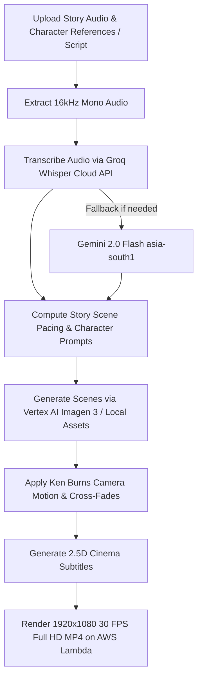

# Image to Video AI (`imagetovideoai.md`)

## 1. Overview & Purpose
**Image to Video AI** is Itnavideo's flagship cinematic narrative & story video creator. Its **primary use case is visual story creation, user narrative storytelling, and cinematic explainers**. It transforms user-uploaded voiceover narration audio, script stories, and character references into a cohesive 16:9 widescreen cinema-grade story video. It incorporates subtle Ken Burns camera motion (pan/zoom), smooth cross-dissolve scene transitions, and timed 2.5D frosted subtitles. (Note: External Pexels API fallback is completely removed; all visuals are generated directly via Vertex AI Imagen 3 / Gemini 2.0 or selected from the curated local Itnavideo library).

---

## 2. Key Specifications & Limits

| Attribute | Specification |
| :--- | :--- |
| **Video Type ID** | `image-to-video` / `IMAGE_TO_VIDEO_AI` |
| **Composition ID** | `IMAGE-TO-VIDEO-AI` |
| **Template Location** | `remotion/templates/IMAGE_TO_VIDEO_AI/template.tsx` |
| **Dashboard Studio** | `components/dashboard/ImageToVideoStudio.tsx` |
| **Dashboard Route** | `/dashboard/image-to-video` |
| **Aspect Ratio** | 16:9 Cinema Widescreen |
| **Resolution & Quality** | **1920×1080 (1080p Full HD)** |
| **Frame Rate** | 30 FPS |
| **Max Audio Duration** | Up to **5 minutes** (300 seconds) strictly per Rule 4.1 |
| **Primary Category** | Cinema, Narrative Stories & Explainers |
| **Credit Cost** | **1 Min = 1 Credit** (1m=1, 2m=2, 3m=3, 4m=4, 5m=5 Cr) per Rule 4.1 |
| **Design System** | Clean White Studio Design (`bg-white`, `border-slate-200`, `text-slate-900`, `bg-slate-50`) + Pure White Canvas (`#FAFAFA` with delicate dot grid texture and warm ambient blooms). |
| **Speech Transcription** | Extracted 16kHz audio → Groq Whisper Cloud API (Fallback: Gemini 2.0 Flash `asia-south1`) |
| **Cloud Engine** | AWS Lambda (Remotion in `us-east-1` Mumbai) |

---

## 3. User Inputs & Dashboard Workflow (4 Simple Steps)

1. **Step 1 — Your Audio / Story Narration (Required)**:
   - Upload voiceover narration audio (MP3, WAV, M4A, AAC — 12 min max). Raw video is never sent directly to Groq; lightweight 16kHz mono audio is extracted first.
2. **Step 2 — Your Story Visuals & AI Source**:
   - **`✨ Generate with AI (Automated)` (Default Mode)**:
     - 100% automated: Zero images needed from user.
     - **Visual Direction & Story Prompt Box**: Allows users to enter custom aesthetic directions (e.g., "3D Pixar animation with vibrant colors" or "Moody 35mm cinema in rainy Tokyo") with 1-click quick style chips.
     - **Consistent Character Reference Upload**: Users can optionally upload 1 character reference image (PNG, JPG) to lock face, hair, and clothing consistency across all scenes.
     - Gemini 2.0 listens to narration audio, detects story beats, and generates 16:9 cinematic visual prompts.
     - Vertex AI Imagen 3 produces custom high-definition scene visuals matching the selected art aesthetic (Cinema 35mm, 3D Pixar Animation, 2D Anime, Cyberpunk Sci-Fi).
     - **⚡ 4 One-Click "Viral Style" Presets** (Automatically locks lighting, camera motion, and color grading in 1 click):
       - `🎞️ Cinematic 35mm Movie`: Warm Kodak film grain, anamorphic lens flare & golden hour tone.
       - `🧸 3D Pixar Animation`: Vibrant 3D CGI characters, soft global illumination & Octane depth.
       - `🎨 Studio Anime / Storybook`: Hand-drawn painterly cloudscapes, clean ink lines & Ghibli aesthetic.
       - `🌑 Dark Moody Mystery`: High-contrast chiaroscuro shadows, deep noir silhouettes & thriller suspense lighting.
   - **`📁 Upload My Images (Up to 100 Images)`**:
     - Bulk drag-and-drop up to 100 images in one action.
     - **Zero manual typing**: The tedious per-image script typing fields are completely removed.
     - **🎬 AI Story Arc Director**: Automatically organizes uploaded images into a true 4-Act cinematic structure:
       - `🎣 1. Hook Intro` (First 3-5 seconds): High-energy visual presence with punchy entrance zoom to maximize viewer retention.
       - `📖 2. Narrative Buildup` (15% to 65% of timeline): Steady cinematic pans and glides matching narrative progression.
       - `💥 3. Peak Climax` (65% to 85% of timeline): Dramatic punch-in zoom on the emotional high point.
       - `🎬 4. Final Resolution` (Final 15%): Smooth, elegant pull-back settling on the closing scene.
     - **Strict 100% Gapless Timeline**: Zero black frames, zero image repeats, and natural speech pause snapping.
     - Includes interactive visual story beat badges (`🎣 Hook`, `📖 Story`, `💥 Climax`, `🎬 Outro`) with "Add More" and "Clear All" controls.
     - **🎵 Intelligent Speech-Paced Camera Motion**: Camera velocity and zoom direction respond organically to speech energy:
       - `⚡ Excitement & Key Punch Phrases`: Rapid dynamic punch-in zoom (`1.02 ➔ 1.15`) that snaps viewer attention to the subject.
       - `🌊 Narrative Background Context`: Gentle, slow panoramic horizontal glide (`1.06` scale with smooth drift) to maintain cinematic immersion.
       - `🍃 Thoughtful Reflection & Pauses`: Slow settling pull-back (`1.05 ➔ 1.01`) that allows the scene to breathe naturally.
   - **`🎬 Itnavideo Library`**:
     - Match narration to our curated studio 16:9 cinematic photo and illustration library.
3. **Step 3 — 32 Master YouTube Caption Styles**:
   - 32 high-contrast animated caption styles (`THIRTY_TWO_CAPTION_STYLES`) matching industry-standard short/long-form styles (Pop Word, Karaoke Line, Box Highlight, Neon Glow, Typewriter, Slam Headline, Hormozi Viral Pop, MrBeast Shorts Impact, etc.).
   - Clean, subtle rounded rectangular boxes (`rounded-lg`, 8px corner radius) with 1px border.
   - Search bar to filter across all 32 styles instantly.
   - Collapsible accordion (closed by default on initial page load to keep studio clean and uncluttered).
   - Rendered using `UniversalCaptionLayer` with dynamic colors and fonts.

4. **Step 4 — Background Music & Audio Engine**:
   - AWS S3 curated library background tracks (`AWS_BGM_TRACKS`) with instant play/pause audition.
   - Dynamic volume slider (normal initial volume, adjustable 0% to 100%).
   - Waveform audio player with interactive visualizer bars and time scrub sync.

5. **Step 5 — In-Player Cinema Stage & Direct Video Controls**:
   - **Direct In-Canvas Editing**: Click directly on the video subtitle overlay to edit text on the fly.
   - **In-Player Toolbar**: Play/pause, time scrubber, instant photo replacement, framing mode toggle (16:9 Cover vs. Blur-Fill Letterbox), in-player caption style picker popover, BGM volume popover, and camera motion toggle.
   - **Interactive Scene Filmstrip**: Visual thumbnail timeline of all uploaded scene photos with click-to-preview, individual photo replacement, and deletion.

6. **Step 6 — Studio Subtitle Engine & Timestamped Captions Track**:
   - Sentence-by-sentence breakdown with millisecond-accurate timestamps (`startTime` → `endTime`).
   - **Click to Jump (Timeline Sync)**: Clicking any sentence instantly seeks audio and video to that second.
   - **Active Speech Follower**: Lights up the active sentence and auto-scrolls into view during playback.
   - **In-Place Inline Editing**: Edit words and fine-tune start/end timing directly in the list.
   - **Search Bar**: Real-time search across all subtitle segments.
   - **1-Click .SRT Export**: Export industry-standard subtitle file for YouTube, Premiere, or Final Cut.

7. **Step 7 — Full Responsive Support & Mobile Sticky Render Bar**:
   - Clean responsive layout for Desktop, Laptop, Tablet, and Mobile.
   - Touchscreen-friendly controls (edit & delete buttons visible on touchscreens).
   - Mobile Sticky Render Bar: Floating 1-click render CTA on mobile/tablet so creators can trigger video export without scrolling.
   - Desktop layout toggle: 1-click `[ Right Side | Left Side ]` preview orientation switch.
   - Strictly conforms to Rule 0.7: Zero eyebrow pill badges above headlines for a clean enterprise brand aesthetic.

---

## 4. Dedicated Processing Pipeline (UI Stepper)

> [!IMPORTANT]
> `User Uploaded Images` mode strictly uses user images. External Pexels API dependencies have been completely removed across all modes.



### UI Stepper Stages & Pacing Rules:
Pexels fallback uses the server-only `PEXELS_API_KEY` from `.env.local`; it is capped at 24 missing or weak scene matches per render and never runs in `User Uploaded Images` mode.

1. **Audio & Media Prep**: Validating audio file, extracting 16kHz mono audio, verifying duration (<= 720s).
2. **Transcribe Narration**: Groq Whisper speech-to-text generating word-level timestamps (Fallback: Gemini 2.0 Flash).
3. **Custom Visual Directions (`userPrompt`)**: Accepts optional user visual directions (e.g., *"Fast cuts, show invoice screenshot on billing..."*), adjusting scene target durations and keyword prioritization.
4. **Strict 1.8s–4.2s Semantic Pacing Engine**:
   - `MIN_IMAGE_DURATION = 1.8` seconds.
   - `MAX_IMAGE_DURATION = 4.2` seconds.
   - Long narration gaps are automatically split into ~2.2s–3.5s visual beats aligned with sentence boundaries.
   - Uniform mathematical division (`totalAudioDuration / imageCount`) is strictly forbidden — eliminating 15s–30s frozen frames even when few images are uploaded.
5. **Anti-Repetition & 35s Cooldown Enforcer**:
   - `COOLDOWN_SECONDS = 35.0` seconds.
   - No image URL or asset ID is reused within 35 seconds of video runtime, and NEVER in two consecutive scenes.
   - When uploaded images are on cooldown or exhausted, the system dynamically pulls matching stock assets or falls back to `ImpactTypographyScene` cards.
6. **Cinematic Parallax & Motion**: Generating smooth camera motion (`zoom-in`, `zoom-out`, `pan-left`, `pan-right`) and cross-dissolves.
7. **Render 16:9 Full HD MP4**: Cloud render via Remotion AWS Lambda (`IMAGE_TO_VIDEO_AI`).

---

## 5. Remotion Composition Props

```typescript
export interface ImageToVideoScene {
  id: string;
  imageUrl: string;
  startFrame: number;
  durationInFrames: number;
  motionType: 'zoom-in' | 'zoom-out' | 'pan-left' | 'pan-right' | 'subtle-drift';
  captionText?: string;
}

export interface ImageToVideoAiProps {
  audioUrl: string;
  totalDurationInFrames: number;
  fps: number;
  scenes: ImageToVideoScene[];
  subtitles?: {
    text: string;
    startFrame: number;
    endFrame: number;
  }[];
  theme?: {
    fontFamily: string;
    primaryColor: string;
    subtitlesEnabled: boolean;
  };
}
```

---

## 6. Visual Design & Motion System
- **Google Analytics Palette**: Deep canvas (`#070B14`, `#0E1526`), warm orange accents (`#FF6D00` to `#FF8F00`) on UI controls and progress meters. See [`COLOR_DESIGN_SYSTEM.md`](file:///c:/Users/user/.gemini/antigravity/scratch/itnavideo/COLOR_DESIGN_SYSTEM.md).
- **Edge-to-Edge 16:9 Cinema & Zero Pillarboxing**: Default `fitMode: 'cover'` with `objectFit: 'cover'` and `objectPosition: 'center center'` across all image layers guarantees zero black margins or pillarboxing. Non-16:9 or vertical images are seamlessly cropped edge-to-edge.
- **Dynamic Pacing (Max 4–6s per Scene)**: No visual scene remains frozen for > 6 seconds. Scenes are strictly capped between 3.5s and 5.5s; longer narration blocks are split into 2 visual cuts.
- **Continuous Ken Burns Motion**:
  - Smooth scale interpolation across parent asset duration: When an asset is subdivided across multiple cuts, `parentStartSeconds` and `parentEndSeconds` maintain continuous scale interpolation (`1.02` ➔ `1.12`) across all cuts without abrupt scale resets.
  - Pan vector: Subtle translation (`0%` to `±0.8%` / `±2.0%`) for natural cinematic movement.
- **35mm Film Grain & Vignette Overlay**:
  - `<FilmGrainOverlay />` applies a subtle 2.5% SVG noise texture (`feTurbulence`) + radial edge vignette overlay at `zIndex: 80`.
- **2-Line Subtitle Clamping**:
  - Subtitle text clamped to maximum 2 lines (`WebkitLineClamp: 2`, `maxHeight: '2.6em'`) and 14 words max per active chunk to eliminate bottom visual occlusion.
- **Zero Canvas Overlay Rule**: The top-left corner topic/filename badge (`sanitizedTitle` overlay) has been permanently removed so uploaded audio file names (e.g. `Testing1.mp3`) never render on top of the video canvas.
- **Cross-Fade Transitions**: Smooth opacity and slide-push blending between sequential scenes.

---

## 7. AI Vision-Based Scene Matcher & Single-Call Batch Multimodal Analysis

> [!IMPORTANT]
> **Custom Upload AI Vision Matching Pipeline**:
> 1. **Batch Multimodal Vision Analysis (Single Call)**:
>    - Rather than heavy individual image calls (which caused `429 RESOURCE_EXHAUSTED` rate limits), all uploaded images are packed into a **single prompt payload** to Gemini 2.0 Flash / Vision.
>    - Extracts visual subjects, core actions, detected objects (e.g., `money`, `stock market chart`, `city skyline`, `desk`), mood, and positive keywords in **1 single API request**.
> 2. **Semantic Script-to-Image Matching Logic**:
>    - Narration text is semantically compared against the batch-analyzed visual tags:
>      - *"While inflation quietly destroys ordinary savings..."* → Binds image with detected cash/money/hourglass.
>      - *"Low-cost index funds and real estate..."* → Binds image with stock chart/property/architecture.
> 3. **Strict Rules Enforced**:
>    - **Zero Duplicates**: An image assigned to a scene is added to `usedUserImageIds` and never repeated.
>    - **Surplus Fallback**: When uploaded images are exhausted, remaining scenes automatically transform into clean `<ImpactTypographyScene/>` cards displaying key spoken metrics/words.

---

## 8. Dashboard Project History & Download Features
- **Persistent M3 Switcher**: `[ Studio ]` and `[ Your Videos / Projects ]` persistent tabs right on the dashboard.
- **Robust Render Completion Detection**: Polling acknowledges `state === 'ready'`, `state === 'done'`, and `statusPayload.done` flags with presigned MP4 resolution to eliminate stuck progress screens.
- **Real-time Local & Cloud Sync**: Completed renders are saved to browser `localStorage` (`itnavideo_image_to_video_projects`) and synchronized with `/api/reels/history` in Supabase using mode aliases (`imageToVideoAi`, `IMAGE_TO_VIDEO_AI`).
- **Direct 1080p MP4 Download**: Dual download capability: in-browser blob download with active spinner feedback + direct cloud anchor link fallback.
- **48-Hour Retention**: Automated private cloud retention with timestamp indicators.

---

## 9. Edge Cases & Safeguards
- **Mismatched Image Count**: If audio is 60 seconds and only 2 images are provided, scenes automatically divide equally with continuous subtle motion.
- **Silent or Inaudible Audio**: Groq Whisper returns `NO_SPEECH_DETECTED`; dashboard flags clear error before triggering cloud render.
- **Non-16:9 Images**: Default `cover` scaling guarantees zero black bars for YouTube.

---

## 10. M3 Stepper Flow & Animated Step Narration Guide
- **Interactive 4-Step Rail**:
  - `Step 1: Your Audio` (Upload voiceover narration audio MP3, WAV, M4A, AAC — up to 12 minutes).
  - `Step 2: Your Visuals` (Choose visual mode: 2D, 3D, Realistic, User Uploaded Images, or Mix).
  - `Step 3: Subtitles & Captions` (Select from 10+ 2.5D frosted glass cinema subtitle styles).
  - `Step 4: Background Music & 1080p Export` (Curated studio BGM with smart speech ducking, 1-click cloud render).
- **Dynamic Animated Step Guide (`AnimatedStepGuide`)**:
  - Kinetic typewriter component animating instructions in real-time (~15ms per character).
  - Ambient Google Analytics orange aura (`#FF6D00` to `#FF8F00` to `#FFA726`).
  - Active step status badge, step narration, and YouTube retention pro-tip ticker.

---

## 11. Resilient Render Execution Flow
- **Direct Voiceover Pipeline**:
  - Validates user-uploaded narration audio, generates word-level timestamps via Groq Whisper, and matches sequential scene images.
- **Resilient Button States**:
  - The final Generate button retains tactile M3 micro-interactions (`active:scale-95`, hover elevation) and validates inputs with clear inline M3 alert banners instead of silently failing.

---

## 13. Direct Cloud S3 Asset URLs & Strict Visual Category Isolation

> [!CRITICAL]
> **AWS Lambda Cloud Rendering Asset Guarantees**:
> To prevent image load crashes (`Fs is not defined`, 404s, or relative path errors) inside AWS Lambda Chromium instances in `us-east-1`:
>
> 1. **Pure HTTPS S3 Asset URLs**:
>    - All stock assets, unified images, and user-uploaded media are mapped to fully-qualified public HTTPS S3 URLs (`https://remotionlambda-useast1-2zq6twaok1.s3.us-east-1.amazonaws.com/...` or presigned S3 URLs) using `toAbsoluteS3AssetUrl()`.
>    - Relative local paths (`/assets/...`) are **never** passed to Remotion Lambda.
>
> 2. **Strict Category Isolation (`2D` / `3D` / `Realistic`)**:
>    - Visual style selections (`2d`, `3d`, `realistic`) strictly enforce visual category boundaries.
>    - When the user selects `2D`, only 2D digital illustrations and anime assets are used. Realistic photographic stock images are strictly blocked from 2D renders.
>
> 3. **Pre-Render Asset Validation**:
>    - Before initiating cloud render jobs, every `scene.imageUrl` is validated and resolved to an active, accessible HTTPS S3 URL or Cloudinary CDN fallback.

---

## 14. Demo Videos Strategy (Dedicated SEO Pages Only)
- **Dedicated SEO Pages Only**:
  - Demo video carousels have been removed from the creation studio workspace (`components/dashboard/ImageToVideoStudio.tsx`) to keep the dashboard focused, fast, and clean.
  - Rendered widescreen 16:9 MP4 samples are featured strictly on dedicated SEO landing pages (e.g. `/tools/image-to-video-ai`).

---

## 15. Pipeline Error Checklist & Auto-Fix Matrix

| Pipeline Stage | Potential Error / Failure | Root Cause | Automated Recovery / Fix | User-Facing Action / Feedback |
| :--- | :--- | :--- | :--- | :--- |
| **1. Upload Validation** | `AUDIO_TOO_LONG` | Audio exceeds 12-minute max duration | Validation check returns 422 with clear message | "Please trim audio under 12 minutes" |
| **1. Upload Validation** | `MISSING_SCENE_IMAGES` | User uploaded audio but 0 images | Client preflight blocks submission | "Please upload at least 1 image for your scenes" |
| **1. Upload Validation** | `BLOB_URL_FAILURE` | Client `blob:` URLs cannot be loaded inside AWS Lambda | Server resolves and uploads blob data to S3 presigned URLs before Lambda render | Seamless conversion to signed HTTPS URLs |
| **2. Speech Transcription** | `WHISPER_RATE_LIMIT_429` | Groq Whisper concurrency limits | Automatic failover to Google Gemini 2.0 Flash (`asia-south1`) | Instant zero-downtime transcription |
| **2. Speech Transcription** | `NO_SPEECH_DETECTED` | Audio lacks audible vocal track | Fails with explicit `NO_SPEECH_DETECTED` reason code | "No clear speech detected. Please upload clear narration audio." |
| **3. Scene Pacing & Parallax** | `IMAGE_COUNT_MISMATCH` | Number of uploaded images does not match scene count | Pacing engine dynamically loops, holds, or stretches image timings across script duration | Smooth transition pacing without freeze or black frames |
| **4. Remotion Render** | `LOCAL_ASSET_404_IN_LAMBDA` | Relative path (`/assets/...`) sent to Lambda | `resolvedCustomUrls` automatically uploads local disk assets to temporary S3 bucket | 100% cloud-accessible HTTPS URLs |
| **5. Render Recovery** | `RENDER_CRASH_OR_TIMEOUT` | Lambda task failure or network disconnect | Status route triggers credit refund via `releaseReservedRenderUsageFromServer` | Instant credit restore with retry button |
| **6. Output Delivery** | `DOWNLOAD_URL_EXPIRED` | Expired presigned S3 link | Polling `/api/reels/jobs/status` regenerates signed URL on demand | Direct MP4 download link available |

---

## 16. Viral Storytelling & Character Consistency Engine (Master Blueprint)

Implemented directly from top-performing faceless YouTube storytelling channels:

1. **Locked Character Anchor Profile**:
   - The AI director establishes a single locked visual DNA for the protagonist (age, hair, facial features, skin tone, exact outfit, and signature prop).
   - In every scene prompt where the character appears, this exact descriptive string is injected word-for-word so the image model maintains 100% facial and wardrobe consistency throughout the entire video.

2. **Strict 5-Second Scene Pacing (Viewer Retention)**:
   - Voiceover transcripts are segmented into rapid 3.5 to 5.5 second visual beats (~12 to 15 spoken words per scene).
   - Images never linger longer than 6 seconds, preventing visual stagnation and maximizing viewer retention.

3. **Visual Storytelling Devices**:
   - `screen-or-document`: Automatically triggers when numbers, balances, contracts, or technology are spoken, displaying readable documents in the scene.
   - `split-screen`: Compares the hero's modest habits on one side against flashy alternatives on the other.
   - `time-path`: Displays a glowing winding road with year signposts when the narration covers years or compounding effort.
   - `thought-bubble`: Shows past memories or future dreams with a warm sepia glow.
   - `money-in-motion`: Visualizes wealth growth with flying coins or growing stacks.

4. **14% Subtitle Safe Zone Clearance**:
   - Prompts mandate that the bottom fifth (20%) of the 16:9 canvas is kept clear of text, faces, and key objects so burnt-in captions never obscure the artwork.
