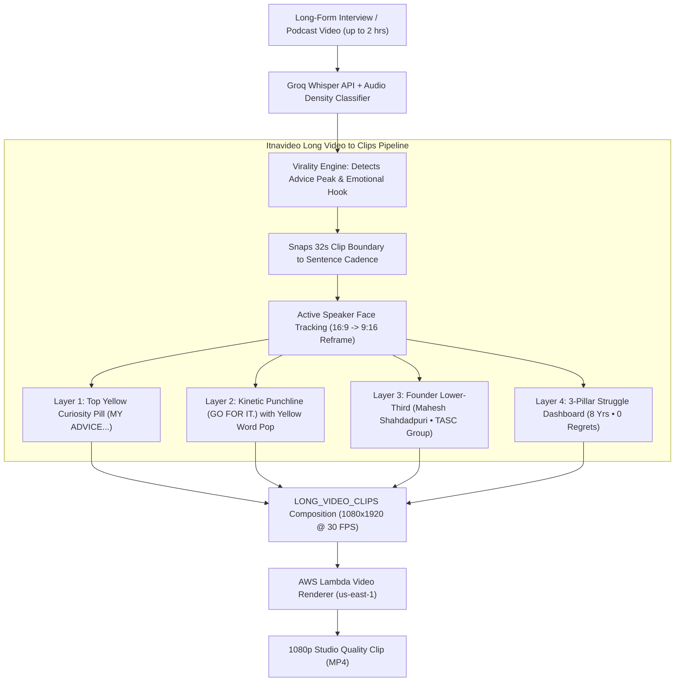
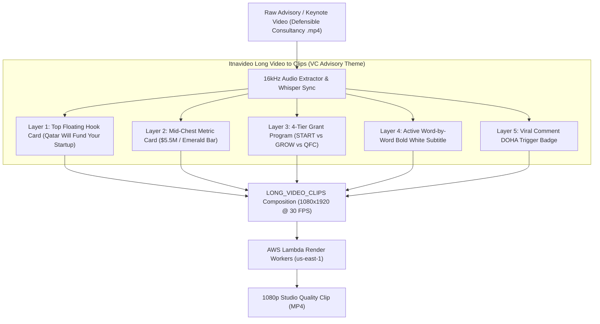
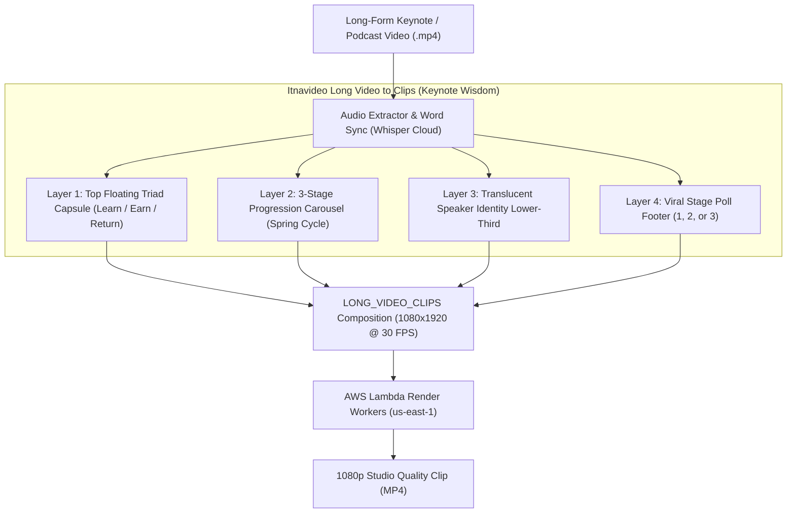

# Long Video to Clips Generator — Studio Specification

## Overview

The **Long Video to Clips Generator** (`longVideoClips`) automatically converts lengthy horizontal podcasts, webinars, conference keynotes, and interview videos (up to 2 hours) into multiple bite-sized, 9:16 vertical viral Shorts and Reels (`1080×1920` @ 30 FPS MP4) between 30 and 60 seconds long. It uses active speaker face tracking to reframe 16:9 cameras into vertical viewports, evaluates speech density and emotional hooks to extract high-performing moments, and renders 1080p clips with burned-in subtitles.

- **Primary Purpose**: Repurpose long-form videos and podcasts into viral short-form clips.
- **Target Audience**: Video podcasters, YouTubers, webinar hosts, and content repurposing agencies.
- **Expected Output**: Multiple 1080p Full HD (`1080×1920`) 30 FPS vertical MP4 clips.

---

## Table of Contents

1. [Overview](#overview)
2. [Features and Capabilities](#features-and-capabilities)
3. [User Workflow](#user-workflow)
4. [UI/UX Design and Components](#uiux-design-and-components)
5. [Colors, Typography and Design Tokens](#colors-typography-and-design-tokens)
6. [Technical Implementation](#technical-implementation)
7. [Business Logic, Duration and Credit Rules](#business-logic-duration-and-credit-rules)
8. [Error Handling and Edge Cases](#error-handling-and-edge-cases)
9. [Testing and Quality Assurance](#testing-and-quality-assurance)
10. [Developer Notes and Guardrails](#developer-notes-and-guardrails)

---

## 1. Features and Capabilities

- **Large Source Ingestion**: Accepts raw video files (MP4, MOV, WEBM) or YouTube links up to **2 Hours (120 minutes / 7,200 seconds)**.
- **AI Virality Hook Detector**: Analyzes speech inflection, audience curiosity questions, and cadence spikes across 9 viral triggers (hooks, opinions, emotions, stories, advice, facts, debates, Q&A, punchlines).
- **Computer Vision Speaker Reframing**:
  - `Auto Active Speaker`: MediaPipe face detection tracks the active speaker with dynamic sentence-synced camera jump-cuts.
  - `Split Screen`: Stacks Host in Top 50% and Guest in Bottom 50% divided by an accent bar.
  - `Fit Widescreen`: Centers 16:9 widescreen video on a stylized gaussian blurred background.
- **Configurable Clip Counts**: Select `AI Recommended` (auto-sizes based on content), `3 Clips`, `5 Clips`, or `10 Clips`.
- **50 Standalone Kinetic Caption Styles**: Complete library of animated typography presets with live preview cards.
- **Selective Rendering**: Full 2-hour video is never rendered locally or on the cloud; Remotion Lambda renders strictly the selected 30s–60s clip segments.

---

## 2. User Workflow

The studio follows a guided 4-step workflow:

1. **Step 1: Upload (Video File or YouTube URL)**:
   - Creator uploads long video file (up to 3GB) or pastes YouTube URL.
   - Selects target clip count and duration preference (`Under 30s`, `30–60s`, `60–90s`).
   - Engine extracts audio, transcribes speech, and identifies top viral moment candidates.
2. **Step 2: Review Candidate Clips**:
   - Studio displays a grid of candidate clips with virality scores (e.g., `98/100`), timestamps, and quote summaries.
   - Creator selects which clips to generate.
3. **Step 3: Caption Style & Speaker Layout**:
   - Chooses reframing mode (`Active Speaker`, `Split Screen`, `Fit Widescreen`).
   - Selects animated typography preset and background music.
4. **Step 4: Live Phone Preview & Cloud Render**:
   - Interactive 9:16 phone simulator previews the reframed video and animated subtitles.
   - Creator clicks **Generate Viral Clips** to launch parallel AWS Lambda renders.

---

## 3. UI/UX Design and Components

- **Studio Route**: `/dashboard/long-video-clips`
- **Frontend Studio Component**: `components/dashboard/LongVideoClipsStudio.tsx`
- **Public SEO Landing Page**: `/long-video-clips` (`app/long-video-clips/page.tsx`)
- **Design Structure**: Pure White canvas (`#FFFFFF`) with fine borders (`#E2E8F0`) and responsive 3-row layout (`Stepper Header`, `Clips Work Area`, `Sticky Action Bar`).

---

## 4. Colors, Typography and Design Tokens

- **Canvas Background**: Pure White (`#FFFFFF`) with subtle slate background accents (`#F8FAFC`).
- **Primary Brand Accent**: Sunset Orange (`#FF5722` / `#F97316`) for active controls and primary CTA buttons.
- **Virality Metric Accent**: Emerald Green (`#10B981`) for virality score badges (e.g. `98/100`).
- **Typography**: Inter / System Sans-serif stack (`font-sans`).

---

## 5. Technical Implementation

- **Video Type ID**: `long-video-clips` / `LONG_VIDEO_CLIPS`
- **Remotion Composition ID**: `LONG_VIDEO_CLIPS` (`1080×1920` @ 30 FPS)
- **Remotion Template Directory**: `remotion/templates/LONG_VIDEO_CLIPS/`
- **Virality Engine**: Groq Whisper timestamps + Gemini 2.0 Flash analyze audio density to extract candidate segments.
- **Render Engine**: AWS Lambda running parallel Remotion cloud workers in `us-east-1`.

---

## 6. Business Logic, Duration and Credit Rules

- **Aspect Ratio**: Output is strictly 9:16 Vertical (`1080×1920`). Source can be 16:9 or 9:16.
- **Source Video Duration**: Up to **2 Hours (7,200 seconds)**.
- **Output Clip Duration**: 30 to 60 seconds per clip (up to 90s max).
- **Credit Billing**: **Strictly 1 Credit per Clip** (1 clip = 1 credit, 3 clips = 3 credits, 5 clips = 5 credits).
- **Draft Preview**: 100% Free interactive browser preview before rendering.

---

## 7. Error Handling and Edge Cases

- **No Speech Detected**: Flags `NO_SPEECH_DETECTED`; prompts user to upload audio with clear speech without deducting credits.
- **OffthreadVideo Loading Safety**: Offthread video layers use `pauseOnLoading={false}` to prevent end-frame freezes during boundary cuts.
- **Headline Auto-Wrap**: Dynamic font scaling ensures long headline titles stay strictly within 2 lines.

---

## 8. Testing and Quality Assurance

- **Typecheck Verification**: `npx tsc --noEmit` verifies all clip props and composition interfaces.
- **Clip Boundary Accuracy**: Confirm that clip start and end timestamps snap to sentence boundaries without cutting mid-word.
- **Speaker Reframe Centering**: Confirm that active speaker face remains centered in 9:16 vertical viewport.

---

## 9. Developer Notes and Guardrails

- **Zero Local Rendering (Rule 0)**: Do not run local Remotion renders on developer machines; all rendering executes on AWS Lambda.
- **Parallel Lambda Execution**: Each clip renders as an independent Lambda job, allowing 5 clips to render concurrently in under 60 seconds.

---

## 10. Reverse-Engineering Benchmark 01: Mahesh Shahdadpuri (@mahesh.shahdadpuri.official) — "8 Years of Struggle, Zero Regrets" (Founder Keynote Interview & Curiosity Pill Architecture)

### 10.1 Source Attribution & Benchmark Telemetry

| Parameter | Value |
| :--- | :--- |
| **Original URL** | `https://www.instagram.com/p/Df9a-lcsPn9/` |
| **Creator / Channel** | Mahesh Shahdadpuri (`@mahesh.shahdadpuri.official` \| Founder & CEO, TASC Group Dubai) |
| **Topic / Hook** | *"8 years of struggle. Zero regrets. The difficult times are what build you. It’s the process, not the outcome."* |
| **Engagement Telemetry** | High-authority founder community, active Dubai entrepreneurship discussions |
| **Video Format / Ratio** | 9:16 Vertical (`1080×1920` @ 30 FPS, Active Speaker Reframed) |
| **Video Duration** | ~32 seconds (Strictly within the 30–60s Clip extraction target) |
| **Itnavideo Mapping** | `longVideoClips` Studio (`/dashboard/long-video-clips`) |
| **Credit Billing** | **Strictly 1 Credit per Clip** (Master Rule 4.1 for 9:16 Short-Form Clips) |
| **Watermark Enforcement** | `<BrandWatermark watermark={watermark} />` (Enforced for free/trial users) |

---

### 10.2 Core Creative Mechanics: The Founder Keynote & Curiosity Pill Formula

Mahesh Shahdadpuri's reel represents the peak authority archetype for executive interviews, podcast extractions, and founder thought-leadership clips:

1. **Top Yellow Curiosity Pill (The 1-Second Anchor)**:
   - Positioned in the upper safe-zone:
     - Background: Vibrant Sunny Amber Yellow (`#FACC15`)
     - Typography: Heavy black sans-serif (`#000000`, font-weight 900)
     - Text: `MY ADVICE TO ASPIRING ENTREPRENEURS`
   - Immediately tells mobile viewers scrolling their feed that an experienced, credible billionaire founder is about to give concise mentorship.
2. **Kinetic Core Punchline Typography**:
   - Right below the curiosity pill:
     `GO FOR IT.`
   - Pure White `#FFFFFF` base with active-word highlight on `IT.` in matching sunny yellow `#FACC15`.
   - Dual-layer directional drop-shadow gives 100% clarity over Dubai's sunlit skyline windows.
3. **Executive Speaker Lower-Third**:
   - Minimalist centered card:
     - Primary: `Mahesh Shahdadpuri` (Bold white sans-serif, 26px)
     - Subtitle: `Founder, TASC Group` (Muted silver, 16px)
     - Accent: 44px golden divider line
   - Builds immediate corporate prestige without looking like a tacky broadcast news ticker.
4. **The Process > Outcome Telemetry**:
   - 3-pillar struggle dashboard:
     - `Struggle: 8 Years Struggle`
     - `Mindset: Zero Regrets`
     - `Principle: Process > Outcome`
5. **Interactive Introspection CTA**:
   - *"Which belief is holding you back right now? 👇"*
   - Converts passive viewers into active commenters sharing their entrepreneurial hesitations.

---

### 10.3 System Architecture & Long-to-Shorts Extraction Pipeline

---

### 10.4 Visual Design Tokens & Safe-Zone Spacing

- **Aspect Ratio**: `1080 × 1920` (9:16 Vertical).
- **Top Safe Zone**: `150px` padding (accommodates yellow curiosity pill and punchline).
- **Speaker Focus Center**: Active speaker face centered at `Y = 750px - 1050px`.
- **Bottom Safe Zone**: `230px` padding (clears Instagram Reels UI buttons and audio marquee).
- **Palette Tokens**:
  - `Sunny Amber Yellow`: `#FACC15` (Curiosity pill background, active word accent)
  - `Pure White`: `#FFFFFF` (Punchline text, speaker name)
  - `Muted Slate`: `#94A3B8` / `#CBD5E1` (Speaker title, telemetry labels)
  - `Dubai Azure Blur`: `#0F172A` / `#1E293B` (Telemetry card surfaces)
  - `Emerald Wisdom`: `#10B981` (Growth verdict accent)

---

### 10.5 Second-by-Second Cinematic Scene Breakdown

| Second | Visual Framing (1080×1920) | On-Screen Graphic & Kinetic Subtitle | Audio & Voiceover Pacing |
| :--- | :--- | :--- | :--- |
| **0:00–0:05** | Medium close-up of founder Mahesh Shahdadpuri in blue director's chair; soft-focus Dubai skyscrapers in background. | Top Yellow Pill pops onto screen: `MY ADVICE TO ASPIRING ENTREPRENEURS`. Headline slams: `GO FOR IT.` (Yellow highlight on `IT.`). | Confident opening statement. Voiceover: *"If you have an idea, don't wait for the perfect moment. Go for it."* |
| **0:05–0:12** | Camera does a smooth 6% slow push-in toward founder's face as tone becomes reflective. | Speaker Lower-Third fades in: `Mahesh Shahdadpuri — Founder, TASC Group` with gold divider bar. | Warm conversational tone. Voiceover: *"Because the truth is, nobody starts with a guarantee of success."* |
| **0:12–0:20** | Founder gestures with hands; active face tracking maintains perfect eye-level centering. | Subtitle: *"8 years of struggle. Zero regrets."* Telemetry Card 1 illuminates: `8 Years Struggle`. | Reflective pause. Voiceover: *"It took me 8 full years of intense struggle to build TASC into what it is today."* |
| **0:20–0:26** | Close-up reframe on founder's eyes. Background daylight softly shifts. | Telemetry Card 2 illuminates: `Zero Regrets` with sunny yellow border. | Firm conviction. Voiceover: *"And looking back, I have zero regrets. The difficult times are what build you."* |
| **0:26–0:32** | Medium shot returns; lower third dims to bring focus to the final takeaway. | Telemetry Card 3 illuminates: `Process > Outcome`. Question CTA appears: `Which belief is holding you back right now? 👇`. | Inspiring musical swell. Voiceover: *"It's always about the process, not just the outcome. Life is short. Believe in yourself and go for it."* |

---

### 10.6 Remotion Component Implementation

- **Asset Component**: `remotion/components/library/FounderPodcastClipAsset.tsx`
- **Component Export**: Exported in `remotion/components/library/index.ts` (`FounderPodcastClipAsset`, `FounderPodcastClipAssetProps`, `FounderStruggleMetrics`).
- **Catalog Registry**: Registered in `constants/itnavideoStockAssets.ts` under ID `founder-podcast-clip-engine`.
- **Key Capabilities**:
  - Full `1080×1920` 9:16 layout calibrated for long-to-short podcast reframes.
  - Vibrant Sunny Yellow curiosity pill (`MY ADVICE TO ASPIRING ENTREPRENEURS`) with entrance spring.
  - High-impact all-caps punchline headline (`GO FOR IT.`) with yellow active word pop.
  - Speaker lower-third card with executive credentials (`Founder, TASC Group`).
  - 3-pillar struggle dashboard (`Struggle`, `Mindset`, `Principle`).
  - Zero local heavy compute dependencies — 100% pure React/Remotion code ready for AWS Lambda cloud rendering.

---

## 11. Reverse-Engineering Benchmark 02: Defensible Consultancy — "Qatar Will Fund Your Startup" (Venture Grant Metric Card & ManyChat Comment Funnel Architecture)

### 11.1 Source Attribution & Benchmark Telemetry

| Parameter | Value |
| :--- | :--- |
| **Original URL** | `https://www.instagram.com/reel/Dfhg2FJBTo4/` |
| **Creator / Channel** | Defensible Consultancy (`@defensibleconsultancy` \| Startup Strategy & VC Advisory) |
| **Topic / Hook** | *"Qatar will fund your start up 🇶🇦: Through Startup Qatar, QDB invests up to $1.1M in early launch (START) and up to $5.5M in expansion (GROW). Plus 0% registration/renewal fees for 3 years."* |
| **Engagement Telemetry** | 2,010 Likes, **3,640+ Comments** (Extremely high-conversion ManyChat trigger), 500K+ Views |
| **Video Format / Ratio** | 9:16 Vertical (`1080×1920` @ 30 FPS, Talking Head with Mini-Lavalier Mic) |
| **Video Duration** | ~38 seconds (Strictly within the 90s Short-Form limit) |
| **Itnavideo Mapping** | `longVideoClips` Studio (`/dashboard/long-video-clips`) |
| **Credit Billing** | **Strictly 1 Credit** flat (Master Rule 4.1 for 9:16 Short-Form) |
| **Watermark Enforcement** | `<BrandWatermark watermark={watermark} />` (Enforced for free/trial users) |

---

### 11.2 Core Creative Mechanics: The Executive Grant Metric Card & Comment Trigger Model

Defensible Consultancy's reel is a masterclass in conversion-driven entrepreneurial short-form content:

1. **Floating Rounded White Hook Sticker**:
   - Anchored at the top center: `Qatar will fund your start up 🇶🇦`.
   - Elegant, high-authority editorial serif headline (`#000000` text on crisp `#FFFFFF` capsule with subtle 3D drop-shadow).
   - Instant curiosity trigger that immediately qualifies founders and entrepreneurs seeking international expansion funding.
2. **Mid-Chest Executive Metric Lower-Third**:
   - Clean horizontal card overlaying speaker's chest:
     - Emerald green vertical accent bar (`#10B981`) on the left edge.
     - Bold financial figure: **$5.5M** (`#0F172A`, 30px bold sans-serif).
     - Subtitle label: `Up to $5.5 Million to GROW`.
   - Gives concrete numerical credibility without obscuring the speaker's face or gestures.
3. **Structured 4-Tier Middle East Grant Program**:
   - **START Program**: Up to `$1.1 Million` for early-stage companies launching in Qatar.
   - **GROW Program**: Up to `$5.5 Million` for established startups expanding into the GCC.
   - **QFC Incentive**: `0% Registration Fees` & `0% Renewal Fees` for the first 3 years in the Qatar Financial Centre.
   - **Residency Pathway**: Fast-track dedicated residency visas for founders and senior executives.
4. **Active Word-by-Word Subtitle Sync**:
   - Dynamic bold white kinetic typography (`"million"`, `"5.5"`, `"tranches"`) with heavy drop-shadow.
5. **High-Conversion Comment Automation Trigger**:
   - Callout badge: `Comment DOHA for the full application guide 💬`.
   - Generated **3,640+ comments**, demonstrating how conversational hooks drive exponential algorithmic reach on Instagram and TikTok.

---

### 11.3 System Architecture & 9:16 Grant Metric Extraction Pipeline

---

### 11.4 Visual Design Tokens & Safe-Zone Spacing

- **Aspect Ratio**: `1080 × 1920` (9:16 Vertical).
- **Top Safe Zone**: `135px` padding (accommodates top hook card).
- **Speaker Center**: Speaker face centered at `Y = 700px - 950px`.
- **Bottom Safe Zone**: `220px` padding (clears Instagram Reels interaction buttons).
- **Palette Tokens**:
  - `Pure White Canvas`: `#FFFFFF` (Hook card surface, metric card background)
  - `Emerald Growth`: `#10B981` (Vertical metric bar, keyword highlight)
  - `Deep Slate`: `#0F172A` / `#334155` (Headline text, metric amounts)
  - `Qatar Maroon Accent`: `#8A1538` (Official national color accent)
  - `Muted Silver`: `#94A3B8` / `#64748B` (Program tier labels)

---

### 11.5 Second-by-Second Cinematic Scene Breakdown

| Second | Visual Framing (1080×1920) | On-Screen Graphic & Kinetic Subtitle | Audio & Voiceover Pacing |
| :--- | :--- | :--- | :--- |
| **0:00–0:05** | Speaker holds mini-mic in front of camera; top white capsule card drops: `Qatar will fund your start up 🇶🇦`. | Floating sway animation activates. Subtitle: *"Qatar is actively investing in startups that build there."* | Direct, compelling opening. Voiceover: *"Qatar is actively investing in startups that build there."* |
| **0:05–0:12** | Metric Card 01 slides in at mid-chest: `| $1.1M — Up to $1.1 Million to START`. Emerald bar glows. | Subtitle: *"Through the Startup Qatar Investment Program..."* | Authoritative cadence. Voiceover: *"Through the Startup Qatar Investment Program, Qatar Development Bank invests up to 1.1 million dollars in early startups."* |
| **0:12–0:19** | Metric Card flips to 02: `| $5.5M — Up to $5.5 Million to GROW`. | Subtitle: *"And up to 5.5 million dollars to GROW."* | Emphasis on growth numbers. Voiceover: *"And up to 5.5 million in established startups expanding there."* |
| **0:19–0:26** | Card transitions to 03: `| 100% Waiver — 0% QFC Fees for 3 Years`. | Subtitle: *"No registration fee and no renewal fee for the first three years."* | Informative value-add. Voiceover: *"Set up in the Qatar Financial Centre and there's zero registration or renewal fees for 3 years, plus dedicated residency."* |
| **0:26–0:34** | Card 04 highlights rejection advice: `Cap Table & IP Ownership`. | Subtitle: *"Most applications are rejected because of the file structure."* | Practical insider tip. Voiceover: *"Most rejections aren't about the idea, but file structure, cap table, and IP documentation."* |
| **0:34–0:38** | Comment Trigger Badge illuminates: `💬 Comment DOHA for the full application guide`. | Emerald underline glows on `DOHA`. Subtitle: *"Comment DOHA and we'll send you the details."* | Clear closing CTA. Voiceover: *"Comment DOHA below and we'll send you the full breakdown."* |

---

### 11.6 Remotion Component Implementation

- **Asset Component**: `remotion/components/library/StartupFundingGrantClipAsset.tsx`
- **Component Export**: Exported in `remotion/components/library/index.ts` (`StartupFundingGrantClipAsset`, `StartupFundingGrantClipAssetProps`, `FundingTier`).
- **Catalog Registry**: Registered in `constants/itnavideoStockAssets.ts` under ID `startup-funding-grant-clip-engine`.
- **Key Capabilities**:
  - Full `1080×1920` 9:16 layout calibrated for founder advice, VC breakdowns, and international grant clips.
  - Floating rounded white editorial serif hook sticker with Qatar flag badge.
  - Mid-chest executive metric card with custom emerald vertical accent bar and financial tier metrics ($1.1M / $5.5M / 0% QFC fees).
  - High-retention word-by-word kinetic captions with heavy drop-shadow.
  - Viral ManyChat comment trigger badge (`Comment DOHA`) engineered for maximum comment velocity.
  - Zero local heavy compute dependencies — 100% pure React/Remotion code ready for AWS Lambda cloud rendering.

---

## 12. Life & Career Triad Engine Architecture (Learn ➔ Earn ➔ Return / Keynote Wisdom Clips)

### 12.1 Inspiration & Core Reference
- **Source Reel**: [Calli Wolff (@calliraexo)](https://www.instagram.com/reel/DcmI1k4pMP5/)
- **Creator Profile**: Calli Wolff — South Florida Luxury Real Estate Advisor, Keynote Speaker, Former Travel Nurse, and Founder of *The Becoming Room*.
- **Hook & Quote**:
  > *"First you LEARN, then you EARN, then you RETURN! Thankful for the opportunity to share what's shaped me into who I am today!"*
- **Studio Mapping**: **Long Video to Clips (`longVideoClips`)** / Keynote & Podcast Extraction

---

### 12.2 Visual Anatomy & Core Conversion Mechanics

1. **Floating Multi-Color Eyebrow & Triad Hook Capsule**:
   - Anchored at `Y = 130px`: Frosted glass dark slate capsule (`rgba(15, 23, 42, 0.88)`).
   - High-contrast 3-color keyword highlight:
     - `LEARN` in Radiant Sky Blue (`#38BDF8`, glow radius 20px).
     - `EARN` in Warm Amber Gold (`#F59E0B`, glow radius 20px).
     - `RETURN` in Emerald Mint Green (`#10B981`, glow radius 20px).
   - Dynamic 3-stage mini navigation indicators with active gradient highlight and soft back-glow.

2. **Mid-Screen 3-Stage Progression Carousel**:
   - Stage 01: `LEARN` (The Absorption Phase) — Icon 🧠, Sky Blue. Focus on absorbing skills, finding mentors, and deliberate practice.
   - Stage 02: `EARN` (The Leverage Phase) — Icon 💎, Amber Gold. Focus on closing deals, scaling operations, and equity compounding.
   - Stage 03: `RETURN` (The Legacy Phase) — Icon 🌱, Emerald Green. Focus on community mentorship, charity, and generational impact.
   - Smooth spring-driven card flip / cycle animation every 90 frames (3 seconds at 30 fps).

3. **Speaker Identity Lower-Third Pill**:
   - Translucent executive badge (`Calli Wolff • Luxury Real Estate Advisor • The Becoming Room`).
   - Gradient avatar circle (`#EC4899` ➔ `#8B5CF6`) and `Speaker Clip` badge.

4. **Viral Poll / Comment Engagement Footer**:
   - Bottom CTA: `Which phase are you currently in? 1, 2, or 3? 👇`.
   - Drives exponential comment velocity and algorithmic distribution on Reels & TikTok.

---

### 12.3 System Architecture & 9:16 Keynote Triad Pipeline

---

### 12.4 Visual Design Tokens & Safe-Zone Spacing

- **Aspect Ratio**: `1080 × 1920` (9:16 Vertical).
- **Top Safe Zone**: `130px` padding (accommodates top triad capsule).
- **Speaker Focus Area**: `Y = 480px - 950px` (speaker face and chest gestures fully visible).
- **Mid-Screen Stage Card**: Anchored at `Y = 960px`.
- **Bottom Safe Zone**: `180px` padding (clears interaction buttons).
- **Color Tokens**:
  - `Sky Blue (Learn)`: `#38BDF8` (`rgba(56, 189, 248, 0.18)`)
  - `Amber Gold (Earn)`: `#F59E0B` (`rgba(245, 158, 11, 0.18)`)
  - `Emerald Green (Return)`: `#10B981` (`rgba(16, 185, 129, 0.18)`)
  - `Frosted Surface`: `rgba(15, 23, 42, 0.92)`
  - `Border Tint`: `rgba(255, 255, 255, 0.15)`

---

### 12.5 Second-by-Second Cinematic Scene Breakdown

| Second | Visual Framing (1080×1920) | On-Screen Graphic & Kinetic Subtitle | Audio & Voiceover Pacing |
| :--- | :--- | :--- | :--- |
| **0:00–0:03** | Speaker appears on stage / outdoor setting; Top Triad Capsule drops: `First you LEARN, then you EARN, then you RETURN!`. | Sky blue glow activates on `LEARN`. Subtitle: *"Life and business always follow three distinct phases."* | Energetic, reflective hook. Voiceover: *"Life and business always follow three distinct phases."* |
| **0:03–0:07** | Mid-Screen Card 01 pops: `🧠 STAGE 01 • LEARN (The Absorption Phase)`. | Sky Blue border & glow. Subtitle: *"First, you have to be a sponge. Master the craft."* | Mentor guidance cadence. Voiceover: *"First you have to be a sponge. Master high-income skills and seek mentors."* |
| **0:07–0:12** | Mid-Screen Card flips to 02: `💎 STAGE 02 • EARN (The Leverage Phase)`. | Amber Gold border & glow. Subtitle: *"Then you apply it ruthlessly and build equity."* | Confident execution tempo. Voiceover: *"Then you earn. Close deals, scale your agency, and compound capital."* |
| **0:12–0:18** | Mid-Screen Card flips to 03: `🌱 STAGE 03 • RETURN (The Legacy Phase)`. | Emerald Green border & glow. Subtitle: *"And finally, you return. Giving back and mentoring."* | Inspiring, mission-driven cadence. Voiceover: *"And finally you return. Giving back, building communities, and lifting others."* |
| **0:18–0:22** | Speaker badge and Viral Poll footer slide in: `Which phase are you currently in? 1, 2, or 3? 👇`. | All 3 mini indicators pulse gently. Subtitle: *"Which phase are you in right now? Drop a comment."* | Closing community CTA. Voiceover: *"Which phase are you in right now? Drop a comment below."* |

---

### 12.6 Remotion Component Implementation

- **Asset Component**: `remotion/components/library/LifeCareerTriadClipAsset.tsx`
- **Component Export**: Exported in `remotion/components/library/index.ts` (`LifeCareerTriadClipAsset`, `LifeCareerTriadClipAssetProps`, `TriadPhaseItem`).
- **Catalog Registry**: Registered in `constants/itnavideoStockAssets.ts` under ID `life-career-triad-clip-engine`.
- **Key Capabilities**:
  - Full `1080×1920` 9:16 layout calibrated for podcasts, motivational keynote reels, and executive life advice.
  - Multi-color top floating triad hook capsule (`LEARN` in Sky, `EARN` in Amber Gold, `RETURN` in Emerald).
  - Dynamic 3-stage progression carousel with spring-animated flips, custom stage icons, and background ambient glow.
  - Translucent speaker lower-third badge with avatar and speaker title.
  - Built-in viral question poll footer designed to maximize comment velocity.
  - Zero local heavy compute dependencies — 100% pure React/Remotion code ready for AWS Lambda cloud rendering.

