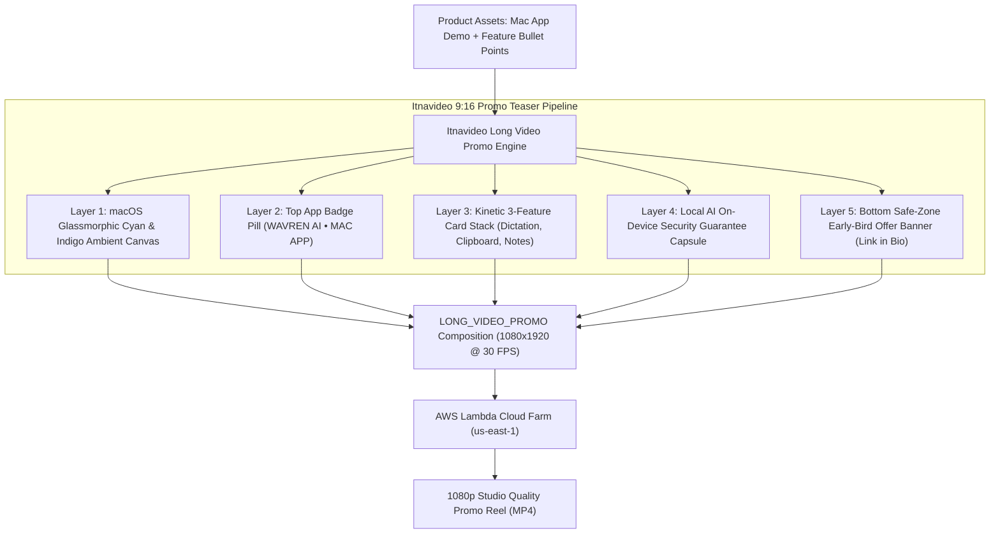
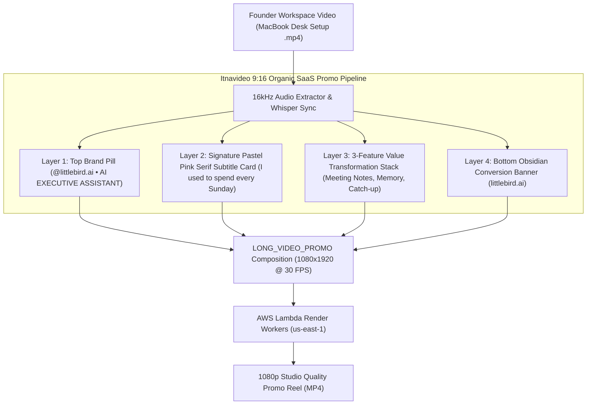
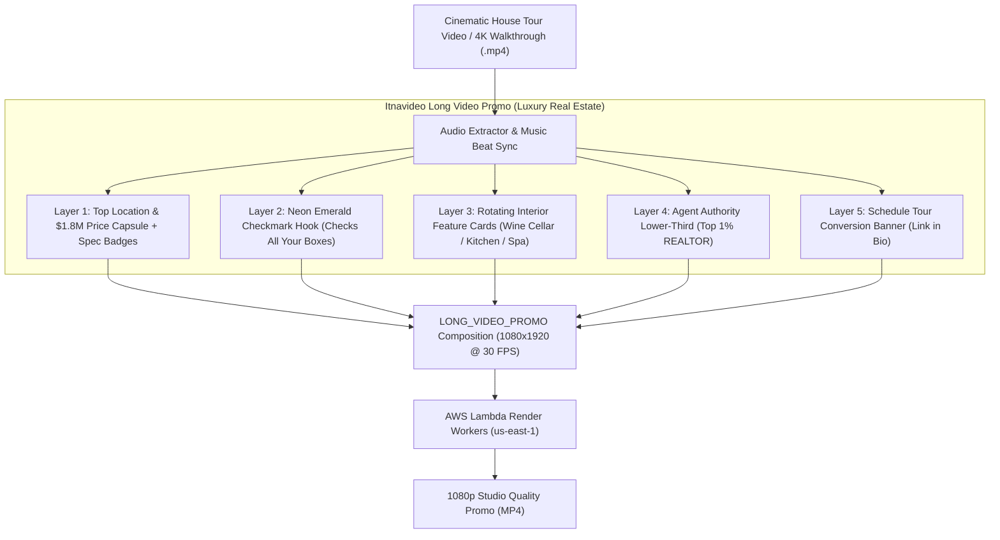
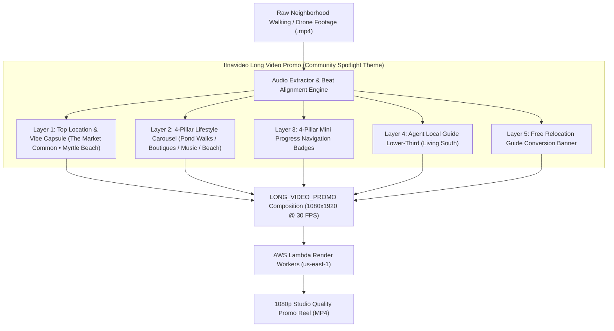
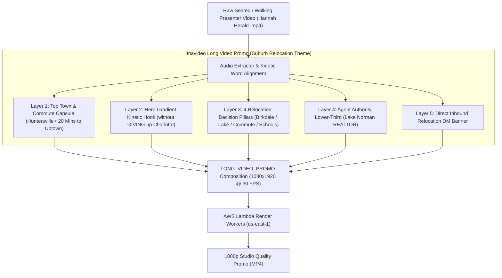
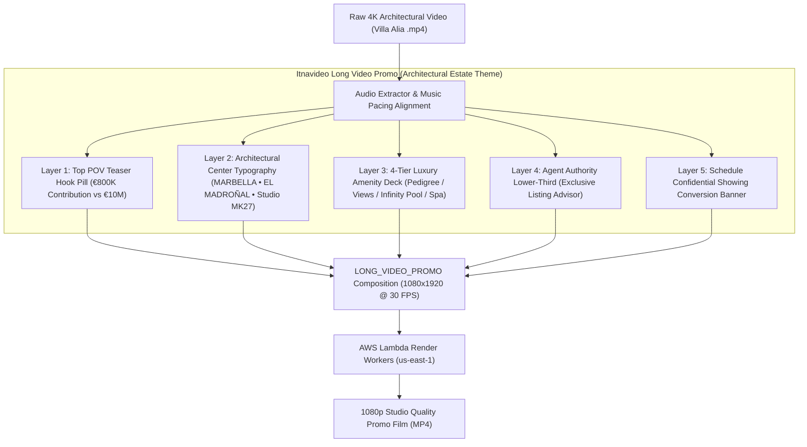

# Long Video Promo Generator — Studio Specification

## Overview

The **Long Video Promo Generator** (`longVideoPromo`) transforms full-length videos, songs, podcasts, and lectures into high-converting 9:16 vertical promotional teaser reels (`1080×1920` @ 30 FPS MP4) up to 90 seconds long. Styled like a movie trailer for digital content, it displays the video's custom YouTube thumbnail card, title badges, teaser video excerpts, and prominent watch prompts that drive viewers to click through to the complete long-form upload.

- **Primary Purpose**: Promote long-form YouTube videos, podcasts, and courses on short-form feeds to drive traffic.
- **Target Audience**: YouTubers, podcasters, musicians, educators, and enterprise marketing teams.
- **Expected Output**: 1080p Full HD (`1080×1920`) 30 FPS vertical MP4 video.

---

## Table of Contents

1. [Overview](#overview)
2. [Features and Capabilities](#features-and-capabilities)
3. [User Workflow](#user-workflow)
4. [UI/UX Design and Components](#uiux-design-and-components)
5. [Colors, Typography and Design Tokens](#colors-typography-and-design-tokens)
6. [Technical Implementation](#technical-implementation)
7. [Business Logic, Duration and Credit Rules](#business-logic-duration-and-credit-rules)
8. [Error Handling and Edge Cases](#error-handling-and-edge-cases)
9. [Testing and Quality Assurance](#testing-and-quality-assurance)
10. [Developer Notes and Guardrails](#developer-notes-and-guardrails)

---

## 1. Features and Capabilities

- **Thumbnail Spotlight Card**: Prominently features the original 16:9 YouTube thumbnail card with subtle 3D tilt animation and drop shadows.
- **Auto YouTube Thumbnail Ingestion**: Creators can upload an image file or paste a YouTube URL to automatically extract the highest-resolution (`maxresdefault`) thumbnail.
- **Movie-Trailer Teaser Motion**: Slices and highlights the best 15-to-45 second video excerpt with animated progress countdown bars.
- **Kinetic Call-to-Action Overlays**: Clear on-screen watch prompts ("Watch Full Video on YouTube", "Link in Bio", "Full Episode Out Now").
- **20 Standalone Kinetic Caption Styles**: Word-by-word synchronized subtitles with active-word color pops.
- **Multiple Background Modes**: Clean White Studio, Ambient Blur Backdrop, or Solid Obsidian.

---

## 2. User Workflow

The studio follows a guided 4-step workflow:

1. **Step 1: Upload (Thumbnail, Title & Promo Clip)**:
   - Creator enters video title (max 80 characters).
   - Uploads 16:9 thumbnail image or pastes a YouTube URL.
   - Uploads the promo video excerpt (up to 90 seconds).
2. **Step 2: Music & Audio Design**:
   - Selects background music from 14 curated AWS S3 tracks.
   - Sets background music volume with auto-ducking to maintain vocal clarity.
3. **Step 3: Caption Style & Background Mode**:
   - Chooses animated typography preset (Pop Word, Slam, Zoom Punch).
   - Selects background mode (`White Studio`, `Ambient Blur`, `Obsidian Solid`).
4. **Step 4: Live Phone Preview & Render**:
   - Interactive 9:16 phone simulator previews the thumbnail card and teaser playback.
   - Creator clicks **Render 1080p Promo Reel** to execute AWS Lambda cloud rendering.

---

## 3. UI/UX Design and Components

- **Studio Route**: `/dashboard/long-video-promo`
- **Frontend Studio Component**: `components/dashboard/LongVideoPromoStudio.tsx`
- **Public SEO Landing Page**: `/long-video-promo` (`app/long-video-promo/page.tsx`)
- **Design Structure**: Pure White canvas (`#FFFFFF`) with fine borders (`#E2E8F0`) and responsive 3-row layout (`Stepper Header`, `Preview Work Area`, `Sticky Action Bar`).

---

## 4. Colors, Typography and Design Tokens

- **Canvas Background**: Pure White (`#FFFFFF`) with subtle slate background accents (`#F8FAFC`).
- **Primary Brand Accent**: Sunset Orange (`#FF5722` / `#F97316`) for active controls and primary CTA buttons.
- **Secondary Tone**: Violet Purple (`#7C3AED`) for teaser badges.
- **Typography**: Inter / System Sans-serif stack (`font-sans`).

---

## 5. Technical Implementation

- **Video Type ID**: `longVideoPromo` / `LONG_VIDEO_PROMO`
- **Remotion Composition ID**: `LONG-VIDEO-PROMO` (`1080×1920` @ 30 FPS)
- **Remotion Template Directory**: `remotion/templates/LONG_VIDEO_PROMO/`
- **Speech Extraction**: Extracted 16kHz mono audio processed via Groq Whisper Cloud API (when promo clip includes dialogue).
- **Render Engine**: AWS Lambda running Remotion cloud workers in `us-east-1`.

---

## 6. Business Logic, Duration and Credit Rules

- **Aspect Ratio**: Strictly 9:16 Vertical Only (`1080×1920`).
- **Maximum Output Duration**: Strictly **90 Seconds Max (90s / 2,700 frames @ 30 FPS)**.
- **Credit Billing**: **Strictly 1 Credit** per video (Master Rule 4.1 for 9:16 Short-Form).
- **Draft Preview**: 100% Free interactive browser preview before rendering.

---

## 7. Error Handling and Edge Cases

- **Invalid YouTube URL**: Client-side regex validates YouTube URL format before fetching thumbnail metadata.
- **Missing Thumbnail**: Fallback creates a clean procedural title card with author branding.
- **Render Interruption**: Credits are automatically refunded if cloud rendering encounters an AWS Lambda timeout.

---

## 8. Testing and Quality Assurance

- **Typecheck Verification**: `npx tsc --noEmit` verifies all promo props and composition interfaces.
- **Thumbnail Aspect Fit**: Confirm that 16:9 thumbnail fits without distorting or clipping critical text.
- **CTA Legibility**: Confirm that the bottom watch prompt remains legible on small smartphone viewports.

---

## 9. Developer Notes and Guardrails

- **Zero Local Rendering (Rule 0)**: Never execute local Remotion renders on developer machines; all rendering executes on AWS Lambda.
- **YouTube Thumbnail Safety**: Remote thumbnail URLs must route through allowed next/image image domains or Cloudinary proxy.

---

## 10. Reverse-Engineering Benchmark 01: Wavren AI (@wavren.ai) — "Mac Voice-to-Text & Meeting Notes" (SaaS Product Teaser & Feature-Spotlight Architecture)

### 10.1 Source Attribution & Benchmark Telemetry

| Parameter | Value |
| :--- | :--- |
| **Original URL** | `https://www.instagram.com/p/Df638jCg8cI/` |
| **Creator / Channel** | Wavren AI (`@wavren.ai` \| `wavren.ai`) |
| **Product / Topic** | *"Wavren AI is a Mac app that turns your voice into text and your meetings into notes."* |
| **Engagement Telemetry** | Early-bird product launch, Black Friday offer, high B2B developer reach |
| **Video Format / Ratio** | 9:16 Vertical (`1080×1920` @ 30 FPS) |
| **Video Duration** | ~35 seconds (Strictly within the 90s Promo limit) |
| **Itnavideo Mapping** | `longVideoPromo` Studio (`/dashboard/long-video-promo`) |
| **Credit Billing** | **Strictly 1 Credit** flat (Master Rule 4.1 for 9:16 Short-Form) |
| **Watermark Enforcement** | `<BrandWatermark watermark={watermark} />` (Enforced for free/trial users) |

---

### 10.2 Core Creative Mechanics: The SaaS Feature-Spotlight & Privacy Teaser Formula

Wavren AI's promo reel demonstrates how modern SaaS founders and developers convert short-form video viewers into software downloads and trial signups:

1. **Top Platform & Product Pill (0:00–0:04)**:
   - Immediately identifies the niche: `⚡ WAVREN AI • MAC APP • LOCAL ON-DEVICE AI`.
   - Mac users instantly perk up because utility software tailored to macOS keyboard shortcuts (fn key, Command-Shift) has very high perceived value.
2. **The "Faster Than Typing" Core Value Proposition**:
   - Headline: *"Turns Your Voice into Text & Meetings into Notes"*.
   - Explains the solution in plain English in under 3 seconds without technical jargon.
3. **The 3-Bullet Feature Stack (Kinetic Card Carousel)**:
   - **Feature 1 (Dictation)**: *"Hold fn key and talk. Wavren types into whatever app you’re in. Faster than typing."*
   - **Feature 2 (Power Clipboard)**: *"Your last nine copies stay ready. ⌘⇧1 pastes the latest, all the way to ⌘⇧9."*
   - **Feature 3 (Meeting Notes)**: *"Join a call and a pop-up offers to take notes. Live transcript + structured notes."*
4. **The Privacy-First Objection Killer**:
   - Badge: `🔒 100% Local Privacy • Data Never Leaves Your Mac`.
   - Directly neutralizes corporate and privacy anxieties regarding cloud transcription.
5. **Irresistible Early-Bird Conversion Offer**:
   - *"Black Friday early-bird offer: 6 months of Pro free, then $9.99/month. Free plan: unlimited dictation. No card needed. Link in bio."*

---

### 10.3 System Architecture & 9:16 SaaS Promo Pipeline

---

### 10.4 Visual Design Tokens & Safe-Zone Spacing

- **Aspect Ratio**: `1080 × 1920` (9:16 Vertical).
- **Top Safe Zone**: `140px` padding (accommodates app pill and headline).
- **Bottom Safe Zone**: `230px` padding (clears Instagram Reels interaction buttons).
- **Palette Tokens**:
  - `Electric Cyan`: `#06B6D4` (Primary brand accent, card borders, icons)
  - `macOS Indigo`: `#6366F1` (Glow nebulae, secondary buttons)
  - `Deep Obsidian`: `#090D16` (High-contrast dark canvas)
  - `Privacy Emerald`: `#10B981` (On-device security pill)
  - `Pure White`: `#F8FAFC` (Card headings)

---

### 10.5 Second-by-Second Cinematic Scene Breakdown

| Second | Visual Layer (1080×1920) | On-Screen Graphic & Feature Callout | Audio & Voiceover Pacing |
| :--- | :--- | :--- | :--- |
| **0:00–0:05** | Top pill slams in with ambient cyan glow: `⚡ WAVREN AI • MAC APP`. Main headline appears: *"Turns Your Voice into Text & Meetings into Notes"*. | Spotlight Card 1 slides from left: `🎤 Instant Voice Dictation`. | Keyboard typing sound abruptly stops, replaced by smooth voice chime. Voiceover: *"Typing is officially the slowest way to get your thoughts onto your Mac."* |
| **0:05–0:12** | Screen recording shows user holding fn key in Slack / Notion while spoken words appear instantly with zero lag. | Subtitle: *"Hold fn key and talk. Types faster than you can type."* | Fast mechanical keyboard typing sound. Voiceover: *"With Wavren, just hold your fn key and talk. It types directly into whatever app you're in."* |
| **0:12–0:20** | Card 2 highlights: `📋 9-Slot Power Clipboard`. Animation demonstrates `⌘⇧1` to `⌘⇧9` hotkeys pasting previous snippets. | Subtitle: *"Your last nine copies stay ready in memory."* | Soft digital clipboard click. Voiceover: *"And its built-in clipboard keeps your last 9 copies ready. Press Command-Shift-1 to paste the latest."* |
| **0:20–0:28** | Card 3 activates: `📝 Zero-Lag Meeting Notes`. Screen shows Google Meet / Zoom pop-up generating live bullet points. | Subtitle: *"Live transcript + automated meeting summaries."* | Gentle notification chime. Voiceover: *"When you hop on a meeting, it automatically takes notes and generates action items without awkward bots joining your call."* |
| **0:28–0:35** | Security capsule illuminates: `🔒 100% Local Privacy`. Bottom gradient offer banner expands: `EARLY-BIRD: 6 MONTHS PRO FREE`. | Callout: `👉 Link in bio · wavren.ai (No Card Needed)`. | Uplifting synth swell. Voiceover: *"Best of all, everything runs 100% locally on your Mac. Get 6 months of Pro free right now. Link in bio."* |

---

### 10.6 Remotion Component Implementation

- **Asset Component**: `remotion/components/library/SaaSProductPromoTeaserAsset.tsx`
- **Component Export**: Exported in `remotion/components/library/index.ts` (`SaaSProductPromoTeaserAsset`, `SaaSProductPromoTeaserAssetProps`, `SaaSFeatureBullet`).
- **Catalog Registry**: Registered in `constants/itnavideoStockAssets.ts` under ID `saas-product-promo-teaser-engine`.
- **Key Capabilities**:
  - Full `1080×1920` 9:16 layout calibrated for software teasers, digital products, and macOS app promos.
  - Interactive 3-card feature stack with spring entrance animations.
  - On-device privacy guarantee capsule and early-bird offer pill.
  - Mobile safe-zone compliance (140px top, 230px bottom).
  - Zero local heavy compute dependencies — 100% pure React/Remotion code ready for AWS Lambda cloud rendering.

---

## 11. Reverse-Engineering Benchmark 02: LittleBird AI — Organic Founder Story & AI Assistant Promo Teaser (Pink Pastel Serif Subtitle & Workflow Transformation Architecture)

### 11.1 Source Attribution & Benchmark Telemetry

| Parameter | Value |
| :--- | :--- |
| **Original URL** | `https://www.instagram.com/p/DfYTdbLg1AP/` |
| **Creator / Channel** | LittleBird AI (`@littlebird.ai` \| AI Executive Assistant) |
| **Topic / Hook** | *"Get an AI assistant that actually works. Upgrade to Plus today and unlock unlimited meeting notes, deeper memory, and an assistant that's already caught up. I used to spend every Sunday..."* |
| **Engagement Telemetry** | High-intent B2B / solopreneur conversion teaser, organic social performance |
| **Video Format / Ratio** | 9:16 Vertical (`1080×1920` @ 30 FPS, Founder MacBook Setup) |
| **Video Duration** | ~32 seconds (Strictly within the 90s Short-Form limit) |
| **Itnavideo Mapping** | `longVideoPromo` Studio (`/dashboard/long-video-promo`) |
| **Credit Billing** | **Strictly 1 Credit** flat (Master Rule 4.1 for 9:16 Short-Form) |
| **Watermark Enforcement** | `<BrandWatermark watermark={watermark} />` (Enforced for free/trial users) |

---

### 11.2 Core Creative Mechanics: The Aesthetic Founder Story & Pastel Serif Hook Model

LittleBird AI's organic teaser demonstrates the modern paradigm of high-converting B2B and consumer SaaS video marketing:

1. **Aesthetic Warm Workspace Naturalism**:
   - Soft window daylight filtering through cream sheer drapes (`#FAF8F5`).
   - Founder seated at a rich wood desk wearing a soft pink cashmere cardigan, with a Space Gray MacBook positioned in foreground.
   - Eliminates generic cold tech graphics in favor of warm, relatable, human-centered luxury minimalism.
2. **Signature Pink Pastel Serif Subtitle Block**:
   - High-contrast editorial hook positioned prominently in the lower quadrant:
     - Card background: Soft powder pink (`#FBCFE8` / `#F472B6`) with subtle shadow.
     - Headline text: Bold black luxury editorial serif (`Playfair Display` / `Newsreader`):
       - Line 1: `I used to spend`
       - Line 2: `every Sunday`
   - Immediately sparks curiosity: *"Spend every Sunday doing what?"* — hooking founders who dread Sunday planning fatigue.
3. **Structured 3-Pillar Value Proposition**:
   - **Feature 01 (Unlimited Meeting Notes)**: Eliminates manual note-taking during Zoom and Google Meet calls.
   - **Feature 02 (Deeper Contextual Memory)**: The AI remembers historical client conversations, past agreements, and milestones.
   - **Feature 03 (Always Caught Up)**: Generates automated 60-second briefing memos before every scheduled call so founders are never underprepared.
4. **Organic Product Transformation Framing**:
   - Contrasts the exhausting manual past (wasting entire weekends sorting notes and writing follow-ups) against the effortless automated present.
5. **High-Converting Dark CTA Badge**:
   - Direct conversion prompt: `Get an assistant that actually works ✦ littlebird.ai`, driving immediate profile visits and Plus tier upgrades.

---

### 11.3 System Architecture & 9:16 Organic SaaS Promo Pipeline

---

### 11.4 Visual Design Tokens & Safe-Zone Spacing

- **Aspect Ratio**: `1080 × 1920` (9:16 Vertical).
- **Top Safe Zone**: `135px` padding (accommodates top brand pill and pastel card).
- **Bottom Safe Zone**: `220px` padding (clears Instagram Reels interaction buttons).
- **Palette Tokens**:
  - `Pastel Powder Pink`: `#FBCFE8` (Signature hook card surface)
  - `Deep Obsidian`: `#0F172A` / `#18181B` (Headlines and bottom CTA surface)
  - `Blush Magenta`: `#BE185D` / `#9D174D` (Brand tag accent)
  - `Warm Parchment`: `#FAF8F5` (Studio backdrop canvas)
  - `Pure White`: `#FFFFFF` (Feature card container)

---

### 11.5 Second-by-Second Cinematic Scene Breakdown

| Second | Visual Framing (1080×1920) | On-Screen Graphic & Feature Callout | Audio & Voiceover Pacing |
| :--- | :--- | :--- | :--- |
| **0:00–0:05** | Founder sits at wood desk looking into camera; pastel pink serif card illuminates: `I used to spend every Sunday`. | Brand Tag: `@littlebird.ai • AI EXECUTIVE ASSISTANT`. Subtitle: *"I used to spend every Sunday doing admin work."* | Intimate, conversational voiceover. *"I used to spend literally every single Sunday planning my week, organizing meeting notes, and summarizing calls."* |
| **0:05–0:12** | Camera does a slow 5% push-in toward MacBook; Feature Card 01 slides in: `📝 Unlimited Meeting Notes`. | Subtitle: *"Auto-joins calls with instant structured summaries."* | Soft chime. Voiceover: *"Until I switched to LittleBird. Now, the minute my calls end, my notes and action items are already done."* |
| **0:12–0:19** | Feature Card 02 illuminates: `🧠 Deeper Contextual Memory`. | Subtitle: *"Remembers past client calls, projects, and deadlines."* | Warm acoustic background strum. Voiceover: *"It actually remembers context from three months ago across all my projects."* |
| **0:19–0:26** | Feature Card 03 highlights: `⚡ Always Caught Up`. | Subtitle: *"Instant catch-up briefs before every call."* | Uplifting tempo. Voiceover: *"Before any meeting, it gives me a 30-second brief so I'm already caught up."* |
| **0:26–0:32** | Bottom obsidian CTA illuminates: `Get an assistant that actually works ✦ littlebird.ai`. | Gentle glow on pastel card. Subtitle: *"Upgrade to Plus today."* | Clear conversion finish. Voiceover: *"Stop wasting your weekends on admin. Upgrade to LittleBird Plus today and get your time back."* |

---

### 11.6 Remotion Component Implementation

- **Asset Component**: `remotion/components/library/OrganicSaaSPromoCardAsset.tsx`
- **Component Export**: Exported in `remotion/components/library/index.ts` (`OrganicSaaSPromoCardAsset`, `OrganicSaaSPromoCardAssetProps`, `SaasFeatureItem`).
- **Catalog Registry**: Registered in `constants/itnavideoStockAssets.ts` under ID `organic-saas-promo-card-engine`.
- **Key Capabilities**:
  - Full `1080×1920` 9:16 layout calibrated for organic founder-led SaaS teasers, solopreneur tools, and AI software launches.
  - Signature pastel pink subtitle card with luxury serif typography (`Playfair Display` / `Newsreader`).
  - Transformation value stack highlighting 3 core SaaS capabilities (Meeting Notes, Contextual Memory, Always Caught Up).
  - High-conversion bottom obsidian banner (`littlebird.ai`).
  - Supports both transparent video overlay mode (`isOverlayMode`) and standalone aesthetic studio mode.
  - Zero local heavy compute dependencies — 100% pure React/Remotion code ready for AWS Lambda cloud rendering.

---

## 12. Luxury Real Estate Tour & Property Promo Architecture (Checks All Your Boxes / $1.8M Estate Showcase)

### 12.1 Inspiration & Core Reference
- **Source Reel**: [Kelsie Blevins (@_k.elsie)](https://www.instagram.com/reel/DbLDJGzRNLv/)
- **Creator Profile**: Kelsie Blevins — Top 1% REALTOR® in Denver, NC & Lake Norman, Realty Executives.
- **Listing Showcase**: Webb's Chapel Cove Estate ($1,800,000 | 5,455 SQ FT | 4.5 Acres | 4 Beds, 6 Baths).
- **Core Hook**: Glowing emerald checkmark badge: `[ ✔ ]` + clean editorial headline: `your boxes.` (*"A luxury custom home that checks all your boxes"*).
- **Studio Mapping**: **Long Video Promo (`longVideoPromo`)** / High-Ticket Real Estate Showcase

---

### 12.2 Visual Anatomy & Conversion Mechanics

1. **Top Location & Price Capsule with Spec Badges**:
   - Anchored at `Y = 100px`: Frosted dark slate container (`rgba(15, 23, 42, 0.88)`).
   - Estate title: `Webb's Chapel Cove Estate • Denver, NC`.
   - Emerald price tag: `$1,800,000` (`#10B981` ➔ `#059669`).
   - Horizontal Spec Pills: `5,455 SQ FT` | `4.5 ACRES` | `4 BEDS • 6 BATHS` | `NO CITY TAXES`.

2. **Signature Glowing Checkmark Hook**:
   - Emerald square pill (`#10B981`) with intense neon bloom glow (`0 0 50px rgba(16, 185, 129, 0.85)`).
   - High-fashion editorial typography: `your` (lightweight clean serif/sans) + `boxes.` (bold high-contrast sans).
   - Instantly qualifies luxury buyers and commands high watch-time.

3. **Rotating Interior Feature Card Carousel (Tour B-Roll Overlay)**:
   - Rotates through key architectural focal points:
     - 🍷 *Custom Arched Glass Wine Cellar with Dedicated Wine Fridge*
     - 🍳 *18ft Vaulted Gourmet Kitchen with Double Oven & Walk-in Butler Pantry*
     - 🛁 *Main Level Primary Spa Suite with Freestanding Soaking Tub & Private Patio*
     - 🚗 *4-Car Garage with Smart Doors & Climate-Controlled Workshop*
     - 🌲 *4.5 Gated Flat Usable Acres in Denver's Most Coveted Community*

4. **Agent Authority Lower-Third**:
   - Frosted glass badge displaying `Kelsie Blevins • Top 1% REALTOR® • Realty Executives Lake Norman`.
   - Contact phone number pill: `828-221-6070`.

5. **High-Conversion Call to Action**:
   - Bottom emerald banner: `Schedule Private Tour 🔑 Link in Bio for 3D Walkthrough`.

---

### 12.3 System Architecture & 9:16 Property Promo Pipeline

---

### 12.4 Visual Design Tokens & Safe-Zone Spacing

- **Aspect Ratio**: `1080 × 1920` (9:16 Vertical).
- **Top Safe Zone**: `100px` padding (accommodates top price capsule).
- **Center Hook Placement**: `Y = 360px` (clears presenter face, overlays driveway/sky).
- **Tour Feature Card**: Anchored at `Y = 1450px` (`bottom: 350px`).
- **Bottom Safe Zone**: `120px` padding (clears Instagram interaction overlay).
- **Color Tokens**:
  - `Emerald Primary`: `#10B981` / `#059669` (Checkmark, Price, CTA)
  - `Neon Bloom`: `rgba(16, 185, 129, 0.85)` (Checkmark glow)
  - `Dark Slate Frosted`: `rgba(15, 23, 42, 0.88)`
  - `Pure White`: `#FFFFFF`
  - `Muted Silver`: `#94A3B8` / `#CBD5E1`

---

### 12.5 Second-by-Second Cinematic Scene Breakdown

| Second | Visual Framing (1080×1920) | On-Screen Graphic & Kinetic Subtitle | Audio & Voiceover Pacing |
| :--- | :--- | :--- | :--- |
| **0:00–0:04** | Presenter stands on estate driveway; Top Capsule drops: `Webb's Chapel Cove • $1,800,000`. Glowing checkmark blooms: `your boxes.`. | Checkmark pulses. Subtitle: *"If you're looking for an estate that checks all your boxes..."* | Upbeat, luxurious introduction. Voiceover: *"If you're looking for an estate that checks all your boxes, welcome to Webb's Chapel Cove."* |
| **0:04–0:09** | B-roll cuts to custom double-sided arched glass wine cellar. Feature Card 01 slides in: `🍷 Custom Arched Wine Cellar`. | Subtitle: *"A custom built-in wine cellar framed by double-sided arched glass doors."* | Smooth, inviting tone. Voiceover: *"Featuring a custom built-in wine cellar with a dedicated wine fridge."* |
| **0:09–0:14** | B-roll transitions to gourmet kitchen. Feature Card 02 slides in: `🍳 18ft Vaulted Gourmet Kitchen`. | Subtitle: *"18-foot ceilings with double ovens and full butler pantry."* | Elevated, grand cadence. Voiceover: *"Gourmet kitchen with double ovens and soaring 18-foot ceilings."* |
| **0:14–0:19** | B-roll transitions to primary bath. Feature Card 03 slides in: `🛁 Main Level Primary Spa Suite`. | Subtitle: *"Freestanding soaking tub and private covered patio."* | Relaxing cadence. Voiceover: *"Main level primary suite with spa-inspired bath and private covered patio."* |
| **0:19–0:24** | B-roll drone shot of 4.5 flat wooded acres. Feature Card 04 slides in: `🌲 4.5 Gated Flat Usable Acres`. | Subtitle: *"Set on 4.5 flat usable acres with zero city taxes."* | Highlighting unique value. Voiceover: *"Set on 4.5 flat usable acres with no city taxes, minutes from Lake Norman."* |
| **0:24–0:28** | Presenter reappears; Agent Badge and Bottom CTA illuminate: `Schedule Private Tour 🔑 Link in Bio for 3D Walkthrough`. | Emerald banner glows. Subtitle: *"Click the link in bio to schedule your private tour."* | Strong closing conversion CTA. Voiceover: *"Offered at 1.8 million. Tap the link in bio for the full 3D tour or to schedule a private showing."* |

---

### 12.6 Remotion Component Implementation

- **Asset Component**: `remotion/components/library/LuxuryEstateTourPromoAsset.tsx`
- **Component Export**: Exported in `remotion/components/library/index.ts` (`LuxuryEstateTourPromoAsset`, `LuxuryEstateTourPromoAssetProps`, `EstateFeatureItem`).
- **Catalog Registry**: Registered in `constants/itnavideoStockAssets.ts` under ID `luxury-estate-tour-promo-engine`.
- **Key Capabilities**:
  - Full `1080×1920` 9:16 layout calibrated for high-ticket property walkthroughs, estate showcases, and developer marketing.
  - Signature glowing emerald checkmark pill hook with high-fashion editorial typography (`checks all your boxes`).
  - Top estate location capsule with price badge ($1.8M) and 4-tier spec pills (5,455 SQ FT / 4.5 Acres / 4 Beds, 6 Baths / 0% City Taxes).
  - Rotating interior architectural feature card carousel designed to overlay cinematic B-roll.
  - Agent authority lower-third badge with name, title, and contact phone number.
  - Bottom conversion CTA banner directing viewers to link in bio / 3D walkthrough.
  - Zero local heavy compute dependencies — 100% pure React/Remotion code ready for AWS Lambda cloud rendering.

---

## 13. Neighborhood Lifestyle & Coastal Community Spotlight Architecture (The Market Common / Leslie Perkins Benchmark)

### 13.1 Source Attribution & Benchmark Telemetry

| Parameter | Value |
| :--- | :--- |
| **Original URL** | `https://www.instagram.com/reel/DW1tczKDqSC/` |
| **Creator / Channel** | Leslie Perkins (`@leslie_perkins_realtor` \| Myrtle Beach Realtor, Living South) |
| **Topic / Hook** | *"Living in The Market Common feels like having everything you love right outside your door... a lifestyle that blends charm and convenience effortlessly."* |
| **Engagement Telemetry** | **2,850+ Likes**, 64 Comments, High Community Share Velocity |
| **Visual Staging** | Presenter standing under a white coastal courtyard pergola with palm trees and Southern colonial architecture in the background. |
| **Video Format / Ratio** | 9:16 Vertical (`1080×1920` @ 30 FPS, Presenter Walking / Community Showcase) |
| **Video Duration** | ~35 seconds (Strictly within the 90s Short-Form limit) |
| **Itnavideo Mapping** | `longVideoPromo` Studio (`/dashboard/long-video-promo`) |
| **Credit Billing** | **Strictly 1 Credit** flat (Master Rule 4.1 for 9:16 Short-Form) |
| **Watermark Enforcement** | `<BrandWatermark watermark={watermark} />` (Enforced for free/trial users) |

---

### 13.2 Core Creative Mechanics: The Community Lifestyle Model

1. **Top Community & Location Header Capsule**:
   - Location: `📍 The Market Common • Myrtle Beach, South Carolina`.
   - Vibe Tag: `COASTAL WALKABLE LIVING`.
   - Frosted obsidian container with sky blue icon accent (`🌴`).

2. **4-Pillar Walkable Lifestyle Carousel**:
   - Rotates through key daily rituals that define the neighborhood's appeal:
     - ☕ **Morning Rituals**: *Scenic walking trails surrounding the central lake with artisanal bakeries and morning coffee right outside your door.*
     - 🛍️ **Walkable Charm**: *Stroll down palm-lined sidewalks to local designer boutiques, movie theater, and top chef-driven restaurants.*
     - 🎵 **Community Vibe**: *Active community atmosphere with farmers markets, outdoor concerts, and dog-friendly neighborhood parks.*
     - 🏖️ **Coastal Access**: *Low-maintenance coastal living with quick access to Myrtle Beach oceanfront, state parks, and golf greens.*

3. **Coastal Linen Aesthetic Tokens**:
   - Warm sky blue (`#0284C7` / `#38BDF8`) paired with soft emerald undertones and frosted dark slate surfaces.
   - Clean, airy sans-serif typography with generous line-height to evoke Southern coastal ease.

4. **Agent Local Guide Lower-Third**:
   - Executive badge: `Leslie Perkins • Myrtle Beach REALTOR® • Living South`.
   - Phone pill: `+1 (843) 360-0089`.

5. **Relocation Guide Lead Magnet CTA**:
   - Bottom conversion banner: `Get the Free Market Common Relocation Guide 🌴 Link in Bio`.

---

### 13.3 System Architecture & 9:16 Neighborhood Promo Pipeline

---

### 13.4 Visual Design Tokens & Safe-Zone Spacing

- **Aspect Ratio**: `1080 × 1920` (9:16 Vertical).
- **Top Safe Zone**: `100px` padding (accommodates top community capsule).
- **Lifestyle Card Placement**: `Y = 980px`.
- **Bottom Safe Zone**: `120px` padding (clears interaction buttons).
- **Color Tokens**:
  - `Coastal Sky Blue`: `#0284C7` / `#38BDF8` (Primary brand accent, glowing card border)
  - `Ocean Emerald`: `#10B981` (Accent highlights)
  - `Dark Slate Surface`: `rgba(15, 23, 42, 0.92)`
  - `Pure White`: `#FFFFFF`
  - `Muted Silver`: `#94A3B8` / `#CBD5E1`

---

### 13.5 Second-by-Second Cinematic Scene Breakdown

| Second | Visual Layer (1080×1920) | On-Screen Graphic & Kinetic Subtitle | Audio & Voiceover Pacing |
| :--- | :--- | :--- | :--- |
| **0:00–0:05** | Presenter stands under pergola with palm trees; Top Capsule drops: `The Market Common • Myrtle Beach`. | Sky blue aura glows. Subtitle: *"Living in The Market Common feels like having everything you love outside your door."* | Warm, welcoming Southern cadence. Voiceover: *"Living in The Market Common feels like having everything you love right outside your front door."* |
| **0:05–0:12** | B-roll cuts to morning walk along the central lake. Lifestyle Card 01 slides in: `☕ Pond Walks & Local Coffee`. | Subtitle: *"From morning walks along the beautiful pond to grabbing coffee..."* | Gentle acoustic background. Voiceover: *"From morning walks along the beautiful pond to grabbing your favorite local coffee..."* |
| **0:12–0:19** | B-roll transitions to open-air shopping and dining. Lifestyle Card 02 slides in: `🛍️ Boutiques & Open-Air Dining`. | Subtitle: *"Shopping local boutiques and dining at top restaurants."* | Upbeat tempo. Voiceover: *"...shopping local boutiques, and enjoying dinner and live music on the patio."* |
| **0:19–0:26** | B-roll transitions to dog park and green trails. Lifestyle Card 03 slides in: `🎵 Live Music & Seasonal Events`. | Subtitle: *"A vibrant neighborhood feel with parks and walking trails."* | Relaxed, community-oriented cadence. Voiceover: *"With walking trails, parks, and a true sense of community, it blends charm and convenience effortlessly."* |
| **0:26–0:35** | Presenter reappears; Agent Badge and Guide CTA illuminate: `Get the Free Market Common Relocation Guide 🌴 Link in Bio`. | Sky blue banner pulses. Subtitle: *"Whether you're looking for low-maintenance living or a vibrant neighborhood..."* | Encouraging closing CTA. Voiceover: *"Whether you're looking for low-maintenance coastal living or a vibrant community, let's talk. Tap the link in bio for the full neighborhood guide."* |

---

### 13.6 Remotion Component Implementation

- **Asset Component**: `remotion/components/library/NeighborhoodLifestylePromoAsset.tsx`
- **Component Export**: Exported in `remotion/components/library/index.ts` (`NeighborhoodLifestylePromoAsset`, `NeighborhoodLifestylePromoAssetProps`, `LifestylePillarItem`).
- **Catalog Registry**: Registered in `constants/itnavideoStockAssets.ts` under ID `neighborhood-lifestyle-promo-engine`.
- **Key Capabilities**:
  - Full `1080×1920` 9:16 layout calibrated for community spotlights, neighborhood walking tours, city guides, and local tourism promos.
  - Top community & city header capsule with customizable vibe tag (`Coastal Walkable Living`) and mini-pillar progress pills.
  - 4-pillar lifestyle card carousel detailing daily local rituals (coffee, shopping, live music, beach access) overlaying walking or B-roll footage.
  - Translucent agent authority lower-third and free relocation guide conversion CTA.
  - Zero local heavy compute dependencies — 100% pure React/Remotion code ready for AWS Lambda cloud rendering.

---

## 14. Suburb Relocation Guide & Commuter Haven Spotlight Architecture (Huntersville / Hannah Herald Benchmark)

### 14.1 Source Attribution & Benchmark Telemetry

| Parameter | Value |
| :--- | :--- |
| **Original URL** | `https://www.instagram.com/reel/DZSjpUxxFlb/` |
| **Creator / Channel** | Hannah Herald (`@hannahheraldrealtor` \| Lake Norman & Charlotte REALTOR®, Coldwell Banker) |
| **Topic / Hook** | *"If I were moving to the Lake Norman area today, Huntersville would be at the top of my list... without giving up Charlotte."* |
| **Engagement Telemetry** | **920+ Likes**, 27 Comments, High Buyer Lead Intent |
| **Visual Staging** | Presenter seated on a stone park bench in Birkdale Village surrounded by lush trees, flowerbeds, and sunny open-air atmosphere. |
| **Video Format / Ratio** | 9:16 Vertical (`1080×1920` @ 30 FPS, Talking Head / Suburb Guide) |
| **Video Duration** | ~32 seconds (Strictly within the 90s Short-Form limit) |
| **Itnavideo Mapping** | `longVideoPromo` Studio (`/dashboard/long-video-promo`) |
| **Credit Billing** | **Strictly 1 Credit** flat (Master Rule 4.1 for 9:16 Short-Form) |
| **Watermark Enforcement** | `<BrandWatermark watermark={watermark} />` (Enforced for free/trial users) |

---

### 14.2 Core Creative Mechanics: The "Top of My List" Relocation Model

1. **The "Top of My List" Suburb Authority Hook**:
   - Frames an expert recommendation: *"If I were moving to [Region] today, [Town] would be at the top of my list."*
   - Directly addresses the #1 relocation buyer hesitation: *Will I feel too far from the major city?*
   - Kinetic Hero Gradient Text: `without GIVING up Charlotte.` (Giant 94px extruded Magenta-Violet gradient verb: `#F43F5E` ➔ `#D946EF` ➔ `#A855F7`).

2. **Top Town & Commute Header Capsule**:
   - Anchored at `Y = 100px`: Frosted obsidian container (`rgba(15, 23, 42, 0.88)`).
   - Town Title: `Huntersville, NC • Top of My List`.
   - Commute Callout: `20 MINS TO UPTOWN CHARLOTTE`.

3. **4 Relocation Decision Pillars Carousel**:
   - Highlights why buyers choose this suburb:
     - 🛍️ **Lifestyle Hub**: *Birkdale Village walkability — outdoor shopping, green gathering spaces, artisan bakeries, and open-air dining.*
     - ⛵ **Waterfront Recreation**: *Instant Lake Norman access — minutes to public boat launches, paddleboarding, and waterfront parks.*
     - ⚡ **Frictionless Commute**: *20 Mins to Uptown Charlotte — quick highway access gives peaceful suburban living without sacrificing career hubs.*
     - 🏡 **Growth & Value**: *Top schools & family space — established tree-lined neighborhoods, larger lots, and top-rated schools.*

4. **Agent Local Specialist Lower-Third**:
   - Executive footprint pill: `Hannah Herald • Lake Norman REALTOR® • Coldwell Banker`.
   - Contact pill: `(828) 320-6411`.

5. **Direct Inbound Relocation CTA**:
   - Bottom conversion banner: `Considering a Move to Lake Norman? Send a DM & Let's Connect 📩`.

---

### 14.3 System Architecture & 9:16 Suburb Guide Pipeline

---

### 14.4 Visual Design Tokens & Safe-Zone Spacing

- **Aspect Ratio**: `1080 × 1920` (9:16 Vertical).
- **Top Safe Zone**: `100px` padding (accommodates top town capsule).
- **Hero Kinetic Typography Zone**: `Y = 260px - 440px`.
- **Decision Pillar Card**: `Y = 980px`.
- **Bottom Safe Zone**: `120px` padding (clears interaction buttons).
- **Color Tokens**:
  - `Magenta Rose`: `#F43F5E` / `#BE185D` (Hero gradient start, CTA background)
  - `Electric Orchid`: `#D946EF` (Hero gradient middle & card border)
  - `Violet Purple`: `#A855F7` (Hero gradient end & glowing aura)
  - `Dark Slate Surface`: `rgba(15, 23, 42, 0.92)`
  - `Pure White`: `#FFFFFF`

---

### 14.5 Second-by-Second Cinematic Scene Breakdown

| Second | Visual Layer (1080×1920) | On-Screen Graphic & Kinetic Subtitle | Audio & Voiceover Pacing |
| :--- | :--- | :--- | :--- |
| **0:00–0:05** | Presenter sits in park courtyard; Top Capsule drops: `Huntersville, NC • 20 MINS TO UPTOWN`. Hero Gradient slams: `without GIVING up Charlotte.`. | Magenta-violet bloom pulses. Subtitle: *"If I were moving to the Lake Norman area today, Huntersville would be at the top of my list."* | Confident, conversational advisor opening. Voiceover: *"If I were moving to the Lake Norman area today, Huntersville would be at the top of my list."* |
| **0:05–0:12** | B-roll cuts to Birkdale Village fountain and outdoor dining. Pillar Card 01 slides in: `🛍️ Birkdale Village Walkability`. | Subtitle: *"From weekends spent at Birkdale Village to incredible local restaurants..."* | Upbeat cadence. Voiceover: *"From weekends spent at Birkdale Village, to incredible local restaurants and boutiques..."* |
| **0:12–0:19** | B-roll transitions to Lake Norman shoreline & boats. Pillar Card 02 slides in: `⛵ Instant Lake Norman Access`. | Subtitle: *"Easy access to Lake Norman and outdoor recreation."* | Expansive, scenic cadence. Voiceover: *"...easy access to Lake Norman, and a quick, easy commute straight into Charlotte."* |
| **0:19–0:26** | B-roll cuts to master-planned neighborhood with lush trees. Pillar Card 03 slides in: `⚡ 20 Mins to Uptown Charlotte`. | Subtitle: *"The perfect mix of convenience, recreation, and community."* | Reassuring family tone. Voiceover: *"What I love most is that it offers the perfect mix of convenience, recreation, top schools, and true community."* |
| **0:26–0:32** | Presenter reappears; Agent Badge & Relocation CTA illuminate: `Considering a Move? Send a DM & Let's Connect 📩`. | Magenta banner pulses. Subtitle: *"Send me a message and let's find the right fit for your lifestyle."* | Strong closing conversion CTA. Voiceover: *"If you're considering a move to Lake Norman, send me a message and let's find the right fit for your lifestyle."* |

---

### 14.6 Remotion Component Implementation

- **Asset Component**: `remotion/components/library/SuburbRelocationGuideAsset.tsx`
- **Component Export**: Exported in `remotion/components/library/index.ts` (`SuburbRelocationGuideAsset`, `SuburbRelocationGuideAssetProps`, `RelocationPillarItem`).
- **Catalog Registry**: Registered in `constants/itnavideoStockAssets.ts` under ID `suburb-relocation-guide-engine`.
- **Key Capabilities**:
  - Full `1080×1920` 9:16 layout calibrated for suburb guides, relocation advisory reels, commuter haven reviews, and regional city rankings.
  - Signature extruded magenta-violet hero gradient kinetic typography (`without GIVING up Charlotte.`).
  - Top region/town header capsule with commute time badge (`20 MINS TO UPTOWN`).
  - 4-pillar relocation decision card carousel detailing lifestyle, recreation, commute, and schools.
  - Translucent agent authority lower-third and direct DM relocation inquiry conversion banner.
  - Zero local heavy compute dependencies — 100% pure React/Remotion code ready for AWS Lambda cloud rendering.

---

## 15. Ultra-Luxury Architectural Estate Film & POV Showcase Architecture (€10.8M Villa Alia Marbella / Rasa Bagdonaviciute Benchmark)

### 15.1 Source Attribution & Benchmark Telemetry

| Parameter | Value |
| :--- | :--- |
| **Original URL** | `https://www.instagram.com/reel/DYCqPDtodFC/` |
| **Creator / Channel** | Rasa Bagdonaviciute (`@rasa.bagd` \| Marbella Luxury Real Estate Advisor) |
| **Property Showcase** | Villa Alia in El Madroñal (Marbella, Spain) — €10,800,000 + IVA (~$11.8M USD) |
| **Architectural Pedigree** | Designed by Studio MK27 / Marcio Kogan (`@mkogan27` / `@studiomk27`) — 7 Beds, 8 Baths, 1,077 SqM |
| **Topic / Hook** | *"POV: when your contribution to the villa is €800,000... and your husband casually handles the other €10M."* |
| **Video Format / Ratio** | 9:16 Vertical (`1080×1920` @ 30 FPS, Cinematic Architectural Showcase) |
| **Video Duration** | ~30 seconds (Strictly within the 90s Short-Form limit) |
| **Itnavideo Mapping** | `longVideoPromo` Studio (`/dashboard/long-video-promo`) |
| **Credit Billing** | **Strictly 1 Credit** flat (Master Rule 4.1 for 9:16 Short-Form) |
| **Watermark Enforcement** | `<BrandWatermark watermark={watermark} />` (Enforced for free/trial users) |

---

### 15.2 Core Creative Mechanics: The Architectural Pedigree Model

1. **The "POV: Statement Acquisition" Viral Hook**:
   - Anchored at `Y = 100px`: Floating translucent pill (`rgba(15, 23, 42, 0.88)`).
   - Hook Copy: `POV: when your contribution is €800K... and he handles the other €10M`.
   - Combines relatable high-society humor with ultra-high-net-worth real estate aspiration.

2. **Cinematic Architectural Center Typography**:
   - Location: `MARBELLA, SPAIN` (34px uppercase tracking-4px).
   - Estate Name: `EL MADROÑAL` (Giant 88px uppercase bold architectural typography in crisp white).
   - Villa Name & Architect: `VILLA ALIA • Designed by Studio MK27` (22px soft gold tracking-wide).
   - Key Specs & Price Pill: `7 Bed | 8 Bath | 1,077 SqM | €10,800,000 + IVA`.

3. **4-Tier Ultra-Luxury Architectural Amenity Deck**:
   - 🏛️ **Architectural Pedigree**: *Marcio Kogan signature horizontal lines, raw natural materials, board-formed concrete, and floor-to-ceiling glass.*
   - 🌊 **Hillside Sanctuary**: *Set within a private gated enclave in El Madroñal with uninterrupted Mediterranean and mountain vistas.*
   - 🏊‍♂️ **Resort Living**: *Cantilevered horizon infinity pool and expansive limestone terraces seamlessly blending indoor-outdoor living.*
   - 🎬 **Private Retreat**: *Fully bespoke wellness sanctuary featuring indoor spa, commercial-grade fitness center, and acoustic cinema.*

4. **Agent Authority Lower-Third**:
   - Executive footprint pill: `Rasa Bagdonaviciute • Marbella Luxury Real Estate Advisor • Exclusive Listing`.

5. **Confidential Showing Inbound CTA**:
   - Bottom conversion banner: `Schedule Confidential Showing 🔑 Private Inquiries via DM`.

---

### 15.3 System Architecture & 9:16 Architectural Estate Pipeline

---

### 15.4 Visual Design Tokens & Safe-Zone Spacing

- **Aspect Ratio**: `1080 × 1920` (9:16 Vertical).
- **Top Safe Zone**: `100px` padding (accommodates top POV pill).
- **Architectural Center Zone**: `Y = 360px - 580px`.
- **Amenity Card Placement**: `Y = 980px`.
- **Bottom Safe Zone**: `120px` padding (clears interaction buttons).
- **Color Tokens**:
  - `Warm Architectural Gold`: `#F59E0B` / `#FCD34D` (Villa subtitle, Amenity icon glow)
  - `Emerald Valuation`: `#10B981` (Price in Euro)
  - `Dark Slate Frosted`: `rgba(15, 23, 42, 0.92)`
  - `Pure White`: `#FFFFFF`
  - `Muted Silver`: `#E2E8F0` / `#94A3B8`

---

### 15.5 Second-by-Second Cinematic Scene Breakdown

| Second | Visual Layer (1080×1920) | On-Screen Graphic & Kinetic Subtitle | Audio & Voiceover Pacing |
| :--- | :--- | :--- | :--- |
| **0:00–0:05** | Drone glides over El Madroñal hillside estate; Top POV Pill drops: `POV: when your contribution is €800K...`. Center Title fades in: `EL MADROÑAL • VILLA ALIA`. | Architectural title glows softly. Subtitle: *"A statement acquisition in El Madroñal designed by Studio MK27."* | Cinematic orchestral crescendo. Voiceover: *"A statement acquisition in El Madroñal, designed by Marcio Kogan and Studio MK27."* |
| **0:05–0:12** | Camera cuts to dining room with sculptural moon globes and panoramic valley view. Amenity Card 01 slides in: `🏛️ Architectural Pedigree: Studio MK27`. | Subtitle: *"Signature horizontal lines and floor-to-ceiling glass."* | Sophisticated, measured cadence. Voiceover: *"Known worldwide for signature horizontal lines, raw natural stone, and seamless indoor-outdoor living."* |
| **0:12–0:19** | B-roll transitions to cantilevered horizon infinity pool over Mediterranean sea. Amenity Card 02 slides in: `🌊 Hillside Sanctuary: Panoramic Views`. | Subtitle: *"Panoramic Mediterranean and mountain views in a gated community."* | Elevated, grand cadence. Voiceover: *"Set within a gated hillside community with panoramic Mediterranean and mountain views."* |
| **0:19–0:25** | B-roll transitions to private cinema and indoor wellness spa. Amenity Card 03 slides in: `🏊‍♂️ Resort Living: Spa, Gym & Cinema`. | Subtitle: *"Expansive terraces, private spa, gym, and cinema."* | Luxurious cadence. Voiceover: *"Featuring expansive limestone terraces, private spa, gym, and cinema filled with clean architectural detail."* |
| **0:25–0:30** | Drone pulls back revealing full 1,077 SqM estate; Agent Badge & Confidential CTA illuminate: `Schedule Confidential Showing 🔑 Private Inquiries via DM`. | Gold border pulses. Subtitle: *"Seven bedrooms, eight bathrooms. Offered at 10.8 million euros."* | Strong ultra-high-net-worth closing. Voiceover: *"Seven bedrooms, eight bathrooms. Offered at ten million eight hundred thousand euros. Confidential showings available via direct message."* |

---

### 15.6 Remotion Component Implementation

- **Asset Component**: `remotion/components/library/UltraLuxuryArchitecturalEstateAsset.tsx`
- **Component Export**: Exported in `remotion/components/library/index.ts` (`UltraLuxuryArchitecturalEstateAsset`, `UltraLuxuryArchitecturalEstateAssetProps`, `EstateAmenityItem`).
- **Catalog Registry**: Registered in `constants/itnavideoStockAssets.ts` under ID `ultra-luxury-architectural-estate-engine`.
- **Key Capabilities**:
  - Full `1080×1920` 9:16 layout calibrated for ultra-luxury villas, architectural estate films, high-net-worth property acquisitions, and celebrity real estate.
  - Floating top POV teaser pill (`when your contribution is €800K... and he handles the other €10M`).
  - High-impact architectural typography suite (`Marbella • EL MADROÑAL • Villa Alia • Studio MK27`).
  - 4-tier luxury amenity carousel detailing architectural pedigree, hillside views, horizon infinity pool, and private spa/cinema retreat.
  - Translucent agent authority lower-third and confidential showing conversion banner.
  - Zero local heavy compute dependencies — 100% pure React/Remotion code ready for AWS Lambda cloud rendering.

