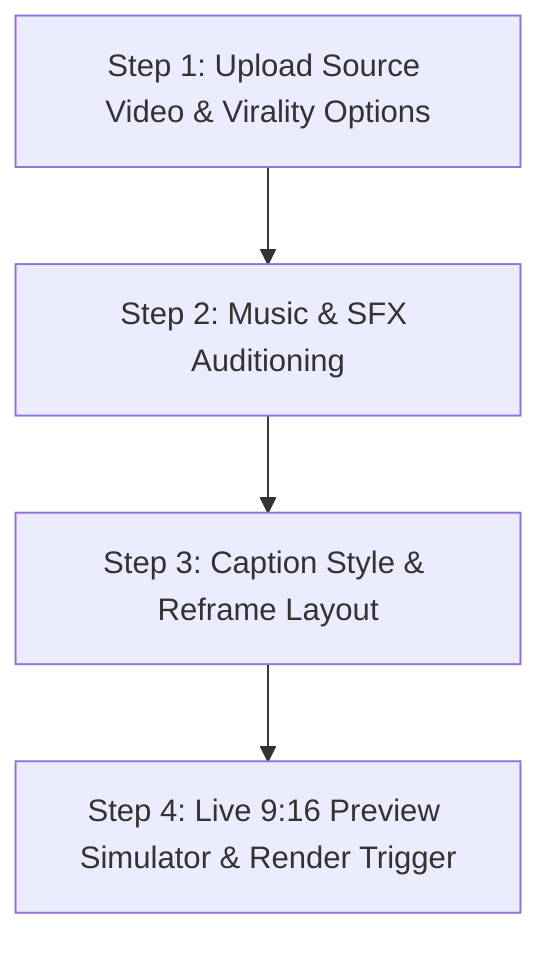

# Long Video to Viral Clips (`longvideoclips.md`)

## 1. Overview & Purpose
**Long Video to Viral Clips** automatically converts lengthy podcasts, YouTube videos, conference talks, and interviews into multiple bite-sized, vertical viral Shorts/Reels with automated subtitles. It uses Computer Vision active speaker face tracking to reframe horizontal 16:9 cameras into 9:16 vertical, evaluates speech density and emotional hooks to extract top moments, and renders 1080p Full HD MP4 clips.

---

## 2. Key Specifications & Limits

| Attribute | Specification |
| :--- | :--- |
| **Video Type ID** | `long-video-clips` / `LONG_VIDEO_CLIPS` |
| **Composition ID** | `LONG_VIDEO_CLIPS` |
| **Template Location** | `remotion/templates/LONG_VIDEO_CLIPS/template.tsx` |
| **Dashboard Studio** | `components/dashboard/LongVideoClipsStudio.tsx` |
| **Dashboard Route** | `/dashboard/long-video-clips` |
| **Aspect Ratio** | **9:16 Vertical Only** |
| **Resolution & Quality** | **1080×1920 (1080p Full HD)** |
| **Frame Rate** | 30 FPS MP4 |
| **Source Video Input** | Up to **2 Hours** (120 minutes / 7,200 seconds) |
| **Input Options** | Dual Input Mode: Direct Video File Upload (MP4, MOV, WEBM) or YouTube URL Paste |
| **Output Clip Length** | **AI Auto** (Flexible natural story arc), **Under 30s**, **30–60s**, **60–90s** |
| **Number of Clips** | **AI Recommended** (Auto-sizes based on content), **3 Clips**, **5 Clips**, **10 Clips** |
| **Primary Category** | Cinema & Long Form |
| **Credit Cost** | **Strictly 1 Credit / Clip** (1 clip = 1 credit, 3 clips = 3 credits, etc.) |
| **Design System** | Clean, Polished White Aesthetic (`bg-white`, `border-slate-200`, `text-slate-900`, `bg-slate-50`) + Material Design 3 |
| **Transcription Engine**| Extracted 16kHz mono audio stream → Groq Whisper Cloud API (Fallback: Google Gemini 2.0 Flash `asia-south1`) |
| **Rendering Rule** | Full video is **never rendered**. AWS Remotion Lambda renders strictly the selected viral clip segments in 9:16 vertical. |

---

## 3. User Inputs & Detection Controls

1. **Dual Source Input (Required)**:
   - **File Upload Tab**: Drag & drop or browse local MP4, MOV, or WEBM up to 3GB.
   - **YouTube Link Tab**: Paste URL (`https://youtube.com/watch?v=...` or `https://youtu.be/...`) with instant regex validation.
2. **Speaker Reframing & Layout Modes (Computer Vision)**:
   - **`Auto Active Speaker` (`auto-speaker`)**: MediaPipe face detection tracks active speaker with dynamic sentence-synced camera jump-cuts (+15% scale punch-in on alternating sentence beats).
   - **`Split Screen` (`split-screen`)**: 2-Person Podcast mode stacking Host in Top 50% (`objectPosition: center 32%` for natural headroom) and Guest in Bottom 50% (`objectPosition: center 68%` for eye-line levels) divided by an accent divider.
   - **`Fit Widescreen` (`fit-widescreen`)**: Original 16:9 widescreen video padded with gaussian blurred background backdrop (`blur(28px) brightness(0.35)`).
   - **Playback Safety & Edge Protection**: `<OffthreadVideo>` layers equipped with `pauseOnLoading={false}` to prevent end-frame freezes during clip boundary extends.
   - **Headline Auto-Wrap**: `HeadlineOverlay` dynamically downscales font size for long titles (>32/48 chars) to clamp strictly to 2 lines.
3. **Number of Clips**:
   - `AI Recommended` (Default, value `0`), `3 Clips`, `5 Clips`, `10 Clips`.
4. **Clip Duration**:
   - `AI Auto` (Default, value `"auto"`), `Under 30s`, `30–60s`, `60–90s`. Snaps to natural sentence boundaries.
5. **AI Focus (Virality Hook Strategy)**:
   - `Auto` (Default, combines all 9 viral triggers: strong hooks, opinions, emotions, stories, advice, facts, debates, Q&A, and punchlines), `Educational`, `High Energy`, `Storytelling`.
6. **50 Standalone Kinetic Caption Styles**:
   - Complete library of 50 animated typography styles built directly into the studio (e.g., Pop Word, Word By Word, Highlight Active, Kinetic Bounce, Red Highlight, Comic Bubble, etc.) with instant live visual sample badges and category filter tabs.
7. **Background Music (BGM) & Audio Controls**:
   - **13+ AWS S3 Production Music Tracks**: Curated lofi, piano, upbeat, and cinematic tracks with instant preview playback.
   - **Custom Audio Upload**: User can upload custom MP3/WAV background music.
   - **Ducked Volume Slider**: Default set to **12% (`0.12`)** to keep spoken dialogue crisp and audible.
   - **SFX Hook Transitions**: Subtle audio whoosh/impact toggle for viral hook moments.
8. **Spoken Narration Editorial Transcript Editor**:
   - Editable markdown/text review area enabling creators to correct speech recognition spelling mistakes, brand names, or technical terms before rendering.
9. **Compulsory Visual Review Gate**:
   - Integrated 9:16 vertical live preview simulator showing the active speaker cut, headline banner, and animated captions.
   - Requires explicit creator confirmation checkbox ("*I have reviewed this hook preview and approve generating viral shorts*") before the cloud render button unlocks.

---

## 4. Modernized 4-Step Studio Architecture (Aligned with Unified Studio Standard)

The Long Video to Viral Clips Studio (`components/dashboard/LongVideoClipsStudio.tsx`) adheres strictly to the unified 4-step studio flow established in `ImageToVideoStudio`:



### The 4 Interactive Steps:
1. **Step 1: Upload & Clip Options (`Upload`)**:
   - Dual Input: High-speed video dropzone (up to 3GB / 2 Hours) or YouTube URL paste with instant validation.
   - Number of Clips selector (`AI Recommended`, `3 Clips`, `5 Clips`, `10 Clips`).
   - Clip Duration selector (`AI Auto`, `< 30s`, `30–60s`, `60–90s`).
   - Virality Focus trigger (`Auto Hook Detection`, `High Energy`, `Storytelling`, `Educational`).
   - Live media metadata banner displaying file name, size, duration, and 1 Credit/clip pricing notice.
2. **Step 2: Background Music & Audio Controls (`Music`)**:
   - 14 Curated AWS S3 production tracks across Cinematic, Lofi, Upbeat, and Ambient genres with in-card audio auditioning.
   - Ducked BGM volume slider with safe default at **12% (`0.12`)**.
   - Auto-ducking toggle and viral SFX hook transitions toggle.
3. **Step 3: Caption Style & Speaker Reframe (`Style`)**:
   - 32 animated typography styles with category filtering (`All`, `Hormozi`, `Minimal`, `Neon & Glow`, `Dynamic`) and live word-by-word visual animation previews.
   - Face Reframing mode picker: `Auto Active Speaker` (jump-cuts on beat), `Split Screen` (2-person podcast), or `Fit Widescreen` (blurred backdrop).
   - Dynamic headline toggle with automatic font downscaling.
4. **Step 4: Live Simulator & Cloud Render (`Preview`)**:
   - Interactive 9:16 vertical phone mockup showing active speaker framing, headline, and animated caption preview.
   - Audio review waveform visualizer.
   - Watermark toggle.
   - Cloud render action bar with credit cost breakdown and instant status indicator.

---

## 5. Remotion Composition Props

```typescript
export interface LongVideoClipsProps {
  mediaSrc: string;
  mediaTrimStartSeconds: number;
  sourceAudioVolume: number;
  durationSeconds: number;
  aspectRatio: '9:16' | '16:9' | '1:1';
  layoutMode: 'auto-speaker' | 'split-screen' | 'fit-widescreen';
  headline?: string;
  showHeadline?: boolean;
  captions: CaptionSegment[];
  captionStyle: string;
  captionPosition?: 'bottom' | 'center' | 'top';
  textColor?: string;
  highlightColor?: string;
  backgroundColor?: string;
  fontSize?: SubtitleConfig['fontSize'];
  watermark?: boolean;
  bgmUrl?: string;
  bgmVolume?: number;
}
```

---

## 6. Visual Design & Theme System
- Strictly conforms to the **Crisp White Theme System**: Clean White Canvas (`bg-white`), subtle Slate borders (`border-slate-200`), dark slate typography (`text-slate-900`), soft gray card backdrops (`bg-slate-50`), and M3 shape rounded geometry (`rounded-2xl`, `rounded-[28px]`).

---

## 7. Edge Cases & Safeguards
- **YouTube Link Validation**: Instant client-side regex check for valid YouTube domain.
- **2-Person Podcast Detection**: Split-screen layout prevents head cutting by rendering both top and bottom viewports simultaneously.
- **Parallel Render Pipeline**: Renders multiple clips concurrently on AWS Remotion Lambda for zero local laptop compute.
- **BGM Ducking Protection**: Background music defaults to 12% so human voices never get drowned out.

---

## 8. Pipeline Error Checklist & Auto-Fix Matrix

| Pipeline Stage | Potential Error / Failure | Root Cause | Automated Recovery / Fix | User-Facing Action / Feedback |
| :--- | :--- | :--- | :--- | :--- |
| **1. Source Ingestion** | `YOUTUBE_RESOLUTION_FAILED` | Private video, age-restricted, or invalid YouTube URL | Returns `YOUTUBE_RESOLUTION_FAILED` with human-readable error | "Could not access YouTube video. Please ensure video is public or upload MP4 directly." |
| **1. Source Ingestion** | `FILE_SIZE_TOO_LARGE` | Video file > 3GB or corrupted during upload | S3 multipart upload with integrity verification | Clear progress percentage and resume capability |
| **2. Audio Extraction** | `EXTRACT_TIMEOUT` | Ultra-long video (>2 hours) taking too long to process | Cloud streaming audio chunk extractor grabs 16kHz mono audio stream in parallel | Audio ready in seconds without downloading full 3GB payload |
| **3. Transcription** | `GROQ_RATE_LIMIT_429` | Large speech transcript burst | Fallback to Google Gemini 2.0 Flash (`asia-south1`) | Instant uninterrupted transcription |
| **3. Transcription** | `NO_SPEECH_DETECTED` | Video has only background music / silent b-roll | Returns `NO_SPEECH_DETECTED` error code | "No spoken dialogue found in this video segment." |
| **4. AI Hook Detection** | `NO_VIRAL_HOOKS_FOUND` | Monotone audio or unstructured dialogue | Fallback to heuristic highest-energy speech density algorithm | Generates top 3 highest-energy segments with clean boundaries |
| **5. Face Tracking & Reframe**| `NO_FACE_DETECTED` | Screen share, gaming video, or landscape B-roll | Auto-switches layout to `fit-widescreen` with blurred Gaussian backdrop | Video never crops abruptly into empty space |
| **6. Multi-Clip Render** | `BATCH_CLIP_FAILURE` | One clip fails in a 5-clip batch | Independent clip isolation: succeeding clips render and deliver; failed clip auto-retries | Partial success delivery with retry option on failed clip |
| **7. Credit Allocation** | `OVER_CHARGED_CREDITS` | Render cancelled or failed midway | System records usage only on completed clips (1 credit per clip) and refunds unused credits | Unused credits refunded automatically |
