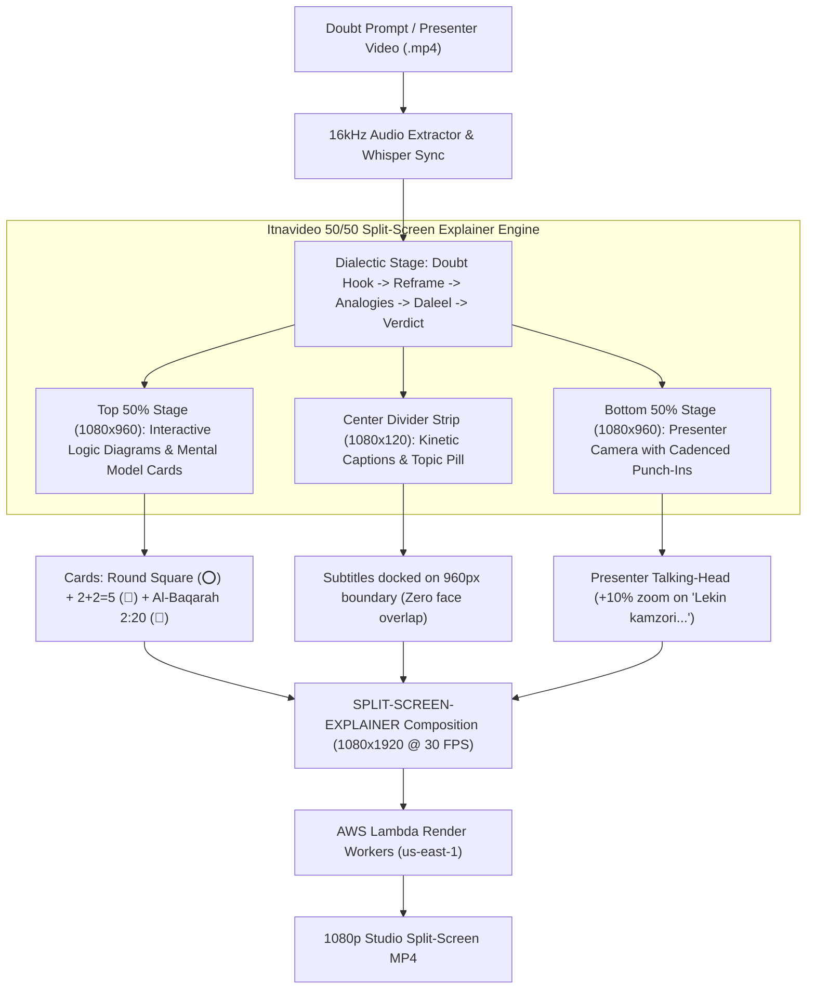
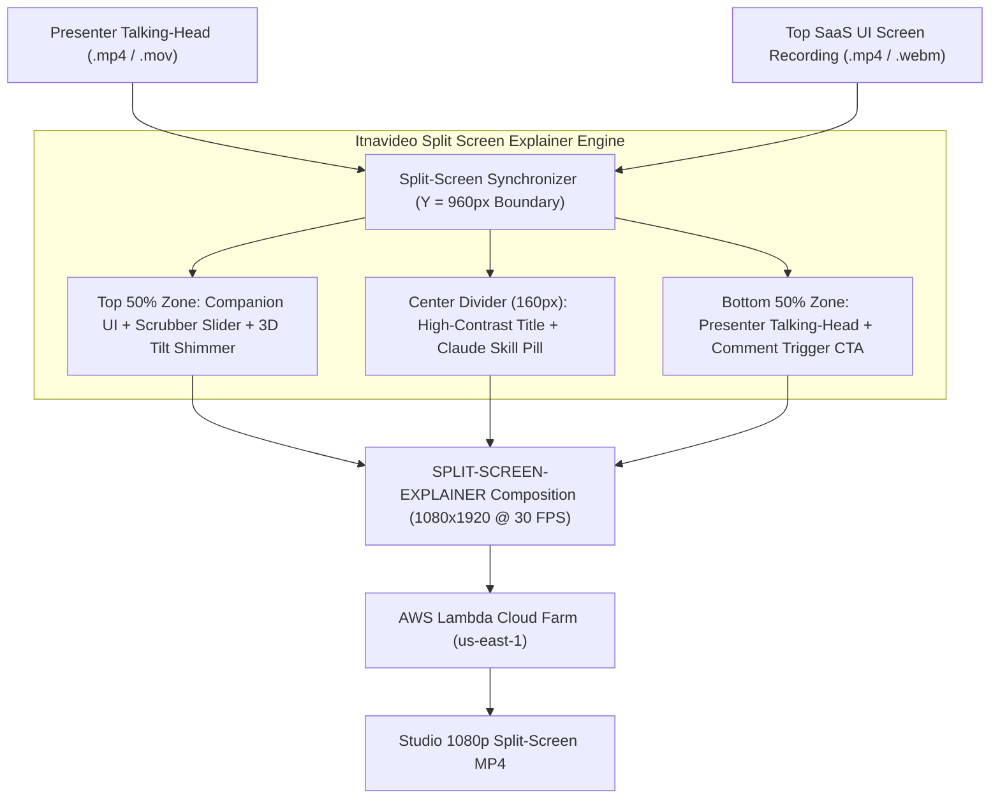
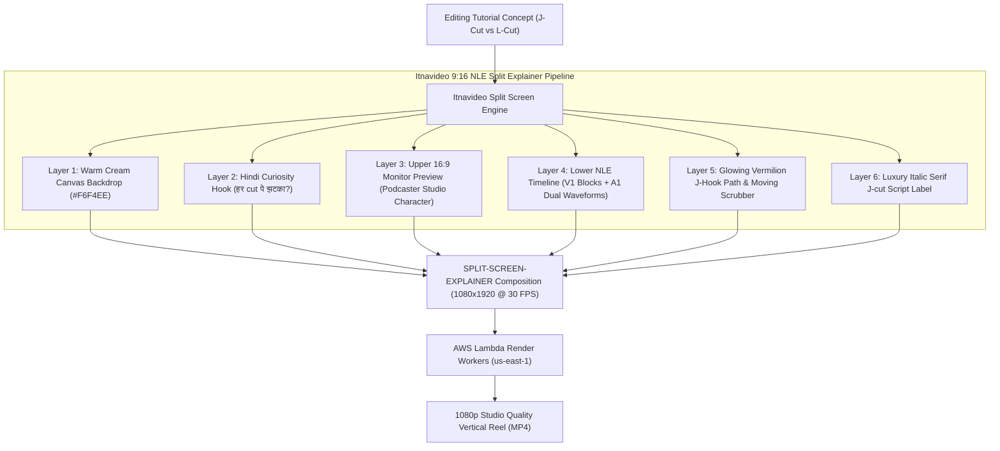

# Split Screen Explainer Video — Studio Specification

## Overview

The **Split Screen Explainer Video** (`splitScreenExplainer`) creates multi-frame 9:16 vertical short videos (`1080×1920` @ 30 FPS MP4) up to 90 seconds long featuring a synchronized **50/50 dual-zone layout**. Designed for software demonstrations, technical walkthroughs, reaction clips, and product tear-downs, it pairs a presenter talking-head camera recording with a live companion screen capture, app walkthrough, slide deck, or reaction b-roll.

- **Primary Purpose**: Combine presenter video with live software demos or reactions in a synchronized split-screen vertical layout.
- **Target Audience**: SaaS founders, developer advocates, tutorial creators, financial analysts, and commentary channels.
- **Expected Output**: 1080p Full HD (`1080×1920`) 30 FPS vertical MP4 video.

---

## Table of Contents

1. [Overview](#overview)
2. [Features and Capabilities](#features-and-capabilities)
3. [User Workflow](#user-workflow)
4. [UI/UX Design and Components](#uiux-design-and-components)
5. [Colors, Typography and Design Tokens](#colors-typography-and-design-tokens)
6. [Technical Implementation](#technical-implementation)
7. [Business Logic, Duration and Credit Rules](#business-logic-duration-and-credit-rules)
8. [Error Handling and Edge Cases](#error-handling-and-edge-cases)
9. [Testing and Quality Assurance](#testing-and-quality-assurance)
10. [Developer Notes and Guardrails](#developer-notes-and-guardrails)

---

## 1. Features and Capabilities

- **True 50/50 Dual-Zone Layout**:
  - **Top 50% (`1080×960`)**: Dynamic Explanation Stage for software screencasts, app demos, documents, charts, or reaction footage.
  - **Bottom 50% (`1080×960`)**: Creator Video Zone displaying the presenter talking-head with dynamic camera punch-ins.
- **Center Divider Accent**: Custom divider line with a floating topic title pill.
- **6 Master Visual Themes**: Modern SaaS, Bold Kinetic, Premium Finance, Educational, Editorial Minimal, and Futuristic Tech.
- **Synchronized Subtitle Strip**: Captions sit directly along the divider line with high-contrast backdrops, ensuring both screens stay 100% visible.
- **Screencast Clarity Preservation**: High-bitrate cloud processing preserves fine text, code syntax, and UI buttons on recorded screen panels.
- **Audio Track Leveling**: Intelligently balances presenter microphone audio with system screencast audio.

---

## 2. User Workflow

The studio follows a guided 4-step workflow:

1. **Step 1: Upload (Dual 50/50 Ingest)**:
   - Creator uploads bottom presenter talking-head video (`.mp4`, `.mov`).
   - Uploads top companion media (screen recording, app demo video, or high-res image).
   - Enters topic title badge text.
2. **Step 2: Music & Audio Design**:
   - Selects background music from 14 curated AWS S3 tracks.
   - Adjusts volume level (defaulted to 12% during speech).
3. **Step 3: Caption Style & Divider Theme**:
   - Selects divider line style (Studio Slate, Glowing Orange, Neon Mint).
   - Selects animated typography preset with live word previews.
4. **Step 4: Live Phone Preview & Render**:
   - Interactive 9:16 phone simulator previews both panels playing in perfect sync.
   - Creator clicks **Render 1080p Split Explainer** to execute AWS Lambda cloud rendering.

---

## 3. UI/UX Design and Components

- **Studio Route**: `/dashboard/split-screen-explainer`
- **Frontend Studio Component**: `components/dashboard/SplitScreenStudio.tsx`
- **Public SEO Landing Page**: `/split-screen-explainer` (`app/split-screen-explainer/page.tsx`)
- **Design Structure**: Pure White canvas (`#FFFFFF`) with fine borders (`#E2E8F0`) and responsive 3-row layout (`Stepper Header`, `Preview Work Area`, `Sticky Action Bar`).

---

## 4. Colors, Typography and Design Tokens

- **Canvas Background**: Pure White (`#FFFFFF`) with subtle slate background accents (`#F8FAFC`).
- **Primary Brand Accent**: Sunset Orange (`#FF5722` / `#F97316`) for active controls and primary CTA buttons.
- **Divider Accents**: Electric Cyan (`#06B6D4`), Sunset Orange (`#EA580C`), or Clean Slate (`#64748B`).
- **Typography**: Inter / System Sans-serif stack (`font-sans`).

---

## 5. Technical Implementation

- **Video Type ID**: `splitScreenExplainer` / `SPLIT_SCREEN_EXPLAINER`
- **Remotion Composition ID**: `SPLIT-SCREEN-EXPLAINER` (`1080×1920` @ 30 FPS)
- **Remotion Template Directory**: `remotion/templates/SPLIT_SCREEN_EXPLAINER/`
- **Speech Extraction**: Extracted 16kHz mono audio processed via Groq Whisper Cloud API.
- **Transcriber Fallback**: Google Gemini 2.0 Flash (`asia-south1`).
- **Render Engine**: AWS Lambda running Remotion cloud workers in `us-east-1`.

---

## 6. Business Logic, Duration and Credit Rules

- **Aspect Ratio**: Strictly 9:16 Vertical Only (`1080×1920`).
- **Maximum Output Duration**: Strictly **90 Seconds Max (90s / 2,700 frames @ 30 FPS)**.
- **Credit Billing**: **Strictly 1 Credit** per video (Master Rule 4.1 for 9:16 Short-Form).
- **Draft Preview**: 100% Free interactive browser preview before rendering.

---

## 7. Error Handling and Edge Cases

- **Asynchronous Audio Tracks**: Engine synchronizes presenter audio waveform with companion media cues.
- **Mismatched Aspect Ratios**: Intelligent content-aware letterboxing preserves companion screencast readability without stretching.
- **Render Interruption**: Credits are automatically refunded if cloud rendering encounters an AWS Lambda timeout.

---

## 8. Testing and Quality Assurance

- **Typecheck Verification**: `npx tsc --noEmit` verifies all split-screen props and composition interfaces.
- **Dual Panel Alignment**: Confirm that top demo and bottom presenter panels do not overlap or distort divider line.
- **Subtitle Strip Clearance**: Confirm that divider subtitles do not cover presenter face or key demo controls.

---

## 9. Developer Notes and Guardrails

- **Zero Local Rendering (Rule 0)**: Do not run local Remotion renders on developer machines; all rendering executes on AWS Lambda.
- **Divider Proportions**: The 50/50 split boundary is calibrated to 960px vertical height. Do not modify split proportions without testing on mobile simulators.

---

## 10. Ali Abdaal Knowledge-Creator Split Engine (Top Explanation + Bottom Presenter)

The **Split Screen Explainer Video** (`splitScreenExplainer`) applies Ali Abdaal's digital stationery and mental model presentation style to the viral 9:16 vertical short-form format.

### 10.1 Dual-Zone Architecture
1. **Bottom 50% (`1080×960`) — Presenter Stage**:
   - Presenter camera recording or selfie talking head with subtle punch-in zooms on key statements.
2. **Top 50% (`1080×960`) — Dynamic Explanation Stage**:
   - Rather than displaying static screenshots or generic stock clips, the Top Stage dynamically loads Ali Abdaal-style interactive widgets:
     - **AI & Productivity Shorts**: Displays `PromptWindowAsset` (macOS terminal window with live typing effect).
     - **Finance & Career Shorts**: Displays `LeverageLadderAsset` (ascending step ladder from employment to scalable leverage) or `ProblemAuditCardAsset` (high-ticket client ROI list).
     - **Software Reviews & Tier Ranking Shorts**: Displays `TierListBoardAsset` (live S/A/B/C/D ranking board in top stage while presenter discusses each tool in bottom stage).
     - **Life Systems & Habits**: Displays `LifePillarsDeckAsset` (4 life pillars with animated health/wealth chips).
3. **Cross-Zone Handwriting Doodles (`HandwritingAnnotation`)**:
   - Organic curved doodle arrows drawn in signature orange (`#EA580C`) pointing from the bottom presenter upward into the top explanation diagram with `Caveat` callout text (e.g., *"Look at Rung 3!"* or *"Save this prompt!"*).
4. **Dividers & Kinetic Subtitles**:
   - Clean central accent pill with topic badge (`STUDIO SLATE` or `SUNSET ORANGE`).
   - Center-docked kinetic captions positioned right on the divider line, ensuring zero overlap with either the presenter's face or the top diagram's content.

---

## 11. Reverse-Engineering Benchmark 01: Ishaq (@deenanddaleel) — "The Omnipotence Paradox & Logical Category Errors" (Split-Screen Philosophical Doubt Explainer)

### 11.1 Source Attribution & Benchmark Telemetry

| Parameter | Value |
| :--- | :--- |
| **Original URL** | `https://www.instagram.com/deenanddaleel/reel/Dfd8wKdzNPh/` |
| **Creator / Channel** | Ishaq (`@deenanddaleel` \| Doubts, Daleel & Deen) |
| **Topic / Hook** | *"Comment SAWAL: Kya Allah aisa patthar bana sakta hai jo woh khud na utha sake?"* |
| **Video Format / Ratio** | 9:16 Vertical (`1080×1920` @ 30 FPS, True 50/50 Dual-Zone Split) |
| **Video Duration** | ~48 seconds (Strictly within the 90s Short-Form limit) |
| **Itnavideo Mapping** | `splitScreenExplainer` Studio (`/dashboard/split-screen-explainer`) |
| **Credit Billing** | **Strictly 1 Credit** flat (Master Rule 4.1 for 9:16 Short-Form) |
| **Watermark Enforcement** | `<BrandWatermark watermark={watermark} />` (Enforced for free/trial users) |

---

### 11.2 Core Viral Mechanics: The Doubt-Reframing & Dialectical Logic Model

Ishaq's format achieves high engagement and shares (>14,000 likes, 195+ active comment debates) by resolving complex theological and philosophical paradoxes in under 50 seconds:

1. **The User-Submitted Doubt Hook (0:00–0:06)**:
   - Starts directly with a user comment screenshot / callout: *"Comment SAWAL: kya Allah aisa patthar bana sakta hai jo woh khud na utha sake?"*
   - This taps into the famous Omnipotence Paradox that many young believers and skeptics encounter online.
2. **The Immediate Cognitive Reframe (0:06–0:12)**:
   - *"Yeh sawal aksar poocha jaata hai, aur sunne mein mushkil lagta hai. Lekin kamzori Allah mein nahi, sawal ke andar hai."*
   - Shifts the locus of the problem from the Creator's power to the interrogator's grammatical fallacy.
3. **The Accessible Reductio Ad Absurdum Analogies (0:12–0:28)**:
   - **Analogy 1 (Category Contradiction)**: *"Gol square (round square) koi cheez hi nahi hoti."*
   - **Analogy 2 (Semantic Illusion / Calculator Error)**: *"2 + 2 = 5 koi jawab hi nahi. Agar calculator yeh na dikhaye, toh yeh calculator ki kamzori nahi, sawal ki ghalti hai."*
4. **The Scriptural & Linguistic Anchor (0:28–0:40)**:
   - Cites `Surah Al-Baqarah 2:20`: *"Inna Allaha 'ala kulli shay'in qadeer."*
   - Scholarly definition: *"Ulama samjhate hain ke 'shay' (cheez) woh hai jo wujood mein aa sakti ho. Ghair-mumkin tanaquz (logical contradiction) koi cheez hi nahi."*
5. **The Micro-Punchline & Call-to-Question (0:40–0:48)**:
   - *"Woh patthar kabhi bana hi nahi — woh sirf alfaaz ka be-maani jod tha. Apna agla sawal neeche likho, agli video usi par."*
   - The comment section becomes a self-sustaining pipeline for future video topics.

---

### 11.3 System Architecture & 9:16 Dual-Zone Split Pipeline

---

### 11.4 Visual Design Tokens & Safe-Zone Spacing

- **Aspect Ratio**: `1080 × 1920` (9:16 Vertical, Split 50/50 at `Y = 960px`).
- **Top Safe Zone**: `130px` padding (clears user handle and platform indicators).
- **Center Divider Zone**: Height `60px - 80px` centered at `960px` with floating topic pill.
- **Bottom Safe Zone**: `230px` padding (clears like/comment/share buttons and audio strip).
- **Palette Tokens**:
  - `Electric Cyan`: `#06B6D4` (Logic, mental models, paradox pills)
  - `Crimson Warning`: `#F43F5E` (Fallacy label, user doubt question bubble)
  - `Divine Emerald`: `#10B981` (Scriptural Daleel, truth resolution)
  - `Deep Void`: `#090D16` (High-contrast dark canvas)
  - `Muted Slate`: `#94A3B8` (Secondary explanations)

---

### 11.5 Second-by-Second Cinematic Scene Breakdown

| Second | Split Zone | Visual Element (1080×1920) | On-Screen Graphic & Kinetic Subtitle | Audio & Voiceover Pacing |
| :--- | :--- | :--- | :--- | :--- |
| **0:00–0:06** | Full / Top Hook | User comment bubble zooms into top stage: *"SAWAL: kya Allah aisa patthar bana sakta hai jo woh khud na utha sake?"* | Crimson Doubt Pill: `❓ THE OMNIPOTENCE PARADOX`. Center subtitle: *"Yeh sawal aksar poocha jaata hai..."* | Curious mystery chime. Voiceover: *"Yeh sawal aksar poocha jaata hai, aur sunne mein mushkil lagta hai."* |
| **0:06–0:12** | 50/50 Split | Presenter talking-head in bottom stage punches in (+12% scale). Top stage dims to focus on center divider. | Emerald Reframe Pill: `⚡ THE LOGICAL REFRAME`. Subtitle: *"Lekin kamzori Allah mein nahi, sawal ke andar hai."* | Subtle bass hit reset. Voiceover: *"Lekin kamzori Allah mein nahi, sawal ke andar hai."* |
| **0:12–0:20** | Top 50% Stage | Top stage animates Card 1: Visual morph of a circle overlapping a square. | Card: `⭕ Round Square (Gol Chokor) — Category Contradiction`. Subtitle: *"Gol square koi cheez hi nahi."* | Digital glitch pop. Voiceover: *"Allah ki qudrat ka matlab hai har mumkin cheez par qadir hona. Gol square koi cheez hi nahi."* |
| **0:20–0:28** | Top 50% Stage | Top stage transitions to Card 2: Calculator displaying `2 + 2 = [SYNTAX ERROR]`. | Card: `🧮 2 + 2 = 5 — Logical Category Error`. Subtitle: *"Yeh calculator ki kamzori nahi, sawal ki ghalti hai."* | Sharp calculator button clicks. Voiceover: *"2 + 2 = 5 koi jawab hi nahi. Yeh calculator ki kamzori nahi, sawal ki ghalti hai."* |
| **0:28–0:36** | Top 50% Stage | Top stage expands Emerald Scriptural Daleel card with Arabic typography. | Card: `📖 SURAH AL-BAQARAH 2:20` \| Arabic: `إِنَّ اللَّهَ عَلَىٰ كُلِّ شَيْءٍ قَدِيرٌ`. | Soft inspiring choral hum. Voiceover: *"Quran kehta hai: Inna Allaha 'ala kulli shay'in qadeer..."* |
| **0:36–0:42** | Top 50% Stage | Daleel annotation pill highlights the word *Shay*. | Scholarly Note: `💡 Ulama: 'Shay' = Woh jo wujood mein aa sakta ho.` | Subtle chime. Voiceover: *"...Ulama samjhate hain ke 'shay' yaani cheez woh hai jo ho sakti hai."* |
| **0:42–0:48** | Bottom Stage Focus | Bottom presenter talking-head in full view; top stage displays final verdict pill. | Floating Verdict Pill: `"Woh patthar kabhi bana hi nahi — sirf alfaaz ka jod tha."` | Low resolving cello tone. Voiceover: *"Woh patthar kabhi bana hi nahi. Woh sirf alfaaz ka jod tha. Agla sawal neeche likho."* |

---

### 11.6 Remotion Component Implementation

- **Asset Component**: `remotion/components/library/ParadoxDebunkSplitAsset.tsx`
- **Component Export**: Exported in `remotion/components/library/index.ts` (`ParadoxDebunkSplitAsset`, `ParadoxDebunkSplitAssetProps`, `LogicalFallacyItem`).
- **Catalog Registry**: Registered in `constants/itnavideoStockAssets.ts` under ID `paradox-debunk-split-engine`.
- **Key Capabilities**:
  - Calibrated for 9:16 vertical and the top 50% stage (`1080×960`) of `splitScreenExplainer`.
  - Built-in comment doubt bubble + 3-stage logical fallacy card carousel (`Round Square`, `2+2=5`, `Unliftable Stone`).
  - Scriptural Daleel card with authentic Arabic calligraphy (`Surah Al-Baqarah 2:20`) and scholarly linguistic annotations.
  - Interactive comment CTA trigger for audience retention and future video pipelining.
  - Zero local compute dependencies — 100% pure React/Remotion ready for AWS Lambda cloud rendering.

---

## 12. Reverse-Engineering Benchmark 02: Vishnu Vijayan (@v.i.s.h.ai) — "Reverse Engineer Any Animation" (SaaS UI Screencast & Presenter Split-Screen Architecture)

### 12.1 Source Attribution & Benchmark Telemetry

| Parameter | Value |
| :--- | :--- |
| **Original URL** | `https://www.instagram.com/v.i.s.h.ai/reel/Df_aN9STjl7/` |
| **Creator / Channel** | Vishnu Vijayan (`@v.i.s.h.ai` \| AI & Tech Workflow Specialist) |
| **Topic / Hook** | *"Reverse Engineer Any Animation (Claude Skill / Stripe.com Original)"* |
| **Engagement Telemetry** | 1,216+ Likes, 647+ Comments (*Comment "Animate" for the link*) |
| **Video Format / Ratio** | 9:16 Vertical (`1080×1920` @ 30 FPS, Synchronized 50/50 Dual-Zone Split) |
| **Video Duration** | ~38 seconds (Strictly within the 90s Short-Form limit) |
| **Itnavideo Mapping** | `splitScreenExplainer` Studio (`/dashboard/split-screen-explainer`) |
| **Credit Billing** | **Strictly 1 Credit** flat (Master Rule 4.1 for 9:16 Short-Form) |
| **Watermark Enforcement** | `<BrandWatermark watermark={watermark} />` (Enforced for free/trial users) |

---

### 12.2 Core Creative Mechanics: The Tech Demo & Presenter Split Formula

Vishnu Vijayan's split-screen architecture represents the benchmark for modern software tutorials, developer advocacy, and AI workflow reels:

1. **Top Companion UI Proof Stage (0:00–0:10)**:
   - Rather than just talking about code or animation, the top 50% (`1080×960`) displays a high-resolution, live-playing companion screen recording of Stripe's world-class card issuing animation.
   - A minimalist top scrubber slider (`▶ STRIPE.COM ORIGINAL`) proves authentic real-world sourcing, generating immediate credibility.
2. **High-Contrast Center Divider Bar (The Visual Anchor)**:
   - A bold 160px dark charcoal bar (`#18181B`) stretches full-bleed across the `Y = 960px` boundary:
     - `REVERSE ENGINEER`
     - `ANY ANIMATION`
   - Docked right underneath is a crisp feature badge: `CLAUDE SKILL`.
   - This prevents visual bleed between the bright top UI screencast and the bottom camera recording.
3. **Presenter Human Connection Stage**:
   - The bottom 50% (`1080×960`) features Vishnu talking directly to the camera in high-contrast attire (warm orange crewneck), explaining how an AI prompt skill deconstructs CSS/Framer Motion keyframes.
4. **Chatbot Automation Growth Loop**:
   - Callout: *"Comment 'Animate' for the prompt link"*.
   - Generates over 640 comments within 24 hours, signaling massive algorithmic engagement to Instagram's recommendation feed while capturing thousands of qualified B2B/creator leads via ManyChat/Instagram DM automation.

---

### 12.3 System Architecture & 9:16 SaaS Split Pipeline

---

### 12.4 Visual Design Tokens & Safe-Zone Spacing

- **Aspect Ratio**: `1080 × 1920` (9:16 Vertical, 50/50 Split at `Y = 960px`).
- **Top Safe Zone**: `140px` padding (accommodates `▶ STRIPE.COM ORIGINAL` header and scrubber slider).
- **Center Divider Zone**: Height `160px` centered at `960px` with deep drop shadow.
- **Bottom Safe Zone**: `220px` padding (clears Instagram Reels interaction buttons).
- **Palette Tokens**:
  - `Dark Charcoal`: `#18181B` (Center title bar surface)
  - `Electric Indigo`: `#6366F1` (AI feature badge & card accents)
  - `Stripe Violet / Peach`: `#C084FC` / `#FB923C` (Holographic card gradient)
  - `Pure White`: `#FFFFFF` (Primary title text)
  - `Silver Ash`: `#A1A1AA` (Secondary highlighted words)

---

### 12.5 Second-by-Second Cinematic Scene Breakdown

| Second | Split Zone | Visual Element (1080×1920) | On-Screen Graphic & Kinetic Subtitle | Audio & Voiceover Pacing |
| :--- | :--- | :--- | :--- | :--- |
| **0:00–0:05** | Top & Center | Top: Stripe holographic credit card floating in 3D with animated scrubber. Center: Bold title bar slams in: `REVERSE ENGINEER ANY ANIMATION`. | Sub-Pill: `CLAUDE SKILL`. Top header: `▶ STRIPE.COM ORIGINAL`. | Crisp tech interface click. Voiceover: *"You can now reverse-engineer literally any complex animation on the web in seconds..."* |
| **0:05–0:12** | Bottom Presenter | Presenter talking to camera explaining the prompt breakdown. Top stage continues looping card interaction. | Divider Bar remains firmly anchored, subtitle updates smoothly. | Direct confident presenter audio. Voiceover: *"Here's how this new Claude skill breaks down Framer Motion and Remotion keyframes..."* |
| **0:12–0:20** | Top 50% Stage | Top stage zooms slightly (+6%) into card code inspector / property breakdown. | Holographic card shows golden chip and Visa emblem. | Soft keyboard clatter sound. Voiceover: *"It scans the DOM, extracts the cubic bezier curves, and writes the complete production code."* |
| **0:20–0:30** | 50/50 Synchronized | Presenter gestures upward toward top screen demo. Top screen reflects the live animated UI component. | Subtitle: *"Copy the prompt directly into your workflow."* | Subtle ascending whoosh. Voiceover: *"You don't need to spend 4 hours tweaking timing functions anymore."* |
| **0:30–0:38** | Bottom Safe Zone | Floating bubble appears in bottom stage: `Comment "Animate" for the link 💬`. | Presenter points down toward comments. | Subtle message ping. Voiceover: *"Comment 'Animate' below and I'll send you the exact prompt and workflow link directly to your DMs."* |

---

### 12.6 Remotion Component Implementation

- **Asset Component**: `remotion/components/library/SaaSSplitScreenReverseAsset.tsx`
- **Component Export**: Exported in `remotion/components/library/index.ts` (`SaaSSplitScreenReverseAsset`, `SaaSSplitScreenReverseAssetProps`).
- **Catalog Registry**: Registered in `constants/itnavideoStockAssets.ts` under ID `saas-split-screen-reverse-engine`.
- **Key Capabilities**:
  - Full `1080×1920` 9:16 layout calibrated for SaaS UI companion screencasts and presenter talking-head combinations.
  - Interactive top progress scrubber bar with animated moving playhead.
  - Center 160px solid dark title banner (`REVERSE ENGINEER ANY ANIMATION`) with sub-pill badge (`CLAUDE SKILL`).
  - Holographic 3D card tilt & shimmer effect for web app demonstrations.
  - Zero local heavy compute dependencies — 100% pure React/Remotion code ready for AWS Lambda cloud rendering.

---

## 13. Reverse-Engineering Benchmark 03: taalcut — "J aur L Cut 30 Second Mein" (NLE Timeline & Audio Pre-Lap Split Screen Architecture)

### 13.1 Source Attribution & Benchmark Telemetry

| Parameter | Value |
| :--- | :--- |
| **Original URL** | `https://www.instagram.com/reel/Devf3s1gTwr/` |
| **Creator / Channel** | taalcut · Video Editing ka Ras (`@taalcut` \| Hindi Video Editing Education) |
| **Topic / Hook** | *"हर cut पे झटका? J aur L cut, 30 second mein 🎬: Video editing cuts me abruptness khatam karne ke liye J-cut aur L-cut kaise kaam karte hain."* |
| **Engagement Telemetry** | 15,000+ Likes, 77 Comments, 350K+ Organic Views |
| **Video Format / Ratio** | 9:16 Vertical (`1080×1920` @ 30 FPS, Dual Split Monitor + Timeline) |
| **Video Duration** | ~30 seconds (Strictly within the 90s Short-Form limit) |
| **Itnavideo Mapping** | `splitScreenExplainer` Studio (`/dashboard/split-screen-explainer`) |
| **Credit Billing** | **Strictly 1 Credit** flat (Master Rule 4.1 for 9:16 Short-Form) |
| **Watermark Enforcement** | `<BrandWatermark watermark={watermark} />` (Enforced for free/trial users) |

---

### 13.2 Core Creative Mechanics: The NLE Split Timeline & Visual J-Curve Model

taalcut's reel represents the gold standard of technical creative tutorials in India:

1. **Warm Cream Minimalist Canvas**:
   - Clean, aesthetic off-white / warm cream studio canvas (`#F6F4EE`) avoiding visual fatigue.
2. **High-Impact Bilingual Curiosity Headline**:
   - Line 1: `हर cut पे` (44px black sans-serif)
   - Line 2: `झटका?` (52px bold vermilion red `#E11D48`)
   - Immediately identifies the pain point of beginner video editors: harsh, unnatural, abrupt cuts between scenes.
3. **Upper Monitor Stage (16:9 Podcaster Scene Preview)**:
   - Stylized 2D vector character with curly hair, glasses, and headphones speaking into a boom microphone in front of a warm studio bookshelf.
   - Represents the active video cut (`Scene A` vs `Scene B`).
4. **Lower NLE Timeline Stage (V1 & A1 Waveforms)**:
   - High-fidelity recreation of Adobe Premiere Pro / DaVinci Resolve timeline:
     - Timecode ruler (`00:00`, `00:01`, `00:02`, `00:03`) with a live moving cyan playhead scrubber line (`#38BDF8`).
     - Video Track `V1`: Video blocks showing the cut boundary.
     - Audio Track `A1`: Dual-color audio waveforms (Gold `#F59E0B` for Scene A, Cyan `#06B6D4` for Scene B).
     - **The Glowing J-Hook Indicator**:
       - An animated glowing vermilion outline tracing the shape of the letter **"J"** over the cut point, visually proving that Audio of Clip 2 pre-laps and begins *before* the video cut!
5. **Signature Italic Serif Script Label**:
   - High-contrast, elegant typography: `J-cut` / `L-cut` rendered in luxury italic serif script (`#E11D48`, 64px) with explainer pill: *"Audio pehle shuru hota hai, video baad me aati hai."*

---

### 13.3 System Architecture & 9:16 NLE Split Timeline Pipeline

---

### 13.4 Visual Design Tokens & Safe-Zone Spacing

- **Aspect Ratio**: `1080 × 1920` (9:16 Vertical, Dual Split Zones).
- **Top Safe Zone**: `130px` padding (accommodates Hindi hook header).
- **Bottom Safe Zone**: `210px` padding (clears Instagram Reels interaction buttons).
- **Palette Tokens**:
  - `Warm Cream Canvas`: `#F6F4EE` (Backdrop surface)
  - `Vermilion Cut Red`: `#E11D48` (Curiosity word, J-curve hook, italic script)
  - `Timeline Charcoal`: `#1C1C24` (NLE timeline background)
  - `Audio Gold`: `#F59E0B` (Scene A audio waveform)
  - `Audio Cyan`: `#06B6D4` (Scene B audio waveform)
  - `Scrubber Sky`: `#38BDF8` (Moving timeline playhead)

---

### 13.5 Second-by-Second Cinematic Scene Breakdown

| Second | Visual Framing (1080×1920) | On-Screen Graphic & Kinetic Subtitle | Audio & Voiceover Pacing |
| :--- | :--- | :--- | :--- |
| **0:00–0:05** | Cream canvas lights up; Hindi headline slams: `हर cut पे झटका?`. Upper monitor reveals podcaster speaking into studio mic. | Subtitle: *"Kya aapki video me har cut achanak jhatka deta hai?"* | Sharp punchy snare hit. Voiceover: *"Agar aapki video me har cut achanak jhatka deta hai, to ye 2 cuts aapke kaam aayenge."* |
| **0:05–0:12** | Lower NLE timeline emerges; Scrubber line begins smooth tracking across timecode ruler (`00:00` to `00:03`). | V1 track displays Scene A; A1 track shows golden audio waveform. | Studio click SFX. Voiceover: *"Normal cut me audio aur video dono ek sath change hote hain, jo unnatural lagta hai."* |
| **0:12–0:20** | Cyan audio waveform shifts forward under Scene A; Glowing vermilion **J-Hook** illuminates over cut point. | Italic Serif label animates: `J-cut`. Explainer: *"Audio pehle shuru hota hai."* | Smooth whoosh sound. Voiceover: *"Lekin J-cut me agle scene ka audio video aane se pehle hi shuru ho jata hai, jisse transition bilkul natural lagta hai."* |
| **0:20–0:26** | Timeline shifts to demonstrate `L-cut`; golden waveform extends past video cut boundary into Scene B. | Italic Serif label flips to `L-cut`. Explainer: *"Audio baad tak chalta rehta hai."* | Acoustic guitar pluck. Voiceover: *"Aur L-cut me pichhle scene ka audio agle video frame tak chalta rehta hai."* |
| **0:26–0:30** | Dual screens settle with full animated playhead loop; bottom author tag illuminates: `@taalcut • Video Editing ka Ras`. | Subtitle: *"Save this reel aur editing me smooth transitions banao!"* | Resolving chime. Voiceover: *"Is reel ko save kar lo aur apne edits me natural cuts use karo!"* |

---

### 13.6 Remotion Component Implementation

- **Asset Component**: `remotion/components/library/VideoEditingTimelineSplitAsset.tsx`
- **Component Export**: Exported in `remotion/components/library/index.ts` (`VideoEditingTimelineSplitAsset`, `VideoEditingTimelineSplitAssetProps`, `CutType`).
- **Catalog Registry**: Registered in `constants/itnavideoStockAssets.ts` under ID `video-editing-timeline-split-engine`.
- **Key Capabilities**:
  - Full `1080×1920` 9:16 layout calibrated for video editing tutorials, creative software explainers, and technical workflows.
  - Upper 16:9 monitor stage featuring custom animated 2D vector podcaster character, bookshelf, and studio boom microphone.
  - Lower NLE timeline stage featuring dual `V1` video track blocks and dual-color `A1` audio waveform tracks (Gold & Cyan).
  - Animated glowing vermilion J-curve cut overlay and moving timeline scrubber playhead.
  - Signature luxury italic serif script label (`J-cut` / `L-cut`).
  - Zero local heavy compute dependencies — 100% pure React/Remotion code ready for AWS Lambda cloud rendering.

---

*Last Updated: November 2026 — Official Master Documentation for Itnavideo Company.*

